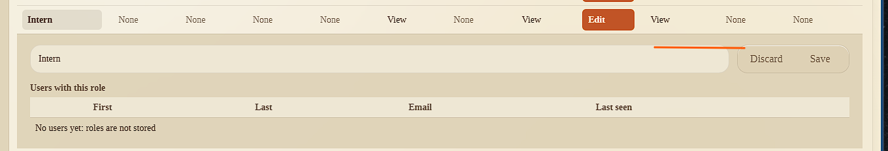

# DeetsHealth — Work log

One dated `##` per sitting, newest first. Never correct an old entry; correct HANDOFF.md.

## 2026-11-22 (Windows, night) — Analytics: the other five views
- Committed Logs as `23aef48` (his "looks good"; not pushed). His words: "let's build out the
  other pages".
- His forks: Flags shows a flag's summary and evidence with PHI View, each read audited (A); all
  five views at once, over two batches (he chose against CLAUDE.md's one-at-a-time rule).
- One option each, stated: the sums in ehr, not from Logs' list; our own charts, no library;
  Cartesia in dollars once its plan's price is set (a new Config › Cartesia row), credits until
  then; Speed's stages in the store.
- Built (ANALYTICS.md §3.2): migration 0014; `ehr/src/stats.rs` and `CallStats`; `ReadFlags`
  with the `flag.view` audit row; `GET /agent/stats` and `GET /agent/flags/{id}`; the kit and
  the five views; `goView` and `findInLogs` for the drill-downs. Tests: `stats.rs`, the store
  test against Postgres, the routes' levers (`test_roles.py`).
- No screenshots this sitting.

## 2026-11-22 (Windows, evening) — Analytics: the readers, and Logs built
- Committed the Timeline, Rules › Booking and Org Chart work as `dc8f30e` (not pushed).
- His words on Analytics: "the pages cater to different people": Home, Cost and Outcome for an
  executive; Speed and Flags for an analyst; Logs above all for the analyst. No role split.
  2B: the console's test calls feed it, no synthetic batch. 3: his "whichever makes sense";
  Claude's 3A (change since the last period; versions compared). Logs first (his pick).
- Logs' forks: a panel under each row (A); the data class as the filter bar's first control (A).
  Then "Build as drafted" (the columns and filters as drafted).
- Built: migration 0013 (seat, EHR, turn waits on `calls`), ehr's `ListCalls`, `GET
  /agent/logs`, the filter bar, the Logs view, Open in Chat (ANALYTICS.md §3.1.1). Tests: the
  waits rule (store.rs), the list against Postgres (`ehr/tests/store.rs`), the route's lever
  (`agent/tests/test_roles.py`). A new column kind, `num` (`--col-num`).
- No screenshots this sitting.

## 2026-11-22 (Windows, later) — The empty views; Chat › Timeline; Rules › Booking
- His words: "voice works, let's chat the unused pages". Counted from the code: 12 views said
  "Empty for now" (Analytics 6, Rules 3, Org Chart, Personalization, Chat's Timeline tab).
  Audit Logs and PHI's Caller tab were already built; HANDOFF said otherwise and is corrected.
- His picks: the Timeline first, then Analytics designed view by view with the built pages as
  the guide; **2A**, one place for every rule (the Booking rules move to the Rules page);
  remove Org Chart for now.
- **Chat › Timeline** (CHAT.md §18): his forks, a waterfall per turn (A) and the voice stages
  recorded now (A). `pages/timeline.ts`; new `voice` events in the call record (schema 15:
  Ink's final line with `last_words_ms`, Sonic's first audio, the seat speaking), from
  `voice.py`; a test in `tests/test_voice.py`.
- **Rules › Booking** (BOOKING-RULES.md §5.5): the hospital view with the rules tab alone
  (`bookingRulesView`). Found while moving it: two views of one hospital version could undo
  each other's save, so a save now sends its own lists over the newest active version.
- **Teams:** Org Chart removed; People alone.
- No screenshots this sitting.

## 2026-11-22 (Windows) — Claude runs the booking desk tests; a new aim
- His words: "remember we're now aiming for a portfolio piece / plug-and-play no-code agent
  harness designed for healthcare professionals". DESIGN.md and BUILD-ORDER.md still say a
  phone agent for a hospital; their rewrite is his fork.
- Pushed `a3685aa` (the 2026-11-21 doc changes).
- The first test call failed with Claude's `AuthenticationError`; he made a new Anthropic key.
  The dev server keeps the key it read at start (`load_dotenv(override=False)`), so a new key
  needs a restart of `npm run dev`.
- Ran three typed Test calls on Local in his Chrome (about 15¢), against BOOKING-RULES.md
  §5.1 to §5.4. The active hospital version holds the Places imported from Epic, so several
  results differ from the steps, which were written for the Default.
  - **Bug: a place's full name can never be picked.** `Shielded::names_terms`
    (`core/src/shielded.rs`) keeps every term whose words are all in what was said, so "EMC
    Cardiology Procedures" also matches "EMC Cardiology" and "Cardiology". The agent asks
    "which one" again after each answer: in `place_info` and in a booking (Verona, cardiology).
  - Pass: before verification, a place's address, phone and hours (EMH X-Ray Imaging, after a
    which question); Main Street closed on Saturday; Chicago unknown; cardiology not at Main
    Street; Verona cardiology offers its three departments; Priya at "the family medicine
    clinic" gets Dr. Moreno's Nov 4 time only; at Main Street Dr. Lin's Nov 2 time is marked
    sooner, with another clinician; chest tightness gets the 911 line, then the call goes on.
  - Differ (from the import, not checked in code): Main Street Clinic has no address or phone,
    so "Where do I go?" after a booking has none and offers staff; Jordan is asked where (no
    usual place named); EMH X-Ray's hours are Monday to Friday 8 to 5; "a heart doctor" is not
    a kind of care the lists know.
  - Fail, cause not found: Priya (no visits) booked Dr. Lin's slot read back as "an office
    visit", not "a new patient visit" (§5.1 step 4).
  - Polish: the options go on counting across searches (the second list starts at Option 2);
    an hours question gets "I don't have the address … I don't have a phone number" first.
- Not run: anything in Epic mode, voice, the Places page (Import and Save change the hospital
  version), and the Config › Hospital edits.
- His words: "Fix it, let's also update our docs to re-align the goal. Then flip the repo
  public if there's no secrets please."
- **Fixed: the most specific name wins.** `names_terms` now leaves out a full match whose words
  all sit inside another full match. Tests: `names_terms_prefers_a_full_match…` (four new
  checks); `ehr`'s 155 tests pass. Desk test: restart `npm run dev` (a new `ehr`); Chat, Local,
  Test: "What's the phone number for EMC Cardiology Procedures?" answers for that place; as
  Jordan, "Verona, cardiology", then "EMC Cardiology": that place's times. Not fixed: "cardiology
  procedures" (no "EMC") still names only "Cardiology", as before.
- **The docs re-aligned to the new aim:** DESIGN.md §0 (the aim, what holds, what is set aside)
  and §1's Product, Customer, Wedge and Deploy rows; BUILD-ORDER.md's header and §3.4 (parked);
  LESSONS.md §1; HANDOFF.md's header; README.md; CLAUDE.md's opening. Decided inside his ask:
  the hospital path (BAAs, per-hospital deploy, the first hospital) is marked "set aside, the
  later path", not deleted; the README leads with the harness, then the phone agent.
- **The secrets scan before going public:** 3,623 file versions on every branch and tag, for
  keys, tokens, private keys, Twilio SIDs, JWTs, passwords in URLs and e-mail addresses: none.
  The phone numbers are Epic's sandbox patients'; the fixtures are synthetic; his name shows as
  the author and in local paths. His e-mail is in the commit metadata (125 commits).
- His words: "Yes, go public." The repo is public; README.md and CLAUDE.md › Repo say so.
  Also fixed on the way: RUSTSEC-2026-0592 (`url` 2.5.9), which stopped the push.
- His words: "Let's do the MIT license, close all the hand tests as verified per my word for
  now, we'll revisit at a later date, feel free to create a doc for
  PRE-LIVE-VERIFICATIONS.MD". Built: `LICENSE` (MIT, © 2026 Aditya Sundaram) and `license =
  "MIT"` in core, ehr, package.json and the agent's pyproject. 20 docs' `desk_test: open` and
  every "desk test open" part marker now read closed 2026-11-22; the list is
  PRE-LIVE-VERIFICATIONS.md. Decided inside his ask: a new value `closed <date>` (docs-check
  rule 4, DOCS-ORG.md §2) so a test closed on his word never reads as passed; the patient app's
  legacy tests are closed too, in their own section; today's open issues live in the same doc.
  Not done: deny.toml still checks no licenses of the dependencies (a fork, now that the repo
  is MIT). He is testing voice himself after choosing a new Cartesia voice.

## 2026-11-21 (Windows) — state of the repo; three desk tests passed
- His words: "cloudflare access is good to go, demo tunnel as well. console on a phone also
  good to go".
- Marked passed: the demo over the tunnel (DEMO.md, now `built`), the guest list's writes to the
  Access group (Security › Auth), the console on a phone (MOBILE-UI.md §4; §5 stays open).
- His goal, said this sitting: a portfolio piece and a captured demo on Deets.Solutions.
- Found: of the open desk tests, Claude can run booking rules, the Places import and the
  call-path tests itself (typed Test calls in his Chrome); voice needs him, and a voice call
  will not start until he picks a new voice ("Emma" is gone from Cartesia).

## 2026-11-19 (Windows) — the wall's refusals in the audit trail
- His words: "Yes, fix it" (the gap in AUDIT.md §7: a 403 from the dev server's own wall wrote
  no row).
- Built: `dev_server.py › record_refusal`, called by the HTTP wall and `ws_principal`, sends
  `LogAccess` as the person with the route's lever and level; `ehr` writes the refused row.
  `ehr` takes a new object kind `route` (`service.rs › log_access`), whose id may hold the
  pattern's braces. The Audit Logs page names it "Route: POST". AUDIT.md §2, §3, §6, §7.
- Decided inside his ask: the row names the route's pattern, never the filled-in path; one row
  per person and route a minute (`REFUSAL_EVERY_S`, 60 s), so a page that asks again and again
  writes one row; someone not on the list writes no row (no id; Cloudflare Access has them).
- Tests: `test_roles.py` (2 new checks). Desk test: as a guest with a Junior Analyst's role,
  open the Watch socket or save on Config › Agent; Audit Logs › Security shows one
  "Route: …" row, Refused, with the lever lacked. Not verified in a browser.

## 2026-11-18 (Windows) — the Test button shows its progress
- His words: "I pressed test, no feedback or progress bar? Can we color the button as if it was
  a progress bar so we know its running please?"
- Found: the first press is the free cost quote (about 30 s). It only dimmed the button, with no
  count. The record's green fill moved only when a whole script finished. A refused press showed
  its reason only in the hover hint.
- Built: the quote reports `checked` (dev_server.py › `estimate_record`) and fills the button
  with a pale wash; the record fills with green as before; the step under way pulses on both;
  "Tests" for the last step; "Not started" with the reason in the hint. New skin tokens
  `--progress-wash`, `--progress-pulse-low`, `--dur-pulse`. CONSOLE.md §9 (the Test bullets).
- Decided inside his ask: the quote's fill is a pale wash, not green, so green still means a
  recording; the pulse values (1.2 s, down to 25%).
- Desk test: restart `npm run dev`. On Config › Agent press Test: the button fills pale, "1 of
  15" counts up. Press again at the cost: it fills green, the next part pulses, "Tests" at the
  end. Not verified in a browser. Nothing committed.
- Then: the kept scripts recorded again (his Test press; 2 failures: one out-of-date test fixed,
  one known slip marked `xfail`; HANDOFF.md). Committed in three: `1eb117d` (one build folder),
  `9e90d9d` (Cartesia's voice list), `fe5828a` (the Test button, the scripts). Not pushed.
- His ask for the roles build: "tracking which user made a change, what change, and what they
  did with their role logged as well as time". Written as ACCESS-ROLES.md §5.1 (0 real forks,
  9 points that follow), with §6 and §8 corrected (migrations 0011 and 0012).
- His word: "Commit and start." Committed the design (`303e55a`), then built Hand-over 1 of
  the roles build (the store and `ehr`): migrations 0011 (roles, `user_roles`, the Default
  roles, Deets for the owner) and 0012 (`staff_audit`, chained by SHA-256; `user_card_versions`,
  sealed under its own rows); `access.rs` (levels, the rules), `audit.rs` (write, read,
  verify); the gate in `service.rs` (`RPC_LEVERS`, `deets-actor`, refusals audited); six new
  RPCs (`Levels`, `GrantRole`, `RevokeRole`, `ReadAudit`, `VerifyAudit`, `LogAccess`). What was
  decided inside his choices: ACCESS-ROLES.md §6 "As built".
- Found while building: the card history first copied the sealed bytes, bound to `users`; a key
  change could not have sealed them again. Now each version is sealed under its own row and is
  on the reseal list; the reseal test covers it.
- A fork for him (ACCESS-ROLES.md §6): Deets has PHI None, so by the "at or below you" rule a
  Deets holder cannot grant any role with PHI View. His answer: "give Deets PHI Edit
  permissions as well". The seed, the tests and §4 changed; the rule stays.
- His word: "Start Hand-over 2." Built: `identity.py` (the launch token and Access as sources;
  levels from `ehr`, kept 30 s); `ehr_client.ACTOR` and `as_system()` (every staff call sends
  `deets-actor`; `ehr` takes `system` for settings, the People list and the annotations);
  `ROUTE_NEEDS` (every route's lever, checked by the wall and at start); the WebSockets checked
  on open, a watch closed when PHI View is lost; new routes `/agent/me`, `/agent/log`,
  `/agent/roles`, the grant and revoke, `/agent/audit` and its verify; transcript reads, watches
  and Test runs recorded. DEV-API.md §2a and `test_roles.py` keep the table and the code
  together. What was decided inside: ACCESS-ROLES.md §6, Hand-over 2 "As built".
- Checks: `npm run check -- agent` passes (every agent test, the kept scripts against a real
  `ehr`); `docs:check` has no failure; `ehr`'s 143 unit and 8 store tests and clippy pass. Not
  committed.
- His word: "Start Hand-over 3." Built the console's side: `access.ts` (the `me` store, `may`,
  `onAccess`); the nav and every sub-nav list only the pages and views you may see, "No role yet"
  with no role, page opens recorded; Config's frame, Auth and Roles at View only with the mark;
  Chat's modes by lever; Auth's Role column and the panel's role chips (grant and revoke);
  Security › Roles rewritten on the store with a whole-list Save; Audit Logs' three views as
  plain tables of the trail, Older and Newest, Check chain. CONSOLE.md §13 with the desk test
  (§13.1); LOADING.md's stores; what was decided inside: ACCESS-ROLES.md §6, Hand-over 3 "As
  built".
- Checks: `npm run check:all` (15 steps, lints too) and `npm run db:test` pass. Not committed;
  not run in a browser.
- His word: "Commit now." Committed `0f417e0` (the three hand-overs, 46 files).
- 2026-11-19, his word: "cool looks good for now. let's update all our docs, mark desk test done,
  and commit/push". The roles desk test (CONSOLE.md §13.1) is passed. ACCESS-ROLES.md moved to
  `docs/architecture/` (built; `docs-move.mjs`), its parts marked built; SECURITY.md (roles and the
  trail no longer "not built"), FUTURE-SETTINGS.md, PROMPT-EDITOR.md, DEMO.md, DATABASE.md §11,
  CONSOLE.md §3 and §13, HANDOFF.md and CLAUDE.md's doc list follow. The migrations keep their old
  path in a comment: sqlx checksums them, and they have run.
- His ask: "did you doc that audit logs are also built with its own architecture docs" — no, it
  was spread over four docs. His word: "go for it". Wrote `docs/architecture/AUDIT.md` (a row,
  every action word and its writer, the chain, reading it, tests, open), read against the code;
  ACCESS-ROLES.md §5.1, DATABASE.md §11, CONSOLE.md §13, HANDOFF.md and CLAUDE.md point to it.
  Found while writing it: a 403 from the dev server's own wall writes no audit row (AUDIT.md §7),
  though §5.1 asks for every refusal.
- Checks: 143 unit tests, 8 store tests, clippy, cargo-deny bans pass. `docs:check` 13 fails
  on the six new RPCs (no agent method yet), as checkpoint 2 expects. Not committed.

## 2026-11-16 (Windows, night) — one Rust build folder
- The cause: C: fell to 5.8 GB free. `target/` held 85 GB six days after a clean, in about ten
  side build folders of 4–16 GB each (the third time). The dev server's ehr locked
  `target/debug`, so `npm run check` built into `target/check`, `npm run db:test` into
  `target/store-test`, and sessions copied the pattern (`probe`, `check-alt`, `epic-check`,
  `alt`, a scratchpad).
- His word: "Yes, fix and rule."
- Built: `npm run dev` copies ehr to `target/run/` and runs the copy (`DEETS_EHR_BIN`);
  `check.mjs` and `postgres.mjs` build into `target/debug`; `npm run check` warns about any
  other folder in `target/`. The rule is in CLAUDE.md › Conventions; HANDOFF.md and
  DATABASE.md follow.
- Desk test: run `npm run dev`, then `npm run check -- --all` in another terminal. The check
  builds and passes with the dev server running, and `target/` holds only `debug`, `run` and
  `tmp`.
- Not verified: no dev server or full check ran. Nothing committed.

## 2026-11-16 (Windows, night) — Cartesia's voice list, checked live
- His questions: "can you check our list of cartesia voices available? Can we get a more
  accurate list via Cartesia's api?", then "Can we wire in the official route to keep the list
  accurate?"
- Found: the Voice menu was `config.RECOMMENDED_VOICES`, copied by hand from Cartesia's guide
  (9 names, 2 ids). Cartesia's List Voices gives every voice and its id, with no credits, but
  has no "recommended for agents" mark.
- His fork A: the shortlist checked live, plus every English voice in a table to search.
- Built: `agent/deets_agent/voice_catalog.py` and `GET /agent/cartesia/voices` (held 10 min,
  Refresh); the store `cartesiaVoices`; on Config › Cartesia the menu checked against the list,
  More voices… and its table, the Voice list row; the voice saved by id and checked by the dev
  server (`resolve_voice`). CONSOLE.md §7.8 (with the desk test and what was decided inside his
  choice), DEV-API.md §2, CARTESIA.md §3.
- Not verified: no real read of Cartesia's list ran. Claude's shell was refused the key in
  `.env`; the answer's shape is from Cartesia's docs. Nothing committed.

## 2026-11-16 (Windows, late) — booking steps 2, 4 and 5 built
- His word: "Let's finish building out the booking rules / steps." Every fork was closed in
  BOOKING-RULES.md, so the build went step by step with no new fork; what was decided inside
  his choices is in each step's "Decided inside" (§5.3 to §5.5).
- Step 2 (§5.3): `Shielded::names_terms` (core), `Hospital::pick`, the place and the specialty on
  `FindSlots` and the place on `FindVisit`; the where question (1B) joined to the preference
  question through `plan_only`; `$find` sends `specialties`. The Default gained a facility,
  addresses, phones, specialties on its departments and hours on the X-ray department; the
  fake gained three slots at two more places.
- Step 5 (§5.4): the `PlaceInfo` RPC and the `place_info` tool, in every step, before
  verification too.
- Step 4 (§5.5): `booking_rules` (hospital key), the rules before and after the search, `Book`'s
  `check_referral`, two code flags (FLAGS.md §3.4), Config › Hospital › Rules.
- Checks: ehr 133 tests and core pass; the agent's 245 pass outside the kept scripts; the 15 kept
  scripts and `test_the_kept_recordings_match_the_prompt_file` miss their replays, as before
  (record them again). The console type-checks.
- Not committed.

## 2026-11-16 (Windows) — what is unwired; booking by place, specialty and rule designed
- He asked what remains unwired to the agent. Checked in the code: no call reads the
  specialty, a place in the search, the address, the phone, the hours, the closed days, the
  facilities or coded reasons (`find_slots` and `FindSlotsRequest` have no place or specialty;
  `$find` sends `service-type` and `time-of-day` only).
- Designed with him: architecture/BOOKING-RULES.md. His forks: 1A refined by his PCP question,
  2A, P-A, E-A ("debating if this should be the start of the rules engine … but definitely
  hospital markable"). His question on referrals ("would a patient typically book those
  without a referral?") is answered in §3.5.
- Found: open.epic's catalog has no search for a patient's referrals; `ServiceRequest.Read
  (Referral)` returns no specialty or state. EPIC.md §7.10 corrected. Found: `coded_bookable`
  offers "New Patient Appointment" to every caller in Epic mode (BOOKING-RULES.md §1, step 1).
- His line: "Not planning on linking orders for the purpose of checking referrals." The orders
  path is out of the design; Referral needed is a rule's outcome with no referral read.
- Step 0 built and run: `ehr epic-booking` (two runs, about 23 requests each; EPIC.md §7.12).
  The PCP is on 3 of 7 test patients, ours, and on Camila Lopez's visits; one patient has two
  PCPs. `specialties` is accepted and ignored by the sandbox, so `ehr` will filter by the Places
  list's specialties (BOOKING-RULES.md §3.1).
- Step 1 built (BOOKING-RULES.md §5.1): the Visit types column Patients, Booking › Years for an
  established patient, one past-visit search a call when a type is for one kind, the slots kept
  by the caller's status at each slot's department. The Default: Office Visit established, New
  Patient Appointment new. Desk test open. Agent tests: 252 pass; `booked_reason_asked`
  misses its replay (Priya Raman is now a new patient) and needs recording again.
- He asked what step 2 changes; it shows nothing in the sandbox. Step 5 first is the open
  choice. **Paused here at his word**; the pick-up list is in HANDOFF › Open now.
- Read his four calls of 2026-11-15, 22:30 to 22:38 (Epic sandbox, synthetic). Found: the voice
  call was silent (Cartesia `voice_not_found` on every line); a name spelled letter by letter
  is refused by the name guard; an in-person ask got five online times; two questions asked
  while choosing were dropped and the reason filed was "book an appointment"; `offer_staff`
  then `hand_off` with no yes; an idle timeout filed as "the caller hung up".
- His word: "Fix all that you can from this list without any forks." Fixed: the cause of the
  silence (his active Config › Cartesia version, 11-13 | 2, names "Emma", whom Cartesia no
  longer has; "Emma" left the voice list); a voice call checks its voice before it starts, and a
  voice that dies mid-call ends the call with a `voice_failed` review flag; a spelled name
  passes the name guard; ehr keeps only times that fit in person or online; Pipecat's idle limit
  is filed as such; the sandbox patients' notes. Left (each needs his choice): asking for a
  reason, questions dropped while choosing, `hand_off` with no yes, the long list of times, and
  a new voice to replace Emma.
- He asked why every sandbox time is online: EPIC.md §7.13 (Epic's own `$find` sample returns a
  type other than the one asked; the hospital's Cadence rules choose it).
- His word: "ask for a reason before presenting options (gives time for 911 flags, specialty
  care, etc)". Built: `find_slots` asks once, before the preference question, when the reason is
  empty or only asks for a visit (`_no_reason`); `line.ask_reason` and `note.after_ask_reason`
  (draft words, his to edit); `arg.find_slots.reason` says to leave it empty. The kept scripts
  miss their replays (8 and the stamp): record them again.
- His forks on the two left: **1A** ("the power of ai is to interpret ambigous sentences,
  multiple tasks, and do it all seamlessly") and **2C**. Built: a choice that comes with a
  question holds the read-back once, and `note.question_with_choice` tells the model to answer
  first (`_asks_question`: a "?" or a sentence that starts with a question word); `task.schedule`
  says the same. After `offer_staff`, a hand-off on the caller's next line says
  `line.hand_off_answer` ("I'll connect you with a member of our staff who can answer that");
  `tool.hand_off` allows the question asked again. Words are drafts. All 15 kept scripts now miss
  their replays (`tool.hand_off` is in every step): record them again.
- He chose to record the kept scripts after step 3, and: "Start step 3". Built (BOOKING-RULES.md
  §5.2): the PCP from verification, the usual place, `location-reference`, the PCP's times
  first, one sooner time with another clinician (P-A; a Booking switch, on), Specialties ›
  Primary care. Decided inside, for his review: the usual place is named with the times, not
  asked before them. Desk test open; ehr 138 tests pass; the kept scripts still to record.
- His review: keep the usual place named with the times ("would rather be safe than sorry with
  the user not getting booked at the wrong place").
- Not committed.

## 2026-11-15 (Windows, night) — Dark theme: a charcoal base discussed
- He asked for the color roles of each theme, then for a charcoal base in Dark in place of
  pure black: the facility card's band (`--theme-color`, black) is lost on a black page, and
  he wants it to stay darker than the card. Compared on a throwaway page: black, `#181818`,
  `#121212`, warm `#16140f`. His choice: B, `#121212`.
- Built: `--paint-charcoal` in palette.css; Dark's `--bg` reads it. The band, the chat canvas
  and `--on-accent` stay pure black. The Dark swatch in the theme menu, its hint ("White on
  charcoal"), the manifest's colors and index.html's `theme-color` follow. CONSOLE.md › The
  look records it; TOKENS.md regenerated.
- Desk test: the page reads lighter, but the cards are still near black: they have no fill
  and sit on `--canvas` (`.cfg-frame`), not on the panel glass. His choice of three (a tint
  role, a solid paint, a lighter canvas): a tint. Built: `--card` in themes.css (Dark white
  0.07, Light cream 0.45, Moonlight moon blue 0.08), the fill of `.people-card` and
  `.place-card`; CONSOLE.md › The look records it.
  Saved: `docs/architecture/images/hospital-places-cards-charcoal-2026-11-15.png`.
- Saved: `docs/architecture/images/hospital-places-cards-moonlight-2026-11-15.png`,
  `hospital-places-cards-dark-2026-11-15.png`, `hospital-places-cards-light-2026-11-15.png`
  (Places › Cards in each theme, after an import; sandbox facilities only).

## 2026-11-15 (Windows, evening) — a slow Hospital page after an import; windowing designed
- He imported Places from Epic (32 facilities, 403 departments, 118 specialties, not saved):
  the page froze, then stayed slow. Measured: the agent answers in 11 to 14 ms and a fresh tab
  draws in 235 ms; the cost is in the console (TABLES.md §6.1).
- His choice: windowing, as DeetsMusic's library. Designed in TABLES.md §6, with forks W1 to
  W4 open (where a long list scrolls, the search box's filter or jump, its scope, Ctrl+F).
- Saved: `docs/architecture/images/hospital-places-search-box-2026-11-15.png`.
- His picks: W1 A (Specialties gets its own tab), W2 A (filter, with motion; jump mode a future
  setting), W3 B (the shown tab; a console Compass later, ideas/README.md), W4 A (Ctrl+F, then
  the browser's find; the other way a future setting). FUTURE-SETTINGS.md › The console.
- Built: `list-window.ts` (tables and the facility cards above 200 rows), the search box with
  Ctrl+F, the filter and its marks, the Specialties tab, and the speed fixes (`growAll`, the
  status and the problem line once a frame, the saved lists' JSON made once, departments grouped
  once). On his saved import, Places › Table draws about 20 of 437 rows. Found while testing:
  the windower took the table's sideways box for its scroller; fixed (TABLES.md §6.0).
  `npm run check -- web docs` passed; the `ehr` step fails only on the dev server's lock of its
  exe. Desk test: TABLES.md §6.6.

## 2026-11-16 (Windows, small hours) — the major updates: verdicts, then the Rust batch
- Each major update tried in a scratch worktree (removed after); the verdicts are
  [DEPENDENCIES.md](architecture/DEPENDENCIES.md) §4: take sqlx 0.9, reqwest 0.13,
  getrandom 0.4, base64 0.23, vite 8 and TypeScript 7; skip rusqlite; protobuf 7 and anthropic 2
  wait on Pipecat.
- Found: `ehr`'s Linux build linked OpenSSL through `core`'s reqwest `native-tls` (§5, item 6).
- His go-ahead, the Rust batch: `native-tls` is now `core`'s default feature and `ehr` turns it
  off (no `native-tls`, `hyper-tls`, `openssl-sys` or `ring` left in `ehr`); reqwest 0.13 (`form`
  is opt-in; `rustls-no-provider`); getrandom 0.4 (0.3 gone from the lock); base64 0.23.
  `npm run check -- core ehr agent --full` passed (9 steps, clippy included); `db:test` passed.
- He desk-tested the batch (good). Then sqlx 0.8 → 0.9: its 11 runtime queries fixed by type.
  Fixed text by `concat!` (settings' version columns, users' UTC times); every joined query
  through the new `ehr/src/sql.rs` (`Sql`: `&'static str`, numbers and bytes only, the one
  `AssertSqlSafe` in `ehr/src`); `settings::get`/`save` take `table: &'static str`. The store
  test's 24 joined queries go through its own local helper. ehr tests (121 + 11), clippy, the
  agent check and `db:test` (reseal, settings, users on Postgres) passed. Rules in DATABASE.md
  §4a.
- Next: vite 8 and TypeScript 7 once the console work in flight lands.
- He saw `npm run dev` wait long after the db line. The cause: cargo's silent `ehr` rebuild
  after the dependency changes, not Postgres. Nothing timed the start. His choice: print and
  keep. Built in `scripts/dev.mjs`: each step timed, a `ready in` summary, a `slower than
  usual` note, `logs/dev-start.jsonl`, a `building ehr…` line (HANDOFF.md › Run it). Not run
  yet: his dev server held the terminal.
- Committed `c62816a` (the dependency work) and `d387127` (Open now), apart from the other
  session's files. SECURITY.md §7.1: a watch list for dependencies and the build (a draft).
- He desk-tested sqlx 0.9 (done). His choice for the no-OpenSSL guard: cargo-deny (Embark
  Studios) over a `cargo tree` step. Built: `deny.toml` (bans OpenSSL, `native-tls`, `ring` in
  `ehr` on every platform; advisories and crates.io-only sources for the workspace), two steps
  in the `ehr` scope of `npm run check`, cargo-deny pinned at 0.20.2, `env:check` shows it,
  `publish = false` on `core` and `ehr`. First run: no advisory; the ban, tried on `core` alone,
  fails on `native-tls`, `openssl` and `openssl-sys` as it should.

## 2026-11-15 (Windows, late night) — the console's one table
- The talk: his screenshot of Places' Table view (Up and Remove in different places, the select
  lower than the boxes, columns that move). His choices: the row tools ↑ ↓ ✕ at the right edge
  in the "i"'s square (1A); Add on each section's title line in the tab bar's frame, the title
  sized up, a new row sliding in (his own option for 2); every table in one change (3A); "Go" on
  the follow list, Import from Epic on the Locations title line.
- Built: [TABLES.md](architecture/TABLES.md); `data-table.ts` and `data-table.css`. Config ›
  Hospital, System and Cartesia, Teams › Auth and Roles moved to it; `.sys-table`, `.cfg-table`
  and Auth's table look deleted. New tokens: `--col-min`, `--col-id`, `--col-short`,
  `--col-choice`, `--col-flag`, `--icon-size`. Decided inside his choices: TABLES.md §3.
- Saved: `docs/architecture/images/hospital-places-table-misaligned-2026-11-15.png`.
- Not desk-tested; not looked at on a phone.

## 2026-11-15 (Windows, late night) — the shape for EHRs other than Epic
- The talk: how Oracle Health, athenahealth, MEDITECH and the SMART sandbox fit. His choices:
  architecture first (1B); Oracle is the first vendor to consider after it; one hospital uses
  one EHR, and the console's many-hospitals talk comes later.
- Checked the SMART R4 sandbox (read only): Smile CDR, 795 patients, 598 slots, every free slot
  in the past (latest 2026-10-29). Booking tests need a test clock or a server we can write to.
- The old other-EHRs doc renamed to [NON-EPIC-EHRS.md](integrations/NON-EPIC-EHRS.md) and rewritten:
  the standard FHIR core with a variant per EHR, `Source` as EHR and environment, one token
  interface, the order of work, testing. Nothing built.

## 2026-11-15 (Windows, late night) — jiff 1.0, timestamps with offsets, the dependency list
- jiff 0.2 → 1.0 in `ehr` (released today): the rename `to_zoned` → `to_zoned_datetime` and
  `Zoned` → `ZonedDateTime`, seven call sites. No other break.
- The agent's `started` and annotation `at` stamps now carry the UTC offset (`.astimezone()`):
  `call_record.py`, `catalog.py`, `dev_server.py`. The recording's file name (the call id) keeps
  its form.
- The safe updates inside every range: `cargo update` (tonic 0.14.9, prost 0.14.6, tokio
  1.54.1, aws-lc-rs 1.19.0, …), `uv lock --upgrade` (fastapi 0.163.1, grpcio 1.85.1, …; Pipecat
  also moved pillow to 13 and onnxruntime to 1.32), `npm update` (vite 6.4.6).
- New: [DEPENDENCIES.md](architecture/DEPENDENCIES.md), every direct dependency with its source
  and versions, the majors not taken, and a trust review. Found: the JWKS worker's `cf`
  1.0.0-beta.19 bundles `undici` and `zod` with high-severity advisories (fixed in beta.32).
- His go-ahead: bumped `cf` to beta.32 and `@cloudflare/vite-plugin` to beta.v.17; `npm audit`
  0, the worker builds. Then the trust review's items (DEPENDENCIES.md §5):
  - `protoc-bin-vendored` replaced by Google's own protoc 36.2, pinned by SHA-256
    (`ehr/protoc.json`, `scripts/protoc.mjs`, `build.rs`'s version check); `dev`, `check`,
    `db:test` fetch it first; `env:check` shows it. Both failure paths tested.
  - Pipecat's `openai`, `onnxruntime`, `pillow`: hard requirements; a replay call loads
    `onnxruntime` (Pipecat's smart-turn module) and `pillow`. Kept.
  - `pyjwt`, `base64`, `python-dotenv`: usage reviewed, no change.

## 2026-11-15 (Windows, night) — Places: Import from Epic, facility cards, drill in
- The talk first: the import route of HOSPITAL-CONFIG.md §8. His choices: import all, analysts
  remove what is not needed ("we'll have to build better filters and UI ... when we get there");
  one card per facility like Teams › People (1A); the Table view grouped by facility; a card
  opens by drilling in (2A, after a mockup of 2A and 2B drawn from the real page), "with a gentle
  animation in line with the rest of DeetsHealth"; two lists (3A).
- Built (§8.2, §8.3): `facilities` and the department fields; `ImportPlaces` and
  `EpicEhr::places`; `POST /agent/hospital/import-places`; the cards, the drill-in, the grouped
  table, Import from Epic with its merge and marks. The motion reuses `--dur-leave` and Chat's
  wave tokens; no new token. A visit's place is matched by FHIR id first. The message limit grew
  from 64 KB to 4 MiB (a hospital's 2,000 departments fit). No Epic reads were made this sitting.
- His first desk test: the page stayed on "Loading" (rows saved before the new fields; fixed by
  `withRowDefaults`). Then his screenshots, saved: `hospital-places-toggle-2026-11-15.png` (the
  toggle should slide: done) and `hospital-places-import-button-2026-11-15.png` (an Import
  button right of the tabs: its fork brought to him). The "R DEP" prefix now shows only beside
  an ID.
- His B for the button: a dropdown panel with the instruction, guardrails and suggestions. Built
  (§8.2): "City, ST" or a state only, checked in the page and again in ehr (`PlaceSearch`); a
  city and its state search `address=<city>&address-state=<ST>`; suggestions from the states
  list and the cities already in the page's addresses.
- His note on the panel: the standard text box, the words behind an "i", "City, State",
  Cancel | Import as Discard | Save. Done. His "Epic sandbox down?": yes, Epic's FHIR server
  answered HTTP 503 at `smart-configuration` (checked twice, once by curl); not ours.
- His screenshot `hospital-import-panel-margins-2026-11-15.png` (saved): one margin through the
  panel, the blue lines' `--canvas-pad`. Done.
- While building, another session (Datetime handling review) moved `jiff` to 1.0 in this
  checkout; `ehr` did not build during its work (`to_zoned` is gone in 1.0). Once it was in:
  ehr's 119 library tests pass, the agent's lint and 253 tests pass against a fresh ehr
  (`target/check`), console `tsc` and docs:check clean. ehr's whole-crate tests wait for the
  dev server to stop (it holds the ehr program).
- Checks: `npm run check`, all 8 steps pass (ehr tests with 4 new; clippy on ehr's library and tests clean; console
  `tsc`; the agent's lint and tests against a fresh ehr; docs:check). Not committed.

## 2026-11-15 (Windows, evening) — `task.verify` with backticks (his B)
- His B: a backticked wording for `task.verify`, tested. The new words say that digits from the
  caller are the code, and to use `check_code` with them at once, in the same reply, without
  asking again. `read_back_correction`: 6 of 6 fresh draws pass (the old backticked words: 0 of
  4). All 15 scripts recorded again and pass; the stamp and the costs written; unused replies
  pruned. About 3¢. Not committed.

## 2026-11-15 (Windows, late afternoon) — synthetic and real apart, the kept scripts' runs, annotations in the store
- The talk first: what is open; how the kept scripts' data is kept (nowhere: a run's results
  were discarded); where scores live (annotations: the JSONL file, the SQLite catalog, a copy
  in Postgres). His choices: run history in Postgres through `ehr` (A); a passing replay draw
  files a record only when its shape changed (C, after the cost talk: B was about 2¢ a month in
  the cloud); the separation of test rows from real rows; "doc it thoroughly, and build".
- Built (DATABASE.md §7 to §10): migration 0010 (schemas `synthetic` and `real` from one
  template, roles `deets_synthetic` and `deets_real`, `calls.origin` and `calls.data_class` with
  checks, the id prefix, `test_runs`, `test_results`, `test_replies`, the view
  `calls_by_class`, format-byte indexes for the reseal pass); `store.rs` split into `Store`
  (public, hospital key) and `ClassStore` (one pool per class as its role; the test key; the
  one-time move to it); `OpenCall` takes `data_class` and refuses a class that does not fit its
  EHR; three RPCs (`FileTestRun`, `AddAnnotation`, `ListAnnotations`); the dev server's Test run
  in a temporary folder, its junit failures in the Test hint, the run filed to the store;
  annotations written to the store only; call ids `<origin>_<start>`; record schema 14.
- Kept-script tests, steps 1 and 3 (AGENT.md §4): failures in the Test hint; every test checks
  events. Each script got the draft tags header (DATABASE.md §8.4: his to edit).
- The tool names in the words went into backticks, and every script was recorded again. Found:
  backticks in `task.verify` made `read_back_correction` fail 4 of 4 fresh draws (the model
  skipped `check_code`); plain, 2 of 2 passed. `task.verify` stays plain: his to decide
  (SYSTEM-PAGE.md §7). 145 replies no script reads were pruned (91 kept). Recording spent about
  7¢ in all.
- Decided inside his choices (listed for review): the origin of a console Test call stays `test`
  (not `console_test`), and there is no `demo` origin (a demo replay starts no call); an
  unspecified `data_class` at OpenCall reads as synthetic; the real store opens only in a deploy
  (not built), so a dev `ehr` refuses every real row; a dev machine switches roles with `SET
  ROLE` (one login), the cloud gets a login per role; the area tag list gained `medical`; the
  failure line is sealed in the store.
- Checks: store tests 7 pass on Postgres (`npm run db:test`); agent 253 pass; docs:check clean;
  console type check clean. Not committed.

## 2026-11-15 (Windows, afternoon) — Location probe, import route, fresh call baseline
- `ehr epic-locations` (new probe, about 11 reads): `Location.Read` of Camila Lopez's 4
  departments; `Location.Search` by address returns all 435 sandbox locations in one page;
  facilities are EAF, departments DEP; the specialty system `…7.10.686980.110`. EPIC.md §2.2, §6.
- The Default's Places from the probe's printout, no new search: the Specialty list's OID, IDs
  9, 4, 40 (radiology a new row), three more departments by name. The owner liked the EAF/DEP
  split; the import route is designed in HOSPITAL-CONFIG.md §8 (not built).
- The survey of logs: `target/` 46 GB (kept, his word), the old Pipecat worktree 1.6 GB
  (removed), 1,042 of 1,132 stored replies unused (kept for now), his Claude session
  transcripts 243 MB (kept, his word).
- His fork A: the 158 call records and 100 annotation lines are in the local tag
  `archive/calls-2026-11-15`; removed from `agent/calls/`; the dev database's calls and
  annotations deleted (158 and 100 rows; the audit table was empty).
- **The draft list for his fresh baseline (his to edit):** a booking with no preference stated;
  one for online, afternoons; an emergency during a booking; a failed code; "when is my next
  visit?"; a visit's instructions; a change after booking; a caller for someone else; a medical
  question; an off-topic question; one voice call.
- Checks: ehr 112 pass; agent 248 pass against the new build; docs:check clean. Not committed.

## 2026-11-15 (Windows, midday) — the preference question (1A), the note label (N2)
- The owner asked what `$book` sends and how `$find` treats preferences; his forks: **1A**
  (ask how and when once, before the first search) and **N2** "configurable (can be
  '(automated transcription from patient)' to start)".
- Built: `find_slots` asks once for what the caller has not said, in fixed lines
  (`line.ask_preference_both/_mode/_when`, `note.after_ask_preference`, `arg.find_slots.any_time`);
  "in person or online?" only when the call books both (`OpenCallReply.books_both_modes`,
  `hospital.rs › books_both_modes`). `booking_note_label` on Config › Hospital › Booking;
  `$book`'s note is the words, then the label (`Hospital::booking_note`). CALL-FLOW.md,
  HOSPITAL-CONFIG.md §2.9, FUTURE-SETTINGS.md §13.2, EPIC.md §6.
- The replays showed the model asking "What day and time…" itself in 3 of 7 booking scripts;
  `tool.find_slots`, `task.menu` and `note.after_verified` now say find_slots asks. Seven scripts
  got an answer line (one removed again). Recorded three times, about 2¢ in all; 15 of 15 pass.
- His screenshots saved: `hospital-reasons-codes-2026-11-15.png`,
  `hospital-specialties-2026-11-15.png` (his questions: §2.3 kept by 1B; §2.8 the sandbox can
  fill its own departments by `Location.Read`) and `epic-catalog-location-2026-11-15.png`,
  `epic-catalog-resources-1/2/3-2026-11-15.png` (EPIC.md §2.2). He then registered
  `Location.Search (Organizational Directory) (R4)`; not tried yet.
- Checks: ehr 112 unit tests pass, clippy clean (separate target folder); agent tests pass against it;
  console `tsc` clean; docs:check clean. Not committed.

## 2026-11-15 (Windows, morning) — kept scripts green; Epic's code systems
- The owner: "Go for 1-3 please". His Epic knowledge does not cover Cadence; he knows 4-digit
  codes (1003, 1024) as IDs of a facility or location.
- `emergency_reminder`: 4 fresh live draws, all passed the code turn and booked (about $0.01).
  The test still failed on replay, because record mode reused the night's failing replies.
  Deleted the 10 replies only this script uses, recorded it again ($0.003), and ran
  `record_and_test`: 15 of 15 scripts, every agent test passes, stamp and costs written.
- Research (open.epic MCP: `tutorial:2659`, `api:840`, `api:928`): the parts of an Epic OID;
  the master file spelled in ASCII (808267 = PRC, visit types; 696871 = EDG; 686980 = DEP);
  one system per list, different in a hospital's test and production Epic; `indications` takes
  the hospital's EDG code and SNOMED; specialties are a category list; no API lists visit
  types. Written to EPIC.md §7.11 and HOSPITAL-CONFIG.md §2.10; §7's fork notes that the
  research supports A. Nothing committed.
- His screenshot of the Visit types table, saved as
  `docs/architecture/images/hospital-visit-type-code-2026-11-15.png` (synthetic build values
  only). He asked for A in detail, and to show a master-file record as "R PRC 1003".
- His choice: A ("translating to master files, id types, and records works best. and no
  inventing or guessing, we respect Epic's decision"). Built (HOSPITAL-CONFIG.md §5.1):
  `visit_type_list`, `diagnosis_list`, `specialty_list` in `hospital.rs`, settings.rs,
  config.py, the Default and `api.ts`; reasons name their system; `hospital::upgrade` reads
  older versions in the new shape; `$find` takes the list's OID; the page's list tables and
  "R PRC 1003" IDs (`epic-oid.ts`, only the two OID forms Epic's examples name).
- Checks: ehr 110 pass and clippy clean (built in a separate target folder: the dev server
  held the exe); agent 247 pass against that build (`DEETS_EHR_BIN`), ruff clean; console
  `tsc` clean; docs:check clean. Not run: the full `npm run check` (it needs the dev server
  stopped). Nothing committed.

## 2026-11-15 (Windows, late) — Config › Hospital built
- The owner: "Let's talk building config > Hospital. re-evaluate the build and design given
  what's been build out." The re-evaluation found the hospital's values in three built-in files
  (`hospital.json`, `epic-sandbox.json`, `sandbox.json`) and constants in `visits.rs`, read by
  two programs, with the store and the Config frame already built.
- His forks: **1B**, every section now, each list no call reads marked so ("1B will let us know
  what we have left to build out"); **2A**, one hospital for every EHR source ("i want to
  implement multiple hospitals and use rules based routing later": ideas/README.md). He let
  Epic's FHIR documentation fill defaults: the reason row is Epic's own `$find` sample
  (SNOMED 46866001).
- Built (HOSPITAL-CONFIG.md §5): the `hospital` service (`hospital.rs`, `settings.rs`,
  migration 0009 with `calls.hospital_version`); each call keeps its own copy from `OpenCall`
  (`times_of_day` and `hospital_version` on the reply); the schedulers take `&Hospital`; spoken
  names, Online marks and place names from the lists; `GET`/`POST /agent/hospital`; the
  `hospital` record event (schema 13); `console/src/pages/hospital.ts` on System's table parts.
- Tests: ehr 107 pass, clippy clean; agent 241 pass. Not passing: four kept scripts miss their
  replays (the visit's spoken name), plus `emergency_reminder` and the stamp test, which fail on
  `main` already (HANDOFF.md). Nothing recorded, nothing committed.
- His first look: the editable columns sat right of their headers (System's too); fixed in
  `config.css`. He asked what Code system and Code mean: a fork on how the page shows them.
  Saved: `docs/architecture/images/hospital-columns-misaligned-2026-11-15.png`.

## 2026-11-15 (Windows) — roles: the forks to enforce them, and the build scoped
- The owner: "Let's talk formalizing the roles and user system to enforce roles."
- Forks brought and answered (ACCESS-ROLES.md §5): 1A, roles first on today's identity with a
  seam for staff sign-in; 2A, several roles per person, the highest level per lever; 3A, None
  hides a page, View shows it without its edit controls. Compliance kept. The owner's `owner`
  flag gives way to a new Team role, **Deets**: Edit on every lever except PHI (None).
- Scoped (ACCESS-ROLES.md §6): three hand-overs, the store and `ehr` (about 6 days), the dev
  server (about 4), the console (about 5). A draft of each route's lever (§7). Nothing built.
- STAFF-SIGN-IN.md §10 notes that roles now come first.
- The owner: build all three parts at once in a cloud session, with checkpoints. The code map
  (ACCESS-ROLES.md §8): every file to add or change, the checkpoints, and the desk test.
- The size, at this project's pace: about 2 sittings to build, 1 to fix (ACCESS-ROLES.md §6).
  The owner: run it locally in the morning, not in the cloud. Docs committed; no code.

## 2026-11-15 (Windows) — booking builds 1 and 2: find_visit, instructions, CSN, $find, $book
- The owner: document the settings first (FUTURE-SETTINGS.md §13, new), then build EPIC.md
  §7.10 in order, build 1 then build 2.
- **Build 1** (EPIC.md §7.10, "Build 1 as built"): `FindVisit` replaced `NextVisit`;
  `find_visit`, `read_instructions`, `change_visit`'s visit number; instructions through the
  sensitive screen; the CSN in a change flag (FLAGS.md §3.3); past visits; the narrowing
  question by visit group; `description` and `status` read; the hospital's time at the call's
  start, from ehr (`OpenCallReply.local_now`, fork 1A). Found while building: the narrowing
  question would come before every "next visit" of a patient with three visits, so it asks
  only when the caller named something; Python on Windows has no time zone data, so ehr holds
  the zone.
- **Build 2** (E-4, "Build 2 as built"): `ehr epic-find` rewritten and run; the sandbox
  answered (EPIC.md §5.2, 2026-11-15): `$find` needs `service-type` with a dash and only the
  identifier, name and birth date. Built `$find`, Epic's page of 10 and More, `$book` with a
  read after, and the lost-reply rule (V2A), behind `DEETS_EPIC_BOOKING` (off). The time of
  day, last day, days and clinician on `find_slots`. `ehr/fixtures/hospital.json` (new).
- One wording change in the owner's words: `task.verify` now says plainly that a caller with
  no text goes to a person even when they also ask for a new code (his option A of
  2026-11-14). The call-start note had tipped the model to `resend_code` in
  `no_code_after_resend` (3 of 3 runs); with the plain words it hands off.
- Epic's `next` page: a GET of the link answers 403; a POST of empty Parameters to it gives
  the next 10. `find_more` does that; the probe's last step runs the real code (10, then 10
  more). In the sandbox every `$find` slot is a video visit, even for the in-person type.
- Kept scripts recorded twice (about $0.03 each time); `npm run check` passes.
- On the owner's go-ahead, one live booking (`ehr epic-book`, new): booked, with a CSN, at the
  slot's start; Camila Lopez's visits to come went from 268 to 269. Read Epic's own guidance
  for `$book` and `$find` through the open.epic MCP server (EPIC.md §7.10).
- The owner: remove the switch. Epic mode now always uses `$find` and `$book`; the stand-in
  (`FakeScheduler::from_weekdays_after`) is gone.
- Scoped a database-backed Local EHR against testing on Epic's sandbox alone; the owner chose
  to write option A (a local FHIR server in Epic's shapes) as an idea for later:
  ideas/LOCAL-EHR.md.
- Scored the Camila call `20261115-002907-test` (Epic mode): 3 of 6 rated dimensions; model
  ratings in `annotations.jsonl`. `FindVisit` passed the 3 s deadline: the new 90-day first
  window (Camila has 269 visits ahead). Fixed on the owner's word: 7, then 30, then 90, then no
  end (an open search returns all, the probe showed); one quiet retry of a slow read; and no
  menu question after the code when the caller already said what they want (identify's
  `caller_wants`, `line.verified_go`, `note.after_verified`).
- The repeat guard (the owner's "do the code guard"): `TurnCollector` drops a reply that only
  repeats the fixed line just spoken and asks the model once to act. A normal reply waits for
  nothing; a repeat costs one model turn (about 0.5 to 0.8 s) in place of about 6 s of speech.
- The request log and the EHR ledger (the owner: "log it and tag it"): schema 12 of the call
  record; `ledger.rs`; `show_call.py --requests`. The log showed Claude did get "246810" in
  `emergency_reminder` and still asked for the code; 4 of 4 fresh draws. Not yet found why.
  Tried: the guard's retry without a note (worse: the model repeated the line again).
- Committed as `0b86ce9` and `8a4e234`; pushed `main` with `--no-verify` on the owner's word,
  because the pre-push check fails on `emergency_reminder` (HANDOFF › Open now, the follow-up).
- Not done: the hospital's location list (no `location-reference` sent); Config › Hospital
  itself; the patient's time zone in `$find`.

## 2026-11-14 (Windows) — booking: every Epic field, used or not
- The owner: the Epic sandbox is the backup; list every booking field Epic gives that we do not
  read, and every input Epic accepts that we do not send.
- Read through the open.epic MCP server: `$find` (`api:840`), `$book` (`api:839`),
  `Appointment.Search (R4)` (`api:10469`), `Slot.Read` (`api:862`), `Schedule.Read`
  (`api:500`). Compared with `ehr/src/epic_ehr.rs`, `ehr/src/scheduler.rs` and `ehr.proto`.
- Written: EPIC.md §7 (designed): the `$find` inputs, the proposed Appointment's fields, the
  unread `Appointment.Search` fields and search parameters, `$book` in and out, Slot and
  Schedule, the paths outside FHIR, and a draft list of 9 candidates by value to the caller.
- New facts: `$find`'s reply carries the department's time zone; `comment` is capped at 500
  characters (likely the note's limit); `$find` has no clinician input; `$book` has no
  idempotency at Epic; the R4 search filters other than `date`, `patient`, `status`,
  `identifier` and `service-category` are post-filters.
- No code changed. Nothing sent to Epic.
- Then the owner's asks on the list: a Config › Hospital page for the hospital's lists (new:
  ideas/HOSPITAL-CONFIG.md); `patientInstruction` in NextVisit's output; the CSN in flags about
  a visit (FLAGS.md §3.3); a time zone setting and the time in `{today}`; keep Epic's page of 10
  and make the number offered and its presentation a setting. Designed in EPIC.md §7.8. Two
  forks left open there: when the instructions are said, and where the time goes (the prompt
  cache). Found: the agent's today uses the PC's time zone, `ehr`'s uses the fixture's.
- The owner chose 1A (the time in a line at the call's start, not in `role`) and 2A (ask
  before reading instructions; read them at once when the caller asks about one visit). Added
  EPIC.md §7.9: 11 booking items still not used.
- Designed the wiring of §7.8 and §7.9 (EPIC.md §7.10): build 1 on `Appointment.Search`
  (instructions, CSN, `description`, `status`, a `find_visit` that finds one visit, past
  visits); build 2 is E-4 (`$find` with `endTime`, time of day, the patient, the page of 10;
  `$book` with a read after; a safe path for a lost reply). Forks V1 and V2 open.
- The owner chose V1A, with a narrowing question by visit group as a hospital setting
  (HOSPITAL-CONFIG.md §2.9), and V2A (ask the caller before a second `$book`). Both builds may
  be in flight together.

## 2026-11-14 (Windows) — SECURITY.md §8 rewritten to match the code
- The owner asked for a walk through the security setup. §8 still said "Nothing of the phone
  agent is built yet"; he asked for a rewrite.
- §8 now has three lists, each checked against the code: built; built for dev only; not built.
  Front matter: `sources` filled, `updated` set. `status` stays `designed` (the doc as a whole).
- Found while checking, each named in §8 as not built: no Content-Security-Policy in
  `console/`; no panic hook in `ehr`; the `audit` table has no writer.
- No code changed in that part. Then:
- **Two of the three gaps designed** (the owner: "design both"). The console's CSP and its
  partner headers: CONSOLE.md §5.1. The panic hook and a guard per request that closes the
  call's session: EHR-SERVICE.md §7a. Fork test: 0 real forks. Not built; no code changed.
- **The CSP built** (the owner: "build the CSP"), for this PC and the demo: the one file
  `console/security-headers.json`; `agent/deets_agent/security_headers.py` and the
  `response_headers` middleware; `POST /agent/csp-report`; Vite's dev policy; Trusted Types
  through `setHtml` in `page.ts`; `scripts/html-sinks.mjs` in the web scope. Decided inside
  the design: CONSOLE.md §5.1 (`report-uri`, the print rule, the Permissions-Policy list,
  HSTS). The panic hook waits for the booking build, which holds `ehr/src/service.rs`.
- Checks: the type check, the sink check, a production build (no inline script; one
  `innerHTML`), 6 new tests in `test_demo_door.py`. `test_the_kept_recordings_match_the_prompt_file`
  fails because of the booking build's uncommitted prompt edit (a Record and test is due).
  Not tested in a browser: the desk test is CONSOLE.md §5.1.
- Committed the CSP alone (38601a4); the booking build's hunks in the same files stayed out.
- **Protected data on screen** (the owner asked what else; then "add all 4"): `no-store` on
  every reply and the page (assets keep their year), `Cross-Origin-Resource-Policy:
  same-origin`, `<body spellcheck="false">` with the word boxes opting in, and
  `translate="no"` on each region that shows a call or a person. CONSOLE.md §5.2, with its
  desk test and the later items (idle logoff, reveal on click, the hospital's browser policy).
  One new test in `test_demo_door.py`.
- **The seal format's domain string renamed** (the owner: "rename the domain string before the
  first deploy"). His picks: the string `deetshealth.store.v1`; old values sealed again at
  start-up, none cleared.
- Built: `core/src/seal.rs` format 3 (format 2's padding under the new string; formats 1 and 2
  open with the old string, never written; `CURRENT_FORMAT`). `ehr/src/store.rs`: `SEALED` (the
  one list of sealed columns and row keys) and `Store::reseal`, run by `Store::connect`.
- Decided inside his choice: one constant for both stores (the patient app's SQLite cache
  writes format 3 too); a value that does not open keeps its bytes and is counted, and the
  start does not fail; a row with nothing sealed again is not written; the old string stays in
  the code as a read path with no date to remove it.
- Tests: core `format_2_still_opens_and_the_domains_do_not_mix`; `ehr/tests/store.rs`
  `an_older_store_is_sealed_again_in_the_current_format` (builds format 2 values by hand,
  checks `SEALED` against the schema). `cargo test -p deetshealth-core --features sqlite seal`:
  8 pass. `npm run db:test`: 4 pass.
- `npm run check`: docs and core pass; its ehr step could not build (the running dev server
  held the ehr exe). The ehr tests then ran in `target/store-test`: 85 pass. Not run: the
  agent's tests, which need a fresh ehr build.
- Not yet done: the next start of the dev server on this PC and on the Mac, which seals each
  dev database again. Before it, this PC's database was all format 2 (1,652 transcript lines,
  5,163 events, 33 staff flags, 3 users). Desk test: after `npm run dev`, stderr has one line
  "ehr: sealed N values again in the current format", Security › Auth shows the same people,
  and a filed call opens on the Chat page. A second start prints no such line.
- The owner restarted the dev server (21:07). This PC's database is now all format 3: 1,652
  transcript words, 5,163 event bodies, 33 flag summaries and 33 evidences, 19 annotation
  words, 3 users' emails and names, 1 user's first name, last name and phone. No value is left
  in an older format, so none failed to open (a value is written only after it opens).
- Found: the line "sealed N values again" never reached his terminal. `ehr ingest` ran the
  pass first, and `scripts/postgres.mjs › ingest` kept ehr's stderr unless ehr failed. Fixed:
  `ingest` returns ehr's stderr lines as `notes`; `dev.mjs` and `db:ingest` print each as
  `[db] ...`. The Mac's first start will show the line.
- With the dev server stopped, `npm run check`: all 8 steps pass (docs, core tests, core for
  WebAssembly, ehr tests, the ehr build for the agent, the agent's proto code, lint and tests).
  Not run: `npm run check:all` (the web and keys steps; no change there).

## 2026-11-14 (Windows, late night) — Config › Agent: one layout, Plain | Code, new titles
- The owner: the Agent page is "still a little confusing"; "Flow is more intuitive, but looks
  'scarier'". The cause in the code: Semantic split each tool from the lines it speaks; Flow
  kept them together but showed a code name at each block's head and repeated the title.
- His picks: 1A (the bar stays and changes only the detail), 2B (titles only; "plays when" stays
  under the "i"), and "we can rewrite titles if needed to use more active, direct, standard
  voice".
- Built (AGENT-PAGE.md §8): one layout, a block per tool, in `agent.ts`; a tool's own words show
  as "When to use it"; the bar reads Plain | Code; Code adds the chip and each key
  (`.prompt-key` in `config.css`). No new token.
- The 40 titles changed in `agent/prompts/GUIDE.md`, old → new:
  - Greet: Greeting → Greet the caller · Impossible date of birth → Ask for the date of birth
    again · Name not said → Ask for the full name again · Details read back → Ask if the details
    are right · No details yet → Ask for the details first · Code sent → Say a code is on its
    way · Code text message → Text the code.
  - Verify: Code not 6 digits → Ask for all 6 digits · Wrong code → Say the code did not match ·
    Too many wrong codes → Say the caller cannot be verified · Verified → Say the caller is
    verified · New code sent → Say a new code is on its way · No codes left → Say no more codes
    can be sent.
  - Menu: No upcoming visit → Say no visit is coming · Next visit → Say the next visit · Next
    visit, just booked → Say it is the visit just booked · Online visit (added) → Add that the
    visit is online · Visit type (added) → Add the visit type · Visit reason (added) → Add the
    visit reason · Open times offered → Offer the open times · No open times → Say no times are
    open · Booked visit stays → Say the booked visit stays · Change goes to staff → Say staff
    will make the change.
  - Schedule: Unknown option → Ask which option · Chosen time read back → Ask to book the chosen
    time · Time already taken → Say the time was taken · Booked → Say the visit is booked.
  - Anytime: Goodbye → Say goodbye · Connecting to a person → Say a person is coming ·
    Connecting after a failed code → Say a person will help with the code · Offer: cannot help →
    Offer a person when it cannot help · Offer: private → Offer a person when the answer is
    private · 911 line → Say to call 911 · 911 reminder → Say the short 911 reminder · Medical
    advice declined → Say it cannot give medical advice.
  - Failure: Reply cut off → Say one moment · Could not use a value → Ask the caller to say it
    again · Not allowed on this call → Say it cannot do that on this call · Refused for now →
    Say it cannot do that now · Scheduling system down → Say the scheduling system is down.
- Checks: `npm run check` passes (docs, the front-end type check, the agent's lint and tests).
  Not desk-tested.
- Then, after his first look ("better"): an AI or HC mark before every title (AGENT-PAGE.md §9).
  AI in the theme color for a prompt the model reads; HC in green for hardcoded words.
- Then his screenshot of Code (saved as
  `docs/architecture/images/agent-code-keys-jitter-2026-11-14.png`; no protected data, the
  prompt's words only) with two asks (AGENT-PAGE.md §10): Plain | Code now animates in place
  (the keys and chips roll, nothing is drawn again), and a Core tab before Greet holds Role and
  rules alone (`GUIDE.md`, `prompts.py › GUIDE_TABS`, a test).
- Then: the two 911 tools and their lines (five sections) moved from Anytime to Core; Anytime
  links to them.

## 2026-11-14 (Windows, night) — the compact nav for narrow screens
- The owner's ask: start the phone layout with the nav. We went over what browsers can tell a
  page (width, `pointer`, `hover`, `visualViewport`, safe areas; user-agent checks avoided).
- His sketch settled both forks: the page dropdown goes under DeetsHealth, where the nav's
  current item was; the page's own nav goes to the right of the same row, where the title was.
  Saved as `docs/architecture/images/nav-compact-layout-2026-11-14.png` (no protected data).
- Built (CONSOLE.md §11): `picker.ts` (the dropdown), the compact bar in `index.html`,
  `Page.picker()`, the tokens `--compact` (720 px) and `--tap-min` (44 px), and the narrow rules
  in `app.css`, `subnav.css` and `chat.css`. The nav's, the menus' and the app name's hover
  washes now need `hover: hover`.
- Checks: the type check and `npm run check` pass. Not desk-tested.
- His second screenshot (saved as `docs/architecture/images/chat-compact-toggles-2026-11-14.png`,
  no protected data: a sandbox patient): the two pills now share the row in halves, and Chat's
  Text | Voice and Local | Epic bars (and Demo's speed bar) move under the text box on a narrow
  screen (CONSOLE.md §11.4).
- Then: Start | End call (and Play | Stop) fill the canvas's width in halves on a narrow screen.
- Then his fork A (CHAT.md §15.1): at 1100 px or less, Demo's Recorded calls and PHI's Caller
  panel sit above the stage until a pick, then slide under it; each entry into the mode starts
  over. New tokens: `--dur-swap`; `tokens.ts` gained `narrowQuery` and `tokenString`.
- Then the grow handle (CHAT.md §15.2; his sketch saved as
  `docs/architecture/images/chat-panel-handle-2026-11-14.png`, test call names only): a strip at
  each rail panel's foot, 1100 px or less; a tap shows the whole list, a second collapses it.
  His fork B: nothing saved across a reload. `pages/panel-grow.ts`; tokens `--grow-handle`,
  `--grow-chevron`. Then: the strip hides when the list already fits.
- His screenshot of a grown list spilling under the canvas and the Tools panel (saved as
  `docs/architecture/images/chat-panel-overlap-2026-11-14.png`, test call names only). Cause:
  the narrow split page was held to the window's height, so the call panel's auto row stayed at
  240 px. Fixed with `flex: 1 0 auto` (app.css); the panels after a grown one now glide down.
- That fix let a resting panel show its whole list, so the grown panel had no strip (his
  screenshot, saved as `docs/architecture/images/chat-panel-no-collapse-2026-11-14.png`). A
  resting panel now has a set height. The pick move no longer crosses: the call panel closes in
  place, then opens below the stage (CHAT.md §15.1).
- The tracker for the phone work is new: `docs/architecture/MOBILE-UI.md` (how a page knows,
  the width tokens, built page by page, open, a log).

## 2026-11-14 (Windows, evening) — Security › Auth: incomplete cards, missing fields in red
- The owner's ask, from a screenshot of an add that would not save (a name, no email): turn the
  missing box's title red; let a second Save save an incomplete card, with Save red.
- Built (DEMO.md §3.5, DEV-API.md's people rows): the first Save with an empty box reds its
  title and Save and names the boxes; the second saves. `ehr` (users.rs) now takes a card with
  no email (a random stand-in key; not in Cloudflare's group, so no sign-in) or no name.
  `UpdateUserReply.email_changed` is new, so a card's first email reaches the group. `POST
  /agent/people` returns `added`. A new role, `--on-error`.
- The screenshot is not saved: it showed his own email and phone number.
- Checks: store tests run against the dev Postgres (not skipped), agent tests, clippy, docs and
  the type check pass. Not desk-tested.
- His `ECONNREFUSED 127.0.0.1:8790` at start, again. Cause: the agent prints "agent dev server
  on" before its lifespan (ehr, the prompt sync, Cloudflare's group) and before uvicorn opens
  the port; `dev.mjs` started Vite on that line. Now `dev.mjs` also waits for the port (90 s).
- His ask, "evaluate for other race conditions": three answers drawn out of order, each fixed by
  drawing only the last read asked. Security › Auth (a focus read answering after a Save drew
  the old list), Teams › People (two reads overlapping), Chat's Resources tab (the timer and a
  change of the shown call). Config › Agent's Test poll now reads once per answer, not on a
  fixed timer: a late "running" could land after "done" and stay.
- The demo build: Vite 6.4's watch empties `console/dist-demo/` at the start of every rebuild
  (read in its code: `prepareOutDir` on `BUNDLE_START`), so for the whole build a guest got a
  404 and an open page could not load a chunk. Now `dev.mjs` empties it once at start and the
  build runs with `--emptyOutDir false`; old hashed files stay until the next start.
- The read layer, designed and built (LOADING.md; the owner: design the fetch layer; fork A for
  the wave; polling must serve debugging, telemetry and health later). DeetsMusic had the model
  for the wave (`reveal.ts`, UX-COVERUPS.md §7) and no shared read layer. Built: `store.ts`,
  `stores.ts`, `ledger.ts`; every page moved (Auth, People, the four Config sections and the
  Test poll, Chat's health, catalog, sandbox, resources and its poll). The hand-written
  counters of earlier tonight are gone. Type check passes; not desk-tested (LOADING.md §8).
- The first-load wave, built at his word ("values are fine, build the wave too"): `reveal.ts`,
  `reveal-wave.ts` (DeetsMusic's rule, ported), the hold marked in `prepaint.js`, the safety
  lift in `app.css`. The stores read during the first load are the hold, found by themselves.
  Vite now answers "unreachable" (a header) when it cannot reach the agent, or has none
  (`dev:web`), so the pages say "not running", not "refused"; checked by starting Vite both
  ways. Type check and the production build pass; not desk-tested (LOADING.md §9).
- He desk-tested tonight's work and asked to mark it so and commit (LOADING.md now `built`,
  desk test passed).
- His question: was each kind of data in one store before? No: each page called `api.ts` and
  kept its own copy, with no shared order, retry or record.
- Looked at and left: Vite may write the new `index.html` before every new chunk is on disk;
  a page that reloads in that moment could miss a chunk (not seen). Chat's call socket and the
  live-reload stream open after the agent is up, now that Vite waits for it.

## 2026-11-14 (Windows, afternoon) — Pulled the Mac's work; a key backup; an alignment check
- Pulled `4f59985..4b114bb`. `npm run env:check` on the PC: all set but Twilio (set up nowhere).
- The owner's ask: a backup of the PC's DeetsHealth secrets in his local secrets folder, for a
  wiped repo. Copied `.env`, `epic-client.json` and the PC's Epic key there (hashes checked)
  and named them in that folder's README. Same machine only, so the keys-per-machine rule holds.
- The owner asked whether two pairs of controls line up. Measured from his screenshots: they do,
  to the pixel. Test | cost and Discard | Save share the top and bottom edge. So do Security ›
  Roles' name box and Discard | Save. Only their edges differ: the name box has a lighter border
  and no inner highlight. Nothing changed. Saved:
  `images/agent-test-save-alignment-2026-11-14.png` and `images/roles-name-save-alignment-2026-11-14.png`.
  
  

## 2026-11-14 (Mac) — Pulled the PC's work; keys per machine; `npm run env:check`
- Pulled 14 commits (`c664ebd..4f59985`). On the Mac: `npm install`, `uv sync` (new: `pyjwt`),
  `npm install` in `ehr/jwks-worker` (`check:all` stops without it). `npm run check:all`: all
  12 steps pass in 83 s. Postgres 18 is EDB's at `/Library/PostgreSQL/18`, which
  `postgres.mjs` finds.
- Epic's sandbox still answers 503 `OltpServerUnavailable` on `metadata`,
  `smart-configuration` and the OAuth well-known URL; the website answers 200. Likely its
  November upgrade (EPIC.md §5.2). `ehr` signs in again by itself when it is back.
- **Keys across machines (the owner's go):** a new key for each machine at each vendor, typed
  in by hand; never copied, synced or kept in a shared password manager. Dropped: a shared
  vault (one lost machine means every key replaced; 1Password costs money) and an encrypted
  `.env` in the repo (git keeps every old copy; HANDOFF said no key in a commit).
- Built: `.env.example` lists every name `.env` may hold, in groups, with the settings filled
  and the secrets blank; `scripts/env-check.mjs` (`npm run env:check`) reads the groups from it
  and names what this machine lacks, then the secret files. It prints names, never a value.
- Epic per machine: `ehr` computed the kid from a constant, so a second machine's key could
  not sign. Now `thumbprint` in `ehr/src/epic.rs` computes it from the key on disk, and a test
  checks every kid in `nonprod.jwks.json`. `make-key.mjs` adds a key to the set and keeps the
  others. EPIC.md §2.3 and HANDOFF › On another machine say so. Nothing deployed.
- This Mac lacks: `CARTESIA_API_KEY`, the demo, TURN and Access-link groups, Twilio (not set up
  anywhere), `epic-client.json` and its Epic key. The Anthropic key is set.
- Then (the owner): the Cartesia key, added by him. `cloudflared` 2026.11.0 installed (brew).
  The Mac runs the **same tunnel** (his choice over a second tunnel or the PC only): a script
  fetched its credentials, made the TURN key `deetshealth-demo-mac` and wrote the demo
  settings into `.env`, printing no value (DEMO.md §7). TURN checked: 2 ICE servers, a relay.
  The tunnel itself is not run yet: his first `npm run dev` on the Mac is its test.
- `cf` cannot make API tokens: no scope for them, even after his forced sign-in. The
  Access-link token is his to make in the dashboard. He made it and pasted it into `.env`.
  Checked: it reads the Access group (1 email). `env:check` now lacks only Twilio and the
  Epic files.

## 2026-11-14 (Windows, roles) — A Rules page; Security › Roles as a draft table
- **Rules** is a new page with its own nav: Agents, Flags, Tools, all empty. The nav's top is
  now Chat, Config, Rules, Teams, Analytics (the owner). Committed as `37abad8`.
- **Roles, decided (the owner):** each lever is None, View or Edit. His starting roles, with
  Compliance (Claude's addition, kept "for now"), are the draft in ideas/ACCESS-ROLES.md §4.
- **Security › Roles** shows the templates as two tables in Auth's look, Customer and
  DeetsHealth Team (his sketch). A click moves a cell to the next level; nothing is saved.
  It uses `auth.css`, so it is committed with the Auth work or after it.
- Then **Add** on each title (a new role, every lever None) and a **panel under a role**
  (click its name): the name in a text box, Discard | Save, and its users, read only and
  empty until roles are stored.
- Then the panel neatened (his sketch): the name box, with no label, on one row with
  Discard | Save and as tall as them.
- Saved: `docs/architecture/images/security-roles-split-2026-11-14.png`,
  `docs/architecture/images/security-roles-panel-name-2026-11-14.png`.

## 2026-11-14 (Windows) — Teams › People as cards: the owner's card
- The owner asked how his sign-in differs from a guest's. On `localhost` the launch token
  admits him as `"owner"` (no email, no row id, `last_seen_at` not stamped); a guest passes
  Access, the agent's own token check and the `users` list. The `users` table had one row:
  the owner, `source = access`, the email and name sealed, `role` empty.
- His sketch (saved: `docs/architecture/images/people-owner-card-sketch-2026-11-14.png`):
  one card per person, the round picture slot, then name, role, phone, email. "For now, let
  the page only hold the single card." Built in `pages/people.ts` and `styles/people.css`;
  two skin tokens (`--card-width`, `--avatar-size`). Placeholders where the store holds
  nothing: "Name", "Role", "XXX-XXX-XXXX". DEMO.md §7 records the view.
- Then: the band above the picture in the theme's own color (`--theme-color`; first built
  with `--canvas` by mistake, fixed), everything left aligned. His forks for the card's data:
  phone saved and marked not verified (white serif X on scarlet; V on forest green when
  verified), picture sealed in Postgres, role shown not editable, email editable.
- He paused the edit dropdown on the cards: People is read only, and editing moved to a table
  on Security › Auth (his choice A: a panel opens under the clicked row). Built: migration
  `0008_user_profile.sql` (first, last, phone, phone_verified, `user_photos`), `users.rs`
  (`update`, the picture, `seen_owner`), four RPCs (`UpdateUser`, `GetUserPhoto`,
  `SetUserPhoto`, `SeenOwner`), four routes, `pages/auth.ts`, `pages/person.ts`, `auth.css`.
- Checks: ehr's tests pass (a new store test for the card). `test_people.py` passes (11). The
  console type check passes. 18 other agent tests fail with `ReplayMiss` and a kept-script
  count of 15 against 14: the prompt edits of a parallel session in this folder, not this work.
- His first desk test of Auth: Save and Cancel became Config's Discard | Save tab bar at the
  panel's top right; Copy invite and the empty status line under the add row are gone (the
  status is now at the row's right end). His screenshot is not saved: it shows his real email,
  which is PII (CLAUDE.md › protected data never goes in).
- Next: the add fields became the title "Users"; Add puts a blank row with its panel open, and
  the first Save puts the person on the list (DEMO.md §7). A save now keeps its panel open.
  His `ECONNREFUSED 127.0.0.1:8790` at `npm run dev` was the page asking `/agent/people` before
  the agent had finished starting; the agent was up on 8790 after. Also seen: Vite reloads the
  `localhost` page each time the demo build rewrites `console/dist-demo/` (not ignored by its
  watcher).
- After commit `819b7e3`: "Added by" names the adder as "First L." ("Aditya S." format), built
  in `users.rs` (`short_name`) from the adder's card; their email until it has a name. The
  owner's own row (no adder) says "Deets", his choice, set in `auth.ts`. Tested in `users.rs`
  and `ehr/tests/store.rs`. Committed as `a445276` (only this sitting's files).
- Screenshots saved, cut to leave out his email and phone number (nothing drawn):
  `auth-panel-actions-2026-11-14.png`, `auth-users-title-2026-11-14.png`,
  `auth-users-title-size-2026-11-14.png` (DEMO.md §7). Not saved: the phone-jitter screenshot
  (his number in every part of it). Saved earlier: `people-owner-card-sketch-2026-11-14.png`.

## 2026-11-14 (Windows) — Epic's docs over MCP; `$find`'s spec read
- Epic runs a public MCP server for open.epic's docs: `https://mcp.open.epic.com`, Streamable
  HTTP, no sign-in, two tools (`search_documents`, `get_document`). Not for PHI. Added to the
  repo's `.mcp.json` as `open-epic-mcp`; a new session loads it.
- Read Epic's own spec for `$find` (`api:840`) and `$book` (`api:839`), which could not be
  read on 2026-11-13. Findings in EPIC.md §5.2: the visit type is the only required input;
  `patient` is a Patient resource matched by demographics (the probe sends only the id); the
  name is spelled `service-type` in the table and `serviceType` in the sample; the sandbox is
  upgraded each November and erased of writes each week.
- On the owner's go-ahead: `ehr epic-find` has three more tries (the patient's demographics,
  the `service-type` spelling, Epic's sample visit type and indications). Built into
  `target/probe/` because the dev server holds `target/debug/deetshealth-ehr.exe`. The run
  stopped at once: the whole sandbox answers 503 "OltpServerUnavailable", even `metadata`
  with no sign-in. Run it again when the sandbox is back.

## 2026-11-14 (Windows, tunnel) — The demo's connector check, HANDOFF caught up
- The owner listed what is open for desk testing: Config › Agent, Teams › People, the tunnel.
  HANDOFF's Open now lacked the tunnel and People and still said the desk-test words were in
  the files (they were gone; the tree was clean). Both corrected.
- His first tunnel test: `npm run dev` said `[demo] off: … could not be read (is cf signed
  in?)` with a DEP0190 warning, and the address gave error 1033 (no connector). `cf` was signed
  in for Claude; the same `cf tunnels connections list` passed every time in Claude's shell.
- `scripts/dev.mjs`: the check now tries three times, 2 s apart, names the real reason when it
  gives up, and starts `cf` through `cmd.exe` on Windows (no `shell` option, no DEP0190).
- His restart said `cf stopped with code 3221226505: ┌ Error`. 0xC0000409 is a crash. The
  same probe in a Terminal panel tab (his real shell) printed "No authentication token found"
  and a libuv assertion. Root cause: Claude Code's shell runs in a sandbox with its own
  `AppData`; the `cf` sign-in of 2026-11-13 lives only there. Fix for him: `cf auth login` in
  his own terminal. `dev.mjs` now says exactly that, and skips the retries for it.
- Friction recorded, as he asked: HANDOFF › Known gotchas, DEMO.md §7, and two new sections
  in `~/.claude/CLAUDE.md` for every project (Claude's shell is not his; Windows scripting).
  Also slow: `.env` is closed to Claude, so the tunnel id came from `cf tunnels list`; the
  auto-mode reviewer gave "no verdict" to tool calls sent together, so terminal calls go one
  per message.
- Screenshot saved: `images/demo-tunnel-error-1033-2026-11-14.png` (linked in DEMO.md §7).
- After `cf auth login` in his terminal, the demo came on. His first Epic test call then ended
  "the harness failed (EhrError)" (`20261113-225604-test`: `OpenCall` FAILED_PRECONDITION after
  370 ms). Root cause: Epic's sandbox was down (`ehr epic-check`: smart-configuration HTTP 503;
  curl: 503 `OltpServerUnavailable` on every FHIR URL). `ehr` signed in once at start, failed,
  and refused Epic till a restart; its stderr line was never read, so nobody saw why.
- Fixed: `EpicSandbox` in `epic_ehr.rs` signs in again every 30 s and says when it is back; an
  Epic call meanwhile is `UNAVAILABLE` "Epic's sandbox is not answering"; the agent ends it
  "the EHR did not answer (…)" (catalog: `crashed`); `ehr_process.py` relays `ehr`'s stderr
  as `[ehr] …`. Tests: 1 new in `service.rs`, 1 in `test_catalog.py`; ehr's Epic tests (12) and
  the agent's catalog, dev server and live-call tests (66) pass. Not rebuilt in place: the
  running dev server holds `deetshealth-ehr.exe`. Screenshot:
  `images/chat-harness-failed-ehrerror-2026-11-14.webp` (CHAT.md §13; kept as WebP, as sent).
- The owner: move the label box to the canvas's top left and name it "Chat Title (Optional)".
  Done: the box is the top row's first item (`chat.ts`), the bars stay at the right
  (`.call-label` takes `margin-right: auto`), as tall as the bars; aria-label "The next call's
  title". CHAT.md §8 and DEMO.md §7 say so. Screenshot: `images/chat-title-box-move-2026-11-14.png`.
- The Resources tab restructured (the owner's layout): Anthropic | Cartesia in two columns,
  what is left with a bar, then the shown call's use (Claude in cents; Cartesia in credits, his
  answer: "credits is enough"), then the cycle. `/agent/resources` adds `anthropic` (the
  cycle against the active budget) and `?call=` (`call_now` live, `resources.py › call_use`
  ended). The tab reads every 3 s while any call runs. 1 new test in `test_dev_server.py`.
  CHAT.md §17, DEV-API.md. Screenshot: `images/chat-resources-tab-2026-11-14.png`.
- The Resources note now says the counts come from this machine's records, not from either
  vendor (the owner's wording). Not wired to Anthropic: its Usage and Cost API needs an Admin
  key. The ways to sign in without a key file are in ANTHROPIC.md §4.0; the owner's idea of
  the console as the hub for every vendor account is in ideas/README.md.
- Read the Priya Raman call (`20261113-232112-test`): the booked reason is dropped (`Book`
  takes the slot only), "Is it online?" went to a hand-off, `next_visit` repeated the visit,
  and the staff summary guessed "she". The owner chose 1A for odd reasons plus a silent flag
  for clinical review (FLAGS.md §3.1, designed). Next: what Epic's `$book` accepts and returns
  decides what the call keeps and sends. Pronouns: Epic documents its own extensions for legal
  sex, sex for clinical use and the pronouns to use; the fork is the owner's.
- The owner chose A for pronouns (always neutral, no gender field read; FLAGS.md §3.2) and
  "build it" for the Local half, documented thoroughly.
- Built in `ehr`: `FindSlots.visit_mode` and `Slot.online`; the reason screened at the edge
  (`BookNote::screen`) and kept in `Session.note`; `Scheduler::book(patient, slot, note)`;
  `BookReply.visit` (`VisitAbout::booked`); the fake's slots with visit types ("Office Visit"
  for 01–03 and 05, "Video Visit" for 04 and 06) and the mode filter. Epic's stand-in passes the
  note through. 4 new Rust tests (77 pass).
- Built in the agent: `VISIT_MODES` and `Visit` from `Book`; `_reason_words` (the model's reason
  only if the caller said it, else the caller's latest line); "online" in an online time's
  words; `visit_is` and `reason_for_visit` after `book`; `next_visit` says
  `line.booked_visit_asked` for the visit just booked; `visit_reason_review`; the pronoun check
  (`_summary_back`). New words, drafts for the owner: `arg.find_slots.visit_mode`,
  `line.booked_visit_asked`, `note.summary_pronoun`, a rule in `role`, a paragraph in
  `task.menu`; GUIDE.md and TOOLS.md entries. New kept script `booked_reason_asked.txt`.
- A customer-side gap found and fixed: a saved prompt version that lacked a new section failed
  the check, and the call fell back to the shipped files, dropping a hospital's own words.
  `active_words` now lays the version over the shipped words (PROMPT-EDITOR.md §9, with the rule
  that a release never adds a code value to an existing section).
- Tests: the gate, prompt and dev server suites pass against an `ehr` built in
  `target/check-alt` (the running dev server holds the main exe). The replay tests and the
  recordings stamp fail until Record and test. Docs: EHR-SERVICE.md §4, CALL-FLOW.md,
  FLAGS.md §3.1–3.2, EPIC.md §5.2, FUTURE-SETTINGS.md §9.2, PROMPT-EDITOR.md §9, HANDOFF.
- The other session worked in the same checkout throughout (People, `store.rs`, the proto,
  `ehr_client.py`); each of its edits was kept, and mine were checked after each of its writes.
- The owner's first Record and test hung on "Working out the cost": the dev server still ran
  the agent code from before the change, read the new prompt file, and refused the three new
  sections; the quote's task died and its state stayed "running". The quote now ends as
  "failed" on any error (Record and test still records). Restart `npm run dev` after a change
  to the agent's code: it does not reload Python.
- The owner asked for Record and test as "Test | cost" left of Discard | Save: red while it
  needs a run, green once run; a first press for the cost ("$?.??" until known), a second to
  run, with a bar. Built: the frame's `top` slot (`config-kit.ts`), `showTest` in `agent.ts`
  (the old line and its auto quote removed), `.cfg-test` in `config.css` (`--stop`, `--go`, the
  fill counts steps: each script, then the tests). CONSOLE.md §9. Screenshot:
  `images/config-agent-test-button-2026-11-14.png`. Then the same size as Discard | Save: the
  token `--action-part` for every part of both.
- His first full Test failed on 2 of 15 scripts. `booked_reason_asked`: the call was right
  (the reason kept, "in person, not online", no hand-off, the review flag raised); the test
  looked for "member of our staff", which the greeting and the code line also say. Fixed.
  `no_code_after_resend`: recorded again with the new words, the model hands off at "I didn't
  get a code, can you send it again?" where it sent a new code before. `task.verify` holds both
  rules; which wins when a caller says both is the owner's fork. **He chose A** (a person at
  once): the test and the script's note follow it, and FUTURE-SETTINGS.md §11 lists the case
  as a hospital choice. All 15 kept scripts pass on replay.
- He asked whether the kept-script tests catch real regressions. Findings, in the reply of this
  sitting: strong on code (the flow, `ehr`, fixed lines, the invented-value and silent-tool
  checks, deterministic on replay); weak on the model (one recorded sample per script, so a
  rule that holds 70% of the time passes or fails by luck, as the resend case showed), on
  coverage (Local and Text only, no Epic, no voice, few hostile callers) and on why a run failed
  (the console shows counts only).

## 2026-11-13 to 11-14 (Windows, config) — Config › System: variables and tools
- Config › Agent's tab bars: the pill now slides from the old tab (a click drew a new bar, so
  the pill was born on the new tab). Committed `08b7db7`.
- The owner asked for a System page: see and configure the variables (`{clinic}`) and the
  tools, `{` and " ." lists in the words, and a path to a rules engine. I first said 72
  sections, then counted 77 by hand; the code says 78 (13 hold variables, 65 none).
- Forks: 1B (" ." opens the tool list; Epic's SmartPhrases use a period), 2A (analysts make
  their own variables). Design: [SYSTEM-PAGE.md](architecture/SYSTEM-PAGE.md).
- A test showed plain tool names cannot be checked (`book` is also a word), so a tool in the
  words is named in backticks. The words in the file were not changed.
- Built: the `system` settings service (migration 0006), the relaxed section rule and the
  checks between the two services in `ehr`, `OpenCall` › `system_version`, the variables
  filled into the text message by `ehr`; `VARIABLES.md` and `TOOLS.md` in `agent/prompts/`;
  `/agent/system`; Config › System, the lists, tool chips, links to sections on Config › Agent.
  Record schema 10 (`system_version`). The 142 replay tests pass unchanged, so the recordings
  stamp was written for the new digest (it now covers the variables too).
- First desk test: `{clinic}` worked; `{test}` sat in two lines that never played (the line
  names misled). Screenshot: `images/system-test-variable-2026-11-13.png`.
- A fixed line once came after the model's next words (1 of 562 in the records): `_say` now
  pushes it out of the LLM (`c282861`).
- Booking: Find and Book still use the stand-in on Epic (E-4); `BookReply` echoes the slot. The
  owner chose 1A (an optional `visit_mode`, from the caller's words); the plan waits on what
  Epic's `$find` needs. Nothing built.
- Config › Agent rebuilt by the call (owner's 2A): tabs Greet … Failure, each line under its
  tool, Semantic for the new analyst and Flow for the power user, titles that say what the row
  is, the rest under an "i" (`agent/prompts/GUIDE.md`; AGENT-PAGE.md). Config › System's lists
  became tables with an "i" per row. Desk tests open for both.
- The tunnel session works in the same checkout: files were split by message; each commit
  stages by path or by hunk.

## 2026-11-13 (Windows, tunnel) — The demo over a tunnel, on paper
- The owner asked for a Cloudflare Tunnel so friends can try the console. He chose full
  access ("pretend they are like me in terms of access"), no spend cap until roles exist, and
  the domain `deets.solutions`.
- Read the wall: Vite's proxy adds the launch token, so Vite must never face the tunnel; Vite
  also serves `dev-certs/*.key` through `/@fs/`. The agent allows one call at a time, and its
  voice seat has no relay.
- Wrote [ops/DEMO.md](ops/DEMO.md) (project): `healthdemo.deets.solutions` behind Access, the
  agent serves the built console, a second door in the wall that checks the Access token,
  TURN for guest voice, each guest write tagged with their email. One fork open: several
  calls at once, or one shared call. Nothing built; no Cloudflare resource created.
- Later the same sitting, the owner closed the forks: several calls at once (to test PHI mode
  by watching each other's calls), the address `deetshealth.deets.solutions/demo`, the guest
  list managed from the console (staff sign-in replaces its backend later), no email on guest
  writes until the audit log, no top-bar marker. DEMO.md is now `designed`. Hot reload over
  the tunnel becomes live reload from a watched build (about 1.7 s for a full build). TURN
  from Cloudflare: $0.05/GB past 1,000 free GB a month, about 45 MB per relayed hour.
  "Don't build just yet."
- Then "build on the same worktree / branch", coordinating with the Config › System session
  (it committed `dc9fc13` first; this session touched no file of its until then). Built, not
  committed: `access.py`, `turn.py`, the second door and the demo routes in `dev_server.py`,
  `at()` / `socketAt()` / `iceServers()` and `reload.ts` in the console, `npm run demo`
  (`dev.mjs --demo`). Tests: 52 new; the agent's full suite passes (195) in a clean worktree
  with the committed prompt words. In this tree the replay tests miss, because
  `AGENT-PROMPT.md` and `VARIABLES.md` hold uncommitted edits from the System desk test.
  `npm run check` could not rebuild `ehr`: a running dev server holds its exe.
- Cloudflare, with the owner's go: the tunnel, the DNS record, the Access group and app, the
  TURN key; the six settings appended to `.env` (append only). Checked: the tunnel connects,
  Access sends a visitor with no sign-in to its email-code page. A fix: the agent loads `.env`
  before it reads the demo's settings.
- The owner's forks: 1A (the Access email names who started a call; a user profile table in
  the store later, for audits), 2A (a label box beside Start), and the demo tied to
  `npm run dev` with three guards (one connector, main checkout only, a stopped tunnel never
  stops the dev server). Built: several calls at once (`State.lives`, a log tap per call,
  record schema 11 with `label` and `started_by`), PHI's Caller list, the label box. A test
  briefly wrote 17 records into `agent/calls/`; they were deleted, and the test now writes to
  its own folder. The full agent suite passes in a clean worktree except two tests that need
  the Config › Agent session's uncommitted `GUIDE.md`.
- Teams › People (the owner's fork A: the adder types the name; the table and the view as
  drafted). Built: migration 0007 `users` (email and name sealed, a keyed hash for lookups from
  an HKDF key off the data key), `ehr`'s `users.rs` and five RPCs, `cloudflare.py` (the group
  follows the list; a remove ends sessions), `sync_people` at start, the guest check on the list,
  three routes, `people.ts`. Tests: the store test against Postgres passes (`npm run db:test`),
  `ehr`'s 68 unit tests, 8 agent tests. Not linked yet: the Cloudflare token for the group needs
  the owner's go.

## 2026-11-13 (Mac, config, later) — Config › Agent: the agent's words in the console
- Committed Config › Anthropic (`a1aa5c6`); desk test passed on wide screens, narrow screens
  to redo.
- The owner chose the Agent page for the prompt's sections. The design went through four
  rounds: five tabs (General, Open and close, Verify, Visits, Safety) under the Config frame;
  plain names an analyst can guess first try; grouped under headings so the names stay short;
  then a Semantic | Flow bar for both orders. I first said 72 sections; there are 78.
- Built: the store's `prompt` service (migration 0005, `settings.rs › PROMPT` and
  `Kind::Prose`); `OpenCall` carries the call's prompt version, and ehr texts the code with its
  words; each test call keeps its own copy (`prompts.use`), the 911 line read when spoken; a save
  writes the file, changing only the edited sections; a hand edit becomes a version at start-up;
  Record and test; `prompt_version` on the record (schema 9) and in `calls`; the page
  (`agent.ts`) with placeholders checked under each box.
- PROMPT-EDITOR.md moved from ideas/ to architecture/ (built). A stamp,
  `tests/RECORDED-PROMPT.sha256`, makes `npm run check` say when the recordings are out of date.
- His first look: "visually cluttered"; the cost quote was a fixed guess. His forks: plain text
  in Read with a fade to Edit, the name left of the words, a free dry run for the quote, and
  "minimize jitter and inconsistency". Rebuilt: no inner card edge; Config-row name column; the
  text and the box as two layers in one place (nothing moves); fields under their action in
  "When to act"; a speech bar on what the caller hears; the key on hover; one quiet record line.
  The dry run (`--keys-out` in the typed harness, `RECORDED-COSTS.json`) measured a full
  re-recording at about $0.017; the old quote said $0.14.

## 2026-11-13 (Mac, config) — Cartesia's unused levers; Config › Anthropic
- Pulled `main` (12 commits). The owner asked for a review of Config › Cartesia for levers we did
  not use. Read Pipecat 1.16's Cartesia services: text aggregation (Token mode, about 200–300 ms
  a sentence), text transforms (could carry the pronunciations with no Cartesia dictionary),
  over 60 emotions (best with voices outside our list), language and accent, number reading by
  locale. Recorded in CONSOLE.md §7.6 and CARTESIA.md §9; none built.
- Found two gaps against ANTHROPIC.md: `inference_geo: "us"` was never sent, and no tool has
  `strict: true`.
- One fork, the owner chose A: the page chooses the model. Built Config › Anthropic (CONSOLE.md
  §8): Model, Effort, Thinking (Off greyed where the model refuses it), Max tokens, Retry cap,
  Cache life, Budget with an offset, Dollars left, and the facts. The store's second service,
  `llm` (migration 0004; `settings.rs › LLM` and `coherent`). Test calls run with the active
  version; the tests keep the code's values, so every recorded reply still matches.
- US-only inference is now sent, after the replay key. Records are schema 8 (`llm` and
  `inference_geo` on `call_start`; the cost uses each model's prices and the 1.1×).
- The Config frame moved out of `cartesia.ts` into `config-kit.ts`, unchanged, so both views
  share it. `strict` on tools is left open: it changes every request and needs a re-recording,
  with its cost quoted first.

## 2026-11-13 (Windows, voice) — Cartesia wired into the Chat page, ready for the Free plan
- The owner asked how hard Sonic and Ink are to wire in, and the cost while we develop. Read
  Cartesia's and Pipecat's docs and Pipecat 1.16's code. Corrected CARTESIA.md: turn detection
  is on its own endpoint (`/stt/turns/websocket`); silence is billed; Ink takes μ-law and Sonic
  sends 8 kHz μ-law; Ink-2 now lists five languages; Twilio's Media Streams fee is $0.004 a
  minute. A 3-minute call is about 1,750 credits; the Free plan's 20,000 give about 11 calls.
- Two forks. The owner: 1B with a tab bar like Demo's speed bar, Text by default every time;
  2A, the proposed limits (60 s silence, 6 min), a FUTURE-SETTINGS doc, close tracking of the
  credits, a Resources tab in the bottom panel. He asked for every Cartesia lever and our
  setting: CARTESIA.md §9.
- Pipecat's browser package for SmallWebRTC depends on daily-js (remote code, CHAT.md §6), so
  `VoiceSeat` is our own, on the browser's RTCPeerConnection. Cartesia has no usage API, so the
  dev server counts credits from Pipecat's usage metrics into the record (schema 7).
- Built: `voice.py`, `resources.py`, `POST /agent/voice`, `GET /agent/resources`, the voice
  pipeline in `call.py`, a spoken line in `screen.py`, the 911 line uninterruptible, the seat
  bar, `VoiceSeat`, the Resources tab. New tests in `test_voice.py` and `test_dev_server.py`.
  Not run with audio: no Cartesia key yet.
- Committed on a new branch, `vocals` (the owner's ask). It starts from `main` (`50fa514`, one
  docs commit ahead of `epic-time`), so it merges into `main` as a fast-forward.
- Then the Epic / Local button became a **Local | Epic** tab bar like the seat bar (the owner;
  CHAT.md §13). The flip and its three tokens are gone; `--seat-part` is now `--pair-part`.
- Config › Cartesia (CONSOLE.md §7): the owner chose key–value settings, one table per service,
  asked for a full change history, and asked how a hospital sets its key. Built the view only: a
  Read | Edit bar (Read greys everything), every lever in cards, usage with adjustments, the
  key's status (never the key), from a new read-only `GET /agent/cartesia`. Saving is designed in
  §7.3, not built: it changes the schema, so it waits for the voice desk test.
- His first look (three screenshots): the slider's track changed size and the Default link was
  clutter; the lines under each name went; lists sat above their add boxes; adjustments were a
  list. Now: our own slider with a line at the default and a fixed-width value; an "i" in a
  rounded square opens each setting's help; the add row first, the entries as a table under it;
  Plan credits − Offset on one row, and Credits left (plan − offset − usage) as you type.
- More rounds on the page: a serif "i"; the slider's default line centred on the thumb; the help
  rolls; the scrollbar inside the panel; cards as wide as their rows, Voice | Hearing in two
  columns; the four turn rows open, Model first, rows one height; the turn profile moves the
  sliders (Cartesia: a profile is only a name for four values).
- The settings store, built at his word ("Set it up please, I'll desk test in the morning"),
  though voice is not desk-tested yet: `0002_settings.sql` (whole versions per service, an
  activation log, all insert-only by trigger), `ehr/src/settings.rs`, the RPCs
  `ListSettingVersions`, `GetSettings`, `SaveSettings`, the dev server's `GET`/`POST
  /agent/cartesia`, the versions dropdown with the glow, and voice calls reading the active
  version. `npm run db:test` passes against the dev Postgres, the insert-only triggers included.
  Not run end to end: the running dev server held the old `ehr.exe`.
- Then, from his first save: the Default version (`0003_settings_default.sql`, number 0, the
  first of every setup, made on the first view); labels "Active | [MM-DD | n]"; the title bar in
  one height with Discard | Save as a tab bar, always shown; the glow centred; Rates in words.
  A read through the real servers and a refused out-of-range save checked the path; his own save
  ("11-13 | 1", Gemma) worked.
- His 16 screenshots, saved per CLAUDE.md and linked in CONSOLE.md §7.1 and §7.7:
  `config-slider-ask`, `config-list-ask`, `config-offset-ask`, `config-info-pin`,
  `config-info-align`, `config-slider-line`, `config-credits-size`, `config-slider-centre`,
  `config-scrollbar`, `config-wide-rows`, `config-advanced`, `config-status-line`,
  `config-cartesia`, `config-title-bar`, `config-glow`, `config-rates` (each `-2026-11-13.png`).
  None shows protected data.
- HANDOFF.md › Known gotchas: size each check to the change, and the Windows `ehr.exe` lock
  (ask him to stop the dev server; no other build directory), so both rules reach the Mac.

## 2026-11-13 (Windows, last) — When no code can go out: words true for every caller
- The owner's call as Warren McGinnis (`agent/calls/20261112-181140-test.jsonl`): his chart has
  no mobile number, so no code went out, yet he heard "we've just sent a 6-digit code". He
  waited 30 s and hung up. The owner: "We shouldn't have gaslit the patient."
- The exact reason ("no mobile number on file") would tell anyone with a name and date of birth
  that he is a patient here (SECURITY.md §4.4), so it was a fork. FUTURE-SETTINGS.md §11 sets
  out A (true for every caller), B (the exact reason), C (A, with B as a hospital setting).
  The owner chose A.
- Built: `line.code_sent` and `line.code_resent` say a code is on its way only if the details
  match and a mobile number is on file, and promise a person if no text comes; `task.verify`
  sends "no text" to a person at once, with a new code only if the caller asks. New kept script
  `no_text_to_person.txt`; `no_code_after_resend.txt` now asks for the new code in words. All
  14 kept scripts recorded again (about 3 cents). All 7 check steps pass.
- FUTURE-SETTINGS.md §7 and §11 updated; B stays a setting, off, not built.

## 2026-11-13 (Windows, later still) — What a visit is; the offer of a person
- From the owner's call as Camila Lopez: she asked twice what her visit was for, heard nothing,
  and was moved to staff at once. Three causes: `ehr` dropped Epic's visit type; the fixed
  next-visit line ended with a question, so the model never answered the rest of her turn; and
  `hand_off` gave no reason and no choice.
- Probed her 284 visits: `serviceType` on all, `reasonCode` on none, `comment` full of other
  developers' test notes (EPIC.md §5.2).
- The owner chose option A (say why, then offer a person; the words a setting) and said an
  online visit keeps its place ("we can't ignore what's on the record").
- Built: `ehr/src/visit_about.rs` (the sensitive screen, a draft list; online by the type's
  words); `Visit` gains `visit_type`, `reason`, `online`, `reason_private`; Epic reads
  `serviceType` and `reasonCode`, never `comment`; the fixture's visit has a type and reason;
  `next_visit` speaks them and ends without a question, with `note.after_next_visit`;
  `offer_staff` (global, silent) with `line.offer_staff` and `line.offer_staff_private`; the
  rail shows each visit's type. Prompt drafts in AGENT-PROMPT.md for the owner to edit.
- Tests: 57 `ehr` unit tests (4 new for the screen), 104 agent (a new gate test, a new kept script
  `visit_reason_offer.txt`). All 13 kept scripts recorded again (about 3 cents of Haiku).
- Docs: FUTURE-SETTINGS.md §9, §10 (new); CALL-FLOW.md; EHR-SERVICE.md; EPIC.md §5.2; AGENT.md.

## 2026-11-13 (Windows, later) — Chat: its own nav; the verdict pill
- Chat has its own nav, as Analytics does: Testing, Demo, PHI, one item per mode, in the
  owner's order. It replaces the mode toggle. The Epic / Local button moved to the canvas's top
  right, in a row of its own, Testing only (CHAT.md §13, §14). `placePill` is now shared from
  `subnav.ts`.
- The Review panel's Pass · Fail · Unsure pill sat flush on the track's edge. It now has a
  2 px gap and a nested corner; the dividers are short and hide beside the choice (CHAT.md
  §12.2).
- The rail is now two panels with tab bars (a horizontal nav with the sliding pill): the call
  on top (Sandbox EPTs, Steps, and Review after a call), the technical record below (Tools,
  Timeline). The owner chose Review as a third tab on top and equal halves (CHAT.md §15).
  `--tools-min` became `--rail-panel-min`; `--slide-rise` and `--dur-slide` are gone.
- After the commit: the Review tab's head (the outcome as its title on the star's line, the
  time under it, the save status at its right; the Note box no longer squashed). The Tools
  tab rebuilt for an analyst: the line as a bubble in the canvas's colors, "→" and each tool
  under it, real bullets with each argument by name and the two times, one text size
  (CHAT.md §9.1). Our own scrollbars: `.own-scrollbars` in app.css, on the Chat page first
  (CONSOLE.md › Scrollbars).
- Then: the arrow drawn and centered; the buttons' words regular, not bold; the tab content
  inset to line up with the pill; each sandbox patient as a name, "Born" and "Phone" bullets
  and a visits dropdown row (CHAT.md §8.2); the bullets one shared style (`.bullets`). The
  owner's seven screenshots from this sitting are in `docs/architecture/images/` as
  `chat-*-2026-11-13.png`, each in its CHAT.md section.
- Demo: the rail's first tab is the recorded calls (rows, a press chooses, Play plays); the
  speed is a three-part bar, 0.5× | 1× | 2×, in the canvas's top row; the picker bar is gone
  (CHAT.md §16). The rail now reads any patient list it must show, so it never stays on
  "Loading". Each recorded-call row then got its own play button, which chooses the call and
  plays it at once: a 44 px rounded square in the theme's own color, a new role
  `--theme-color` (black, navy, orange).
- Desk tests, with the owner (from `annotations.jsonl`, the call records, his screenshots and
  his word): passed CHAT.md §9.1, §14, §15, §16, the "Loading" fix and the scrollbars; §12
  partly (open: a dimension's note, a Demo replay keeps the choices, the model's line). No log
  records what is clicked on the page: the evidence is the records and the screenshots.
- Committed without the visit-type work in flight in the same tree: `chat.ts`'s sandbox-row
  line for the visit type stays uncommitted with it.

## 2026-11-13 (Windows) — Epic mode: desk test passed
- The owner desk-tested Epic mode (CHAT.md §13) and passed it: a test call as Camila Lopez
  (`agent/calls/20261112-172937-test.jsonl`, record schema 6, `ehr: epic`). Epic found her by
  name and date of birth, the code went to her mobile number on file, it passed, and
  `next_visit` read her next visit from Epic (Friday, November 13, 8 AM, 30 minutes). She then
  asked the visit's reason and whether it was a primary checkup; the agent cannot see the visit
  type and handed off with a staff flag.

## 2026-11-13 (Windows) — Console pages with their own nav; Chat's edges and corners
- New pages: Teams (Org Chart, People) and Config (Agent, System) under Analytics; Security
  (Auth, Roles) and Audit Logs (Config, Calls, Security) above Settings. Each view is empty.
  Analytics lost its "Nothing here yet." line.
- Analytics' own nav became `pages/subnav.ts` and `styles/subnav.css`, so all five pages share
  one nav (CONSOLE.md §3, ANALYTICS.md §2).
- Chat: the title sits where every other page's title does; the canvas and the bar sit
  `--pad-panel-x` in from the sides and the bottom, so the canvas lines up with the title and
  the toggle (CHAT.md §3). `--pad-panel` split into `--pad-panel-y` and `--pad-panel-x`.
- A trial the owner asked for: one 16 px radius for panels, controls, menus, the nav pill and
  bubbles. `--radius-control` (6 px, the short rows) stays.
- The mode toggle left the controls hidden till a reload: the running dev server was older than
  the page (its sandbox reply had no `more`), and the throw stopped the swap halfway. The swap
  now always finishes, and the rail reads a missing `more` as none.
- Committed with the Epic work's `console/src/agent/api.ts` and `transport.ts`, because
  `chat.ts` holds both and needs them to compile. The rest of the Epic work stays uncommitted.

## 2026-11-12 (Windows, late night) — Epic: the sign-in (E-2) and Epic mode on the Chat page
- Branch `epic-time`, from `main` after the database work merged. The owner chose fork 1A (start
  Epic now) and 2A (`ehr` runs one adapter at a time; the rail shows that adapter's patients),
  with a button near Test that flips between Epic and Local.
- The patient app's Epic wire (`core/src/auth.rs`) was a standalone patient launch with PKCE. The
  phone agent needs Backend Services, so only the base URL and the `smart-configuration` read
  carried over.
- Built `ehr/src/epic.rs` and `ehr epic-check` (EPIC.md §5.1). First run: the key matches the
  published set, the token came back, `metadata` 200, the `Patient` search for Camila Lopez found
  1 match. About 5 requests, at no cost. Two new tests.
- `npm run dev` held `target/debug/deetshealth-ehr.exe`, so the check ran from
  `target/epic-check`.
- The owner said "build it". Probed the sandbox first (about 40 reads, at no cost): the patient
  search needs family, given and birth date; phone search finds nothing; `$find` is 405; Camila
  Lopez has 261 booked visits ahead, the other six test patients none (EPIC.md §5.2).
- Built Epic mode (CHAT.md §13): `OpenCallRequest.ehr`; `Session.source`; `ehr/src/epic_ehr.rs`
  (the patient search, the next visit, the rail's list as `ehr epic-sandbox`); a sixth pass,
  `EhrPass`, held to that file; `Candidate.phone` is an `Option` (mobile only); the fake slots
  move to the next weekdays in Epic mode; the dev server's `?ehr=` on `/agent/call` and
  `/agent/sandbox`; record schema 6 (`call_start` › `ehr`); the Epic / Local button and the
  rail by source; the `--disabled-opacity` token.
- Checked: one Epic call through `ehr` with no model (Camila found, code passed, next visit
  read; Elijah Davis, no mobile number, got no code). 56 `ehr` tests, 47 core, 102 agent, the
  console type check, clippy, the docs check. Not run: the desk test with the model.
- Another session edited the console in parallel (the chat header's padding, Analytics, the
  sub-nav); those changes are not this work's.
- The owner asked for the docs to be current, and about Epic's sandbox rules and a demo in a
  hospital's own Epic. Read fhir.epic.com: EPIC.md §3.1 (synthetic data only, a shared
  sandbox wiped every Sunday about 8 PM Central, no load or security tests) and §4 (Ready for
  Production freezes the app, the hospital's download, non-production before production, the
  background user, a test environment that may hold real copies). New EPIC.md §6: every
  request we send to Epic. CORE-CRATE.md §4 now lists the fifth and sixth passes.
- **Correction:** `$find` is an STU3 operation (§2.1). The 405 came from the R4 address; on the
  STU3 address it answers 400 to a bare request, so the sandbox serves it. EPIC.md §5.2,
  CHAT.md §13, HANDOFF and two code comments corrected.
- FUTURE-SETTINGS.md §8 (new, the owner's ask): which numbers on file may receive the code, with
  the code pieces and a sketch of the setting. Writing it showed two gaps; the owner said fix
  them: an ended mobile number (`period.end`) no longer gets the code, and the patient's
  `rank` picks among several (`epic_ehr.rs` › `code_number`, `ended`; two tests). 58 `ehr`
  tests pass, clippy clean.

## 2026-11-12 (Windows, night) — The Casey Morgan call review, friction at verification
- Reviewed the owner's test call as Casey Morgan (a twin record: no code goes out). The
  verification rules held and nothing showed whether the details matched. Two prompt gaps:
  `line.code_resent` said a code went out when none did, and `task.verify` sent a caller with no
  text to a person only after a failed code check.
- The owner's drafts A and B: `line.code_resent` now says a new code went out only if the details
  match; `task.verify` hands off when there is still no text after a new code, by itself.
- His idea, an instant "technical limitation" transfer for twins, would tell anyone with a name
  and date of birth that two or more records exist (SECURITY.md §4.4). He chose the same path
  for every caller, warmer: a `verification_failed` hand-off speaks `line.hand_off_code`. The
  instant transfer is a hospital setting, off by default, with its cost stated:
  FUTURE-SETTINGS.md §7 (new). The silent "no single record matched" flag raised by `ehr` is
  designed there, not built.
- The tests hung for 10 minutes: a missing recording failed the call, but the pipeline was left
  running. `TypedCall.hang_up` now cancels a failed call; `test_typed_call.run` hangs up in
  `finally`. A miss now fails in 6 s. `npm run check` builds its own ehr in `target/check`, so a
  running dev server no longer blocks it. New kept script `no_code_after_resend.txt` (the
  owner's call). All 12 scripts recorded again. 100 agent tests pass in about 40 s. When to run
  the tests: HANDOFF.md › Known gotchas.

## 2026-11-12 (Windows, night) — The Analytics page, the recovered sketches
- The owner asked for a blank page beside Settings to sketch on, then whether his design
  screenshots were saved. Only the Chat sketch was. Four more came back from the session
  transcripts (his pasted images only, no terminal or portal shots) into
  `docs/architecture/images/`, linked from CONSOLE.md §6 and CHAT.md §8.
- He narrated the Analytics page over his sketch: a nav stacked in the panel that works like
  the big one; Home first, Flags last. Built: ANALYTICS.md (desk test open), each view empty
  till he designs it.

## 2026-11-12 (Windows, night) — The API surface, the annotation gate, the drift checks
- The owner asked for the API surface, front end and back end, then for the annotate gap and
  the state of the docs; then "go ahead with all recommended fixes, ensure to account for
  possible drift in our docs checks".
- The annotate gap, found: the console's body was untyped; the gate let unknown fields into the
  committed `annotations.jsonl`; a sender could set `at` and `rubric_version`; the Review panel
  dropped the gate's reason; no test ran the routes over HTTP. Fixed: `FIELDS` and `STAMPS` in
  `catalog.py`, the `Annotation` union and `AnnotationRefused` in `api.ts`, the reason in the
  Review panel's status line, `test_dev_server.py` (the wall, the close codes, the gate).
  `/agent/call` now says "ehr is not up yet" instead of "already running" in that case.
- The Windows catalog bug in the test (HANDOFF.md › Known gotchas) is fixed: `Catalog.close`.
  The agent's catalog and dev server tests: 33 pass.
- Docs: new DEV-API.md (the route ledger, the wall, the annotation body, the watch stream, the
  seat, a map to every other API); the RPC ledger in EHR-SERVICE.md §3; README.md rewritten for
  the phone agent (it still described the patient app); CHAT.md §7's two stale lines; the six
  patient-app docs marked `legacy: patient-app` (DOCS-ORG.md §2); CONSOLE.md's Run it and its
  token counts, which check 6 found stale.
- docs:check gained checks 12, 13, 14 (facts) and 6 (a suspicion). Each was proved by breaking
  its ledger once. Check 13 at once caught the "Dev server setup" session's new
  `rpc FileCall`, which has no ledger row yet; that session was told.
- The other session's commit 2c4a624 took in this work's edits as they stood then; the rest
  (the checker, DOCS-ORG.md §4, CONSOLE.md, this entry) is in the tree, not committed.

## 2026-11-12 (Windows, late night) — The Review panel
- The Step panel passed its desk test; committed as 4b8b45d (this work's edits only; the other
  session's edits to flow.py and call.py stay in the tree).
- The owner chose A for the Review panel, the rubric itself: "each dimension can be a row with
  sliders, 0 to 5 can be five dots, a star works. Not all of it is required." Built (CHAT.md
  §12): the rail's 5th panel, sliding in when a test call or a full Demo playback ends; the
  star, a label and a note for the call; a row per rubric dimension with a Pass · Fail · Unsure
  control whose pill slides to the choice, five score dots and a note; each choice saved at
  once to `annotations.jsonl`; the model's rating shown only after the tester's verdict.
- The "Dev server setup" session is moving catalog.db to Postgres. The panel uses only the HTTP
  API; sent that session the API shapes it reads, and the `tool_calls` table and latency query
  to port.
- Checks: front-end type check, docs check. Not run: the desk test (CHAT.md §12).

## 2026-11-12 (Windows, night) — The Step panel
- Committed the Chat work as ec8c838. The other session's 38e08ee, made while this was being
  staged, had already taken the agent-side half (the fake Twilio, latency.py, record schema 4).
- The steps today: greet → verify → menu ⇄ schedule → goodbye or hand off; the global tools
  run in any step without moving the call.
- The owner chose 1A, the map, as "each step as a block and stack blocks to document the order
  the call went in", and 2A, the current step's tools and limits left. Built (CHAT.md §11):
  `StepLog` in `chat.ts`; record schema 5 with `step` events stamped at each move
  (`CallFlow._step`, `STEPS` and `CLOSING_STEPS` in `flow.py`); `left` counts on `ehr` events;
  `OpenCall`'s reply carries the limits in full; `npm run dev` remakes the gRPC code.
- Checks: ehr 41 tests and clippy clean (target/alt); front-end type check; ruff; agent test
  files all pass alone except two not from this work: the old Windows-only catalog test, and
  `test_typed_call.py`, which waits on a replay miss because the other session has edited the
  kept scripts and the prompt and not yet recorded them again. Not run: the desk test.

## 2026-11-12 (Windows, night) — Staff sign-in, on paper
- The owner asked how to set up role-based access with a hospital's security team when the
  hospital runs Active Directory. The answer: sign-in through its IdP (Entra ID), never the
  on-site directory; its groups decide who has a role, our levers decide what a role can do.
- He asked for it in ideas/ until it is built: ideas/STAFF-SIGN-IN.md. It maps HIPAA, the
  Joint Commission, ISO 27001, SOC 2, HITRUST, NIST and state rules to eight modules, and the
  steps with a hospital's security team. Facts not checked are marked *confirm*.
- Forks: F1 A (a recent sign-in with MFA before protected data), configurable by the hospital;
  F2 C (a reason for access is a hospital setting, restricted calls only by default). Both on
  FUTURE-SETTINGS.md's index, with the idle logoff. Six levers added to ACCESS-ROLES.md §3.
- He asked how hard the SSO wiring is, and said to build it with the roles. STAFF-SIGN-IN.md
  §10: the staff API (Phase 4) comes first; OIDC is days; SCIM and SAML are weeks; developer
  tenants are free. He chose OIDC only for now, with a SAML plan kept ready for a hospital
  that needs it (§8).

## 2026-11-12 (Windows, evening) — Per-tool latency, an API
- The owner asked whether a call's record keeps how long each tool took. It does: his 12:58
  test call showed the model is most of every trigger (527–1497 ms), each tool's run took
  1–8 ms on the fakes, and each answer was stamped about 400 ms late by the text harness's turn
  grace (`TURN_GRACE_S`), a wait no voice caller has.
- He chose A, "just an API for now", and a doc for the Analytics tab to build on. Built
  (CHAT.md §10): `latency.py` (one row per tool call, six spans, names and numbers only), the
  catalog's `tool_calls` table, `GET /agent/latency` (a summary per tool and model with p50,
  p90 and max; the rows on request; filters). Record schema 4: every `t_ms` to a tenth of a
  millisecond, and `first_ms` on each agent line, stamped at its first frame, so the answer
  time no longer carries the grace. Older records leave the answer spans empty, not guessed.
- The Analytics tab went into ideas/README.md, with this API as its first source.
- Checks: ruff; agent 69 of 70 tests (the same Windows-only catalog test); over the 87 records,
  390 tool calls, 310 without the replayed ones.

## 2026-11-12 (Windows, late afternoon) — The code-by-text doc; the Tools panel
- Documented the code by text in full: a new architecture doc, TEXTS.md (the path by file and
  symbol, the request, the settings, `TextPass`, the fake Twilio, the tests, the Phase 5
  steps), and CHAT.md §8 rewritten as the full UI record (§8.1–§8.5).
- The Tools panel (CHAT.md §9). The owner chose A: the time to confirm is the tool's own run,
  "to help us track latency as accurately as possible"; and a main line with bullets under it,
  not one row. Built: each tool call as its name and arguments, with "Triggered by", "Time to
  trigger" and "Time to confirm" under it, in every mode.
- For accuracy the record now keeps both times from the agent's high-resolution clock to a
  tenth of a millisecond: `trigger_ms` on `tool_call`, and `ms` on `tool_result`, which was
  whole ms (record schema 3). Older records fall back to whole-ms event times.
- Checks: front-end type check, docs check, ruff pass; agent 59 of 60 (the same Windows-only
  catalog test as before). Not run: the desk test (CHAT.md §9).

## 2026-11-12 (Windows, afternoon) — The sandbox patients in the rail; the code by text
- The owner chose fork A: a fake Twilio now, Twilio itself in Phase 5, and asked to build as
  close to the end product as is reasonable. His layout, from two screenshots: the sandbox
  patients in the rail (Test and Demo: name, date of birth, a collapsible list of visits); a
  split button where the help button was, the code on the left (it opens the text), a send
  shortcut on the right.
- Built (CHAT.md §8): `ehr/fixtures/sandbox.json`, one list for the fakes and the page;
  `ehr/src/texts.rs`, a random code sent with Twilio's Messages request on the wire's AWS-LC
  provider; a fifth pass, `TextPass`, held only by `texts.rs`; the text's words in
  AGENT-PROMPT.md › `text.code`; the fake Twilio in the dev server
  (`agent/deets_agent/fake_twilio.py`), which writes a `text` event into the test call's
  record; the rail panel and the code button in `chat.ts`. Kept tests: `ehr/tests/texts.rs`
  (the real request against a local listener), `agent/tests/test_fake_twilio.py`.
- `npm run dev` now builds `ehr` first, and on Windows ends the whole process tree on Ctrl+C.
  Found while checking: an `ehr` left behind by an earlier dev server held the binary, so no
  rebuild could replace it.
- Checks: ehr 41 tests and clippy clean (in a second target folder, because the running dev
  server holds `target/debug`'s binary); agent 59 of 60 tests pass: one catalog test fails on
  Windows (`test_annotations_survive_a_rebuild…`: it deletes a SQLite file still open; the
  catalog files are unchanged, so it was failing before this work); front-end type check and
  docs check pass. Not run: the desk test (CHAT.md §8).

## 2026-11-12 (Windows, afternoon) — The regulations map; the greeting's disclosures; confusion goes to a person
- Pulled the Mac's work. `npm run dev` failed on Windows: `spawn("npx")` gives ENOENT, because
  `npx` is a `.cmd` file. `scripts/dev.mjs` now runs Vite's own script with Node (`d14b9a5`).
- The owner's test call as Casey Morgan failed at the code three times. That was by design:
  the fakes hold Casey Morgan and Casey Morgen on one date, so no code went out. The review of
  that call led to REGULATIONS.md: HIPAA, the other federal rules, state laws, ISO, and what
  each one asks of the agent.
- The owner, 2026-11-12: test mode keeps full logs, because the data is synthetic; the call
  record splits before the first real call. "If we know there is confusion, transfer to a
  person since we know we can't help."
- Built: the greeting is a fixed line spoken by the code, with the disclosures (automated, not
  a person; transcribed; a person at any time). The failed-code line offers a person. A caller
  confused after a failed code goes to `hand_off` (a prompt rule in `task.verify`). A new kept
  script, `code_confusion.txt`. All 8 scripts recorded again (about $0.004). 56 of 57 agent
  tests pass; the catalog test fails on Windows (HANDOFF.md › Known gotchas). Desk test open.
- The owner asked for a doc on the default call flow, pointing to the code and not copying it,
  because each fixed piece will become a console setting. New: CALL-FLOW.md, and the rule in
  DOCS-ORG.md §1, rule 8. FUTURE-SETTINGS.md now points to the lines in place of quoting them. The
  emergency phrase list now lives only in `screen.py`, with each entry's examples as a comment;
  the test that matched the doc's copy to the code is gone.
- The owner's retest (Casey Morgan, chest pains in the first line): the greeting, the screen and
  the confusion hand-off worked. Two defects: the 911 line played twice, and the agent asked
  again for the name and date of birth given in the first line.
- The owner, 2026-11-12: over-warning is fine, but a caller who said yes should not be asked
  again; a reminder in neutral words, then go on. Built: `safety_reminder` (a global tool) speaks
  `line.emergency_reminder`; anything new or worse still gets `emergency`. The code holds the
  safe side: before the full line has played on the call (`CallFlow.warned`), the reminder plays
  the full line. `task.greet` now uses details already given. New kept script
  `emergency_reminder.txt`.
- Found while recording: Haiku skipped the reminder until the rule gave examples ("it still
  hurts, they will go to urgent care"); then it said the reminder twice and stopped, the
  statement-line problem of AGENT.md §3. Fixed with a note in the tool result
  (`note.after_reminder`, a new `note.*` kind of section: for the model only, never spoken).
  All 9 scripts recorded again (about $0.01). 61 of 62 tests pass (the Windows catalog bug).
- Staff flags, the owner's forks: 1A (the model's summary plus the caller's own words as its
  evidence) and 2A (silent to the caller; a flag starts work in the background: a rules
  engine, a nurse who chooses to join). Built Phase 1 (FLAGS.md): code flags on the 911 line,
  a lock and no code left; the model's `flag_for_staff`; the evidence check in code.
- Found while recording: a caller for their mother was asked for their own details, which
  would book the caller, not the mother. A rule now sends such a caller to a person. The model
  then handed off without a flag, because a hand-off ends the call; `hand_off` now carries
  the flag's fields itself. New kept script `flag_for_someone_else.txt`. All 10 scripts
  recorded again (about $0.01). 69 of 70 tests pass (the Windows catalog bug). A separate
  session wrote the flag settings, FUTURE-SETTINGS.md §5 (`d9c48b6`).
- Committed `38e08ee` (flags, the reminder, all of `agent/`) and `3376dca`: the first call
  scores in `annotations.jsonl` (the owner's four test calls, a model grader).
- The owner's run as Priya Raman (12:58) double-booked: after booking option 2, "option 3
  instead" searched again, renumbered, and booked a different time; the first visit stayed.
  The owner chose A, confirm before booking. Built: `choose_option` reads the time back and
  `book` books only that; option numbers keep their time for the whole call; `change_visit`
  names the visit that stays booked, raises a `booking_change` flag and hands off. New kept
  script `change_after_booking.txt`. 73 tests pass.
- Found: in one recording the model spent all of `MAX_TOKENS` thinking and said nothing; the
  call sat silent until the turn limit (AGENT.md §4). Not fixed: the cap is the owner's call.
- The owner: raise the cap; if a reply ever goes over, code flags the call for an analyst or
  engineer; "One moment, please." as a configurable line. Built: `MAX_TOKENS` 1,200,
  `RETRY_MAX_TOKENS` 2,400; `_CutOffGuard` (llm.py) holds back thinking until text or a tool
  starts, drops a cut-off reply, speaks `line.one_moment`, raises a `token_cap` review flag
  (FLAGS.md §8), retries once. All 12 scripts recorded again (about $0.01). 76 tests pass.
- The owner on the catalog: file each transcript into the database by a script, and shape it
  like the production store, ready for the cloud. Design on paper first (forks brought).
- The owner chose native Postgres (Docker Desktop and WSL2 are fiddly on the PC), asked what it
  takes to be demo ready, and asked `npm run dev` to start Postgres. Built: `scripts/postgres.mjs`
  (one cluster per repo in `.pg/`, run by `pg_ctl` as the user, 127.0.0.1, scram, a free port
  from 5433, kept up after Ctrl+C; `npm run db:start | db:stop | db:status`). Postgres 17 pinned
  and installed on the PC with winget. New: DATABASE.md (decisions, the Chat page's contract
  from the Review-panel session, the draft schema, the demo-ready list).
- winget's download of the installer failed twice from EnterpriseDB's CDN (403 partway, then
  very slow); no licence is involved. The owner installed 18.7 from EDB's site by hand; the
  pin moved to 18 (AWS RDS has served 18 since November 2025, support to February 2031).
- The owner confirmed `ehr` as the only writer, if it scales (DATABASE.md §2.1 says why it
  does), and asked to build the wiring meanwhile. Built: `ehr/migrations/0001_calls.sql` (the
  draft schema), `store.rs` (migrate, file a record idempotently, file annotations by line
  hash), `seal_key.rs` (core's `Cipher` on AWS-LC; the dev key in `.pg/seal.key`), the
  `ehr ingest` command, `npm run db:ingest | db:test`, and the ingest at each `npm run dev`.
  40 ehr unit tests pass. After the install: `npm run db:start` hung on Windows (the server
  `pg_ctl` starts held its pipes; fixed by giving `pg_ctl start` none). `npm run db:test`
  passed against Postgres 18.7 (it builds into `target/store-test`, because a running dev server
  holds `target/debug`'s ehr). First ingest: 128 calls and 46 annotation lines in 3.4 s; the
  second filed nothing new.
- The live path (the owner: "calls file as they end"). Built: `FileCall` in the contract (a
  client stream, one record line per message, `(phi)`); `file_call` in ehr (checks the stream
  first, then files through the store) and in the agent's client; the dev server and the typed
  harness file each call when its record closes; ehr opens the store at start from the
  settings `npm run dev` passes, or `.pg/ehr.env` for a typed call by hand; the tests' ehr has
  no store. Found: Python writes records with `\r\n` on Windows, so the live path and the ingest
  hashed one call two ways and filed it twice; the hash is now over the canonical form, and
  the store test covers it. Checked live: a typed call filed at its end, and the next ingest
  skipped it. 41 ehr unit tests, the store test, and 99 agent tests pass. Mac notes in
  DATABASE.md §4b and HANDOFF › Run it.

## 2026-11-12 — The Mac set up; the Chat page wired to the agent; the catalog of calls
- On the Mac: `npm install`, `uv` (Homebrew), the `wasm32` target, `uv sync`, `ehr` built, the
  dev certificates. The owner passed the Chat UI's desk test in Safari for now.
- He asked about the security in `ehr/`: the crypto and TLS are rustls on AWS-LC; the rules
  (sessions, verification, the edge) are ours. He asked for the text code's check to be
  constant time: built (`Shielded::ct_eq`, the `subtle` crate; EHR-SERVICE.md §6a).
- Forks: the first slice is Test and the watch stream together (1A); `npm run dev` starts both
  (2A); the catalog in SQLite (1B); ratings per dimension with an optional 0–5 score (A); a
  new dimension, intent drift. Staging after this desk test (2A), at $0 for anything but
  Anthropic credit (CLOUD.md §5a).
- Found on the way: Pipecat's browser WebSocket transport loads Daily's call-machine bundle
  from Daily's CDN, so the console uses client-js with our own text transport; Pipecat's
  serializers drop RTVI messages unless told not to; RTVI's text events do not carry the
  Flow's fixed lines, so the watch stream does.
- Built: the dev server, the launcher, the seat, the watch stream, Demo from the catalog, the
  catalog and its annotations file (CHAT.md §6, §7). A replayed booking ran end to end through
  the seat and the watch stream. 56 agent tests. Not run in a browser: the owner's desk test.
- Desk tests in Safari, the same night: the narrow canvas (the help label wrapped, the split
  ran out of the canvas; now "Help" and a fluid split); a replay miss ended a call (nothing
  lost: the record held the full error); Test made always live, replay kept for Demo (the
  owner's ask); one grid for the stage's edges, the line facts under the bubble's text.
- DeetsEngine cloned: nothing taken (a skeleton, Rust against a Python catalog, no BAA path);
  GLOBALS.md archived (the owner).
- The owner made `.env`; the `.env` deny rules in `.claude/settings.json` stay. API spend:
  about $0.001 (a few live lines).

## 2026-11-12 — Idea: a CLI and an MCP server for the console
- The owner asked for an MCP server or a CLI that lets Claude operate the console to debug,
  and later lets a hospital's analysts query logs, edit settings and run demos. Talked first,
  then wrote ideas/CONSOLE-MCP.md.
- Forks: protected data through MCP is off by default, and a hospital can turn it on for a
  client its own BAA covers (1 A); analysts get the external MCP server, and the in-console
  assistant waits until it proves useful (2 A).
- Decided inside his choices: one staff API for the console, the CLI and the MCP server; the
  CLI first; a remote MCP server; setting changes as drafts that a person applies in the
  console; the tool list is a draft for him to edit.
- No code. No API spend.
- Then the owner asked for one central list of future settings. FUTURE-SETTINGS.md held only
  the 3 with a built default; 13 more were named across the docs. Added an index by topic at
  its top, on DeetsMusic's pattern (its FUTURE-SETTINGS.md ledger): every setting on the
  index the day a doc names it, a full entry once its default is built, stable section
  numbers, a SETTINGS.md as the live table once the store is built.
- Cloned `deets-137/DeetsEngine` beside this repo on the Mac (over HTTPS: `gh` is set to SSH
  here). Its `docs/ideas/deetshealth-needs.md` (commit `adea158`, 2026-10-13) is not on GitHub;
  at the owner's word, dropped it from GLOBALS.md's sources. The docs check passes clean.
- He asked for another idea: access levels by role. I first wrote a full design (levels, a
  role table, rules, forks); he asked for it open ended instead, for his own design and build.
  ideas/ACCESS-ROLES.md now holds only his direction (custom-named roles built from levers,
  found as we build) and a list of the levers seen so far. SECURITY.md §4.10's four roles
  are now marked as examples.

## 2026-11-12 — The Chat page's UI, the wave, `main` brought up
- The owner asked to record the analyst-team demo as an idea (a Cloudflare Tunnel;
  ideas/README.md), to merge the Pipecat 1.16 branch into `conversion` and `conversion` into
  `main` (a fast-forward), and to branch `chat-what-we-doin` off `main`.
- He drew the Chat page and narrated it (the sketch: `architecture/images/`). Forks: Start |
  End call as one split button in the canvas, mirroring the help box, green and red by theme,
  End asking "Confirm?" first, and large enough that nothing moves; the help box opens and
  closes in the canvas, which keeps a row for the controls; Demo's player in the same button
  style. He confirmed my reading of "tied to Pipecat's PHI setting" (CHAT.md §2).
- Built the UI with no connection (CHAT.md §3): the toggle, the canvas, the split buttons, the
  help box, the text bar, Demo's player. Then his ask: the controls come in as one gentle
  wave on each mode change and each time the page comes into view.
- Moved the call view with a timeline out of ideas/ and into the plan (BUILD-ORDER.md §3.1).
  Wrote HANDOFF's setup for a second machine: he will wire the agent in from his Mac.
- Checks: the type check, the bundle and the docs check pass. Not opened in a browser by me.
  No API spend.

## 2026-11-11 — Pipecat 1.16
- Raised `agent/` to `pipecat-ai[anthropic]>=1.16,<2`, locked at 1.16.0 (before the browser
  caller over RTVI). The lock also moved `sentencex` 1.0.32 → 1.0.34, added
  `pipecat-resampler` 0.2.0, and removed `resampy`, `numba`, `llvmlite` and `soxr`.
- Read the 1.14, 1.15 and 1.16 changelogs and grepped our code for each deprecated name: no
  hit. Diffed Pipecat's Anthropic service, 1.13 against 1.16: only the default for an unset
  effort changed (Haiku 5.5: thinking off → `effort: low`). We already send `effort: low`.
- Ruff and the 43 tests pass in replay mode. Every replay matched, so no request changed and
  nothing was recorded again. API spend: $0.
- The words-before-a-fixed-line gap (AGENT.md §4) is unchanged: the fix only sets the effort we
  already set, and the replayed replies are the same.
- The docs check fails in a worktree under `.claude/worktrees/` only: `../DeetsMusic` and
  `../DeetsEngine` do not resolve there. With two temporary links to the sibling repos (removed
  after), `npm run check` passed all 6 steps.

## 2026-11-11 (late night) — The console's skeleton
- The owner asked for the console's skeleton in DeetsMotion's style: the look, the nav, the
  panels. Chat at the top of the nav, with a large panel and a rail of three, as in
  DeetsMotion's Visualizer; Settings at the foot, blank. He asked about OS compatibility first.
- Two forks. **1A, a browser only** (not a Tauri desktop app as well). He asked for a way to
  get a desktop feel on the hospital's own managed Edge or Chrome, as Epic does at its sites.
  The answer built: an installable web app with the window-controls overlay, which hospital IT
  can push with the `WebAppInstallForceList` policy. A native shell stays a later choice.
  **2A:** DeetsMotion's three themes and its glass look; the old themes, skins and card engine
  go to the archive.
- Built `console/` (CONSOLE.md): the top bar and its Theme menu, the nav with the sliding pill,
  the Chat stage and its three empty panels (draft names: Caller, Step, Tools), a blank
  Settings page, the three tiers of tokens, the manifest. The old front end moved to
  `archive/src/`, the primitives with it, because they import patient-only files and use the
  old tokens. `SURFACES-AND-CARDS.md` moved to `docs/archive/`.
- Checks: the type check, the bundle and the docs check pass. Not opened in a browser by me:
  the desk test is the owner's (CONSOLE.md §6). No API spend.
- **Desk test passed** (steps 1–4, in Edge). His notes, built: no "CONSOLE" eyebrow, the
  Settings panel fills the page; a Timeline panel at the top of Chat's rail, and the rail is now
  a third of the width. The icon: two rounds of trials on DeetsMusic's art. He moved the head to
  his standing sprite's (no headphones) and picked a dark fill with a smooth ring;
  `scripts/icons.py` builds it.
- He asked whether we are ready to run the typed call in the console's Chat panel. He will
  lead its design.

## 2026-11-11 (night) — Phase 0 done, the text run closed, the plan reframed
- The owner asked where Phase 0 stands and whether the patient app's Epic registration carries
  over. It was a Patients-audience app. I said the audience could not change; it can. The
  owner changed it to Backend Systems and retired the patient app's registration. The client
  IDs did not change. A future patient-facing part needs its own Patients app.
- The form dropped `Observation (Flowsheets)` for the new audience; Epic's catalog says Backend
  Systems may use it. Lab results do not need it.
- Read Epic's live catalog through the feed behind fhir.epic.com › Specifications: each API's
  allowed audiences and notes. Found: no API cancels or moves a visit (S3 and S4 hand off,
  the owner's choice); `MedicationDispense (Fill Status)` answers R3; `MedicationAdministration`
  is Dutch-only; `Patient.$match` is Epic's pick for a backend app; no outgoing API fits.
- The owner selected the core list and four held sets (a chart note, the full medicine list,
  pending lab orders, surgeries and vitals): "we can find uses for them later". All are in
  EPIC.md §2.1. He wants medication check-ins both ways: inbound now, outbound later
  (ideas/README.md).
- The owner chose Cloudflare for the non-production JWK Set URL. Built `ehr/jwks-worker/` with
  the `cf` CLI, made a P-384 key (ES384; the private key in git-ignored `dev-certs/`), deployed
  `https://health-keys.deets.solutions/nonprod/jwks.json` and checked it live (EPIC.md §2.3).
  Twilio and Cartesia accounts move to Phase 3. No API spend.
- On the owner's word: SMART v2 (narrower grants: the held note write is create only) and
  64-character FHIR IDs (the standard; we save no IDs). `epic-client.json` now says v2.
  Committed `9b10f24` (the Epic work) and `91eb92e` (the 149 replay recordings).
- **The text run is closed** (the owner). Its one open item, the call timeline, measures speed,
  which matters on a voice call, not a typed one. What it left is polish: the gaps in AGENT.md
  §4, fixed as each desk test finds them. The owner wants the timeline in the console instead: a
  chat view to see and run calls, with rows for what the agent says, what the caller hears and
  what each tool does, with their times. Recorded as an idea (ideas/README.md).
- **The plan, reframed** (the owner): no more numbered phases. Three tracks remain to the
  finish line, not three builds at once: the console, the chart and the store, the phone and the
  voice. The console starts, and each next step follows as we go, so its uses, features and
  settings grow one at a time. Then going live. BUILD-ORDER.md is rewritten; its §5 maps the
  old phase names, which older docs and this log still use. Next: the single check command,
  then the console's design on paper.
- **The single check command, built** (the owner asked for it with parameters, fast for what
  changed). `scripts/check.mjs`: six scopes (docs, web, core, ehr, agent, keys); by default it
  runs the scopes that the changed files need, against the upstream branch plus the working
  tree; named scopes, `--all`, `--full`, `--list`, `--base`, `--keep-going`. A change to core
  also runs `ehr`, and a change to `ehr` also runs `agent`, because the agent's tests run
  against a real `ehr`. The pre-push hook runs it on the commits being pushed. `--all --full`:
  12 steps, 50 s, all pass (clippy on `ehr` with warnings as errors included). Fixed on the
  way: one import order in the agent's tests (ruff).

## 2026-11-11 (evening) — the third desk test: an emergency in the middle of a booking
- The repo is confirmed private. On the owner's word, the dev call records in `agent/calls/` are
  now committed (all synthetic; every caller line checked first). `.obsidian/` is ignored.
- The third typed call: Casey Morgan (two fake patients share the name) got no code, as
  designed; the caller switched to Priya Raman and verified. "What's my disease?" got no
  answer. "Option 1. Am I dying?" got the model's own 911 line, then `hand_off`'s "connecting
  you to staff"; the booking was lost and the call ended. The fork C check flagged it.
- The owner chose A: an `emergency` tool with a fixed 911 line; the call stays open and the
  booking goes on. Built with a kept script and test (`emergency_then_book`). What follows the
  line becomes a hospital setting: new FUTURE-SETTINGS.md. The owner added the emergency flag:
  several actions at once (a nurse joined to the call for a warm hand-off, a transfer when the
  task ends, a message, a chart note), recorded there.
- The call record now has the time to the first word and to the first tool call.
- The prompt rules, with the owner: he chose 1A (a `medical_question` tool with a fixed line)
  and 2A (code screens each caller line for emergency phrases and speaks the 911 line itself),
  "tools give us a route to add more config and more levers later". Built with three more:
  the name guard in code, an off-topic prompt rule, and the invented-value check in the record
  and the tests. FUTURE-SETTINGS.md §2 and §3 hold the hospital settings for both.
- He asked about tool limits. Anthropic: accuracy degrades past 30 to 50 tools; standard
  calling fits under 10. Each node offers 5 to 7. Server-side tool search is not
  HIPAA-eligible, so it is out on the PHI path (AGENT.md §3).
- Spend: about a cent in all. 32 agent tests pass.
- Later desk test: the model still answered sums. The off-topic rule now says to give no
  answer, not even arithmetic, kindly, and steer back to visits (kept script `off_topic`).
  "ellis jordan 21 3 1984" did not verify: the fake patient is Jordan Ellis, born March 12,
  1984, so both the name order and the date were wrong, and the agent said the same words as for
  a match, as designed. Re-recording found the medical line spoken twice: it ended in a
  statement, so the model spoke next and repeated it; it now ends in a question.
  The full emergency phrase list is in FUTURE-SETTINGS.md §3, checked against the code by a
  test; DESIGN.md C5 and VOICE-AGENT.md now match option A. 34 agent tests pass.
- The owner chose A: read back the name and date of birth before the lookup. Built: `identify`
  reads back, `confirm_details` looks up. His slip now gets corrected and verifies (kept script
  `read_back_correction`).
- He asked to read and hand-edit the prompt. Every word moved to
  `agent/prompts/AGENT-PROMPT.md`, loaded and checked at start-up (`prompts.py`). Its first edit:
  "I'm just worried" had been taken as a medical question and the booking skipped; worry alone
  is not a medical question now. 43 agent tests pass; about two cents spent this round.

## 2026-11-11 (later) — the second desk test: the code step, ending a call
- The owner's second typed call ran with no crash. He stopped at the code step: no text is
  sent, and the harness did not say the fake code. The code step was wired; `ehr` accepts
  `246810`. The harness now prints the fake callers and the code when a call starts.
- From the call logs, the agent missed three chances to end a call. "End call" at the code
  step was handed off to staff. "Goodbye" at the greeting got a goodbye in the model's words,
  and the call stayed open. "Or I'm done" got an unasked goodbye in the model's words. Fixed:
  `end_call` is global, and the prompt says to use it for every goodbye (AGENT.md §3).
  Two kept scripts and tests cover it: `leave_at_greet`, `leave_at_code`.
- The model's own words before a tool's fixed line, seen as "...Goodbye. Of course. I'm
  connecting you with a member of our staff now." The owner chose C: a prompt rule, plus a
  check in code that notes it in the call record and fails the tests (AGENT.md §3). Holding
  every reply (A) was dropped: 0.4 to 0.7 seconds on each reply. The check catches the reply
  from his call when run over its recording.
- The owner offered short audio cues for call start, hand-off, goodbye and a hold sound for
  long waits. Not built; it waits for Phase 3 (voice).
- Spend: under a cent to record the three scripts twice. 24 agent tests pass.

## 2026-11-11 — the first desk test; the thinking-block crash; the dev call record
- The owner ran two typed calls: one genuine, one to break the agent. Both crashed right after
  `identify`. In the break call the agent stayed in scope, would not name its technology, and
  asked again about a birth year in the future.
- The cause, reproduced live: Haiku thought before calling `identify`; the next request, under
  the verify node's tools, sent that thinking block back, and the API refused it (400, the
  block is bound to another tool list). Pipecat's LLM service stopped and the harness timed out
  after 60 seconds. A scripted run passed only because Haiku did not think there. Fixed in our
  client (stale blocks dropped; the beta header fix is ruled out by the GA rule), with a test.
  A failed request now ends the call at once.
- The owner asked for a log of both sides and any telemetry to trace errors. Built the dev
  call record (AGENT.md §1): one JSON Lines file per typed call in `agent/calls/`, git-ignored,
  synthetic only, and `harness/show_call.py` to read it. The full text of library errors goes
  there, not to the console.
- Found while testing (AGENT.md §4): the agent rewrites `say` after `identify`; an impossible
  date of birth uses a try; the model fills a missing last name and once spoke of a
  "placeholder".
- The owner chose fork 1A: the code speaks each fixed line word for word, not the model.
  Built with `TTSSpeakFrame` (the voice path's own frame); every fixed line now ends in a
  question so the model does not speak after it (it repeated one in a test run). Also built:
  an impossible date of birth refused by the Flow and by `ehr`'s edge before a try counts; the
  name rule in the prompt; "today" set per call, pinned to the fakes' day in typed calls.
  The booking script was recorded again (the prompt changed).
- The owner asked whether to rebuild Pipecat in Rust. Answer: no, not now (the reasons are in
  this sitting's chat; the measure that would reopen it is Phase 3's latency per step).
- Spend: about two cents on Haiku in all. 18 agent tests and 32 `ehr` tests pass. The new
  recordings in `tests/replays/` are not committed; the older ones no longer match the prompt.

## 2026-10-21 — Phase 1 begins: the ehr service and its contract
- Late on 2026-10-20 the owner decided Phase 1's model: Claude through a replay cache, not a
  local model first. The API budget is the Max plan's $100 a month of credit, a hard ceiling;
  every test starts on the cheapest model (Haiku) and moves up only when a test shows it must.
  The key is in the git-ignored `.env`; `.claude/settings.json` denies Claude any read of it.
- The owner approved the repo layout (P0.2): each folder is born with its phase. He chose a
  Rust `ehr` service from the first call over Python fakes, so the patient binding is never
  retrofitted, and gRPC over HTTP with JSON as its wire (deadlines and cancels reach Rust; the
  PHI tag lives in the contract). New: [architecture/EHR-SERVICE.md](architecture/EHR-SERVICE.md).
- Installed `uv` 0.13.4 with winget. Built `ehr/`: the contract (four calls), the `(phi)` and
  `(secret)` marks with redacted debug prints made by `build.rs`, the edge, the sessions, the
  fake scheduler. Added `WirePass`, the fourth pass, to core. 15 tests pass; core's 42 still do.
- Two forks found and brought to the owner: the TLS library (the FIPS standard against what
  `tonic` and `grpcio` ship) and how the caller is identified before the two factors. He
  chose FIPS crypto at both ends (the standard still holds) and name and date of birth, then
  the code (not the calling number first). Recorded in EHR-SERVICE.md §6 and SECURITY.md §4.4.
- Built the rest of `ehr/` for Phase 1: `Identify`, `ResendCode`, `CheckCode` with the limits
  of SECURITY.md §4.4; `Shielded::same_name` in core (one slip in a name of 5 letters or more);
  four fake patients and the fixed code `246810`; booking in its own task so a dropped request
  cannot cut it off; `rustls` on AWS-LC, TLS 1.3, mTLS, a `fips` feature and a refusal to start
  in a deploy without it; the dev certificate example; a transport test against the real
  server. 26 `ehr` tests and 43 core tests pass; clippy is clean.
- Committed (`56fb877`). Built `agent/` (AGENT.md): Pipecat 1.13 with its built-in Flows (the
  separate package stopped at Pipecat 1.4); a client that drops Pipecat's beta flag and calls
  the GA endpoint, with the replay cache; the Flow (greet, verify, menu, schedule, goodbye,
  hand off); the gRPC client with mTLS and deadlines; the Python `Shielded` and the log
  processor that withholds all library log text; the typed harness, which starts `ehr` on a
  free port. Added `NextVisit` to the contract for S5 (29 `ehr` tests).
- The first live typed call on Haiku 5.5: 15 requests, well under one cent; it booked a visit
  and read back the next one. Replayed, it costs nothing. 15 agent tests pass, replay only.
  Found: the model does not always read the `say` template as written (AGENT.md §4).

## 2026-10-20 — the build order
- The owner asked for the build process and where to start. Wrote [BUILD-ORDER.md](BUILD-ORDER.md):
  six phases, each with a desk test; Phase 0 (paper) is in flight; one fork open, what goes
  first while the Epic registration waits (§3 there). Pointed to from CLAUDE.md and HANDOFF.md.
- The owner decided the fork: the typed, Epic-free call (Phase 1, the text slice) is built
  first; the Epic Backend Services sign-in (Phase 2) follows once the registration lands.
  Phase 1 starts 2026-10-21. HANDOFF.md › Open now carries the six phases.
- His working rule, recorded: always say what an option is when it comes up again; never a
  bare letter.

## 2026-10-19 — the tag pushed, from the owner's machine
- The owner's local `main` held one unpushed commit, the record view (`05e7584`). By his
  choice it went to `archive/patient-app` (`ee35b9d`, cargo check passes), not to the
  conversion. Local `main` reset to `origin/main`.
- Tagged `patient-app-final` on `ee35b9d` and pushed the branch and the tag. Corrected
  HANDOFF.md and CONVERSION.md §5.1.

## 2026-10-19 — the pivot to a hospital phone agent; conversion steps 1–3
- The owner asked for a voice-agent idea doc, then chose the phone agent run by hospitals:
  [ideas/VOICE-AGENT.md](architecture/VOICE-AGENT.md). Researched Epic's Emmie and voice roadmap
  (incoming voice AI in 2027), the vendors' BAAs, FHIR booking per EHR, Twilio
  ConversationRelay versus Media Streams, and Pipecat.
- Decided: phone agent; convert this repo; wedge W1 and W3 but every EHR from the start;
  A2 deploy behind an interface; inbound first; results on the phone with guards; Cartesia;
  Pipecat with Flows; Postgres with our sealing; no call audio by default; sandboxes with
  record and replay, no local FHIR server for now.
- Conversion steps 1–3 ([CONVERSION.md](CONVERSION.md) §5.1). The tag push was refused by
  the session's git proxy (403); the branch `archive/patient-app` stands in for it.
- Step 4, first pass, with DeetsMusic as the model (`deets-137/DeetsMusicWindows`; the public
  `deets-137/DeetsMusic` is an older Swift app): DESIGN.md, HANDOFF.md and CLAUDE.md rewritten
  in its shape; its archive rule ported.
- SECURITY.md rewritten for the phone agent (the old one archived): S1 A, the hospital's own
  single sign-on; S2 A, two factors for any chart answer, configurable above a floor, with a
  random chart fact as an option for the first (its question may never reveal the chart).
- EPIC.md (the backend app registration), DEBUGGING.md and SECURITY-BRIEF.md rewritten for the
  phone agent, the old ones archived as `PATIENT-APP-*`; a header on CORE-CRATE.md; a draft
  `ops/PROTOCOLS.md` for helpers and their agents (the owner's ask).
- One doc per vendor in `integrations/` (the owner's ask): Twilio, Cartesia, Anthropic,
  Pipecat, the cloud (fork C1 open) and the EHRs after Epic, from the day's research plus a
  search of users' lessons (Pipecat's GitHub issues on Twilio barge-in and 8 kHz pacing; Twilio's
  latency guide; Cartesia's pronunciation dictionary).

## 2026-10-13 — the globals draft, from Camila's record
- The owner asked whether Camila's exported record shows the shape of the globals to tune
  DeetsEngine towards. Answer: it shows the axes, not the proportions (one synthetic
  patient; 248 of 297 rows are vitals on one visit, and that visit was not sent).
- He asked for a draft doc, and added: prepare for panels of 8 to 15 values (lipid, CMP) and
  microbiology with more. New `architecture/GLOBALS.md`: one value, one record in `^RES`,
  with `parent`, `root` and `seq`; stubs for targets that did not arrive; a concept key and a
  date key; forks G1 (how to split the globals) and G2 (components as records or a subfile).
  He chose G1 A (one global per kind) and G2 A (one value, one record, components included).
- Questions for him in GLOBALS.md §8 (how Epic sends a culture; LOINC on lab components).
  Next data step: an Epic sandbox patient with a CMP, a lipid panel and a culture.
- No code changed.
- The repo has a remote now. The owner had the old public `deets-137/DeetsHealth` (an iOS
  Oura app) renamed to `DeetsHealthiOS`, and a new **private** `deets-137/DeetsHealth`
  created as `origin`; `main` pushed. The history was checked first: no secret or record
  file was ever committed. CLAUDE.md › Repo, HANDOFF.md and LESSONS.md §2 updated.

## 2026-10-13 — fresh eyes: a true patient portal
- The owner has a fhir.epic.com account, a new M engine (`../DeetsEngine`), and a larger
  DeetsMusic to model the look on. He asked to pick up with fresh eyes.
- He chose: read-only with a model designed for writes; Home and hub cards with levels; the
  engine set D-A + R-A + L-A (the sealed SQLite store on disk, an in-memory globals tree
  rebuilt at open, a protected mode in the engine, the tree kept while the app is open); Epic
  sandbox sign-in next. All in HANDOFF.md › Decided (2026-10-13).
- Found in the code: DeetsEngine's `NotUnique` error carries its values, and its index
  subscripts are plain in its SQLite keys, so the engine cannot hold protected data on disk.
  This is why the record stays in the sealed store and the engine runs in memory. The
  collection-card engine and Compass never came across to DeetsHealth. The core's `Cipher`
  trait is sync, but WebCrypto is async.
- New docs: `integrations/EPIC.md` (the sheet he fills in, the plan, forks E0–E3),
  `features/HOME-AND-HUBS.md` (the layout; after review, real forks H3 and H5), `ideas/IDENTITY-WORKER.md` (tiered
  access over a Cloudflare worker; after review, real forks W2 and W3). New PATIENT-APP-DESIGN.md §6.4 (web readiness).
- No code changed. Stage 7's desk test is still open, and its work is still not committed.
- The owner asked how many of the 12 layout and worker forks were real. 4 were. He asked for
  the evaluation style in writing: new LESSONS.md §5 (the fork test) and two tie-breaker rows,
  and a pointer in CLAUDE.md › Working style. PATIENT-APP-EPIC.md §2 now follows the real "Create an App"
  form, with a new fork E0 (Automatic Client Distribution).
- The fork test went into the global `~/.claude/CLAUDE.md` (Bringing forks), with a rule that a
  Claude-written or old rule may be wrong, so ask when it matters. A one-line pointer is in
  LESSONS.md §5.2.
- Incoming APIs: every R4 read and search (PATIENT-APP-EPIC.md §2, row 2). Dynamic clients: the JWT bearer
  grant (new PATIENT-APP-EPIC.md §6). SECURITY.md §5 corrected: its "refresh tokens" words were Claude's,
  and wrong for this path.
- The owner filled in the Epic form and has a non-production client ID. Built E-2:
  `core/build.rs` (reads `epic-client.json` at build time; serde_json as a build dependency,
  already in the tree), `epic-client.example.json`, `SiteEntry.scopes`, `SCOPES_V2`,
  `EPIC_SANDBOX`, the Epic sandbox at index 1 of the Connect menu, and the test
  `epic_entry_follows_the_build`. E1–E3 failed the fork test, so each follows (PATIENT-APP-EPIC.md §5).
- Checks: core 41 tests + 3 proofs (the new test also with a dummy file, no file and a bad
  file), wasm check, host `cargo check`. No live run: the owner's own terminal is needed for
  the scheme.
- The owner chose USCDI v3 (E0), and the work was committed (`e2bb0a5`). First Epic sign-in as
  Camila Lopez: the sign-in and consent worked, then the page stalled. The console showed the
  cause: Epic's CSP `form-action *` blocks the redirect to a custom scheme (PATIENT-APP-EPIC.md §3).
- The owner chose a loopback return over the scheme (Decided 2 replaced). Built `loopback.rs`
  (127.0.0.1, a port per sign-in, the `Host` check, `303 /done`, four fixed pages); `on_link`
  returns an outcome; the scheme, its registry writes and `tauri-plugin-deep-link` are gone;
  `link-register-failed` became `sign-in-port`. Checks: host 16 tests (2 new), `cargo check`,
  `tsc`. The owner added `http://127.0.0.1/callback` to the registration; at the first check
  Epic still answered `error=4` for it (not synced yet). A background probe waits for it.
- Committed `1ccf20e`. Added `scripts/epic-redirect-check.mjs` (kept). Epic accepted
  `http://127.0.0.1/callback` at 17:41 (about 25 minutes after the save), but rejected every
  other port: it matches the port exactly. `loopback::PORTS` = 80, 42813, 46219, the first
  free one wins; the script checks each. Host tests 18 (3 new). The dev app rebuilt at 17:43.
- Committed `400b5b0`. **E-3 passed:** Camila signed in through the loopback return; the fetch
  stored 296 rows of 12 types, 32 calls, 8 s, 76 warnings, 592 waiting links, CarePlan refused.
- The owner asked for DeetsMusic-grade telemetry and confirmed SECURITY.md §4.8 (sandbox data
  may be shown). Built: the call ledger (`sync::CallNote`, `fetch.rs` `call_line`),
  `fhir::issue_word` (FHIR's closed lists; digits-only detail codes), the fetch summary
  (`Summary.waiting_by_type`, `warnings_by_code`), the inspector (`core/src/dev.rs` with
  `DevPass`, feature `dev`; `src-tauri/src/dev_tools.rs`, `examples/inspect.rs`,
  `npm run inspect`). New `ops/DEBUGGING.md`. Checks: core 43 tests (2 new) + 3 proofs with
  `dev`; the inspector run on Camila's store through WMI.
- What it showed (ops/DEBUGGING.md §7): CarePlan needs one of ten categories; 17 types withhold
  Outside Record data from this client; SmartData Elements not authorized; the 592 waiting
  links name 54 distinct records.
- Committed `f42d691`. The owner: the Outside Record APIs are selected, so their suppression
  has another cause (open). Built the CarePlan category fallback (`fhir::CAREPLAN_CATEGORIES`,
  `category_fallback`; FETCH.md §5.2), one new test; not yet run against Epic (a Refresh runs it
  and shows the call ledger). Not committed. The owner asked to pause and re-align the build path.
- The owner ran a Refresh: the call ledger works (42 calls, 6 s, 300 resources, 13 types).
  CarePlan: 2 of 10 categories accepted, 8 refused `fatal:invalid`, which marked CarePlan
  incomplete and toasted. Fixed: a refused fallback category is "not served" (`Job.is_fallback`,
  outcome `category-not-served`), and the refused list no longer repeats a type. Core 44 tests.
  Not run live yet. Committed and merged into `main`; the owner opens a branch for the layout.
- DeetsEngine checked: it builds natively and for wasm; its `Store` trait is about 10 methods;
  its API takes and returns plain strings. The owner chose **R-A lite** over R-A (a generic
  value type would rework `globals.rs`, the indexes, packing and the journal), and the memory
  store and redacted reports **ahead of the engine's stage 1**. Wrote the request:
  `../DeetsEngine/docs/ideas/deetshealth-needs.md`, with a pointer at the top of its
  HANDOFF.md › Open now. DeetsHealth's own globals are designed here afterwards.
- Committed both repositories (DeetsEngine `adea158`, DeetsHealth `dfacc33`). The owner asked
  for Camila's mock record as CSV to model the layout on. Built `dev::export_csv` (sandbox
  only, enforced in the core) and `npm run inspect -- --csv <folder>`; exported 17 files to
  `dev-dumps/epic-sandbox/` (git-ignored). Core 45 tests.
- Committed `c6f610a`. The owner asked for one .xlsx in `npm run inspect`. The core now returns
  tables (`dev::export_tables`, `to_csv`); `src-tauri/src/xlsx.rs` writes the workbook by hand
  (no new crate). `--export` (or `--csv`) writes the CSV files and `record.xlsx`. A first build
  wrote 2 extra bytes per zip directory entry, which Python refused; fixed, and the test now
  walks the whole directory. Checked: Python's zip test, openpyxl reads all 18 sheets. Not
  checked: Excel and LibreOffice (the LibreOffice helper does not run on Windows).

## 2026-09-24 — stage 7: `ts-rs` and Settings › Sites
- The owner asked where the SMART work stood, then asked for stage 7.
- Built: `core/src/payload.rs` (the Sites payloads and the event types; `CardPass`'s first
  user, the site's name), `ts-rs` 12 behind the core's `ts` feature, `npm run types`
  (`scripts/types.mjs` → `src/model/`, 9 files). `Store::type_counts`. `auth::entry_for`
  and `auth::renew_site` for a saved site's Sign in. Host: `site_sign_in`, `sites_list`,
  `site_sign_out`; the fetch drops dead tokens on "sign in again". Front end: `src/sites.ts`
  and the Sites section of the Settings card. Three new error codes.
- The sign-out erase came with stage 7 (S5 says the second click erases); stage 8 keeps the
  refreshes.
- Checks: core 40 tests + 3 proofs, host 14, wasm, clippy (3 old notes in `log.rs`), `tsc`,
  `vite build`, `docs:check`. Live tests not run: the fetch itself did not change.
- Corrected HANDOFF.md: the fixes after stage 6 were committed in `0061887`.
- New crates: `ts-rs`, `ts-rs-macros` and `termcolor`, build time only (the `ts` feature).
- Open: the owner's desk test (CORE-CRATE.md §12) and the choices in HANDOFF.md › Open now 11.

## 2026-09-21 — the fixes after stage 6
- The owner said values can be padded, asked to fix the five findings, and asked that every
  failure and error route have an error the app can toast. He chose: Padmé with a 64-byte
  floor; a plain Observation search with the 9 categories as the fallback; automatic
  re-index by version; one `app-error` event with toasts now.
- Built: `seal.rs` format 2 (padding), schema 2 with an in-place migration, `CoreError::Version`,
  IMMEDIATE transactions and a 5 s busy wait; `net::on_site`; the Observation fallback; the
  `token-refresh` warning and `Summary.stopped`; `INDEX_VERSION` and `reindex_if_stale`;
  `src-tauri/src/errors.rs`, `fetch::check_sites`, a code on every sign-in, fetch and store
  failure; `src/app-errors.ts`. New `architecture/ERRORS.md`.
- Live on the SMART sandbox: the plain Observation search is accepted; 68 jobs and 70 calls
  (was 76 and 78); 163 resources, 223 links, 0 warnings. Core 37 tests, host 14, clean.
- Open: the toast wording (ERRORS.md §3) is a draft for the owner.

## 2026-09-21 — the architecture docs
- The owner chose a separate `STORE.md` (not a DATA-MODEL.md part) and a map for
  DATA-ARCHITECTURE.md (not a fold-in).
- New `architecture/FETCH.md`, `architecture/INDEX-AND-LINKS.md`, `architecture/STORE.md`,
  each written from the code.
- DATA-ARCHITECTURE.md cut to a map of the data's path, with its section numbers kept for
  old links. Refreshed CORE-CRATE.md (header, §3 layout redrawn from the code),
  DATA-MODEL.md (header, `Provenance`, fork 8), SECURITY.md (header, new §8.8 as built),
  SECURITY-BRIEF.md (§6 q3, §7, §8), CLAUDE.md's doc list.
- Found in the code, none fixed (HANDOFF.md › Open now 10): sealed lengths show which
  values are missing; the `next`-link check is a text prefix; Observations with no FHIR
  category are missed on the SMART sandbox too; a failed refresh after a 401 stops a job
  with no warning; `reindex` has no caller. Corrected the "missing" claim in CORE-CRATE.md
  §12 and in two comments in `core/src/store/`; the stage list in `core/src/lib.rs`.

## 2026-09-21 — the data model
- Laid out every FHIR R4 type by category, marked against Epic's 60 and US Core. US Core
  9.0.0 has 27 types (it added `FamilyMemberHistory`). Checked each US Core profile's
  Must Support flag for the encounter link.
- The owner described Epic's links: a lab result links to its ordering and its collecting
  encounter; medicines ordered outside a visit get a telephone encounter; problems and
  allergies carry an encounter only sometimes.
- The owner set the model: the encounter at the center, core pieces and encounter pieces, a
  unified results table with a kind column, joined at runtime. Weaving the record together
  is the app's differentiating feature.
- New `architecture/DATA-MODEL.md`. The owner closed forks 1–6 (1a 2a 3a 4a 5a 6a) and chose
  to grab the non-patient data that sits next to the record. It is sorted into `other`,
  `definition`, `site`, `site_warning`, `document`, `directory` and `vocab`. Open: fork 7
  (the `vocab` files) and fork 8 (which columns stay plain, at build).
- New `architecture/CORE-CRATE.md`, the paper design for step 3. The owner closed forks 1a
  2a 3a 4a 5a 6a 7a 9a 10a and named the wrapper `Shielded<T>`. He set the strictest standard
  for PHI (HHS's bar for covered entities), which brought Windows CNG and SChannel (10a) and
  the rule that no protected value is plain in SQLite. SECURITY.md §4.6 now has one key per
  site. Then 8a (`ts-rs`, new to the Deets apps) and 11a (one payload struct per card view).
  New SECURITY.md §8: every security measure in one place, to speak from.
- The owner accepted the Sites section (S1–S6 a) and the build order (CORE-CRATE.md §2).
- Epic has no central sign-in: each health system runs its own FHIR server and MyChart. Its
  Brands bundle lists 1,278 R4 endpoints; Epic asks apps to download it weekly and re-host
  it, never to query it at runtime.
- New `integrations/ENDPOINT-DIRECTORY.md`: the Brands bundle's shape (94.9 MB; 1,278 brands,
  95,645 locations, 820 endpoints; no logos). The owner chose a worker to re-host it weekly.
  Trimmed for the picker it is 1.06 MB compressed.
- Built stage 1 (CORE-CRATE.md §12): the workspace, `deetshealth-core`, `Shielded<T>` with a
  sealed two-pass design, the platform traits, `CoreError`. Added the wasm32 target to the
  toolchain. Checks: 3 tests, 3 compile-fail proofs, the wasm check, `cargo check`, clippy.
- Built stage 2: `seal.rs` (format byte; table, row and column in the associated data),
  `cng.rs` (CNG AES-256-GCM, RNG, SHA-256), `keystore.rs` (DPAPI-wrapped key per site).
  19 tests pass, including the GCM specification's vectors and a flipped-bit test per byte.
- PATIENT-APP-DESIGN.md §6.1–6.3: the owner's rule that every fork weighs every platform (also in
  CLAUDE.md), and notes for macOS and iPhone. The one real limit found: a Mac app has no
  uninstaller, so uninstall cannot erase there.
- Built stage 3: the store (`core/src/store/`, rusqlite 0.32 bundled behind a `sqlite`
  feature) and `src-tauri/src/sites.rs`. Every column but row keys and table names is sealed,
  a missing value included. 27 tests pass; a byte scan of the real files finds no plaintext.
- Stage 4 fork: sign-in and the fetch must send the token, the `Patient` id and the site's
  URL back to the site. The owner chose a third pass (`SitePass`, the network module only)
  over a separate credential type. SECURITY.md §4.2, §8.2, §8.5 and SECURITY-BRIEF.md updated.
- Found that SMART's launcher refuses a standalone launch on a plain base URL; it reads its
  setup from a base64url JSON array in the URL. With the patient set and login skipped, the
  authorize step returns the code at once, which makes a browser-free live test possible.
- Built stage 4: `core/src/net.rs`, `core/src/auth.rs`, `src-tauri/src/signin.rs`,
  `browser.rs`, the link wiring in `lib.rs`; `SiteRow` gained `client_id`. New crates:
  reqwest 0.12 (`native-tls`, `gzip`), `serde_json`. 33 offline tests pass; the live sign-in
  test (PKCE, state, token trade, refresh, refused refresh) passes against the sandbox.
- New `architecture/SIGN-IN.md` (the owner asked): the flow, every constant and where to
  change it, the SMART launcher's setup array, the link on Windows, log lines, fixes.
- Committed stages 1–4 (`10f8cfb`).
- Built stage 5, the fetch: `core/src/fhir.rs`, `core/src/sync.rs`, the `Store` and `Timer`
  traits, `src-tauri/src/fetch.rs`; the fetch starts after sign-in. New crate: futures-util
  (already in the build), and serde_json's `preserve_order` (adds indexmap) so raw JSON keeps the
  site's key order. Live on the SMART sandbox: 76 jobs, 78 calls, 5–7 s; paging at 20
  a page followed every `next` link on the site; a second fetch left row counts unchanged.
- Committed stage 5 (`a8f125d`).
- Stage 6 scope: the owner chose the index and links now, and the card models later, with
  each card's design (this narrows fork 9a; CORE-CRATE.md §8).
- Built stage 6: `core/src/index.rs` (index columns, every reference with its field and
  role), link writing and resolution in the fetch, `sync::reindex` (rebuild from raw, no
  fetch). Live on the SMART sandbox: 101 resources, 122 links, 4 waiting (targets the site
  never sent). 30 core tests pass.
- Committed stage 6. Listed the architecture docs to write or refresh in HANDOFF.md › Open
  now 10 (three new docs: the fetch, the index and links, the store; and five stale
  passages). The session
  ends here; stage 7 is next.

## 2026-09-21 — the empty shell
- Fixed two old doc lines: README (SMART first, Epic on hold) and SURFACES-AND-CARDS.md §2
  (the first slice is decided). Fixed three § pointers that named list items, not headings.
- The owner closed the shell forks: DeetsMusic's Midi and Max shapes, the Patient card for
  Now Playing, the Timeline card for the Queue, a new Conditions card for Max's fourth slot,
  the cog and quick panel in the title bar, and the first look Lilac × Press / Moonlight × Glass.
- Built scaffold steps 1–2 (SURFACES-AND-CARDS.md §3): the Tauri app and the engine brought
  across from DeetsMusic, each file checked against SECURITY.md §4 on the way in. Wall changes:
  hints lost row hints, the menu log lost labels, diag logs error kinds only, the panic hook
  withholds the message, the log cuts URL query strings, the CSP allows no inline script.
- Ported the scripts: `dev-app.mjs`, `docs-check.mjs` (checks 1–4, 11), `docs-move.mjs`,
  `tokens.mjs` (made `docs/architecture/TOKENS.md`).
- Checks: `tsc`, `vite build`, `cargo check` (dev and release), 3 log tests pass,
  `docs:check` clean. One dev launch: the page reported ready, no front-end error.
- The owner desk-tested the shell: passed. Next: the core crate, then Compass.

## 2026-09-21 — security rules and the probe plan
- The owner set the priority: patient experience, then privacy and security, then the rest.
- New `architecture/SECURITY.md`: protected data = PHI + PII (any identifier), the threats,
  end-to-end encryption, the fixed rules (`textContent` only, CSP, no plugins to the front
  end, PKCE + `state`, log and panic rules, keys, dev rules), and a law summary.
- The owner closed forks: cache encryption by our own crate (wrapping audited primitives
  only — noted as a rule), the wrapper type, dynamic client registration first for Epic,
  delete on sign-out and uninstall.
- Epic is on hold: the owner cannot register on fhir.epic.com yet. SMART Health IT is the only
  live site.
- Probe plan decided: a kept `scripts/fhir-probe.mjs` and `architecture/FHIR-SHAPES.md`.
- New open fork: HANDOFF.md › Open now 7, the shape of the encryption crate.
- Built `scripts/fhir-probe.mjs` and ran it on SMART's open server: 9 resource types, 300
  each, shapes only. Output: `architecture/probes/smart-open.md` (generated).
- Epic's specification page renders with JavaScript and could not be read; its sandbox
  CapabilityStatement could, and gives 60 resource types (Epic August 2026).
- New `architecture/FHIR-SHAPES.md`: findings per resource, five normalizer rules, three
  forks (HANDOFF.md › Open now 8). Biggest surprises: lab ranges missing in about half,
  no high / low flags, no allergy reactions, no dose text, and Synthea patients carry
  social security, licence and passport numbers.
- The owner closed 7a (per-value sealing, to and from SQLite), 8.2a (the site's own range;
  filling missing ranges goes to ideas), 8.3a (build dose text; his ideas at build time).
  8.1 is re-asked with "keep" defined and a new recommendation (name, birth date, sex).
- PATIENT-APP-DESIGN.md §1 now says handling messy data well is the app's point of difference.
- The owner closed 8.1b: keep name, birth date, sex; compute the rest at runtime. Listed
  SMART's Patient extension URLs and identifier types (no values) to name what is dropped.
  New open fork: which field is "sex" (FHIR-SHAPES.md §5.4).
- Sex parked with a direction: display `gender`, compute a clinical sex from several
  factors at runtime.
- Fork 6 read against DeetsMusic's imports and closed in part: 6A empty app + one-by-one
  import, 6B no tray + web-ready design (PATIENT-APP-DESIGN.md §6), 6C release path scaffolded up to
  the worker. 6D (Compass) re-opened by the owner. `frames.ts` must come with the engine.
- Cactus Needle 3 read and noted in ideas/README.md.
- The owner closed the web-ready split (a; a secure cloud provider is acceptable if a web
  version needs a server) and 6D (a: Compass shell with the scaffold). Needle planned as a
  Compass layer for ambiguity. Looked up Quest and Labcorp patient APIs; noted in ideas.

## 2026-09-21 — a second sandbox site
- The owner added SMART Health IT's public sandbox as a second site in the same app.
  Recorded in HANDOFF.md › Decided and DATA-ARCHITECTURE.md §2.
- Probed the discovery endpoints (no sign-in, no patient data): Epic's and SMART's
  `smart-configuration` and `r4.smarthealthit.org/metadata` all return 200. Epic lists
  `client-public` and `permission-offline`; its `scopes_supported` has no `patient/*`
  scopes, so Epic's resource scopes come from the app registration.

## 2026-09-21 — habits brought over from DeetsMusic
- Read DeetsMusic's CLAUDE.md, LESSONS.md, TASTE.md, DOCS-ORG.md, HANDOFF.md and the
  sign-in part of DEBUGGING.md.
- CLAUDE.md: added the full working style (forks, hand-off list, one feature in flight, the
  pre-build list with a PHI rule for hints, toasts and logs), the verify notes (no harnesses,
  the MSIX registry trap, the dev-app ready line), the explain rules, Conventions, and the
  front-matter / part-marker rules.
- New `docs/LESSONS.md`: DeetsMusic's lessons cut to this project, with a fourth stop rule
  (PHI) and a PHI tie-breaker. TASTE.md is pointed to, not copied (it is local only).
- DOCS-ORG.md: the status table, part markers, the HANDOFF / WORKLOG rule.
- HANDOFF.md: three sign-in gotchas; a note on dev vs release redirect URIs under fork 5.
- Not brought over: playback, graphics measurement, release and publishing, workers, the
  agent / MCP routes (PATIENT-APP-DESIGN.md §3 rules them out until the PHI wall is designed).

## 2026-09-21 — the project folder
- Made `Documents/DeetsHealth` with README, CLAUDE.md and the first docs, and a local git repo
  (no remote).
- Decided by the owner: a patient-facing app on Epic's FHIR API, sandbox patients first,
  structured as a 1-to-1 copy of DeetsMusic, with Midi and Max as the only surfaces.
- Open forks: HANDOFF.md › Open now.
- Later the same day, the owner closed forks 1–4: copy the skeleton, deep-link scheme,
  labs/meds/allergies for 1–2 sandbox patients, SQLite cache.
