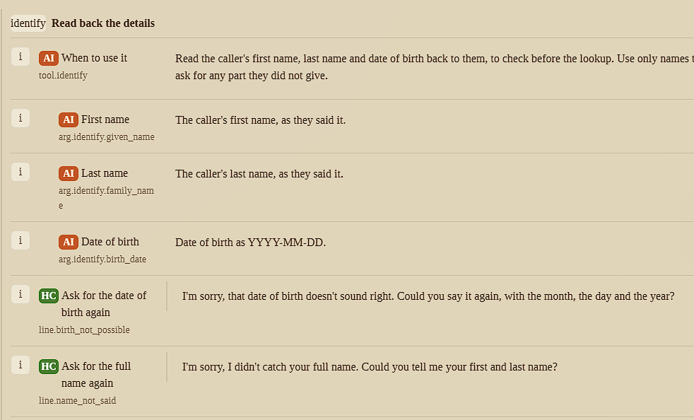

# DeetsHealth — Config › Agent, arranged by the call

The owner, 2026-11-13, after a desk test in which `{test}` in "Did not hear clearly" never
played: "I evidently got confused and I imagine an analyst most definitely would." The page
said what each section says, never when it plays. This design arranges the sections by the
call's steps, puts each line under the tool that speaks it, and gives every section a "Plays
when" line. It replaces CONSOLE.md §9's five tabs.

**Read §8 to §10 first** (2026-11-14): one layout by tool for both readers, Plain | Code in
place of Semantic | Flow, new titles (§8); the AI and HC marks (§9); the Core tab before Greet
and the gentle Plain | Code change (§10). §2's tab list, §3, §5's names and §5a's desk test are
the record before them.

**Terms.** A **section** is one block of AGENT-PROMPT.md (78). A **step** is a node of the call
(`flow.py` › `TOOL_STEPS`). A **line** is a fixed line the caller hears. A **field** is one
input of a tool (`arg.*`). The **reader** is a hospital IT analyst, new to building an agent.

## 1. What the owner decided (2026-11-13)
> **Part:** designed · 2026-11-13
- **2A:** the tabs are the call's steps; each line sits under the tool that speaks it.
- **The tab for lines no tool speaks is "Failure".** Every tab name is one word.
- **Semantic | Flow stays**, to frame the page for two readers: one new to this, one a power
  user. "Imagine a hospital IT vet who isn't particularly tech savvy and building with an agent
  for the first time."

## 2. The tabs
`Greet · Verify · Menu · Schedule · Anytime · Failure`, in the call's order.
- **Greet** — from the call's start until the code is sent.
- **Verify** — until the caller is verified.
- **Menu** — what the verified caller wants.
- **Schedule** — choosing and booking a time.
- **Anytime** — the role prompt and the seven tools the model has at every step.
- **Failure** — the lines no tool chooses: the scheduling system refused or did not answer, or
  a reply was cut off.

A tool offered in two steps sits once, in its first step, and the other step shows a one-line
link to it ("Find open times · in Menu"). One section, one place to edit.

## 3. Semantic and Flow
The same sections in each tab, read two ways. The bar stays at the right of the tab bar.

**Semantic (the default: for the reader new to this).** Three plain headings, by what a
section is:
- **What the agent is told** — the step's instructions, and the notes it reads after a tool.
- **What the agent can do** — each tool, by its plain name, with its fields indented under it.
- **What the caller hears** — each line, and the text message.

Every section shows its name and, under it, one grey line: **Plays when …** (§5). No keys, no
tool names, no tags.

**Flow (for the power user).** The step as the code runs it: the step's instructions first,
then each tool as a block: the tool's words, its fields, then every line and note it can
produce, in the order of its outcomes. The block's head shows the tool's name as a chip
(`book`); each section's key shows under its name (`line.booked`). "Plays when" stays.

```
Semantic, Schedule tab                         Flow, Schedule tab
─────────────────────────────────────────      ─────────────────────────────────────────
What the agent is told  1                      Step 4: choose and book      task.schedule
  Step 4: choose and book    [words…]            Plays when: …               [words…]
    Plays when: after open times are offered   ┌ `choose_option` Read back a time
What the agent can do  2                       │   Read back a time         tool.choose_option
  Read back a time           [words…]          │   Option number            arg.….option
    Option number            [words…]          │   Which time?              line.which_option
  Book the time              [words…]          │   Confirm the time         line.confirm_slot
What the caller hears  4                       └
  Which time?                [words…]          ┌ `book` Book the time
  Confirm the time           [words…]          │   Book the time            tool.book
  Time just taken            [words…]          │   Time just taken          line.slot_taken
  Booked                     [words…]          │   Booked                   line.booked
                                               └
```

## 4. What follows (one option was left each time)
1. **"Plays when" lives with the names**, in one file the page and the tests read
   (`agent/prompts/GUIDE.md`, the shape of TOOLS.md: per section its tab, its name, its tool and
   its "plays when"). The page's `SECTIONS` list in `agent.ts` goes; a test checks that every
   section has an entry and that each one's tab and tool agree with `tool_scope`.
2. **Read | Edit, versions, Record and test, the `{` and " ." lists, the problem lines and the
   glow** stay as built (CONSOLE.md §9, SYSTEM-PAGE.md).
3. **A tab with a problem or a change shows its dot**, as now.
4. **The remembered tab** maps from the old names: General → Anytime, Open and close → Anytime,
   Verify → Verify, Visits → Menu, Safety → Anytime; unknown → Greet.
5. **Config › System's links** ("Used in", "Says", "Its words") open the right tab, as now.

## 5. Draft: every section's place, name and "plays when" (for the owner to edit)
> **Part:** designed · 2026-11-13 — a draft list; the names are today's unless marked *new*.

**Greet**
| Section | Name | Under | Plays when |
|---|---|---|---|
| `line.greeting` | Greeting | — | The call starts. Spoken before the model runs. |
| `task.greet` | Step 1: name and date of birth | — | The model reads it from the call's start until the code is sent. |
| `tool.identify` | Read back details | — | The model calls it when the caller has said a full name and a date of birth. |
| `arg.identify.given_name` | First name | identify | The model fills it from the caller's words. |
| `arg.identify.family_name` | Last name | identify | The model fills it from the caller's words. |
| `arg.identify.birth_date` | Date of birth | identify | The model fills it from the caller's words. |
| `line.birth_not_possible` | Date of birth not real | identify | The date cannot be true (before 1900 or in the future). No try is spent. |
| `line.name_not_said` | Full name not heard | identify | The model sent a name the caller did not say. No try is spent. |
| `line.read_back` | Read back details | identify | Both checks pass; the caller hears the details and says yes or no. |
| `tool.confirm_details` | Look up and send code | — | The model calls it when the caller says yes to the read-back. |
| `line.ask_details` | Ask for details | confirm_details | Nothing was read back yet. |
| `line.code_sent` | Code sent | confirm_details | The details went to the record. The same words whether or not a patient matched. |
| `text.code` | Code text | confirm_details | Sent by text to the number on file, when exactly one patient matches. |

**Verify**
| Section | Name | Under | Plays when |
|---|---|---|---|
| `task.verify` | Step 2: check the code | — | The model reads it after the code is sent, until the caller is verified. |
| `tool.check_code` | Check the code | — | The model calls it when the caller reads a code. |
| `arg.check_code.code` | Code | check_code | The model fills it with the digits the caller read. |
| `line.code_length` | Code not 6 digits | check_code | The code is not 6 digits. No try is spent. |
| `line.code_wrong` | Code does not match | check_code | The code is wrong, and tries are left. |
| `line.locked` | Cannot verify | check_code | Too many wrong codes. The call goes to a person. |
| `line.verified` | Verified | check_code | The code is right. The chart and booking open. |
| `tool.resend_code` | Send a new code | — | The model calls it when the caller asks for a new code. |
| `line.code_resent` | New code sent | resend_code | A new code went out. |
| `line.no_more_codes` | No more codes | resend_code | No code is left to send. The call goes to a person. |
| (link) | Read back details · in Greet | — | — |

**Menu**
| Section | Name | Under | Plays when |
|---|---|---|---|
| `task.menu` | Step 3: what the caller needs | — | The model reads it once the caller is verified, until they choose a time. |
| `tool.find_visit` | Tell a visit | — | Since 2026-11-14 (EPIC.md §7.10) it replaces `next_visit`, with its fields, lines and notes; `agent/prompts/GUIDE.md` holds the current rows. |
| `tool.find_slots` | Find open times | — | The model calls it when the caller wants to book, or another day. Also in Schedule. |
| `arg.find_slots.reason` | Reason for the visit | find_slots | The model fills it from the caller's words. |
| `arg.find_slots.earliest_day` | Earliest day | find_slots | The model fills it when the caller names a day. |
| `line.slots` | Open times | find_slots | Open times were found. Holds each "One open time". |
| `line.slot_option` | One open time (part) | find_slots | One time, inside Open times. |
| `line.no_slots` | No open times | find_slots | No open time from that day. |
| `tool.change_visit` | Change or cancel a visit | — | The model calls it when the caller asks to move or cancel a visit. The call goes to a person, with a flag. Also in Schedule. |
| `line.change_booked` | Visit stays booked | change_visit | A visit was booked on this call: the caller hears it stays booked. |
| `line.change_visit` | Change or cancel a visit | change_visit | No visit was booked on this call. |

**Schedule**
| Section | Name | Under | Plays when |
|---|---|---|---|
| `task.schedule` | Step 4: choose and book | — | The model reads it after open times are offered. |
| `tool.choose_option` | Read back a time | — | The model calls it when the caller picks an option number. |
| `arg.choose_option.option` | Option number | choose_option | The model fills it with the number the caller chose. |
| `line.which_option` | Which time? | choose_option | The number is not one the caller heard. Book says it too, when no time was read back. |
| `line.confirm_slot` | Confirm the time | choose_option | The chosen time is read back for a yes. |
| `tool.book` | Book the time | — | The model calls it when the caller says yes to the read-back time. |
| `line.slot_taken` | Time just taken | book | Someone else took the time first. |
| `line.booked` | Booked | book | The visit is booked. |
| (links) | Find open times · Change or cancel a visit · in Menu | — | — |

**Anytime**
| Section | Name | Under | Plays when |
|---|---|---|---|
| `role` | Role and rules | — | The model reads it at every step. |
| `tool.end_call` | End the call | — | The model calls it when the caller says goodbye or has nothing else. |
| `line.goodbye` | Goodbye | end_call | The call ends after it. |
| `tool.hand_off` | Connect to a person | — | The model calls it when the caller asks for a person, says yes to an offer, or the code did not work. |
| `arg.hand_off.kind` | Reason for a person | hand_off | The model chooses a kind of flag. |
| `arg.hand_off.summary` | Summary for staff | hand_off | The model writes it for staff. |
| `arg.hand_off.evidence` | Caller's words for staff | hand_off | The model quotes the caller; the code keeps only words the caller said. |
| `line.hand_off` | Connecting to a person | hand_off | Any hand-off but one after the code did not work. |
| `line.hand_off_code` | Code does not work | hand_off | A hand-off because the code did not work. |
| `tool.offer_staff` | Offer a person | — | The model calls it when it cannot do or see what was asked. |
| `arg.offer_staff.why` | Reason for the offer | offer_staff | Cannot help, or private. |
| `line.offer_staff` | Cannot help, offer a person | offer_staff | The agent cannot do or see what was asked. |
| `line.offer_staff_private` | Private reason, offer a person | offer_staff | The record holds it, but it is private. |
| `tool.emergency` | Emergency | — | The model calls it when the caller may be in danger. |
| `line.emergency` | Call 911 | emergency | The emergency tool; the phrase screen hearing an emergency phrase; or a 911 reminder before any warning. No one can cut it off. |
| `tool.safety_reminder` | 911 reminder | — | The model calls it when the same danger comes up again. |
| `line.emergency_reminder` | 911 reminder | safety_reminder | The caller has heard the full 911 line already. |
| `note.after_reminder` | After the 911 reminder | safety_reminder | Sent to the model after the reminder. Never heard. |
| `tool.medical_question` | Medical question | — | The model calls it when the caller asks for medical advice. |
| `line.medical_question` | Cannot answer medical questions | medical_question | Every time the tool is called. |
| `tool.flag_for_staff` | Flag for a nurse | — | The model calls it to mark the call for staff. Silent to the caller. |
| `arg.flag_for_staff.kind` | Kind of flag | flag_for_staff | The model chooses a kind. |
| `arg.flag_for_staff.summary` | Summary for the nurse | flag_for_staff | The model writes it for staff. |
| `arg.flag_for_staff.evidence` | Caller's words for the nurse | flag_for_staff | The model quotes the caller; the code keeps only words the caller said. |
| `note.after_flag` | After a flag | flag_for_staff | Sent to the model after a flag. Never heard. |

**Failure**
| Section | Name | Under | Plays when |
|---|---|---|---|
| `line.one_moment` | Reply cut off *(new)* | — | The model's reply ran past its length cap. The agent tries again after it. |
| `line.say_again` | Could not use a value *(new)* | — | The scheduling system refused a value as unreadable (a date it cannot read). Not for speech the agent did not catch: the model says that in its own words. |
| `line.not_on_this_call` | Not allowed on this call *(new)* | — | The scheduling system says this call may not do that (not verified, or the call closed). The call goes to a person. |
| `line.not_now` | Refused for now *(new)* | — | The scheduling system refused for now (too many tries). The call goes to a person. |
| `line.ehr_down` | Scheduling system down | — | The scheduling system did not answer. The call goes to a person. |

Counts: Greet 13, Verify 10, Menu 17, Schedule 8, Anytime 25, Failure 5 = 78.

## 5a. As built and the desk test (2026-11-13)
> **Part:** built · 2026-11-13
- **The guide** is `agent/prompts/GUIDE.md` (§5's table, as a file): `prompts.py ›
  load_guide`, sent by `/agent/prompt` and `/agent/system` as `guide`; `/agent/prompt`'s tools
  also carry their `steps`. `agent.ts` reads it; its old `SECTIONS` list is gone.
  `test_the_guide_places_every_section_once_where_the_code_runs_it` holds every section to one
  entry, each tool and what sits under it to the tool's first step, each task to its step, each
  note to its tool.
- **Semantic's headings:** What the agent is told · What the agent can do · What the caller
  hears (the text message is under the last). The links to a tool in another step ("Also
  here: Find open times · in Menu") sit under "What the agent can do", and at the end in Flow.
- **Flow:** sections with no tool first, in GUIDE.md's order; then a block per tool (a bar at
  its left; its chip and name at its head). Each section shows its key under its name.
- **The title alone says what the row is; the rest is under the "i"** (the owner, 2026-11-13,
  after seeing it). Each section has a Config row's "i" before its name; it rolls down "Plays
  when", the code values it keeps ("Keeps: {visit}") and, in Flow, its key. The titles were
  made unique and plain (a tool by what it does, a line by when the caller hears it): GUIDE.md
  is now the list, and §5's names are the first draft. A test refuses two alike.
- **Kept:** Read | Edit, the versions, Record and test, the `{` and " ." lists, the problem
  lines, the dots on the tabs, the glow, System's links.

**Desk test.** Restart `npm run dev` first (the dev server reads GUIDE.md).
1. Config, Agent: the tabs read Greet · Verify · Menu · Schedule · Anytime · Failure; the page
   opens on the tab it last showed (Visits → Menu, the other old groups → Anytime).
2. Failure, Semantic: "What the caller hears 5". Each row: an "i", the title alone, the words.
   Press the "i" of Could not use a value: "Plays when: …" rolls down; press again, it rolls up.
   It works in Read and in Edit. No keys, no chips.
3. Schedule, Flow: Schedule instructions first, then a block `choose_option` Read back the
   chosen time (Option number, Unknown option, Chosen time read back) and a block `book` Book
   the time. An "i" here also shows "Key: …". At the end: "Also here: Find open times · in Menu
   · Hand a change to staff · in Menu". Press one: Menu opens on that tool, and it glows once.
4. Verify: "Also here: Read back the details · in Greet · Look up and send a code · in Greet".
   Menu › Next visit's "i" shows "Keeps: {visit}".
5. Edit a line in Menu so it fails (delete `{visit}` from Next visit): Menu's tab shows the red
   dot; Save stays off and its hint names "Menu › Next visit".
6a. Narrow the window below one Cartesia card: the "i" and the title sit on one line, the words
   under them, the help under the words.
6. Config, System, a variable's "Used in" link: Agent opens on the right tab, the section glows.
7. Change a "plays when" line in GUIDE.md and restart: the page shows the new words.

**Three new sections (2026-11-14, the booking work; EHR-SERVICE.md §4).** No page code changed:
the page lists `PLACEHOLDERS` and reads GUIDE.md, so each new section needed only its words, its
two list entries (`prompts.py`, `ehr/src/settings.rs`) and its GUIDE.md entry
(PROMPT-EDITOR.md §9). Where each shows: Menu › Find open times › **In person or online**
(`arg.find_slots.visit_mode`); Menu › Tell the next visit › **Next visit, just booked**
(`line.booked_visit_asked`); Anytime › Flag for a nurse › **Note when a summary guessed a
pronoun** (`note.summary_pronoun`). Two existing sections gained a rule: Anytime › Role and
rules (no guessed pronoun in a staff summary) and Menu › Menu instructions (an odd reason is
booked and flagged). Desk test: open each and check its "i".

## 8. One layout, Plain | Code (2026-11-14)
> **Part:** built · 2026-11-14 · desk test open. Where this part disagrees with §3, §5 and §5a,
> this part is the code.

The owner, 2026-11-14: "I still feel the Agent config tab is a little confusing and not quite
intuitive … I think Flow is more intuitive, but looks 'scarier'."

**The cause.** Semantic put every tool under one heading and every line under another, so
nothing said which tool speaks which line. Flow kept them together, but its block head showed a
code name in a chip, and its first row repeated the head's title.

**What the owner decided.**
- **1A: the bar stays and changes only the detail.** Both choices show the same layout: the
  sections with no tool first, then a block per tool.
- **2B: titles only.** A block shows its title and its rows. Every "plays when" stays under an
  "i". No labels inside a block.
- **The titles may be rewritten** "to use more active, direct, standard voice".

**As built** (`agent.ts`, `config.css`, `GUIDE.md`).
- **One layout.** Semantic's three headings are gone. A tab shows its step's instructions, then
  each tool as a block (the bar at its left, its title at its head), then "Also here".
- **A tool's own words show as "When to use it"** inside its block (`agent.ts › TOOL_ROW`). The
  title is at the head once. Links, the Save hint and Config › System still use the tool's title.
- **Plain | Code** replace Semantic | Flow on the bar (the browser's remembered choice carries
  over: Semantic → Plain, Flow → Code). Plain shows titles only. Code adds the tool's name as a
  chip at the block's head and each section's key under its title (`.prompt-key`). The key left
  the "i".
- **The titles** (GUIDE.md): 40 lines' titles now start with a verb and say what the agent says
  (Say, Ask, Offer, Add, Greet, Text). A tool's title already said what the agent does. Fields,
  notes and instructions keep their titles. Four "plays when" lines that quote a title follow.

**Decided inside his choices (for his review).**
- The bar's words "Plain" and "Code", and the row title "When to use it".
- Each of the 40 new titles (the WORKLOG entry of 2026-11-14 lists old → new). Edit GUIDE.md and
  restart `npm run dev` to change one.
- Code shows the key under the title, always in view, not under the "i".

**Desk test.** Restart `npm run dev` first (the dev server reads GUIDE.md).
1. Config, Agent: the bar at the right reads Plain | Code. It opens on the choice it had
   (Semantic → Plain, Flow → Code).
2. Verify, Plain: Verify instructions first. Then a block "Check the code": When to use it, Code
   the caller read, Ask for all 6 digits, Say the code did not match, Say the caller cannot be
   verified, Say the caller is verified. Then a block "Send a new code". No headings with
   counts, no chips, no keys.
3. Press Code: the same rows in the same places. Each block's head gains a chip
   (`check_code`); each row shows its key under its title (`line.code_wrong`). Press Plain: they
   go.
4. Press an "i": "Plays when" (and "Keeps" where a section keeps a code value). No "Key" line in
   either choice.
5. Verify, "Also here: Read back the details · in Greet": Greet opens, the row "When to use it"
   of that block glows once.
6. Edit, Menu: delete `{visit}` from Say the next visit. Menu's tab shows the red dot; Save's
   hint reads "Menu › Say the next visit: Needs {visit}".
7. Config, System, a tool's "Its words" link: Agent opens on the tool's block.
8. Narrow the window below one Cartesia card: in Code, the key sits under the title, over the
   words.

## 9. AI and HC (2026-11-14)
> **Part:** built · 2026-11-14 · desk test open

The owner, 2026-11-14, after seeing §8: "can we indicate with 'HC' or 'AI' to indicate something
that's hardcoded vs something that is a prompt for the Agent? Thinking in the serif font placed
in a theme color box for AI and green box for HC".

- **Every row has a mark before its title**, in Plain and in Code (`agent.ts`,
  `.prompt-mark-kind`).
  - **AI**: a prompt the model reads (instructions, a tool's "When to use it", a field, a note).
    The theme color (`--theme-color`, `--on-theme-color`).
  - **HC**: hardcoded words the caller hears or reads exactly as written (a line, the text
    message). The green of Start (`--go`, `--on-call-button`).
- **Decided inside his choice (for his review):** the box is as wide as the "i"
  (`--info-size`), with the small type in bold, so the titles start on one line; the mark sits
  between the "i" and the title; its hover hint reads "AI: a prompt the agent reads" or
  "Hardcoded: the caller gets these exact words". No new token.
- **Desk test.** Verify, Plain: Verify instructions, When to use it and Code the caller read
  show AI; the four lines under Check the code show HC. Change the theme: the AI box takes the
  new theme color; HC stays green. Narrow the window: the mark stays before the title.

## 10. Core, and a gentle Plain | Code (2026-11-14)
> **Part:** built · 2026-11-14 · desk test open

The owner, 2026-11-14, with a screenshot of Code: "when i switch to code, adding the subtitles
increases the height of the box. Can we either remove the jitter or animate the change gently?"
and "remove the Role and Rules piece (ie the core prompt) and put it into its own section before
Greet called 'Core'".



- **The tabs** are now `Core · Greet · Verify · Menu · Schedule · Anytime · Failure`. Core holds
  Role and rules, and the two 911 tools with their lines (the owner, the same day: "move the 911
  pieces to core since its a very very important piece as well"): Send to 911 and Remind about
  911, five sections. GUIDE.md; `prompts.py › GUIDE_TABS`; `agent.ts › TABS`; a test holds Core
  to those six sections. Anytime keeps the other five tools of every step, and shows "Also
  here: Send to 911 · in Core · Remind about 911 · in Core" (a tool's home is its tab in
  GUIDE.md).
- **Plain | Code animates in place.** One option was left: the keys add a line, so the rows
  must grow, and a row that kept the line's room in Plain would waste it. Every key and chip is
  always in the page. A click sets `data-order` on the card and nothing is drawn again: each
  key rolls down under its title and each chip rolls in from the left, with the help's roll
  (`.cfg-help`: `--dur-collapse`, `--ease`). The page keeps its scroll place. Reduced motion: a
  snap. Only the bar itself is made again, so its pill slides.
- **Decided inside his choices (for his review):**
  - A browser with no remembered tab opens on Core (the first tab). The old "General" maps to
    Core.
  - A key wraps after a dot, never inside a word (the screenshot shows `…family_nam` / `e`).
  - A field's title stays inset; its key now starts at the column's edge, so it has room.
- **Desk test.** Restart `npm run dev` first (GUIDE.md and `prompts.py` changed).
  1. The tabs start with Core. Core shows Role and rules (AI), then the blocks "Send to 911"
     and "Remind about 911". Anytime starts with the block "End the call" and ends with "Also
     here: Send to 911 · in Core · Remind about 911 · in Core"; press one: Core opens and the
     row glows once.
  2. Greet, scroll to the middle, press Code: the page does not jump to the top; each key rolls
     down and each chip rolls in, about a fifth of a second. Press Plain: they roll away.
  3. `arg.identify.family_name` breaks after a dot or not at all.
  4. With the system's reduced motion on: the change is a snap.
  5. Edit a section, then press Code: the typed words stay (nothing was drawn again).

## 6. Every place it runs
The console only (a browser). No change to the call, the store, `ehr` or any EHR: the
sections' keys and words are the same; only where the page shows them changes.

## 7. Not now
- A section for the model's own "didn't catch that" (today it is the model's words, not a
  line). It would be a new fixed line and a new rule; its own design.
- Searching sections by name or words.
