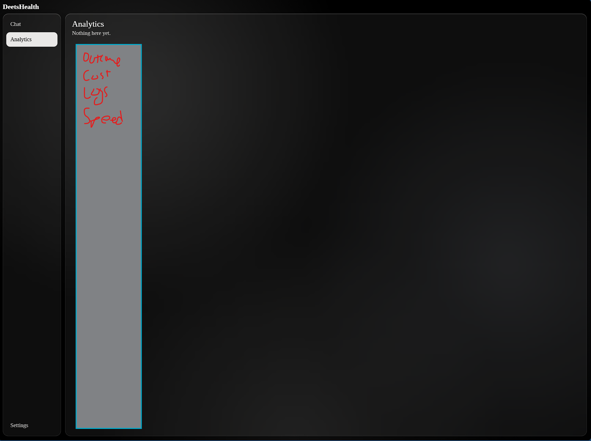

# DeetsHealth — The Analytics page

> The console's Analytics page: one panel with its own nav inside it. Each choice in that nav
> fills the rest of the panel with its own panels. The owner's design, narrated 2026-11-12
> over his sketch; he designs each view next. The shell it sits in is
> [CONSOLE.md](CONSOLE.md).

## 1. His words (2026-11-12)
The box at the left (blue in the sketch) is a nav "that we'll stack into the panel". It "can
operate like the big nav bar but specifically for the analytics page". "Each selection will
determine what panels and what is displayed on the screen." Add **Home** above Outcome, "a
summary overall". Add **Flags** at the end. "I'll design each subpage manually."

## 2. As built
> **Part:** built · 2026-11-12

- **The panel:** one glass panel fills the page. Its head is the title *Analytics* alone (the owner,
  2026-11-12: no "Nothing here yet." line). Under the head: the Analytics nav at the left, the view at the right.
- **On a narrow screen** (2026-11-14, CONSOLE.md §11): the title and the Analytics nav leave the
  panel; the nav is the dropdown at the compact bar's right, and the view fills the panel.
- **The Analytics nav:** a panel stacked on the page panel, with the chat canvas's look
  (`--canvas`). As wide as the big nav (`--subnav-width`, which is `--nav-width`). Its items,
  in order: **Home**, **Outcome**, **Cost**, **Logs**, **Speed**, **Flags**.
- **It works like the big nav** (CONSOLE.md §3): the same items and accent pill, which slides
  to the chosen item. ↑ and ↓ move between views. The old view fades out, then the new one
  fades in; with reduced motion, both are instant. The last view is reopened on the next visit
  (`localStorage`, `deets.console.analytics`).
- **The views:** each is built once, on its first visit, and kept (`View` in
  `pages/subnav.ts`). Each is empty now: "Empty for now", in the middle of the view.
- **Shared with Teams, Config, Security, Audit Logs and Settings** (2026-11-13): the panel, the nav and the view swap live in
  `pages/subnav.ts` and `styles/subnav.css`. A page with its own nav gives only its title, its
  `localStorage` key and its views (CONSOLE.md §3).

**Decided inside his choice (for him to see):** the item names are his words as written
("Outcome", not "Outcomes"); the nav is as wide as the big nav; the view swap fades like the
page swap.

## 3. The views
Each gets its own section here when the owner designs it.

> **Part:** designed · 2026-11-22 — the owner's words and forks that day.

**The aim (the owner, 2026-11-22):** "executive dashboards as well as analyst level analytics to
find optimizations and bugs during operation".

**Each view is for one kind of reader** (his words: "the pages cater to different people").
It is not a split by role, and no lever separates them: it is a rule for each view's design.
- **For an executive:** Home, Outcome, Cost. Few numbers, large; the change since the last
  period; a click goes down to the analyst's views.
- **For an analyst:** Speed, Flags, and above all Logs. Breakdowns, the slowest and the worst,
  and every row leads to one call (the Chat page in Demo, with its Timeline and Tools tabs).

**The data (his 2B):** the calls the console's tests make, no batch of synthetic calls for now.
Each Test call feeds the views. The views must read well with few calls.

**Comparisons (his "whichever makes sense"; Claude's pick, 3A):** each headline number shows
its change against the period before; on the analyst's views, two versions (the words, System,
Hospital, the model) can be compared, since every call records the versions it ran with.

**For every view (no fork):** one filter bar, kept across the views (the dates; Test, Demo or
live calls; the EHR; the version). Counts, times and dollars only, under the Analytics lever; a
call's words or a flag's summary and evidence are sealed, so each look at them is audited.

| View | Reader | Intent | State |
|---|---|---|---|
| Home | Executive | A summary of all the others | Built (§3.2) |
| Outcome | Executive | How calls end: booked, handed off, abandoned, crashed, locked | Built (§3.2) |
| Cost | Executive | Dollars: per call, per booking; Claude and Cartesia | Built (§3.2) |
| Speed | Analyst | Each turn's wait against 800 ms, and where it went | Built (§3.2) |
| Flags | Analyst | Flags by kind and source; each flag's words with PHI View (see [FLAGS.md](FLAGS.md)) | Built (§3.2) |
| Logs | Analyst | Every call, each one opening in Chat | Built (§3.1) |

The order of work (the owner, 2026-11-22): **Logs first**, since every other view is a sum of
its rows and every drill-down ends in it; then the other five **all at once** (his pick over two
batches, the same evening).

**The other five, decided (the owner, 2026-11-22):**
- **Flags shows a flag's words** (his A): the summary and the evidence of each staff flag, to a
  role with PHI View only, and each opening writes an audit row (`flag.view`) in ehr. Without PHI
  View: kinds, sources and counts.
- **No fork (one option each):** the sums are worked out in ehr (`CallStats`), never from Logs'
  2000 rows; the charts are drawn by our own code (HTML, not SVG as said in the chat) in the theme's roles, no chart library; Cost counts
  Cartesia too, in dollars once Config › Cartesia has the plan's price per credit, in credits
  until then (never a guessed price); Speed splits each wait by stage, kept in the store as
  numbers; each executive number shows its change against the period before; each number names
  how many calls it rests on.
- **The draft he took** (the table in the chat of 2026-11-22): Home: calls, % booked, $ per
  call, typical wait, open flags, each opening its view, and calls per day by outcome. Outcome:
  the shares by outcome, outcomes per day, where calls stop, the end reasons. Cost: $ total, per
  call, per booking, Claude and Cartesia, $ per day, by model, the 5 most costly calls. Speed:
  median and 90th-percentile wait, % within 800 ms, the spread of waits, the split by stage, the
  slowest tools and turns, a compare by version. Flags: staff and review flags, % flagged, flags
  per day by kind, by kind and source, the flagged calls.

### 3.1 Logs
> **Part:** designed · 2026-11-22 — the owner's forks that day; the columns and the filters are
> drafts for him to edit.

- **The rows come from the store** through a new `ehr` read, `ListCalls` (DATABASE.md §2: the
  console reads the store through a read API, never the dev catalog). Plain columns only; each
  turn's wait is worked out inside `ehr` from the sealed events, and only the numbers leave. A
  dev route and the lever Analytics View; its rows in `RPC_LEVERS` and DEV-API.md. No API
  dollars, no FHIR calls.
- **The filter bar** (shared by every Analytics view) is built here. **The data class is its
  first control** (his A): "Synthetic", the only choice on a dev machine. The list shows one
  class at a time, as the store keeps them in two schemas (DATABASE.md §7.6: this is the mark).
- **The table:** the one table (TABLES.md), newest first, windowed past 200 rows, the search box
  and Ctrl+F. It reads again each time the view opens and once after each call ends.
- **A click on a row opens a panel under it** (his A), as on Security › Auth: each turn's wait as
  a small bar strip with a line at 800 ms, the tools and their errors, the flag kinds, the
  versions, and **Open in Chat**, which plays the call in Chat › Demo with its Timeline, Tools and
  Review (Testing View; each look at the words is audited there). The panel holds numbers only.
- **Draft, the columns:** Started · Origin (Test, Kept, Typed) · Seat (Text, Voice) · EHR ·
  Outcome · Last step · Turns · Length · Typical wait (the median turn) · Slowest turn · Tool
  errors · Flags (a count by kind) · $ · Versions (words, System, Hospital, model) · Label ·
  Rating.
- **Draft, the filters:** Dates · Origin · Outcome · EHR · Seat · Version · Flagged only · Over
  800 ms only.

#### 3.1.1 As built
> **Part:** built · 2026-11-22 · desk test open — the owner's "Build as drafted". Where this part
> and §3.1 disagree, this part is the code.

- **The store** (migration 0013, `ehr/src/store.rs`): `calls` has `seat`, `ehr`,
  `turn_waits_ms` (one wait per caller turn) and `requests_live` and `requests_replayed`, in
  both schemas. `summarize` works them out when a record is filed (`turn_waits`, the same rule
  as the Timeline, CHAT.md §18; an agent line stamped late, whose first frame came before the
  turn began, closes nothing). The migration empties each row's record hash, so the next `ehr
  ingest` (every `npm run dev`) files every record again and fills them. A filed call whose
  record file is not here (the kept-script draws: 30 on 2026-11-22) keeps empty columns.
- **Replayed calls:** a call with any request from the replay cache waited on the cache, not on
  the model. Its waits show "Replayed", and it is never counted or filtered as over 800 ms
  (`latency.py` leaves such rows out for the same reason).
- **ehr** (`ListCalls`, Analytics View; EHR-SERVICE.md §3): the calls of one class started in a
  range, newest first, at most 5000, with their tools and which failed, the staff flags' kinds,
  the review flags' reasons, the current label (opened in ehr; a synthetic call's only) and the
  current ratings' passes and fails. The label is the one field tagged `(phi)`.
- **The route** `GET /agent/logs` (DEV-API.md): Analytics View; 2000 calls at most per read;
  the dates as a count of days, counted on the dev server's clock (the records' start times are
  its local time), so a guest in another time zone sees the same list. Each call carries
  `record`: whether Demo can play it. An allowed read writes no audit row (names and numbers,
  as `ReadAudit`); the gate audits each refusal.
- **The console:** `pages/logs.ts`, `pages/analytics-filter.ts`, `styles/analytics.css`; the
  store `logs` by range (`agent/stores.ts`); Open in Chat through `open-call.ts`.
  - **The filter bar:** Synthetic (the class, with the accent's edge), Dates (Today, Last 7, 30
    or 90 days, All time; Last 30 days at first), Origin, Outcome, EHR, Seat, Version (grouped:
    Words, System, Hospital, Model; only the labels the rows hold), Flagged only, Over 800 ms
    only, and the search box. Kept for this viewer (`localStorage`), shared by the Analytics
    views to come. The dates are read by the store; the rest filter the rows in the page.
  - **The title line:** *Logs*, and at the right "N calls · M flagged · K over 800 ms"; when the
    read stopped at its 2000, it adds "the newest 2000 only: choose fewer dates".
  - **The table:** the draft's 16 columns; numbers in the narrow `--col-num`, Versions and Label
    share the rest. A slowest turn over 800 ms is in `--error`. A click on a row (or its "i")
    opens the panel: *Turns* (a bar per turn, its height its share of the slowest or of 800 ms,
    a line at 800 ms, a bar over it in `--error`; each bar's hint names its turn and wait),
    *Tools*, *Flags*, *Steps*, *End*, *Script*, *Versions*, and **Open in Chat** (with Testing
    View), which goes to Chat, switches to Demo, chooses the call and plays it. A call with no
    record here says "No record on this machine to play in Chat" in its place. "$" is Claude's
    cost only; Cartesia's credits are not in it.
  - **Reads:** on the first showing, again each time the view is opened, and on a new range.

**Decided inside the owner's choice (for his review):**
- The range starts at Last 30 days; a range is a fixed word in the store (never a date).
- "Typical wait" is the median turn; a call with no answered turn shows "—".
- Rating shows "n ✓ · m ✕" from the current ratings (each grader's newest per dimension).
- "$" shows three decimals under 10¢. Length is m:ss.
- The search looks in the id, label, script, outcome, steps, tools, flags, versions, model and
  end reason.
- Open in Chat plays at once (a click on Play saved).
- Each turn's wait in the store, not worked out at each read: a list of thousands needs no
  sealed event opened.
- Replayed calls stay in the list (origin *Kept*), their waits shown "Replayed".

**Desk test** (restart `npm run dev` first: ehr, its migration and the agent changed):
1. Analytics › **Logs**. The filter bar: *Synthetic* first, with an accent edge, then the
   dates on *Last 30 days*. The title line counts the calls. The table lists your test calls,
   newest first. *Typical wait* and *Slowest turn* have values for calls since schema 4.
2. Click a row: its panel opens under it, with the turn bars and the line at 800 ms. A bar over
   the line is red. Click again: it closes.
3. Choose *Outcome: Booked*: only booked calls stay, and the count follows. Press *Flagged
   only*: it turns accent, and only flagged calls stay. Reload: the filters are kept.
4. Type a tool's name (`find_slots`) in the search box: only calls with it stay. Press Esc: all
   come back. Press Ctrl+F: the box takes the cursor.
5. In a row's panel, press **Open in Chat**: the console goes to Chat, Demo, and plays the call;
   the Timeline tab shows its turns.
6. Make a Test call on Chat, then open Analytics › Logs again: the new call is at the top.
7. A role without Testing View has no Open in Chat; without Analytics View, no Analytics page.

### 3.2 Home, Outcome, Cost, Speed and Flags
> **Part:** built · 2026-11-22 · desk test open — the owner's "all five now", the draft he took
> (§3), and Flags' words with PHI View (his A).

**The parts they share**
- **The store** (migration 0014, `ehr/src/store.rs`): each call's `cartesia_credits` (from
  `call_end.cartesia`) and `turn_stages`, one set per answered turn (`turn_stages`): *Ink* (the
  caller's silence to Ink's final line), *Claude* (its requests), *Tools* (the tools' own runs
  less the ehr calls in them), *EHR*, *Voice out* (the first frame to the caller hearing it) and
  *Other* (the rest). Each span counts only where it falls inside the turn. Filled at the next
  ingest, as 0013 did.
- **The sums** (`ehr/src/stats.rs`, ehr's `CallStats`, `GET /agent/stats`; Analytics View):
  every number in ehr, over every call that passes the filter bar (the filters in SQL, the sums
  in `stats::aggregate`), and the totals of the range before (as long as the range; none for All
  time). Replayed calls' waits are left out, as in Logs. `usd_per_credit` is the active Cartesia
  plan's price over its credits.
- **Config › Cartesia, Usage:** a new row, *Plan price ($ a month)*, `plan_price_usd` (0: not
  set). Cost turns credits into dollars with it; until it is set, Cartesia shows in credits.
- **The kit** (`pages/analytics-kit.ts`, `styles/analytics.css`): the view's frame (the title,
  the shared filter bar, a count line, the body), the headline tiles, and the charts: columns
  per day (stacked by series, every day of the range shown), bars across, one split bar, the
  spread of waits with a line at 800 ms, and short lists. All drawn by our own code in HTML, in
  the theme's roles; no chart library. Each view reads again when it opens.
- **Drill-downs:** a tile opens its view (Home) or Logs with a filter set; a chart's part opens
  Logs on that outcome or on flagged calls; a list's row opens Logs with that call or tool in
  its search box (`findInLogs`). The filter bar on every view follows a change made on another.

**The views**
- **Home** (executive): *Calls*, *Booked*, *Cost per call*, *Typical wait* (the median turn),
  *Flagged calls*, each with its change and each opening its view; *Calls per day*, by outcome.
- **Outcome** (executive): *Booked*, *Handed off*, *Abandoned*, *Crashed* as shares, each opening
  Logs on it; *Outcomes per day*; *Where calls reach* (how many reached each step, in the Flow's
  order); *How calls end* (the end reasons, at most 10).
- **Cost** (executive): *Total*, *Per call*, *Per booking*, *Cartesia*; *Dollars per day*
  (Claude and Cartesia stacked, or Claude alone until the price is set); *By model*; *The most
  costly calls* (5).
- **Speed** (analyst): *Median wait*, *90th percentile*, *Within 800 ms*; *The spread of waits*;
  *Where the wait goes* (the mean of each stage); *The slowest tools* (median and 90th of their
  own runs, the failures); *The slowest turns* (10); *Compare versions* (by words, System,
  Hospital or model: calls, booked, median, 90th, within 800 ms, $ per call; a row sets the
  Version filter for every view).
- **Flags** (analyst): *Flagged calls*, *Staff flags*, *Review flags*, *Unverified evidence*;
  *Flags per day*; *Staff flags by kind* (with the source: code or model); *Review flags by
  reason*; *The flagged calls* (from Logs' list, at most 200): a row opens its panel. With PHI
  View, the panel reads the call's flags through `GET /agent/flags/{id}` (ehr's `ReadFlags`,
  which writes a `flag.view` audit row before the words leave) and shows each flag's kind, its
  source, its summary and its evidence. Without PHI View: the kinds, and a line that says what
  is needed. *Find in Logs* in each panel.

**Decided inside the owner's choice (for his review):**
- The series' colors are theme roles: Booked and Tools `--go`; Handed off and Claude `--accent`;
  Abandoned and Other `--text-3`; Crashed and staff flags `--error`; Locked and Ink
  `--unverified`; Ended and EHR `--text-2`; Cartesia and Voice out `--shape-2`. No new theme
  role was made; a theme where two read alike is for the desk test.
- A change is "▲/▼ size vs the 7 days before", green when better, red when worse, plain when a
  rise is neither (Handed off, Calls). Shares change in points.
- "Flagged calls" on Home in place of "open flags": a flag has no open or closed state yet.
- **Every call counts on every view** (the owner, 2026-11-22: "Count every call"), the
  kept-script draws too; the Origin filter narrows it. Replayed calls' waits stay out of Speed.
- *Cost per call* and *Total* add Cartesia's dollars only when the price is set; the tile says
  "Claude only" until then.
- The x axis names the first and last day; each column's hint names its day and numbers.
- The day axis uses this browser's day for the range's first day; the sums use the server's.
- The flagged calls list reads Logs' list (2000 at most), so a range past that shows the newest.

**Desk test** (restart `npm run dev` first: ehr, migration 0014 and the agent changed):
1. Analytics › **Home**: five tiles with numbers and "of N calls" lines; with Last 7 days, each
   has a change line ("▲ … vs the 7 days before"). *Calls per day* shows a column per day.
2. Click *Booked*: Outcome opens. Click a column's green part: Logs opens with Outcome Booked,
   and the filter bar on every view shows Booked. Set Outcome back to Any.
3. **Cost**: *Cartesia* says to set the plan's price. In Config › Cartesia, Edit, set *Plan
   price* (Free: 0; a paid plan: its price), Save. Back on Cost: Cartesia in dollars, and
   *Dollars per day* stacks Claude and Cartesia.
4. **Speed**: the three tiles, *The spread of waits* with the 800 ms line, *Where the wait goes*.
   Make a voice call first to see Ink and Voice out. Click a slow turn: Logs opens with that call
   in its search box. Choose *Compare by words* and click a row: every view's Version filter is
   set.
5. **Flags**: open a flagged call. With PHI View (the owner): its flags' summary and evidence.
   Audit Logs › Calls shows a `flag.view` row for it. As a guest without PHI View: kinds only.
6. Change the dates on any view: every view follows, and the numbers change.

**Open.**
1. `npm run dev`, open the console, click **Analytics** in the big nav. One panel fills the
   page: the title, then the Analytics nav at the left with Home, Outcome, Cost, Logs, Speed
   and Flags. Home is chosen. The view says "Empty for now".
2. Click **Cost**. The pill slides from Home to Cost, and the view fades.
3. Press ↓ and ↑ with an item focused. The choice moves, and wraps at the ends.
4. Click **Chat**, then **Analytics** again: Cost is still chosen. Reload: Cost is still chosen.
5. Change the theme from the app-name menu. The Analytics nav keeps the chat canvas's look in
   each theme.
