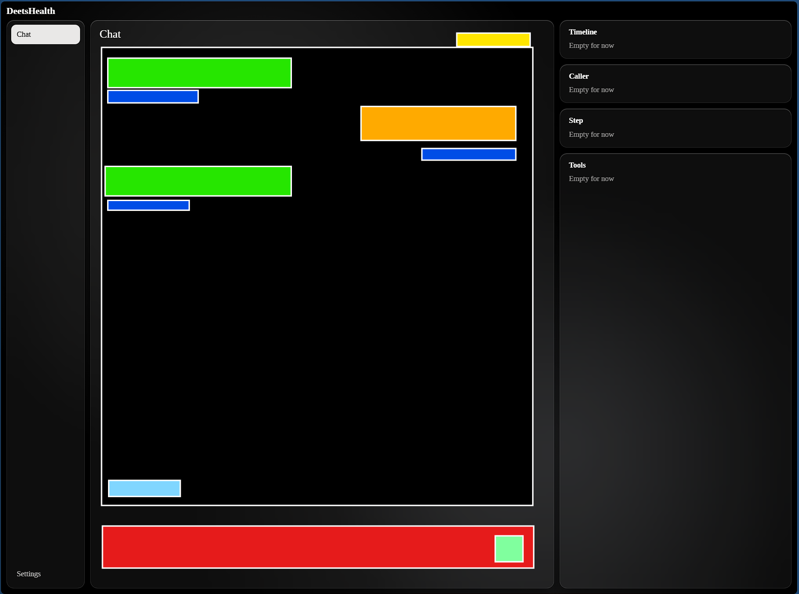
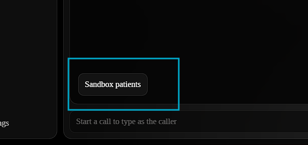
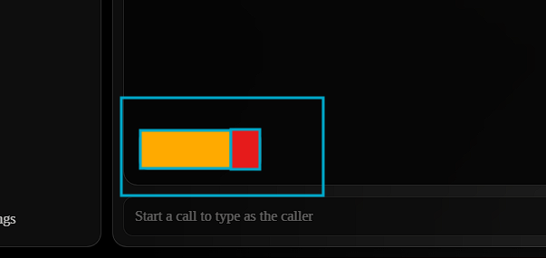

# DeetsHealth — The Chat page

> The console's Chat page: one call in a chat view, in three modes. The owner's design,
> narrated 2026-11-11 over his sketch. The shell it sits in is [CONSOLE.md](CONSOLE.md). The
> connection is the hybrid (§5), built 2026-11-12 (§6); the catalog of calls is §7; the
> sandbox patients in the rail and the code button are §8 (the text path itself is
> [TEXTS.md](TEXTS.md)); the Tools panel is §9; per-tool latency across calls (an API) is §10; the Step panel is §11; the Review panel is §12; Epic mode is §13; the
> Chat nav (Testing, Demo, PHI), which replaced the mode toggle, is §14; the rail's two
> panels with tabs are §15; Demo's recorded calls and speed bar are §16.
> **Every route, message and refusal of the dev server is [DEV-API.md](DEV-API.md).** This doc
> says what the page does with them.

## 1. The parts (the owner's words, by the sketch's colors)
- **The chat canvas** (black): a panel stacked on the stage. A little translucent, about 85 %
  opaque, for the stacked-glass feel. The same rounding as every other panel. The color of
  the main panel, pushed darker: toward black (Dark), coffee beige (Light), navy (Moonlight).
- **The agent's lines** (green): bubbles on the left.
- **The caller's lines** (orange): bubbles on the right.
- **The line facts** (dark blue): a row under each bubble. For the agent: the time to make the
  text, the time to make the speech. For the caller: the time to transcribe, the time to reach
  the agent.
- **The mode toggle** (yellow): above the canvas, at its top right. One button that flips its
  word, gently, through three modes:
  - **PHI** — the watch view: observe a call. Read only.
  - **Test** — the analyst is the caller.
  - **Demo** — a recorded call plays back as if it were live.
  It is tied to Pipecat's PHI setting.
- **The help box** (light blue): bottom left, in Test only. The sandbox patients the tester may
  use.
- **The text box** (red) with **the send button** (green): the caller's line. Not shown in PHI
  mode.

## 2. The forks and the answers (the owner, 2026-11-11)
1. **Where a test call starts and ends:** in the canvas, at the bottom right, mirroring the help
   box. One rounded rectangle split in two by a hairline: **Start** on the left, tinted green,
   **End call** on the right, tinted red. The greens and reds by theme: forest and scarlet
   (Dark), grass and burgundy (Light), turquoise and purple (Moonlight). The first press on End
   call turns its word to **Confirm?**; the second ends the call. The buttons are large, and
   nothing moves when a word changes ("make the buttons large enough where jitter does not ever
   occur").
2. **The help box:** inside the canvas, at the bottom left (his sketch). One press opens it,
   the next closes it, gently. The canvas keeps a row at its foot for these controls; the help
   box opens upward from it, over the lines, because it is not open all the time.
3. **Demo's controls:** the text bar becomes a player, in the same button style: Play | Stop in
   the canvas where Start | End sit, and in the bar a call picker and the speed, 1× | 2×.
4. **"Tied to Pipecat's PHI setting"** (confirmed by the owner, 2026-11-12: "Yup, works"). The
   toggle picks where the data comes from and how much protected data the watch stream may
   carry:
   - **PHI:** live calls. In development every field shows, because the data is synthetic. In
     production each field shows only as far as the viewer's role allows, and each view writes
     an audit row (SECURITY.md §4).
   - **Test and Demo:** synthetic data only; every field shows.
   - **The caller's seat** keeps RTVI's `function_call_report_level` at `name` in every mode, so
     the browser never gets a tool's arguments or result through RTVI. The rail panels get them
     from our watch stream, where each field carries its PHI mark.
   - Why not RTVI's own setting alone: RTVI belongs to the caller's seat, and PHI mode has no
     caller seat in the browser, so that setting would control nothing there.
   **To change it:** the levels live in the agent's dev server (the RTVI observer's parameters)
   and in the watch stream's per-field marks; the toggle itself only picks a mode.

## 3. As built
> **Part:** built · 2026-11-12 — the UI. Its connection is §6.

`console/src/pages/chat.ts`, `console/src/styles/chat.css`; the tokens in `skin.css` (chat),
the roles in `themes.css`, the six call paints in `palette.css`.
- **The title** sits where every other page's title sits: `--pad-panel-x` from the panel's
  left edge, its top `--pad-panel-y` from the panel's top (the owner, 2026-11-13). The head
  shortens its top padding by half the height that the toggle has over the title's line.
- **The inset:** the head, the canvas and the bar all sit `--pad-panel-x` in from the
  panel's sides and bottom (the `.chat` padding). So the canvas's left edge lines up with the
  title's left edge, and its right edge with the toggle's right edge (the owner, 2026-11-13).
- **Our own scrollbars** (the owner, 2026-11-13): the page's root carries `own-scrollbars`,
  so the canvas, the rail's tabs and the page itself scroll with the console's thin thumb, not
  the system's bar ([CONSOLE.md](CONSOLE.md) › The look › Scrollbars).
- **The mode swap always finishes:** if the swap's work throws (a dev server older than the
  page, 2026-11-13), the controls still come back and the word still turns in.
- **One radius, a trial** (the owner, 2026-11-13): `--radius-item`, `--radius-small` and
  `--radius-bubble` all point at `--radius` (16 px), so panels, the canvas, controls, menus,
  the nav pill and bubbles match. Before: 11, 10 and 14 px. `--radius-control` (6 px, the
  short rows) stays.
- **The toggle** (replaced by the Chat nav on 2026-11-13, §14; this bullet is the old record)
  sat right of the title, centered on the title's line, `--pad-panel-x` from
  the panel's right edge. A press turns the word over on its horizontal axis
  (`--dur-flip`, 240 ms: half out, half in); instant with reduced motion. The mode is kept per
  browser (`deets.console.chat.mode`); Test is the default. Each mode keeps its own lines.
- **The canvas:** `--canvas` per theme, 85 % opaque, `--radius`. The lines scroll above the
  control row.
- **The buttons' words are regular, not bold** (the owner, 2026-11-13: bold "looks visually
  messy"; `images/chat-button-weight-2026-11-13.png`, the bold Epic and Start | End call): every
  split button (Start | End call, Play | Stop, 1× | 2×, the code button) and the Epic / Local
  button.
- **Start | End call:** each half is 132 px by 44 px (`--split-half`, `--control-height`).
  Both words of End call sit in one grid cell, so "Confirm?" never resizes it. Confirm? waits
  3 s (`--confirm-hold`), then turns back; Esc turns it back at once.
- **A test call:** Start calls the agent (§6). The greeting comes in, the text box opens, and
  each line you send comes back as a caller bubble, then the agent's answer. End call, then
  Confirm?, hangs up; when the agent ends the call, the canvas says why.
- **The help box:** replaced on 2026-11-12 (§8). The sandbox patients moved to the rail; the
  code button now sits at the bottom left and opens the text with the same card and motion.
- **Demo:** since 2026-11-13 the calls are the rail's first tab and the speed is a bar in the
  canvas (§16); the picker and the bar under the canvas are gone. Play fetches the chosen
  call's events and draws each one at its own time, divided by the speed (0.5×, 1× or 2×);
  Stop ends it.
- **PHI:** the live call, whoever is its caller (in dev, a test call in another tab or
  window); "No live call to watch" when there is none.
- **The wave** (the owner, 2026-11-12: "animate the buttons appearing to be gentle and like a
  wave as a whole ... when we change between surfaces, all visual buttons go"). On a mode
  change, every visible control (the help button, the split buttons, the text box, the send
  button, the picker, the speed pair) fades out together in 120 ms (`--dur-wave-out`) while
  the toggle's word turns away. Then the new mode's controls come in as one wave: top row
  first, left to right, each 60 ms after the one before (`--wave-step`), each rising 6 px
  (`--wave-rise`) and fading in over 360 ms (`--dur-wave-in`, `--ease-wave`). The same wave
  plays each time the Chat page comes into view. The animation is not held, so at rest
  nothing is transformed. With reduced motion there is no wave. A control joins the wave by
  carrying `data-wave` (`chat.ts`); the toggle itself only flips.

**Decided inside his choices** (for his review): the theme-to-color order (his list's order
against Dark, Light, Moonlight); the exact shades (`palette.css`), each dark enough for white
text; "Confirm?" turns back after 3 s; the send button is a 44 px square in the theme's green
with an arrow; the help button's label "Sandbox patients"; the speed's chosen half takes the
accent color; the drafts below are built as drafted.

## 4. Drafts for the owner
- **Bubble colors:** the agent's is a light glass wash; the caller's is the theme's accent.
- **The line facts:** agent "text 0.8 s · speech 0.3 s" and a "fixed line" mark; caller
  "transcribe 0.2 s · to agent 0.05 s". Only numbers that exist show; a typed call has none
  yet, so no facts row shows.
- **The toggle's flip:** 240 ms, on its horizontal axis.

## 5. The connection (the owner, 2026-11-11: the hybrid)
The caller's seat (Test) is Pipecat's RTVI over a WebSocket, one per call; later SmallWebRTC
for voice in the browser, and Twilio in production. The watchers (the rail panels, the line
facts, PHI mode, Demo) read our own event stream, any number per call. The dev server listens
on this PC only. The demo for an analyst team over a Cloudflare Tunnel is an idea
([ideas/README.md](../ideas/README.md)).

## 6. The connection as built
> **Part:** built · 2026-11-12 — the owner's forks 1A (Test and the watch stream together) and
> 2A (`npm run dev` starts both).

**Run it:** `npm run dev`. `scripts/dev.mjs` takes a free port for Vite (from 1420) and one
for the agent (from 8790), makes a fresh 256-bit token, starts the agent's dev server
(`agent/deets_agent/dev_server.py`), then starts Vite. Vite's proxy sends `/agent/*` to the
agent and adds the token. Ctrl+C stops both. `npm run dev:web` starts the console alone; then
the Chat page says the dev server is not running. **Test calls are always live** (the owner,
2026-11-12: "limit replaying conversations only to the Demo view"): every line goes to Claude,
with no replay cache, so each line costs tokens (about $0.0003 for a short Haiku turn). Without
an Anthropic key in `.env` there is no test call ("a test call needs an Anthropic key"); Demo
still works. The replay cache stays for the typed harness and the tests (AGENT.md §1).

**The parts:**
- **The caller's seat (Test):** `@pipecat-ai/client-js` 1.16 with our own text transport
  (`console/src/agent/transport.ts`): RTVI as JSON text, one message per WebSocket frame, no
  audio. The server's half is `agent/deets_agent/rtvi_json.py`. The seat sends; it draws
  nothing from RTVI.
- **The watch stream** (`/agent/watch`): each event of the live call, as the dev call record
  writes it. Test, PHI and Demo draw from the same events with the same code (`CallView` in
  `chat.ts`), so a recorded call plays exactly as it was drawn live. Fixed lines (the 911
  line, the code lines) come this way: they are not model text, so RTVI's text events do not
  carry them.
- **One test call at a time.** A second Start while a call runs is refused ("a test call is
  already running"). Each test call writes a record (`source: test`) that joins the catalog
  when it ends.
- **The line facts, for now:** an agent bubble shows "text 0.8 s" (the time to the first word
  of its first live request to Claude). A recorded call from the typed harness can show
  "replayed" in Demo; a test call never does. Speech and transcription times come with the
  voice.
- **The bar** (the owner, 2026-11-12): the text box and the send button together are exactly
  as wide as the canvas above them. They share one height: the bar sets 44 px and each fills
  it, and both have the same 1 px edge. The text box has `appearance: none` for Safari. The
  line facts start where the bubble's text starts (`--bubble-pad-x`).
- **The control row is fluid** (after two narrow-window desk tests): the help button keeps its
  own width ("Help" when the canvas is 480 px or less); the split takes the room left, up to
  its full size, its halves always equal and never narrower than "Confirm?". It never runs out
  of the canvas.

**The wall** (SECURITY.md §4; dev only, synthetic callers only):
- The dev server listens on 127.0.0.1 only.
- A WebSocket is not covered by CORS, so any web page could open one to a local port. So every
  request needs the launch token, compared in constant time (only Vite's proxy has it; the
  page never does), and must come from the console's own origin. Checked on 2026-11-12: no
  token, 403; another origin through the proxy, 403.
- **RTVI's tool reports are at `NONE`** in the seat: tool events carry only an id, with no
  name, arguments or result. That is stricter than §2.4's `name`, because nothing in the seat
  uses the names; the watch stream carries them.
- **No remote code.** Pipecat's own browser WebSocket transport is not used: it pulls in
  `daily-js`, which loads Daily's call-machine bundle from Daily's CDN. Checked 2026-11-12: the
  built bundle has no `daily` code. Voice in the browser (SmallWebRTC) needs the same check.
- The watch stream carries caller lines and tool arguments. It is safe only because every
  caller is synthetic. A real call has no path to a dev call record (call_record.py).

**Levers seen on the way** (Pipecat 1.16, not used yet): RTVI's `metrics` messages (time to
first byte per service, token usage) now flow to the seat with `enable_metrics` on; the record
times its own requests, so the line facts use those. Pipecat ships an RTVI client transport
and an "eval transport" for simulated callers (`pipecat.transports.websocket.rtvi_client`),
which fits the evals (§7) and test layer 4 (VOICE-AGENT.md §9).

**Desk test:**
1. `npm run dev`; open the address Vite prints, in Safari.
2. Test: Start. The greeting shows. Type as a sandbox patient (the rail's Sandbox patients
   panel) and book a visit. Each answer shows "text n.n s" under it (a live request: about
   $0.0003 a line), and the call ends with the goodbye line. The code by text is §8.
3. Check the edges: the text box starts at the canvas's left edge and the send button ends
   at its right edge; the two are the same height. The facts under a bubble start where its text starts. Narrow the
   window: Start | End call narrows, never past the canvas's edge.
4. Open a second window on PHI during a test call: the same lines show as they happen.
5. Demo: pick the call you just made (the newest), Play at 2×. It plays as it ran.
6. Stop the dev server (Ctrl+C) with the page open: the Chat page says the dev server is not
   running, and comes back by itself when you start it again.

## 7. The catalog of calls (the owner, 2026-11-12: SQLite; ratings per dimension)
> **Part:** built · 2026-11-12 — the store and its API (DEV-API.md §4); the rating controls are
> the Review panel (§12).

`agent/deets_agent/catalog.py`. Every dev call record is one row; ratings are kept for evals
later (Anthropic's "Demystifying evals for AI agents": grade the outcome, one rubric per
dimension, an "unknown" answer, calibrate model graders against human ones).
- **Two sources, one database.** A row is worked out from its record's events every time the
  catalog is built, so it never drifts. What a person or a grader adds (a label, a note, a
  star, a rating) goes in `agent/calls/annotations.jsonl`, committed and append only, so the
  PC and the Mac merge cleanly; the last line for a field wins. `agent/calls/catalog.db` is
  git-ignored and rebuilt from both at each start. The column names and types follow Postgres,
  for the store (VOICE-AGENT.md §8.7).
- **`calls`:** `id` (the record's file name), `schema_version`, `started`, `source` (typed ·
  test), `mode`, `model`, `scenario` (a kept script's name, so repeated runs group for pass^k),
  `outcome`, `end_reason`, `reached` (the Flow's nodes in order), `turns`, `tool_calls`,
  `duration_ms`, `tokens_in`, `tokens_out`, `cost_usd`, `flags`, `label`, `note`, `keep`.
- **The outcome is the real end state, not the agent's words:** `crashed` · `booked` (ehr's
  `Book` answered `booked`) · `handed_off` · `locked` · `ended` · `abandoned`, the first that
  holds, in that order. Records since 2026-11-12 (schema 2) carry ehr's domain answer on each
  `CheckCode` and `Book` event (an enum's name, never a value). The 47 records of 2026-11-11
  (schema 1) do not; for them, a `Book` that returned ok with no tool error counts as booked.
- **`flags`:** `emergency`, `screen_911`, `invented_value`, `words_before_tool`,
  `library_error`.
- **`ratings`:** one row per call, grader and dimension: `grader_kind` (human · model ·
  code), `grader` (`owner`, a model id, a check's name), `dimension`, `verdict` (pass · fail ·
  unknown), an optional `score` from 0 to 5 (the owner), `note`, `rubric_version`,
  `rated_at`. All are kept; the view `current_ratings` holds the latest from each grader on
  each dimension, so a human and a model rating of the same dimension sit side by side.
- **The dimensions** (a draft for the owner to edit; `DIMENSIONS` in catalog.py):
  `right_outcome`, `verification`, `no_invented_values`, `emergency`, `hand_off`,
  `phone_style`, and `intent_drift` (the owner, 2026-11-12: the agent going off to solve math
  or doing things away from the clinic's business). Change `RUBRIC_VERSION` when a
  dimension's meaning changes.
- **`tool_calls`:** one row per tool call with its spans, names and numbers only (§10).
- **The API:** `GET /agent/catalog`, `GET /agent/calls/{call_id}` and
  `POST /agent/annotations`: DEV-API.md §2 and §4 (the body of each kind, the gate, the
  stamps).
- **The rating controls** are the Review panel (§12, 2026-11-12).
- **Not built:** a model grader or a code grader as code. The model ratings in
  `annotations.jsonl` (`3376dca`, 2026-11-12) came from a one-off grading in a Claude session
  (WORKLOG.md), not from a grader in the tree.

## 8. The sandbox patients and the code by text
> **Part:** built · 2026-11-12 — the owner's choices: fork A (the fake Twilio now, Twilio itself
> in Phase 5); "build as close to end product as reasonable during dev"; the layout from his two
> screenshots of 2026-11-12.

**His words (2026-11-12).** The "Sandbox patients" box moves to the rail, in Test and in Demo
("while we replay a test log"), with patient data only: name, date of birth, and a collapsible
list of their visits. When a text comes, a split button appears where the help button was: the
wide left half is the code ("just the 6 digits"); a press opens a small panel with the full
text, "like the current button does"; the narrow right half sends the code in the chat
directly.

**Where the text comes from:** [TEXTS.md](TEXTS.md), the code by text from end to end: `ehr`
makes a random code and sends Twilio's own Messages request; in dev the fake Twilio in the
agent's dev server takes it and writes a `text` event (the number and the words) into the live
test call's record. The watch stream carries that event here like any other, and Demo plays it
back at its time. The sandbox list is TEXTS.md §8.

### 8.1 The data on the page
- **`GET /agent/sandbox`** (`sandbox` in `console/src/agent/api.ts`; types `Sandbox`,
  `SandboxPatient`, `SandboxVisit`): the place, the patients (id, given and family name, birth
  date, number on file) and the visits (patient id, start in the place's local time, minutes,
  clinician). The page loads it once at build (`loadSandbox`), and again when the watch stream
  comes back up if the first load failed. With the dev server down, the panel says so.
- **The `text` event** (`CallView.add` → its `onText` callback): a `CallEvent` with `to` and
  `body`. `CallView` keeps it out of the lines; `addText` takes the first run of six digits in
  the body as the code, as a phone's code autofill does, and drops an event with none.
- **Each mode keeps its own texts** (`texts` in `chat.ts`): Test's from the live call, Demo's
  from the call playing. Start clears Test's (`clearTexts("test")`); Play clears Demo's. PHI
  keeps none: `shownTexts` returns nothing in PHI, so a code never draws there.

### 8.2 The rail's second panel
Since 2026-11-13 the patients are the top panel's first tab, not a panel (§15). The page sets
`data-mode` on `.split-page` as well as on `.chat` (`showMode`), and CSS picks the tab's word
and content: **Sandbox EPTs** (`.sandbox`) in Testing and Demo, **Caller** (`.caller-empty`,
empty for now) in PHI.

Each patient (`sandboxRows`), in the fixture's order, all of them (the near-twins too). Since
2026-11-13 (the owner: "main line and their contact info, DOB as bullets with the visits as a
dropdown below"):
- **The main line** (`.patient-name`): the full name in bold.
- **Bullets under it** (`.bullets`, the Tools tab's discs, shared since 2026-11-13; built by
  `bulletList`): **Born:** the date in words (`longDay`, read in UTC so no time zone moves the
  day); **Phone:** the number on file (`phoneWords`). The phone is the sandbox's own, the
  number the code by text goes to.
- **The visits, a dropdown row** (`.visits-toggle`): as wide as the tab, in the canvas's
  color with the glass edge, the count at the left ("1 visit", "245 visits") and a down arrow
  (`--chevron`) at the right. One press opens the list under it, the next closes it. The
  button carries `aria-expanded` and `aria-controls`. The list opens with the help box's
  motion: its row height and opacity over `--dur-collapse`; the arrow turns over in the same
  time. With reduced motion, both are instant. With no visits, the same row says "No visits",
  fainter, and opens nothing.
- **One bullet per visit** (`visitTime`): the weekday, the date, the time (the place's local
  time, shown as stored), the length, the clinician and the place, joined by " · ". Sorted
  soonest first. "and N more" ends the list, with no disc.
- The panel's text can be selected and copied.

### 8.3 The code button
In the control row's left slot, where the help button was (`#chat-code`, which reuses the help
box's `.help` card and its open and close motion).
- **When it shows:** only once the current mode has a text (`renderCode`). Then it **rises in**
  like one step of the wave (`.arrive`: the `wave-in` keyframes, `--dur-wave-in`,
  `--ease-wave`); no motion with reduced motion. It also joins the mode-change wave
  (`data-wave`). With no text the slot is empty, and Start | End call keeps its place at the
  right.
- **The left half** (`#chat-code-show`, `.split-plain`): the newest code's six digits, in
  tabular figures, a little apart (`--code-tracking`). Its accessible name reads the digits
  one by one, then "Show the text message". A press opens the card; the next press closes it.
  While open, the half takes the pressed wash (`--press`).
- **The card** (`#chat-code-card`, `textCards`): the heading "Text message" ("Text messages"
  for more than one), then each text of the call, newest first. Each: a muted line with "To",
  the number in US form (`phoneWords`) and, when the number belongs to a sandbox patient, their
  name; then the text in full. An older text is dimmed and its line ends "Replaced", because a
  new code stops the old one working (TEXTS.md §2, step 8). The card's text can be selected.
- **The right half** (`#chat-code-send`): the send button's green (`--go`) and arrow, square
  (`--send-size`). A press sends the newest code as the caller's line, through the same seat
  as the text box (`client.sendText`). The line then comes back over the watch stream like any
  typed line. The press closes the card and puts the cursor in the text box. It works only in
  a live test call: before Start, after the call ends, and in Demo it is dimmed and disabled
  (`setLive` and `showMode` both redraw it).
- **No match, no button:** when the claim matches no one, or two (the near-twins), no text is
  sent, so no button comes. That is the honest result, the same as on a real phone.

### 8.4 Tokens and files
- New skin tokens (`skin.css`, listed in TOKENS.md): `--code-tracking`, `--chevron`.
  `--help-width` now sizes the text card. No raw value in a component.
- `console/src/pages/chat.ts` (the panel, the button, the card, `CallView`'s `onText`),
  `console/src/styles/chat.css` (the code by text; the rail's panels),
  `console/src/agent/api.ts` (`sandbox`).
- Removed: the help button and its "Help" short label, and the hard-coded sandbox list and
  code in `chat.ts`.

### 8.5 Decided inside his choices, gaps, desk test
**Decided inside his choices** (for his review): the right half is green with the send arrow
(as the bar's send button) rather than a color of its own; the card lists every text of the
call, newest first; the send half closes the card and puts the cursor in the text box; the
code button joins the mode-change wave; PHI's rail shows the empty "Caller" panel in the same
place; all four sandbox patients show (the Morgen twin too); the "1 visit" wording; the text's
words (a draft in AGENT-PROMPT.md); `npm run dev` now builds `ehr` first and, on Windows, ends
the whole process tree on Ctrl+C (an `ehr` left behind had locked the binary).

**Known gaps:** a visit booked during a test call does not show in the rail (the fake
scheduler keeps bookings in memory only). The text path's own gaps are TEXTS.md §13.

**Desk test:**
1. Stop any running `npm run dev`. If Task Manager still shows `deetshealth-ehr.exe`, end it.
   Then `npm run dev` (it builds `ehr` first).
2. Test: the rail shows Sandbox patients. Press "1 visit" under Jordan Ellis: the visit opens;
   press again: it closes.
3. Start. Say you are Jordan Ellis, born March 12, 1984, and confirm. The code button rises in
   at the bottom left with six digits (not the fixed `FAKE_CODE`).
4. Press the digits: the card shows the full text, to (555) 555-0101 · Jordan Ellis. Press
   again: it closes.
5. Press the green half: the code goes in as your line and the agent verifies you.
6. Start again, give the details, then say you got no text: the agent sends a new one. The button shows the new code; the
   card shows the old text dimmed, "Replaced". Send the old code: the agent refuses it.
7. Start again as Casey Morgan, born June 5, 1990: no button comes.
8. PHI (a second window during a test call): no code button; the rail shows Caller.
9. Demo: play the call from step 3. The button comes in when the text does; its green half
   is dimmed; the digits still open the card.

## 9. The Tools panel
> **Part:** built · 2026-11-12 — the owner's choices: fork A (the time to confirm is the tool's
> own run); "a main line with subtitle text / bullet points underneath", not one row; "the
> confirm time ... is to help us track latency as accurately as possible".

**His words (2026-11-12).** "Show the tool call as the main line, with details underneath of
the message that triggered it, time to trigger and confirm, and that's it for now."

### 9.1 What each entry shows
> **Part:** rebuilt 2026-11-13 · desk test passed 2026-11-13 (his screenshot of Olivia
> Roberts's call, then his word) — the owner: "make the font sizes consistent here, and aligned
> ... more readable to an analyst ... the text box presented akin to the main panel (with the
> appropriate color for agent and caller) with the tool underneath with an -> ... proper
> bullets". Before: a main line with the arguments' values, and "Triggered by" as a bullet.

One turn per line that led to tools (`ToolLog` in `chat.ts`), oldest at the top, all at
`--text-small`:
- **The line, as a bubble** in the canvas's colors: the caller's last line before the tool
  (`--bubble-caller`); before the caller has spoken, the agent's last line (`--bubble-agent`);
  with neither, "Before any line". The full line, wrapped. Tools the model calls from the same
  line sit under one bubble.
- **Each tool under it:** an arrow in a column of its own, then the tool's name in bold. The
  arrow sits under the bubble's text. It is drawn (the send button's arrow, `--text-small`
  square), not the "→" character, which sat low in the serif; it is centered on the name's
  first line.
- **Under the name, real bullets** (discs hung outside the text, `--bullet-indent`), each
  text lined up with the name's first letter, each with a fainter label:
  - **Each argument, by name** (`argList`: "reason_kind" → "Reason kind"), in the order the
    model gave them. A list is joined with commas, its strings in quotes. Empty values are
    left out.
  - **Time to trigger:** from the caller's line to the model's call to the tool: what the
    caller waits through first (the model's request included).
  - **Time to confirm:** the tool's own run, from its call to its result: the EHR, the text
    service, and Pipecat's dispatch around them. "waiting…" until the result comes; "· failed"
    after it when the tool returned an error.
- **No result line,** as he asked ("that's it for now").

### 9.2 Accuracy
Both times come from the agent's own high-resolution clock (`time.perf_counter`), not from the
page, and are kept to a tenth of a millisecond:
- `trigger_ms` on each `tool_call` event: from the moment the record took the caller's line
  (`CallRecord.caller`; in a test call, where the line enters the pipeline at the caller
  screen) to the tool call (`CallRecord.tool_call`).
- `ms` on each `tool_result` event: from the tool call to its result
  (`CallRecord.tool_result`). It was whole milliseconds; a fake tool takes a few, so whole ms
  hid it.
- These are record schema 3 (`SCHEMA_VERSION` in `agent/deets_agent/call_record.py`). An older
  record has no `trigger_ms`: the panel works it out from the events' `t_ms`, which are whole
  ms, so it is right to about a millisecond. Its `ms` is whole ms.
- The page shows a span under a second in ms to a tenth, and from a second in seconds to the
  millisecond (`spanWords`), so the display loses none of the record's precision.
- Both times are measured where the agent sees the frames (the turn collector in `call.py`).
  The time inside `ehr` alone is the `ehr` event's own `ms` (DEBUGGING.md); the panel does not
  show it.

### 9.3 Where it shows
- **Every mode, from the same events** (`CallView`'s `tools` hook): Test from the live call,
  PHI from the call being watched, Demo from the call playing. Each mode has its own list
  (`.tools-log[data-for]`), and a new call or a new Play clears it. PHI shows every field in
  dev (synthetic data), as §2 decided; roles gate it in production.
- **The list is the bottom panel's first tab** (§15) and scrolls inside the tab's body. A new
  entry scrolls into view only when the list is already at its end,
  so reading an older entry is never interrupted. The text can be selected.

**Decided inside his choices** (for his review): the labels "Time to trigger", "Time to
confirm"; "waiting…" before the result and "· failed" on an error; oldest at the top; the
follow-only-at-the-end scroll; record schema 3 with the two exact times. On 2026-11-13: every
bubble at the left edge (not the canvas's left and right), so each arrow sits under its line;
one bubble for the tools of one line; the arguments by name, as bullets (before: values only,
on the name's line); the full line in the bubble (before: cut to one line); the whole tab at
`--text-small`; the agent's line only before the caller has spoken.

**Desk test:**
1. `npm run dev`, Test, Start. Book a visit as Jordan Ellis.
2. The Tools tab shows your line as a bubble in the caller's color, and under it "→" and
   each tool it triggered, in bold. Under each name, disc bullets: each argument by name
   ("Name", "Birth date"), "Time to trigger" (hundreds of ms) and "Time to confirm" (a few ms
   on the fakes; `confirm_details` takes longer, because it sends the text). Every bullet's
   text starts under the name's first letter; all text is one size.
3. A long line of yours wraps in full in its bubble. `hand_off`'s summary is its own bullet.
4. A second window on PHI shows the same entries. Demo: play the call; the entries come in at
   their times. An older recorded call (before schema 3) still shows both times.
5. Scroll up in the panel during a call: new entries do not pull you down.

## 10. Per-tool latency (an API)
> **Part:** built · 2026-11-12 — the owner's choice: "just an API for now", and a doc so the
> Analytics tab can build on it later (ideas/README.md).

**Why:** to compare how long each tool takes across calls, not one call at a time (§9 shows one
call). `agent/deets_agent/latency.py` works the rows out from the records;
`agent/deets_agent/catalog.py` keeps them in the `tool_calls` table; the dev server serves them.

### 10.1 The spans
All in milliseconds, per tool call (`latency.py`'s docstring has the exact rule for each):

| Span | From → to | Source in the record |
|---|---|---|
| `trigger_ms` | the caller's line → the model's call to the tool | `trigger_ms` on `tool_call` (schema 3+); else the `t_ms` difference |
| `model_ms` | the model's request → the tool call in its reply | `first_tool_ms` on the `llm` event before the call |
| `confirm_ms` | the tool's call → its result | `ms` on `tool_result` |
| `ehr_ms` | the part of the run spent in `ehr` | the sum of the `ehr` events inside the run; `ehr_calls` names them |
| `answer_ms` | the tool's call → the first frame of the agent's next line | `first_ms` on `agent` (schema 4 only) |
| `total_ms` | the caller's line → that first frame: the caller's whole wait | the same (schema 4 only) |

Two or more tools before one agent line share that line's first frame. A span the record
cannot give is empty (null), never a guess.

### 10.2 Accuracy
- **Record schema 4** (`SCHEMA_VERSION` in `call_record.py`): every event's `t_ms` keeps a
  tenth of a millisecond, and each agent line carries `first_ms`, stamped by the turn collector
  (`TurnCollector._add` in `call.py` → `CallRecord.answer_started`) when the line's first frame
  passes. Before this, the line was stamped only after the text harness's turn grace
  (`TURN_GRACE_S`), a wait no voice caller has: in the 12:58 test call it added about 400 ms
  to every answer. So `answer_ms` and `total_ms` exist only for schema 4 records.
- **`exact`** marks rows from schema 3 and later: `trigger_ms` and `confirm_ms` to a tenth of
  a millisecond. Older rows are whole ms, worked out from event times.
- **`replayed`** marks a tool call whose model reply came from the replay cache (the typed
  harness). It measures the cache, not the model, so every summary leaves those rows out
  unless `with_replayed` asks for them.

### 10.3 The API
`GET /agent/latency` (`dev_server.py`, behind the launch token like every `/agent/*` path):

| Query | Meaning |
|---|---|
| `source` | `test` or `typed` |
| `model` | a model id, as in the record's `call_start` |
| `since` | a day (`2026-11-12`) or a call id: that call and later ones |
| `exact` | `true`: schema 3+ rows only |
| `with_replayed` | `true`: count replayed rows too |
| `rows` | `true`: add every row, not only the summary |

The reply: `filters` (as asked), `spans` (the six names), `summary` (one entry per tool and
model, most-called first: `calls`, `failed`, and for each span `n`, `p50`, `p90`, `max`; nearest
rank, worked out in Python because SQLite has no percentile), and `rows` when asked. A row:
`call_id`, `seq`, `t_ms`, `tool`, `node`, `model`, `source`, the six spans, `ehr_calls`,
`replayed`, `exact`, `failed`.

To read it now: with `npm run dev` running, open `/agent/latency?source=test` on the address
Vite prints (the proxy adds the token). The catalog is rebuilt from every record when the dev
server starts, and a test call's rows join when it ends.

### 10.4 What the rows never hold
No argument, result or word of the call: names and numbers only. So the table carries no
protected data, and it has the shape of DEBUGGING.md's production call log ("latency per step,
plain columns carry no protected data"). The column types follow Postgres, as the rest of the
catalog does.

### 10.5 For the Analytics tab (later)
The tab reads this API; nothing in it is built for one screen. Open for that work (its own
design on paper first): the charts and filters, a per-turn table for turns with no tool, and
the move from the dev catalog to the store.

**Tests (kept):** `agent/tests/test_latency.py`: each span of an exact record; an old record's
fallback, with no guessed answer time; replayed rows left out; two tools sharing one line; the
nearest-rank percentile.

**Checked, 2026-11-12:** over the 87 records then on disk, 390 tool calls, 310 once replayed
ones are left out. On the test calls, the model is most of every trigger, and each tool's own
run is 1–15 ms on the fakes.

## 11. The Step panel
> **Part:** built · 2026-11-12 · desk test passed 2026-11-12 — the owner's choices: 1A, the map of the call's steps, with
> "each step as a block and stack blocks to document the order the call went in"; 2A, under the
> current step its tools and the limits left.

**The steps** are the Flow's nodes (CALL-FLOW.md §2): greet → verify → menu ⇄ schedule → a
closing step (goodbye or hand off). The global tools (`emergency`, `hand_off`, …) work in every
step and do not move the call. The full list, in order, is `STEPS` in
`agent/deets_agent/flow.py`, with `CLOSING_STEPS`; a new node goes there.

### 11.1 What the panel shows (`StepLog` in `chat.ts`)
- **A block for each step the call entered, stacked in the order it went.** A loop shows as
  more blocks: menu, schedule, menu. A step entered again while still in it (`find_slots`
  inside schedule re-enters schedule) stays one block with a count, "×2".
- **A passed block:** a check (`--go`), the step's word, and on the right its start on the
  call's clock and its time spent ("0:31 · 9.6 s"; `callClock`, `spanWords`).
- **The current block:** lit (the accent edge and the pressed wash), a dot for the check, and
  "from 0:42". Under it, two bullets:
  - **Tools:** the step's own tools. A tool that spends a verification limit carries what is
    left: "check_code (2 left)", "resend_code (1 left)", "identify (3 left)". A limit shows only
    beside the tool that spends it, so a count never shows where it means nothing (after a
    pass, `ehr` reports no code tries left).
  - **Every step:** the global tools.
- **Marks:** a global tool that ran in a step leaves a small chip on its block: "911 line",
  "Safety reminder", "Medical question", "Staff flag" (`MARK_WORDS`), and "911 line (phrase
  screen)" when the caller screen spoke it.
- **The steps ahead,** faint with a dashed edge, below the current block: every step of
  `STEPS` not entered yet, in order, and the closing steps as one block ("Goodbye or
  Hand-off") until the call ends one way. Once the call ends, the last block becomes a passed
  one with its time, and the closing alternatives go.
- **Every mode, from the same events** (`CallView`'s `steps` hook): Test live, PHI watching,
  Demo playback. Each mode keeps its own panel; a new call or a new Play clears it.

### 11.2 The data (record schema 5)
- **`step` events, stamped when the Flow moves** (`CallFlow._step` in `flow.py`, called by
  each node builder, which runs only at the move; `TypedCall` writes the event): the step's
  `name`, its own `tools`, the `global_tools`, and `steps` / `closing_steps`. The older `node`
  event is stamped only at the model's first reply in a node, late by the model's time, and
  never for a closing step; it stays for the catalog's `reached`.
- **Why not a Flow pre-action:** a "function" action runs only when its frame reaches the
  pipeline's end, and it holds up the actions after it (the greeting).
- **The limits left:** `ehr`'s `OpenCall` reply now carries each limit in full
  (`identifies_left`, `resends_left`, `code_tries_left`, from `MAX_IDENTIFIES`, `MAX_RESENDS`,
  `MAX_CODE_FAILURES` in `ehr/src/service.rs`), so the page never copies them. `Identify`,
  `ResendCode` and `CheckCode` already said what was left. The agent's ehr client writes them
  on each `ehr` event as `left` (`identify`, `resend`, `code`), counts only.
- **An older record** (before schema 5) has no `step` events: the panel builds its blocks from
  the `node` events and says, under them, that their times run late. It has no tools, limits
  or steps ahead.
- `npm run dev` now also makes the agent's gRPC code from the contract again
  (`scripts/gen_proto.py`), so a changed contract never meets old code.

**Decided inside his choices** (for his review): the step words (a draft: Greeting, Verify,
Menu, Schedule, Goodbye, Hand-off); a re-entry of the same step as "×2", not a new block; the
limits beside their tools, not as their own list; the mark chips and their words; the closing
steps as one "Goodbye or Hand-off" block ahead; the time as the call's clock plus time spent;
no ticking timer on the current block ("from 0:42" is exact in every mode, Demo at 2× too).

**Tests (kept):** `agent/tests/test_steps.py`: every node the Flow builds is in `STEPS`, and
each build reports its name and tools.

**Desk test:**
1. Restart `npm run dev` (it builds `ehr` and remakes the gRPC code). Test, Start.
2. The Step panel shows a lit "Greeting" block "from 0:00", with its tools (identify (3 left),
   confirm_details) and the global tools; Verify, Menu, Schedule and "Goodbye or Hand-off"
   faint below.
3. Give the details and confirm: Greeting gets a check and its time; Verify is lit, with
   check_code (3 left), resend_code (2 left). Say you got no text: resend_code drops to 1 left.
4. Read the code: Verify passes; Menu is lit. Ask for times, pick one: Schedule, then Menu
   again, stacked as three blocks after Verify.
5. Say "I have chest pains": a "911 line" chip on the current block.
6. End the call: the last block gets its time; the faint blocks for the other ending go.
7. Demo: play an older call: the blocks build from its steps, with the note that their times
   run late.

## 12. The Review panel
> **Part:** built · 2026-11-12 · desk test partly passed 2026-11-13: the tab after a call, the
> star, the label, the verdicts and the dots (to 0 and back), the verdict pill's gap and the
> head (`annotations.jsonl`, his screenshots). **Still open:** steps 4 (a dimension's note), 5
> (a Demo replay of a rated call keeps the choices) and 6 (the model's line after a verdict).
> — the owner's choice A, the rubric itself: "each dimension can be
> a row with sliders, 0 to 5 can be five dots, a star works. Not all of it is required. It
> should match the design language of DeetsHealth."

**What it writes:** the catalog's own structures (§7), through `POST /agent/annotations`,
so every choice is one line of the committed `agent/calls/annotations.jsonl`, the newest line
winning. Nothing new in the store: the call's `keep` (the star), `label` and `note`, and one
`rating` per dimension (`grader_kind` human, `grader` "owner" until staff sign-in names each
tester, the dimension, the verdict, an optional score 0–5, an optional note). It reads the
call's row and the rubric's dimensions from `GET /agent/catalog`. The panel uses the HTTP API
only, never the database, so the catalog's move to Postgres does not touch it.

### 12.1 When it shows (`Review`, `showReview` in `chat.ts`)
- **The top panel's third tab** (since 2026-11-13, the owner's choice; §15). The **Review**
  tab appears, and the pill slides to it, when a test call ends (the dev server adds the call
  to the catalog before it says "ended") and when a Demo playback runs to its end. Its content
  fades in, and the rail scrolls to the panel. With reduced motion it is simply there. When
  the tab hides, the tab chosen before it comes back. (Before: a 5th panel that rose and faded
  in.)
- It stays until the next Start (Test) or Play (Demo). Each mode keeps its own call to review;
  switching modes shows that mode's. A Demo stopped early asks for no review. PHI has none: a
  watcher rates a call afterward, in Demo.

### 12.2 What it holds

- **The head** (the owner, 2026-11-13): the **title** is the call's outcome in words
  ("Abandoned", "Handed off": `outcomeWords`), on the star's line and centered on it. Under it,
  the **subtitle** is when the call started ("11-12 18:11": `callTime`, the picker's form), with
  the save status at the right of that line. Then the Label and Note boxes. No part of the tab
  shrinks to fit; the tab scrolls (the Note box was a sliver before).
- **The save status:** a quiet status ("Saving…", "Saved", or "Not saved:" with the
  reason: the gate's reason names a field, never a value; DEV-API.md §4), and the **star**: an outline in a 44 px glass button that fills with the accent
  when the call is starred.
- **Label** and **Note** boxes in the text box's look. Each saves when you leave it, and only when it changed.
- **One row per dimension,** in the rubric's order, from the API, so a new dimension appears
  with no console change:
  - its words (a draft: `DIMENSION_WORDS`) in bold, its one-line description in small text, and
    a **Note** button that opens a note box for that dimension;
  - **the verdict, the "slider":** Pass · Fail · Unsure in the split button's shape, with one
    pill that slides to the choice with the nav pill's motion (`--dur-pill`, `--ease-pill`), in
    the call colors: Pass `--go`, Fail `--stop`, Unsure the accent. The pill sits inside the
    track with a `--space-1` gap on every side and a nested corner (the track's radius less
    the edge and the gap), so it never touches the track's edge. The dividers are short
    hairlines that hide beside the chosen part and beside a hovered part; the hover wash is
    pill-shaped too (2026-11-13, from the owner's screenshot);
  - **the score:** five dots, lit up to the score in the accent, with "3/5" beside them ("—"
    when unscored). A press on a dot sets that score; a press on the highest lit dot takes one
    away, so 0 is reachable.
- **Nothing is required.** A dimension left alone writes nothing, so a dimension that did not
  apply stays empty rather than "unsure".
- **The score and the note wait for a verdict** (dimmed until then), because a rating needs one
  (`check_annotation`). A verdict can change, but not go back to none: the file only appends,
  and it has no "cleared" rating.
- **The model's rating stays hidden until yours has a verdict.** Then a muted line shows it
  under the row ("Model (claude-opus-5-5): Fail · 2/5 — its note"), so it never leads the
  tester, and the two sit side by side for calibration.
- **Coming back** to a call shows what you set: the panel reads the latest "owner" rating of
  each dimension.

### 12.3 Tokens and files
- New skin tokens: `--verdict-height`, `--verdict-min`, `--dot-size`, `--star-size`
  (TOKENS.md). `--slide-rise` and `--dur-slide` went with the slide (§15). The colors are the
  existing roles.
- `console/src/pages/chat.ts` (`Review`, `dimensionRow`, the wiring), `console/src/styles/chat.css`
  (the Review panel).

**Decided inside his choices** (for his review): the verdict words Pass · Fail · Unsure (the
file's `unknown`); the dimension words (draft); the colors per verdict; the 0 rule on the dots;
the score and note waiting for a verdict; save on each choice with a quiet status; the panel
also after a full Demo playback; the star as a 44 px button at the head's right; the model's
rating revealed after yours.

**Desk test:**
1. `npm run dev`, Test, Start, make a short call, End call → Confirm?. The Review panel slides
   in at the bottom of the rail, and the rail scrolls to it.
2. The head: the outcome ("Abandoned" or the like) on the star's line, the time under it. The
   Note box is full height. Press the star: it fills. Type a label, press Tab: "Saved" at the
   right of the time's line.
3. On "Verification", press Pass: the green pill slides in; the dots light. Press Fail: the pill
   slides to Fail and turns red. Press dot 3: "3/5". Press dot 3 again: "2/5". The pill has a
   thin gap of track on every side, at Pass, Fail and Unsure alike; no divider line touches it.
4. Open Note on a row, type, press Tab: "Saved".
5. Start a new call: the panel goes. Demo: play the call you rated to its end: the panel slides
   in with your choices kept.
6. Demo: play one of the four calls the model graded today (12:58 and the others): after you
   pick a verdict on a dimension, the model's line shows under it.
7. `agent/calls/annotations.jsonl` has one line per choice.

## 13. Epic mode: the Epic / Local button
> **Part:** built · 2026-11-12 · desk test passed 2026-11-13 (the call as Camila Lopez,
> `agent/calls/20261112-172937-test.jsonl`) — the owner's forks 1A (start Epic now) and 2A
> (`ehr` runs one source per call; the rail shows that source's patients), and his placement: "another button
> near Test that flips between Epic and Local" (his screenshot, the space left of the mode
> toggle).

**The button** (`#chat-ehr`, `.flip-toggle.ehr-toggle`): since 2026-11-13 (§14) at the
canvas's top right, in a row of its own (`.chat-top`), so the lines scroll under the row and
never under the button. Its word, Local or Epic, turns over when pressed. It names the EHR the
next test call reads, and the page keeps the choice (`deets.console.chat.ehr` in
`localStorage`). It joins the controls' wave.
- Testing only. In Demo and PHI the row is gone, and the lines take its room.
- Locked from Start to the call's end: the EHR is fixed for a call.
- Disabled, with its reason in the hint, when the dev server has no Epic files (`/agent/health`
  › `epic`); the page then falls back to Local.

**The call:** Start opens `/agent/call?ehr=local|epic`. The dev server passes it to
`TypedCall` (`ehr_source`) and the record (`call_start` › `ehr`, schema 6). `OpenCall` carries
it to `ehr` (EPIC.md §5.2). An Epic call uses the real date for "today".

**The rail's Sandbox EPTs tab** shows the button's source, in Testing only (since 2026-11-13
Demo's first tab is its recorded calls, §16). Demo still reads the source of the call that
plays (its `call_start` › `ehr`; a call before schema 6 is Local), for the code card's name of
the phone's owner. The rail reads any list it must show that is not read yet, so it never
stays on "Loading" (2026-11-13: Testing on Epic, then Demo, stayed on "Loading"). `GET /agent/sandbox?ehr=epic` runs `ehr epic-sandbox`, about 15 reads of Epic's
sandbox, kept 5 minutes on the dev server; each source is read once per page load. A visit row
shows its own place (Epic's "EMC Family Medicine") where it has one; the count on the visits
button includes the visits past the 10 listed, and the list ends "and N more". A failed read
says "Epic's sandbox did not answer" in the panel.

**Decided inside his choices** (for his review): the words Local and Epic; locked during a call; Demo follows the played call's source with no
button; 10 visits listed per patient and 60 days ahead; the 5-minute cache; the panel's loading
line "Reading Epic's sandbox"; the `--disabled-opacity` token (0.45, the split buttons' value),
now used by both.

**What stays local in Epic mode:** the greeting's clinic name (Main Street Clinic) and the slots
offered for booking (the fake's slots on the next weekdays), because booking through the sandbox (STU3
`$find`, `$book`) is step E-4 (EPIC.md §5.2). The code still goes to the fake Twilio.

**Desk test:**
1. `npm run dev`, Chat, Testing. The button at the canvas's top right says Local; the rail
   lists Jordan Ellis and the others.
2. Press it: the word turns to Epic, and the rail says "Reading Epic's sandbox", then lists
   Camila Lopez (with "245 visits" or so; open it: 10 rows and "and N more"), Derrick Lin,
   Linda Ross, Olivia Roberts, Elijah Davis, Desiree Powell, Warren McGinnis.
3. Start. The button greys out. Call as Camila Lopez, born September 12, 1987. The code button
   appears; send the code. Ask "when is my next visit?": the answer is her next visit in the
   rail, at EMC Family Medicine.
4. End the call. The button works again. Start a call as Elijah Davis, born August 18, 1993: no
   code comes, and after the code step the agent hands off.
5. Demo: play the Camila call. The rail shows the Epic list; play an older call: Local.
6. Press the button back to Local: a Local call behaves as before.

## 14. The Chat nav: Testing, Demo, PHI
> **Part:** built · 2026-11-13 · desk test passed 2026-11-13 — the owner's ask: "add a navbar to the chat page ... testing,
> demo and phi each being a one to one of the modes", and the Epic button "in the top right of
> the newly positioned chat canvas" (his screenshot). It replaces the mode toggle of §1 and §3.

**The nav** (`.chat-nav` in `chat.ts`): the page's own nav, at the left of the stage, under the
title. It is the Analytics nav: the same panel (`.subnav`), width (`--subnav-width`), items and
pill (app.css › nav). Three items, in his order: **Testing**, **Demo**, **PHI**, one per mode.
Each item's hint is the mode's one line ("You are the caller", and the others).
- A press picks the mode. The pill slides to it at once (`--dur-pill`, `--ease-pill`); the old
  controls fade out together (`--dur-wave-out`), then the new mode's controls come in as the
  wave (§3). With reduced motion the swap is instant.
- Up and Down move between the items, as in the big nav.
- The mode is kept per browser, as before (`deets.console.chat.mode`). Testing is the default.

**The layout:** the title alone in the head; under it the nav, and beside it the canvas with
the bar under the canvas (`.chat-body`, `.chat-main`). The Epic / Local button is at the
canvas's top right, in Testing only (§13). The rail is unchanged.

**Decided inside his choices** (for his review): the word "Testing" (his word; the old toggle
said "Test"); the nav's look copied from Analytics, with no new token; the nav runs the full
height beside the canvas and the bar; the Epic button in its own row at the canvas's top, so a
caller's bubble never sits under it, and the row gone outside Testing; the toggle's word flip
dropped for the modes (the nav pill's slide replaces it), kept for the Epic button.

**Not handled yet:** a very narrow window. The nav keeps its 168 px, and the canvas takes what
is left.

**Desk test:**
1. `npm run dev`, Chat. The head shows only "Chat". The nav at the left lists Testing, Demo,
   PHI; the pill is on the mode you last used.
2. Press Demo: the pill slides to Demo; Start | End call and the text bar fade out; Play | Stop,
   the speed bar (§16) come in as a wave. The Epic button is gone, and the canvas is
   taller by its row.
3. Press PHI: "No live call to watch", no controls. Press Testing: the Epic button is back at
   the canvas's top right, with Start | End call and the text bar.
4. Click into the nav, press Down and Up: the mode moves with the pill.
5. In Testing, start a call and send a few lines: no bubble sits under the Epic button.
6. Reload: the page opens on the last mode.

## 15. The rail: two panels with tabs
> **Part:** built · 2026-11-13 · desk test passed 2026-11-13 — the owner's ask: "a column of 2 panels with nontechnical info
> on top, and technical info in the second panel", tabs "Sandbox EPTs" and "Steps" on top,
> "Tools" and "Timeline" below, "the tab system akin to a horizontal navbar". His forks: the
> Review panel becomes a third tab on top (1A); the two panels split the column equally (2A).

**The panels** (`.rail-panel` in `chat.ts`):
- **The call** (`#rail-call`, on top): **Sandbox EPTs** (in PHI the tab says **Caller**, empty
  for now, as §8.2 had it), **Steps** (§11), and **Review** (§12), which shows only after a
  call ends.
- **The technical record** (`#rail-tech`, below): **Tools** (§9) and **Timeline** (empty for
  now).
- Each panel takes half the rail (`flex: 1 1 0`), never less than `--rail-panel-min` (240 px).
  The tab's content scrolls inside the panel, so the tab bars never move. Under 1100 px the
  panels sit side by side under the stage, as the rail's panels did.

**The tab content lines up with the tab bar** (the owner, 2026-11-13, the screenshot above):
each tab body is inset by the strip's edge and padding (`.tab-body`'s `padding-inline`), so
its left and right edges line up with the pill's.

**The tab bar** (`Tabs` in `chat.ts`, `.tabs` in `chat.css`): a horizontal nav. A strip in the
canvas's color, `--control-height` tall, holds the tabs; the big nav's accent pill
(`.nav-highlight`, placed by `subnav.ts › placePill`) slides to the chosen tab with
`--dur-pill` and `--ease-pill`. The pill's and the tabs' corners nest inside the strip's (its
radius less its edge and its padding), the rule the verdict pill follows. The chosen tab's
content fades in (the page swap's fade). ARIA tabs: `tablist`, `tab` with `aria-selected`,
`tabpanel`; Left and Right move between the tabs. Each panel remembers its last tab
(`deets.console.chat.tab.call`, `deets.console.chat.tab.tech`). If the tabs do not fit, the
strip scrolls sideways.

**Decided inside his choices** (for his review): the tabs replace the panels' titles; the
tabs sized to their words and set at the left, at body text size; the strip in the canvas's
color, like the Chat nav's panel; Review chosen when it appears, and the tab before it chosen
again when it hides; the old slide-up of the Review panel dropped (the pill's slide replaces
it); Timeline and Caller kept as "Empty for now"; `--tools-min` renamed `--rail-panel-min`.

**Desk test:**
1. `npm run dev`, Chat. The rail has two panels. The top one's tabs: Sandbox EPTs, Steps. The
   bottom one's: Tools, Timeline. Each pill sits on the first tab.
2. Press Steps, then Timeline: each pill slides, and the content fades in. Reload: each panel
   opens on the tab you left.
3. Press PHI in the Chat nav: the top's first tab says Caller, and the pill fits the word.
4. Testing: make a short call while Tools is open. Its entries scroll inside the panel; the
   top panel's tab bar does not move.
5. End the call: a Review tab appears on top, and the pill slides to it. Start a new call:
   the Review tab goes, and the tab you had before comes back.
6. Click a tab, then press Right and Left: the pill moves with the focus.
7. Narrow the window under 1100 px: the two panels sit side by side under the canvas.
8. In each tab, the content's left edge lines up with the pill's left edge.
   (Demo's first tab is §16.)
9. Sandbox EPTs: each patient is the name in bold, then two disc bullets, "Born: …" and
   "Phone: …", then a full-width row "245 visits" with the arrow at its right. Press it: the
   visits open under it as bullets, ending "and N more". A patient with no visits shows the
   same row, fainter, saying "No visits".

## 16. Demo: the recorded calls in the rail; the speed bar in the canvas
> **Part:** built · 2026-11-13 · desk test passed 2026-11-13 (a replay from the list; the
> "Loading" fix) — the owner: "In the Demo subpage, let's replace the Sandbox
> EPTs tab entirely and move the list of logs available for replay there. Then let's add a
> tabbar inside of the chat canvas itself to control speed 0.5x, 1x, and 2x. Bar can be split
> in 3."

**The recorded calls** (`#demo-calls`, `callRow` in `chat.ts`): in Demo, the top panel's
first tab is **Recorded calls**, in place of Sandbox EPTs. Every call in the catalog (§7),
starred first, then newest.
- **A play button in each row** (the owner, 2026-11-13: "a play button nested in each row for
  the analyst to start the replay directly"), at the row's right. In the theme's own color
  (the owner: "black / navy / orange": the new role `--theme-color`, with `--on-theme-color`
  for the triangle), a square the send button's size (`--send-size`, 44 px) with the page's
  one radius (`--radius-item`) and the glass edge. Under the pointer the edge brightens. A press chooses that call and plays it at once. The row is two
  buttons side by side (a button cannot hold a button): the wide one chooses, the round one
  plays.
- **Each call is a row:** the main line in bold is its label, or its outcome in
  words when it has none ("Booked"), with "★" when starred. Under it, in small text: when it
  started ("11-12 18:22"), its outcome (when the label took the main line), its scenario, and
  its length on the call's clock ("3:12"), joined by " · ".
- **A press chooses the call**; the chosen row has the accent edge and the pressed wash (the
  Steps tab's current step). Play plays the chosen call. The newest (or starred) call is
  chosen when the list loads; a reload of the list keeps the choice.
- With no calls: "No recorded calls yet". With the dev server down: "The agent's dev server
  is not running".

**The speed bar** (`#demo-speed`): in the canvas's top row at the right, where the Epic button
sits in Testing. The rail's tab bar (`.tabs`), split in three equal parts, **0.5×**, **1×**,
**2×** (`SPEEDS`), each `--speed-part` (56 px) wide; the pill slides to the chosen speed. 1×
at first. A change takes effect at the next Play. Up to now the speed was 1× | 2× in the bar
under the canvas.

**The canvas in Demo:** no bar under it (the picker and the speed pair are gone), so the
canvas takes that room. The top row holds the speed bar; the control row holds Play | Stop.

**Decided inside his choices** (for his review): the tab's word "Recorded calls"; a press
chooses and Play plays (a press does not play at once); the row's main line and small line;
the chosen row's look; the speed kept for the page's visit only, 1× at first; the speed bar
the same height as the Epic button, in its place.

**Desk test:**
1. `npm run dev`, Chat, Demo. The top panel's first tab says Recorded calls and lists the
   calls, starred first; the first is chosen. No bar sits under the canvas.
2. The canvas's top right shows 0.5× | 1× | 2×, the pill on 1×. Press 0.5×: the pill slides.
3. Choose a call, press Play: it plays at half speed. Stop. Press 2×, Play: twice as fast.
   Press the play button on another row: that row is chosen and plays at once. The button is a
   rounded square: black in Dark, navy in Moonlight, orange in Light.
4. Testing: Sandbox EPTs is back, and the Epic button is in the top row. PHI: no top row.
5. Testing on Epic, then Demo, then Testing: the patient list never stays on "Loading".

## 17. Voice: the seat bar, the voice seat and the Resources tab
> **Part:** built · 2026-11-13 · desk test open (it needs a Cartesia key) — the owner's forks,
> 2026-11-13: **1B "but with a tabbar like how we set up the speed of chat for the demo mode.
> Can default to Text to require a manual click of voice every time."** **2A "with proposed
> limits and a doc in future settings. We should closely track how many credits we use and have
> left. Can add a Resources tab to the lower right panel in the chat page."** Cartesia's side and
> every lever: integrations/CARTESIA.md §8–9.

**The seat bar** (`#chat-seat`, `SEATS` and `showSeat` in `chat.ts`): **Text | Voice**, in the
canvas's top row at the right, before the Epic button; Testing only. The speed bar's look (the
rail's `.tabs`), two parts each `--seat-part` (64 px) wide; the pill slides to the chosen part.
- **Text each time:** Text when the page opens and again after every call ends, so a voice call
  always takes a fresh press of Voice. Never saved.
- **Locked during a call**, with the hint "Fixed for the call in progress".
- **Voice is off without the key:** dimmed, with the hint "A voice call needs a Cartesia key in
  .env" (the dev server's `health` reports `voice`).

**A voice call** (Start with Voice chosen):
- The browser asks once for the microphone. The call is the same test call as a typed one: the
  same canvas, line facts, rails, record and catalog. The caller's spoken lines show as caller
  bubbles, from Ink's final words for each turn.
- **The text box stays live:** "Speak, or type as the caller and press Enter". A typed line in
  a voice call gets a spoken answer. The code button's send works the same way.
- **The seat:** `VoiceSeat` in `transport.ts`: the browser's own WebRTC and nothing else (no
  Pipecat or Daily package, so no remote code: §6's rule). One request sends the offer to `POST
  /agent/voice` (DEV-API.md §6) and takes the answer. The agent's voice plays from a page audio
  element.
- **Barge-in:** speaking over the agent stops it. The 911 line alone plays to its end.
- **It ends** at End call, when the agent ends it, or at a limit: **60 s with no speech from the
  caller, or 6 minutes** (`config.VOICE_IDLE_S`, `config.VOICE_MAX_S`). No line is spoken; the
  canvas shows "Call ended: …" with the limit. A guard for the Free plan's credits, not a
  caller's experience (FUTURE-SETTINGS.md §12 holds the real-call design).

**The Resources tab** (`#chat-resources`, `resourceRows` in `chat.ts`; the bottom panel's third
tab, after Tools and Timeline):
- **Cartesia credits:** the credits left of the plan's, in large type; a meter of the share used
  (accent fill); then rows: used this cycle (and how many voice calls), Ink (minutes heard and
  their credits), Sonic (characters and their credits), **this call** (its length and credits,
  while a voice call runs), and the day the credits renew.
- **Two notes:** the limits ("A voice test call ends after 60 s with no speech, or at 6:00"),
  or "No Cartesia key in .env: voice calls are off"; and "Counts this machine's voice calls only.
  Cartesia's dashboard has the full count."
- **When it reads:** when the page opens, after each call, and every 3 s while a voice call runs
  (`RESOURCES_LIVE_MS`).
- **Where the numbers come from:** Cartesia has no API that reports usage, so the dev server
  counts (`resources.py`): each voice call's record carries its `cartesia` totals on `call_end`
  (record schema 7), summed for the cycle, plus the live call's meter (`voice.py › VoiceMeter`,
  from Pipecat's usage metrics: Ink's seconds of audio, silence included, and Sonic's
  characters). The plan's credits and the day they renew are `CARTESIA_PLAN_CREDITS` and
  `CARTESIA_CYCLE_DAY` in `.env` (20,000 and the 1st by default). Counts and dates only: no
  value from a call.

**Tokens and files:** `--seat-part` (64 px), `--meter-height` (8 px) in `skin.css`; the
accent, `--glass-fill-strong`, `--line`, `--text-2`, `--text-3` roles. `chat.ts`, `chat.css`,
`transport.ts › VoiceSeat`, `api.ts › resources, voiceOffer`; the agent's `voice.py`,
`resources.py`, `dev_server.py › voice, resources`, `call.py › TypedCall` (the voice pipeline
and `_watch_limits`), `screen.py` (a spoken line), `flow.py › emergency_frame`.

**Decided inside his choices** (for his review):
- The words: "Text", "Voice", the hints, "Speak, or type as the caller and press Enter", the
  Resources tab's heading, row names and two notes.
- The seat bar sits left of the Epic button in the same row.
- The text box stays live in a voice call, and a typed line gets a spoken answer.
- A limit ends the call silently, with the reason on the canvas.
- The Resources tab counts by cycle, with the cycle day in `.env`; the live call's row shows
  only while one runs; the meter fills with the accent.
- The draft voice is Skylar until he picks one (CARTESIA.md §3).

**Gaps:**
- Not run: no Cartesia key yet. The agent's tests cover the meter, the limits, the cycle, the
  screen on a spoken line and the 911 frame (`tests/test_voice.py`), and the route's wall
  (`tests/test_dev_server.py`).
- The agent bubble shows the whole reply even when the caller cut it off; the model's memory
  holds only the words played (Pipecat's word timestamps).
- The line facts show text times only; speech times (Ink's turn end, Sonic's first audio) come
  with the 800 ms tuning.

**Desk test** (after the Cartesia key is in `.env` and `npm run dev` is restarted):
1. Chat, Testing. The top row shows Text | Voice with the pill on Text, and the Epic button.
   The bottom panel has a Resources tab: 20,000 left of 20,000, 0 voice calls.
2. Press Voice, then Start. Allow the microphone. The agent greets you aloud. Say you want a
   check-up. Your words show as a caller bubble; the agent answers aloud.
3. Speak while the agent speaks: it stops. Type a line and press Enter: it answers aloud.
4. Open Resources during the call: "This call" counts up every few seconds.
5. Stay silent for 60 s: the call ends with "Call ended: 60 s with no speech from the caller".
   The bar is back on Text, and Resources shows one voice call and the credits it used.
6. Without the key in `.env`: Voice is dimmed, and its hint names the key.
