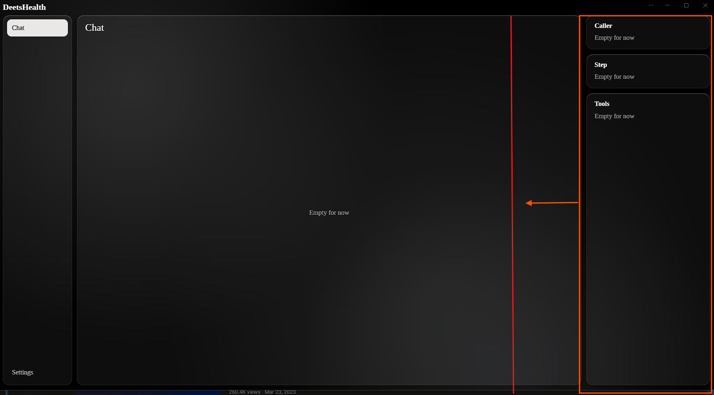

# DeetsHealth — The console

> The hospital's web console: the shell as built. The shell is DeetsMotion's (its
> `docs/ui.md`, 2026-10-29), brought into a browser page and into this project's tokens.
> What the console will show is DESIGN.md §2 C; the order of its work is BUILD-ORDER.md §3.1.
> The patient app's card engine and its other looks are in `archive/src/`
> ([archive/SURFACES-AND-CARDS.md](../archive/SURFACES-AND-CARDS.md)).

## 1. Run it
```
npm install
npm run dev           # the agent's dev server, the dev database, then Vite (1420 or the next free port)
npm run dev:web       # the console alone, with no agent
npm run build         # type check and bundle into console/dist/
```
What `npm run dev` starts, and in what order, is HANDOFF.md › Run it; the routes the page calls
are [DEV-API.md](DEV-API.md). Open the address that Vite prints in Edge, Chrome, Firefox or Safari. The front-end check is
`npm run check -- web` (the type check); `npm run check:all` also bundles.

## 2. Where it runs (fork 1A, the owner, 2026-11-11)
> **Part:** built · 2026-11-11

**Decided: in a browser only.** The console is a web page. The hospital installs nothing, and
every operating system works the same: Windows, macOS, ChromeOS, Linux.

**The browsers** (`vite.config.ts` › `build.target`): Chrome and Edge 109 or later (109 is the
last on Windows 7 and 8.1, which some hospital PCs still run), Firefox 115 or later (its
long-term release), Safari 16 or later.

**Installable as an app.** `public/manifest.webmanifest` makes the console an installable web
app (a PWA). In Edge or Chrome, the install button in the address bar puts the console in
its own window, with a taskbar or Dock icon and a Start-menu entry. Nothing else is installed:
the window runs on the hospital's own managed Edge or Chrome, under its policies.
- **The window-controls overlay.** An installed console asks for
  `window-controls-overlay`, so its top bar becomes the window's title bar, as in
  DeetsMotion. The bar drags the window; the app name and its menu stay clickable
  (`app.css` › window-controls overlay). The OS's own window buttons stay, drawn by the
  browser.
- **Hospital IT can push the install.** Edge and Chrome both have the
  `WebAppInstallForceList` policy (Group Policy or Intune): it installs the console on every
  staff PC, with no installer, no code signing and no update feed. A new deploy updates every
  window on its next load.
- **No service worker.** Nothing is cached for offline use, so the browser holds no copy of
  any page or answer. The console needs the network to work. The theme and the last page are
  the only things it keeps (`localStorage`), and neither is protected data.
- **The theme color.** `theme.ts` sets `<meta name="theme-color">` to the theme's base color,
  so the installed window's bar matches the page.

**Low load on weak PCs.** A remote desktop (Citrix, VDI) often has no GPU, so blur and
animation cost CPU.
- The backdrop's shapes move by `transform` only. They stop when the OS asks for reduced
  motion, and they pause while the tab is hidden (`main.ts` sets `data-idle`).
- When the OS asks for reduced transparency (Windows: Settings › Personalization › Colors ›
  Transparency effects off), the panels lose their blur and take the denser fill.
- Not measured yet in a remote desktop: a desk test there is open (§6).

**Later, not now.** A native app for Windows, macOS or iPhone is not built. If one is needed,
the same page can go in a thin native shell (Tauri: WebView2 on Windows, which is Edge's own
engine; WKWebView on macOS and iOS). Raise it when a hospital asks for something an installed
web app cannot do.

## 3. The shell as built
> **Part:** built · 2026-11-11

- **The top bar** (40 px, `--topbar`): the app name, bold, is the menu button, as in
  DeetsMusic and DeetsMotion. The menu has one row, *Theme ›*, which flies out the three
  themes with a swatch each and a dot on the current one. Keys: ↓ opens it, → enters the
  themes, ↑ and ↓ move, ← and Esc go back. There are no window buttons: the browser owns the
  window.
- **The nav** (168 px, `--nav-width`): text items. **Chat**, then **Analytics**, at the top;
  **Settings** is at the foot. One accent pill slides to the selected item (280 ms). ↑ and ↓ move between pages.
  The old page fades out (120 ms), then the new one fades in (220 ms). With reduced motion,
  both are instant. The last page is reopened on the next visit (`localStorage`,
  `deets.console.page`).
- **Pages** are built once, on the first visit, and kept (`pages/page.ts`).
- **Chat** (`pages/chat.ts`): DeetsMotion's Visualizer layout. A large stage panel and a rail
  of four panels. The rail takes a third of the page's width (`--stage-share` 2fr,
  `--rail-share` 1fr), and never less than 300 px (`--rail-min`) (the owner, 2026-11-11: a
  wider rail for the Timeline). The last rail panel fills to the stage's bottom edge. Below
  1100 px the rail moves under the stage. There the stage keeps 70 % of the window's height
  (`--stage-narrow`), and the rail's panels sit side by side, as many in a row as fit at
  `--rail-min` each; the Review panel takes a row of its own (the owner's sketch, 2026-11-12).
  The panels are empty. The stage is *Chat*; the rail
  is *Timeline* (the owner's, at the top), then *Caller*, *Step* and *Tools* (a draft for the
  owner).
- **Settings** (`pages/settings.ts`): one panel, the title and "No settings yet.", that fills
  the page (the owner, 2026-11-11: no eyebrow over the title).
- **Analytics** (`pages/analytics.ts`): one panel with its own nav inside it
  ([ANALYTICS.md](ANALYTICS.md)).
- **The page title** is the fixed text "DeetsHealth" (SECURITY.md §4.3).

### The look (fork 2A, the owner, 2026-11-11)
- **Three themes, DeetsMotion's:** Dark, Light (Solarized), Moonlight. With no saved choice,
  the OS's dark mode gives Dark and its light mode gives Light; nothing is saved until the user
  picks a theme. `public/prepaint.js` sets the theme before the first paint.
- **One skin, Glass.** `skin.css`'s base block is Glass. The `data-skin` attribute and the
  mechanism stay, so a second skin is one more block.
- **The tiers.** `palette.css` holds the solid paints; `themes.css` maps them to color roles
  (the Chat page's call colors, `--go` and `--stop`, and its canvas and bubbles joined on
  2026-11-12: CHAT.md); `skin.css` holds the tokens for type, layout, shape, spacing, blur and
  motion; `app.css` reads only tokens. The list and the counts are [TOKENS.md](TOKENS.md)
  (`npm run tokens`).
- **Shared helpers:** `tokens.ts` reads a duration token (`tokenMs`) and the reduced-motion
  setting (`reducedMotion`) for the nav and the Chat page (2026-11-12).
- **Glass, as in DeetsMotion:** a panel's fill, edge, highlight, shadow and blur are on its
  `::before` layer, so its text is never blurred. Panels are never transformed. Liberation
  Serif, 400 and 700, with `font-synthesis: none`; 16 px body, 14 px floor.

### Decided while building, inside the owner's choices
- The theme is saved in `localStorage` (DeetsMotion saved it through Rust, which a web page
  does not have). Key `deets.console.theme`.
- The OS light or dark mode picks the first theme (DeetsMotion always started on Dark).
- The blur radius is one skin token, 28 px, for all three themes (DeetsMotion's Light used
  24 px): a blur is geometry, so it is a skin token, not a theme role.
- The panels go solid with no blur under reduced transparency (new; DeetsMotion has no such
  rule).
- The nav has no status lines at its foot (DeetsMotion showed the hand tracker's state there;
  the console has nothing to show yet).
- The empty panels say "Empty for now".
- **The icon** (the owner's pick, 2026-11-11, after two rounds of trials): DeetsMusic's
  app icon, his head on the Skyline1 city, with the head from his standing sprite (no
  headphones), and a white H in a smooth white ring over the whole icon; the art inside the
  ring is darkened so the H reads at 16 px. `python scripts/icons.py` (Pillow) builds
  `public/icons/icon-{512,256,192,32}.png` from `console/icon-template/` (copied from
  DeetsMusic). The manifest uses 192, 256 and 512; the browser tab uses 32.
- The styles are one stylesheet linked in `<head>` (`styles/index.css`), so the first paint is
  styled; DeetsMotion imported them from its script behind a hidden window.

## 4. What moved to the archive (fork 2A)
Into `archive/src/` and `archive/` by `git mv`, so each file keeps its history:
- the six old themes and the Vanilla, Press, Ocean, Glass and Cyber skins (`styles/`, the
  ambient layers `ambient.ts` and `storm.ts`, the other fonts);
- the card engine (`cards`, `layout`, `layout-bus`, `card-grow`, `card-swap`, `card-memory`,
  `surface`) and its doc, now [archive/SURFACES-AND-CARDS.md](../archive/SURFACES-AND-CARDS.md);
- the patient-only files (`sites`, `record-cards`, `frames`, `boot-cover`, `main`, `model/`);
- **the primitives too** (`toast`, `hint`, `dropdown`, `slider`, `context-menu`, `pop`), and
  the settings card and quick panel. They import the patient-only `frames.ts` and
  `boot-cover.ts`, and their styles use the old skin's tokens. Each one comes back, in the new
  tokens, with the first console feature that needs it.
- the old `index.html` and `public/prepaint.js`.

`@tauri-apps/api` is gone from `package.json`: nothing in the build calls Tauri.
`npm run types` now writes into `archive/src/model/`, because the payloads it writes are the
patient app's cards (CONVERSION.md §5.1).

## 5. Security notes
- The page carries no protected data yet: no sign-in, no calls, no settings.
- **The Content-Security-Policy comes from the deploy's response headers**, not a `<meta>`
  tag: Vite's dev server adds inline styles that a strict meta policy would block. The
  policy (no inline script, which is why `prepaint.js` is a file) is set with the deploy
  (VOICE-AGENT.md §7.2). Not built.
- No service worker and no offline cache (§2).

## 6. Desk test
**Passed, 2026-11-11** (the owner, in Edge). His notes, built the same day: no eyebrow over
Settings, its panel fills the page; the icon; a Timeline panel at the top of the rail and a
wider rail. Steps 5–7 (install, transparency, other browsers) are still open.



1. `npm run dev`, then open the address in Edge. The page shows the top bar, the nav with Chat
   at the top and Settings at the foot, and Chat's stage with three panels on its right.
2. Click **DeetsHealth** in the top bar, point at **Theme**, and pick each theme. The colors
   change at once, the dot moves, and a reload keeps the theme.
3. Click **Settings**, then **Chat**. The pill slides, and the pages fade. Reload: the last page
   opens.
4. Make the window narrower than 1100 px. The panels move under the stage. The stage fills
   70 % of the window's height. The panels sit two to a row (Timeline beside Sandbox patients,
   Step beside Tools); narrower still, one to a row. When a call ends, Review takes its own row.
5. In Edge, use the install button in the address bar (or … › Apps › Install). The console
   opens in its own window, with the top bar as the title bar: drag it, and the window moves.
6. Turn off Windows' Transparency effects. The panels go solid.
7. Later: the same page in Chrome, Firefox and Safari, and in a remote desktop with no GPU.
