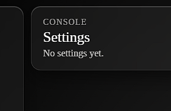

# DeetsHealth — The console

> The hospital's web console: the shell as built. The shell is DeetsMotion's (its
> `docs/ui.md`, 2026-10-29), brought into a browser page and into this project's tokens.
> What the console will show is DESIGN.md §2 C; the order of its work is BUILD-ORDER.md §3.1.
> The patient app's card engine and its other looks are in `archive/src/`
> ([archive/SURFACES-AND-CARDS.md](../archive/SURFACES-AND-CARDS.md)).

## 1. Run it
```
npm install
npm run dev           # the agent's dev server, the dev database, then Vite (1420 or the next free port)
npm run dev:web       # the console alone, with no agent
npm run build         # type check and bundle into console/dist/
```
What `npm run dev` starts, and in what order, is HANDOFF.md › Run it; the routes the page calls
are [DEV-API.md](DEV-API.md). Open the address that Vite prints in Edge, Chrome, Firefox or Safari. The front-end check is
`npm run check -- web` (the type check); `npm run check:all` also bundles.

## 2. Where it runs (fork 1A, the owner, 2026-11-11)
> **Part:** built · 2026-11-11

**Decided: in a browser only.** The console is a web page. The hospital installs nothing, and
every operating system works the same: Windows, macOS, ChromeOS, Linux.

**The browsers** (`vite.config.ts` › `build.target`): Chrome and Edge 109 or later (109 is the
last on Windows 7 and 8.1, which some hospital PCs still run), Firefox 115 or later (its
long-term release), Safari 16 or later.

**Installable as an app.** `public/manifest.webmanifest` makes the console an installable web
app (a PWA). In Edge or Chrome, the install button in the address bar puts the console in
its own window, with a taskbar or Dock icon and a Start-menu entry. Nothing else is installed:
the window runs on the hospital's own managed Edge or Chrome, under its policies.
- **The window-controls overlay.** An installed console asks for
  `window-controls-overlay`, so its top bar becomes the window's title bar, as in
  DeetsMotion. The bar drags the window; the app name and its menu stay clickable
  (`app.css` › window-controls overlay). The OS's own window buttons stay, drawn by the
  browser.
- **Hospital IT can push the install.** Edge and Chrome both have the
  `WebAppInstallForceList` policy (Group Policy or Intune): it installs the console on every
  staff PC, with no installer, no code signing and no update feed. A new deploy updates every
  window on its next load.
- **No service worker.** Nothing is cached for offline use, so the browser holds no copy of
  any page or answer. The console needs the network to work. The theme and the last page are
  the only things it keeps (`localStorage`), and neither is protected data.
- **The theme color.** `theme.ts` sets `<meta name="theme-color">` to the theme's base color,
  so the installed window's bar matches the page.

**Low load on weak PCs.** A remote desktop (Citrix, VDI) often has no GPU, so blur and
animation cost CPU.
- The backdrop's shapes move by `transform` only. They stop when the OS asks for reduced
  motion, and they pause while the tab is hidden (`main.ts` sets `data-idle`).
- When the OS asks for reduced transparency (Windows: Settings › Personalization › Colors ›
  Transparency effects off), the panels lose their blur and take the denser fill.
- Not measured yet in a remote desktop: a desk test there is open (§6).

**Later, not now.** A native app for Windows, macOS or iPhone is not built. If one is needed,
the same page can go in a thin native shell (Tauri: WebView2 on Windows, which is Edge's own
engine; WKWebView on macOS and iOS). Raise it when a hospital asks for something an installed
web app cannot do.

## 3. The shell as built
> **Part:** built · 2026-11-11

- **The top bar** (40 px, `--topbar`): the app name, bold, is the menu button, as in
  DeetsMusic and DeetsMotion. The menu has one row, *Theme ›*, which flies out the three
  themes with a swatch each and a dot on the current one. Keys: ↓ opens it, → enters the
  themes, ↑ and ↓ move, ← and Esc go back. There are no window buttons: the browser owns the
  window.
- **The nav** (168 px, `--nav-width`): text items. **Chat**, **Analytics**, **Teams** and
  **Config**, in that order, at the top; **Security**, **Audit Logs** and **Settings**, in that
  order, at the foot (the owner, 2026-11-12 and 2026-11-13). One accent pill slides to the selected item (280 ms). ↑ and ↓ move between pages.
  The old page fades out (120 ms), then the new one fades in (220 ms). With reduced motion,
  both are instant. The last page is reopened on the next visit (`localStorage`,
  `deets.console.page`).
- **Pages** are built once, on the first visit, and kept (`pages/page.ts`).
- **Chat** (`pages/chat.ts`): DeetsMotion's Visualizer layout. A large stage panel and a rail
  of four panels. The rail takes a third of the page's width (`--stage-share` 2fr,
  `--rail-share` 1fr), and never less than 300 px (`--rail-min`) (the owner, 2026-11-11: a
  wider rail for the Timeline). The last rail panel fills to the stage's bottom edge. Below
  1100 px the rail moves under the stage. There the stage keeps 70 % of the window's height
  (`--stage-narrow`), and the rail's panels sit side by side, as many in a row as fit at
  `--rail-min` each; the Review panel takes a row of its own (the owner's sketch, 2026-11-12).
  The panels are empty. The stage is *Chat*; the rail
  is *Timeline* (the owner's, at the top), then *Caller*, *Step* and *Tools* (a draft for the
  owner).
- **Teams**, **Config**, **Security**, **Audit Logs** and **Settings** (`pages/teams.ts`,
  `pages/config.ts`, `pages/security.ts`, `pages/audit.ts`, `pages/settings.ts`): each is one panel with its own nav, the same as Analytics
  (`pages/subnav.ts`; [ANALYTICS.md](ANALYTICS.md) §2). The head is the title alone. Each view
  says "Empty for now". The last view is reopened on the next visit (`localStorage`,
  `deets.console.<page>`). The nav items, in order (the owner, 2026-11-13):
  - Teams: **Org Chart**, **People**.
  - Config: **Agent**, **System**, **Cartesia** (§7).
  - Security: **Auth**, **Roles**.
  - Audit Logs: **Config**, **Calls**, **Security**.
  - Settings: **Personalization** (its first item). Settings had one panel with "No settings
    yet." until 2026-11-13; with it went `pageHead` and the `.page-head` styles.
- **Analytics** (`pages/analytics.ts`): one panel with its own nav inside it
  ([ANALYTICS.md](ANALYTICS.md)).
- **A page with its own nav** (`pages/subnav.ts`, `styles/subnav.css`; 2026-11-13): the one
  module behind Analytics, Teams, Config, Security, Audit Logs and Settings. A page gives only its title,
  its `localStorage` key and its views (`subnavPage`); an empty view is `blankView`. The module
  draws one glass panel: the title alone in its head, then the page's own nav at the left and
  the chosen view beside it. The page's nav is a panel stacked on the page panel, in the chat
  canvas's look (`--canvas`), as wide as the big nav (`--subnav-width`). Its items, pill, keys
  and view swap work like the big nav's. Each view is built once, on its first visit, and kept.
  A new page with its own nav is one file and one line in `main.ts`.
- **The page title** is the fixed text "DeetsHealth" (SECURITY.md §4.3).

### The look (fork 2A, the owner, 2026-11-11)
- **Three themes, DeetsMotion's:** Dark, Light (Solarized), Moonlight. With no saved choice,
  the OS's dark mode gives Dark and its light mode gives Light; nothing is saved until the user
  picks a theme. `public/prepaint.js` sets the theme before the first paint.
- **One skin, Glass.** `skin.css`'s base block is Glass. The `data-skin` attribute and the
  mechanism stay, so a second skin is one more block.
- **The tiers.** `palette.css` holds the solid paints; `themes.css` maps them to color roles
  (the Chat page's call colors, `--go` and `--stop`, and its canvas and bubbles joined on
  2026-11-12: CHAT.md); `skin.css` holds the tokens for type, layout, shape, spacing, blur and
  motion; `app.css` reads only tokens. The list and the counts are [TOKENS.md](TOKENS.md)
  (`npm run tokens`).
- **Shared helpers:** `tokens.ts` reads a duration token (`tokenMs`) and the reduced-motion
  setting (`reducedMotion`) for the nav and the Chat page (2026-11-12).
- **Shape and spacing tokens, as of 2026-11-13** (the full list is [TOKENS.md](TOKENS.md)):
  - **One radius, a trial** (the owner, 2026-11-13: "the same 16 px radius for everything").
    `--radius-small` (a menu, the help card), `--radius-item` (a nav item and its pill, every
    control) and `--radius-bubble` (a chat bubble) all point at `--radius`, 16 px, the panels'
    radius. Before the trial: 10, 11 and 14 px. To end the trial, set those three back.
  - `--radius-control` stays 6 px: the short rows (a menu row, the app-name button, the Step
    panel's rows and marks), where 16 px would turn a row into a pill.
  - `--pad-panel` is now two tokens, `--pad-panel-y` (16 px) and `--pad-panel-x` (20 px), and
    `--pad-panel` is made of them. Its value is the same. The Chat page uses the halves to put
    its title, canvas and bar on the same edges as every other page's title (CHAT.md §3).
- **Scrollbars: our own, not the system's** (the owner, 2026-11-13, "so we can pull for
  future pages"; desk test passed 2026-11-13 on the Chat page). A page opts in with one class, `own-scrollbars`, on its root
  (`<section class="page own-scrollbars">`); every scroll box inside it then gets them. The
  Chat page is the first; to give another page them, add the class there. The parts:
  - **The rule:** `app.css` › `.own-scrollbars`. No track, no arrows, a rounded thumb that
    darkens under the pointer.
  - **The tokens:** skin `--scrollbar-size` (10 px, the gutter) and `--scrollbar-inset` (3 px
    of clear space around the thumb, so the thumb is 4 px wide); color roles
    `--scrollbar-thumb` (`--press`) and `--scrollbar-thumb-hover` (`--text-3`), made of other
    roles, so each theme gets its own.
  - **The browsers:** Chromium (Chrome, Edge) and Safari draw the `::-webkit-scrollbar` parts.
    Firefox has none, so it gets the standard thin bar in the same colors
    (`scrollbar-width`, `scrollbar-color`).
  - **A strip that must never show a bar** (the Chat rail's tab bar) sets
    `scrollbar-width: none` on itself; that wins over the class.
- **Glass, as in DeetsMotion:** a panel's fill, edge, highlight, shadow and blur are on its
  `::before` layer, so its text is never blurred. Panels are never transformed. Liberation
  Serif, 400 and 700, with `font-synthesis: none`; 16 px body, 14 px floor.

### Decided while building, inside the owner's choices
- The theme is saved in `localStorage` (DeetsMotion saved it through Rust, which a web page
  does not have). Key `deets.console.theme`.
- The OS light or dark mode picks the first theme (DeetsMotion always started on Dark).
- The blur radius is one skin token, 28 px, for all three themes (DeetsMotion's Light used
  24 px): a blur is geometry, so it is a skin token, not a theme role.
- The panels go solid with no blur under reduced transparency (new; DeetsMotion has no such
  rule).
- The nav has no status lines at its foot (DeetsMotion showed the hand tracker's state there;
  the console has nothing to show yet).
- The empty panels say "Empty for now".
- **The icon** (the owner's pick, 2026-11-11, after two rounds of trials): DeetsMusic's
  app icon, his head on the Skyline1 city, with the head from his standing sprite (no
  headphones), and a white H in a smooth white ring over the whole icon; the art inside the
  ring is darkened so the H reads at 16 px. `python scripts/icons.py` (Pillow) builds
  `public/icons/icon-{512,256,192,32}.png` from `console/icon-template/` (copied from
  DeetsMusic). The manifest uses 192, 256 and 512; the browser tab uses 32.
- The styles are one stylesheet linked in `<head>` (`styles/index.css`), so the first paint is
  styled; DeetsMotion imported them from its script behind a hidden window.

## 4. What moved to the archive (fork 2A)
Into `archive/src/` and `archive/` by `git mv`, so each file keeps its history:
- the six old themes and the Vanilla, Press, Ocean, Glass and Cyber skins (`styles/`, the
  ambient layers `ambient.ts` and `storm.ts`, the other fonts);
- the card engine (`cards`, `layout`, `layout-bus`, `card-grow`, `card-swap`, `card-memory`,
  `surface`) and its doc, now [archive/SURFACES-AND-CARDS.md](../archive/SURFACES-AND-CARDS.md);
- the patient-only files (`sites`, `record-cards`, `frames`, `boot-cover`, `main`, `model/`);
- **the primitives too** (`toast`, `hint`, `dropdown`, `slider`, `context-menu`, `pop`), and
  the settings card and quick panel. They import the patient-only `frames.ts` and
  `boot-cover.ts`, and their styles use the old skin's tokens. Each one comes back, in the new
  tokens, with the first console feature that needs it.
- the old `index.html` and `public/prepaint.js`.

`@tauri-apps/api` is gone from `package.json`: nothing in the build calls Tauri.
`npm run types` now writes into `archive/src/model/`, because the payloads it writes are the
patient app's cards (CONVERSION.md §5.1).

## 5. Security notes
- The page carries no protected data yet: no sign-in, no calls, no settings.
- **The Content-Security-Policy comes from the deploy's response headers**, not a `<meta>`
  tag: Vite's dev server adds inline styles that a strict meta policy would block. The
  policy (no inline script, which is why `prepaint.js` is a file) is set with the deploy
  (VOICE-AGENT.md §7.2). Not built.
- No service worker and no offline cache (§2).

## 6. Desk test
**Passed, 2026-11-11** (the owner, in Edge). His notes, built the same day: no eyebrow over
Settings, its panel fills the page; the icon; a Timeline panel at the top of the rail and a
wider rail. Steps 5–7 (install, transparency, other browsers) are still open.



1. `npm run dev`, then open the address in Edge. The page shows the top bar, the nav (Chat,
   Analytics, Teams and Config at the top; Security, Audit Logs and Settings at the foot), and
   Chat's stage with its panels on its right.
2. Click **DeetsHealth** in the top bar, point at **Theme**, and pick each theme. The colors
   change at once, the dot moves, and a reload keeps the theme.
3. Click **Settings**, then **Chat**. The pill slides, and the pages fade. Reload: the last page
   opens.
4. Make the window narrower than 1100 px. The panels move under the stage. The stage fills
   70 % of the window's height. The panels sit two to a row (Timeline beside Sandbox patients,
   Step beside Tools); narrower still, one to a row. When a call ends, Review takes its own row.
5. In Edge, use the install button in the address bar (or … › Apps › Install). The console
   opens in its own window, with the top bar as the title bar: drag it, and the window moves.
6. Turn off Windows' Transparency effects. The panels go solid.
7. Later: the same page in Chrome, Firefox and Safari, and in a remote desktop with no GPU.

### The 2026-11-13 additions
> **Part:** built · 2026-11-13 — desk test open.

1. The nav reads Chat, Analytics, Teams, Config at the top, and Security, Audit Logs, Settings
   at the foot.
2. Click **Teams**, **Config**, **Security**, **Audit Logs** and **Settings** in turn. Each shows one panel:
   the title alone, then its own nav at the left (Org Chart, People · Agent, System · Auth,
   Roles · Config, Calls, Security · Personalization). The first item is chosen; the view says "Empty for now".
3. On one of them, click the second item. The pill slides and the view fades. Press ↑ and ↓:
   the choice moves. Reload: the same item is chosen.
4. Analytics looks and works as before, with no line under its title.
5. The radius trial: the toggles, Play / Stop, the picker, the text box, the bubbles, the nav
   pill, the theme menu and the help card all have 16 px corners, as the panels do. Decide if
   it stays.

## 7. Config › Cartesia
> **Part:** built · 2026-11-13 · desk test open — the owner, 2026-11-13: "a subpage under config
> dedicated to Cartesia settings and items … At the top of the subpage, let's do a tabbar of
> 'Read' and 'Edit' … On read mode, everything can be grayed out." Then the versions and the
> settings store: "Set it up please, I'll desk test in the morning." Every lever: CARTESIA.md §9.

### 7.1 The view as built (`pages/cartesia.ts`, `styles/config.css`)


- **Config's third item, Cartesia**, after Agent and System.
- **The top row** (the owner, 2026-11-13: "align the buttons in the title bar"): a **Read | Edit**
  tab bar (the Chat page's pair bars, `--pair-part`); the **versions** dropdown right of it; a
  status line that is empty unless a save says something; **Discard | Save** as one tab bar,
  always shown (each greys when it has nothing to do; Save, when it can save, wears the chosen
  part's colors). All three are `--control-height` tall with the tab bar's frame. The view opens
  on Read each time. No line of help (the owner: "it's clear to a healthcare analyst").
- **The versions** (the owner, 2026-11-13: "a version as determined by date + version of the day
  … 11-12 | 1 for the first today, 11-12 | 2 for the second"): newest first; the one the agent
  runs with reads **Active | [MM-DD | n]** ("for clarity's sake"), every other **MM-DD | n** (the
  day's date on the database's clock, and its number that day). Its hint gives when it was saved.
  The dropdown is `--cfg-version` wide: room for "Active | [MM-DD | VVV]".
  - **Default** (the owner: "The 'Default' can be a version, the first ever in the dropdown for
    every new implementation, but it's still a version"): number 0, the code's defaults, always
    listed last. The dev server makes it the first time the page asks (`ensure_default`), and
    it is active until the first save ("Active | [Default]"). There is never a state with no
    Active version. A store that had saves before its Default (the owner's dev database) gets one
    too, listed last and not active.
  - Without Postgres: "No settings store", disabled, and Save is off with a hint to start
    Postgres.
  - **An older version** shows read only (Edit is off, with the hint "Choose Active to edit"),
    and each row whose value differs from the active one glows (the owner: "a gentle glow"): a
    soft wash and glow of the accent that fades in (`--glow-fill`, `--glow-strength`,
    `--glow-blur`), on a layer centred on the row's content (`--glow-pad` past it on every side;
    the owner: it "looks too offset vertically"). The turn profile glows with any turn value;
    Plan credits with the offset.
  - **Save** (Edit, on Active, with a change): the whole set becomes a new version, the active
    one, and the page goes back to Read on it, with "Saved as MM-DD | n. Active from the next
    call". A refusal shows "Not saved: …" with the setting it names.
- **Read:** every control greyed (`--disabled-opacity`) and disabled. The "i" buttons still open.
- **Each row** (the owner, 2026-11-13: "remove all the subtitle text … add an info icon 'i' in a
  rounded square in the left most column before every setting"): the "i" (`--info-size`), the
  setting's name, its control. A press on the "i" opens the setting's help under the name (its
  edge takes the accent); a second press closes it. It rolls down and back up with a fade, over
  `--dur-collapse` (the Chat page's help card's collapse; the owner, 2026-11-13), instant with
  reduced motion. The help words are `HELP` in
  `cartesia.ts`. The "i" is the letter itself, lower case, in the console's serif face
  (Liberation Serif) at body size (the owner, 2026-11-13: "after a lower case classical serif
  font"); its left edge sits on the card's text edge, under the card's title.
- **Edit:** the controls open. A change stays on the page until Save. Discard puts every value
  back. Choosing another version drops changes not saved. Edits made
  in Edit stay when you go back to Read, greyed.
- **The cards** (in a canvas: `.cfg-frame` draws the edge and clips; `.cfg-scroll` inside it
  scrolls, and its scrollbar's track stops a radius short of each end, so the thumb stays inside
  the rounded corners; the owner, 2026-11-13: "the scrollbar is leaving the panel"):
  - **Model first in each card** (the owner, 2026-11-13).
  - **Voice (Sonic):** Model (`sonic-3.6`, shown only); Voice (Cartesia's 10 stable voices for
    agents; Listen shows, disabled: not built); Speed and Volume (sliders); Emotion (Cartesia's
    default, or one of five); Number reading (Auto, Off); Pronunciations (a table).
  - **Hearing (Ink)**, every row open (the owner, 2026-11-13: no "Advanced" fold), in the order a
    turn happens: Model (`ink-2`, shown only); Turn profile; Start of a turn; End of a turn;
    Longest wait (ms); Early end of turn (Off | On) with Early end guess under it, the value it
    uses; Barge-in (Off | On); Keyterms (a table).
  - **The turn profile moves the sliders.** Cartesia's docs: a profile is not an API parameter,
    only a named set of the four turn values (CARTESIA.md §9). So choosing Balanced (Cartesia's
    default), Responsive or Patient sets the four sliders to its values; moving any slider makes
    the profile read the one the four now match, or Custom. Custom is shown, never chosen. The
    draft holds only the four values; the profile is worked out from them.
  - **Rows are one height:** each control is at least `--field-height`, and the Off | On bars
    are a field's height.
  - **Test-call guard:** Silence (s) and Longest call (s).
  - **Usage** (the owner, 2026-11-13: "a box … where I can set a manual offset", and "Credits
    Left" as plan credits − offset − usage): Plan credits, then "−" and an Offset box on the same
    row; Cycle day; **Credits left**, in the page's normal type (the owner, 2026-11-13: a larger
    figure belongs on Analytics, not Settings): the plan's credits, less the offset, less what
    this cycle's voice calls used (`/agent/resources`). It updates as you type.
  - **Key and facts:** the API key ("Set", or "Not set: add CARTESIA_API_KEY to .env"; never the
    key), the API version, the rates.
- **The sliders** (the owner, 2026-11-13: the bar changed size, and in place of the Default
  button "a vertical line where 1.0 / the default is"): our own track and thumb
  (`--track-height`, `--thumb-size`); a line at Cartesia's default, under the thumb's centre
  there and taller than the thumb (`--mark-height`), so it still shows above and below the
  thumb when the thumb sits on it; the value beside it as a number only, in a fixed width
  (`--cfg-value`). Sliding back onto the line returns the setting to Cartesia's default. On the
  default, the thumb is centred on the line both ways: the track's edge is an inset shadow, not
  a border, because a border moves the thumb's travel in by its width (the owner, 2026-11-13).
- **The tables** (the owner, 2026-11-13: "move the active list into a structured table below the
  text boxes"): the add row first (one box per column, then Add; Enter adds too), the entries
  under it as a table with a header row and Remove at each row's end. No table while it is
  empty.
- **The data:** `GET /agent/cartesia` (DEV-API.md §2): every value the next call runs with, and
  each lever's range and Cartesia's default, from the constants `voice.py` uses
  (`config.py`). A null value is "Cartesia's default": the agent sends nothing for it.
- **The layout** (the owner, 2026-11-13: rows "wider than they need to be"; then option A, "hearing
  and voice can be the two columns and their relevant settings below them"): each card is as
  wide as its rows, which are fixed columns: the "i", the name (`--cfg-label`, 168 px) and the
  control (`--cfg-control`, 320 px), so no field or slider stretches. One card is 582 px.
  - **Two columns** when the view has room for two cards (1,176 px, a container query on the
    view's own width): Voice | Hearing; the test-call guard under Hearing (silence is what Ink
    hears); then Usage | Key and facts.
  - **One column** below that, in the order Voice, Hearing, guard, Usage, Key and facts.
  - **Narrower than one card:** the cards fill the width, and each row puts its control under
    its name.
  - **Selects** (the owner, 2026-11-13: the dropdowns ran past the card when narrow; "they only
    need to be wide enough to contain the widest option"): each select is as wide as its
    longest option, not the control column. In a card narrower than that, it shrinks to the
    card and ends its words with "…". No field, number or fixed value is wider than its card.
    Both Config pages. The cards keep their width: the sliders and the tables set it.
  - The container query cannot read tokens, so `config.css` writes the sum out and names the
    tokens it comes from.
- **Tokens:** `--field-height`, `--cfg-label`, `--cfg-control`, `--cfg-number`, `--cfg-value`,
  `--info-size`, `--help-max`, `--thumb-size`, `--track-height`, `--mark-height` (new), with `--pair-part`,
  `--disabled-opacity` and the color roles.

### 7.2 Decided inside his choices (for his review)
- The cards' order and titles; every lever's name and its help text (`HELP` in `cartesia.ts`).
- Read each time the view opens; edits kept on the page when you switch back to Read.
- Booleans as Off | On bars, the same as Read | Edit; numbers with a range as sliders.
- A slider within half a step of the default counts as the default.
- One help open per press, several may be open at once; help opens in Read too.
- The Hearing order: start, end, longest wait, then the early switch with its guess, then
  barge-in and keyterms.
- The profile select's words: "Balanced (Cartesia's default)", "Responsive", "Patient",
  "Custom".
- A voice outside the 10 with ids in Cartesia's docs gets its id from Cartesia's voice list by
  name when saved (no credits; it needs the key).
- The offset is one number for the cycle, with no note; Credits left may go below zero.
- The versions' words: "Active | [MM-DD | n]", "MM-DD | n", "Default", "No settings store". The Default is made by the dev server on first view, by "default".
- Save returns the page to Read on the new Active version.
- An older version cannot be made Active again from the page yet: edit Active to match it and
  save (a new version). A "Make active" button is a small follow-up.

### 7.3 The settings store (as built, 2026-11-13)
> **Part:** built · 2026-11-13 · desk test open. The design before it was a change table per
> setting; the build keeps whole versions instead, which answers the same question exactly.

- **One key–value table per service** (the owner, 2026-11-13: "A per service as we continue
  (Core model provider, Voice model provider, etc)"): `settings_voice` today; `settings_llm` and
  others join the same way. Each row: a version, a setting's name, its value (JSON).
- **Whole versions:** a save sends every setting of the service, once each, and they become one
  new version (`setting_versions`: the service, the day, its number that day, when, who). So a
  version is the exact set the agent ran with.
- **Exactly which value was live, and when** (the owner's question): `setting_activations` gets one
  row each time a version becomes the active one, with when and who. The active version is the
  newest row; the value live at any moment is in the version of the last activation before it.
- **Insert-only:** a trigger on all three tables refuses every UPDATE, DELETE and TRUNCATE
  (`ehr/migrations/0002_settings.sql`). The history can only grow.
- **Checked in Rust:** `ehr/src/settings.rs › VOICE` lists every setting and what it may hold
  (each range is Cartesia's; the same as `config.py`'s for the page). `ehr` refuses a set with a
  setting missing, given twice, unknown, out of range or the wrong kind, and names the setting,
  never its value. A test (`test_the_voice_defaults_name_every_setting_ehr_checks`) fails if
  the agent's defaults and `VOICE` list different settings.
- **The path:** the page → the dev server (`GET`/`POST /agent/cartesia`, DEV-API.md §2) →
  `ehr`'s `ListSettingVersions`, `GetSettings`, `SaveSettings` (EHR-SERVICE.md §3) → Postgres. The
  console never opens the database (DATABASE.md §1).
- **The agent reads the active version** when a voice call starts (`dev_server.py ›
  active_voice_settings`), so a save applies to the next call, never the one in progress. Every
  lever is applied (`voice.py › build_stt`, `build_tts`, `VoiceMeter`) except the
  pronunciations: they are stored, and need a Cartesia pronunciation dictionary before Sonic can
  use them (§7.6). The Resources tab and Credits left take the plan's credits, the offset and the
  cycle day from it. Without Postgres, or before a save, the code's defaults apply.
- **Not yet:** the usage columns on `calls`; the `audit` row for each save (the activation row
  records who and when meanwhile); staff ids in place of "dev".

### 7.6 Open
- **Pronunciations:** make or update a Cartesia pronunciation dictionary from the saved table,
  and send its id with Sonic.
- **Make active:** restore an older version as a new activation.
- **Listen:** Cartesia's voice list can give each voice's preview file, which plays with no
  credits; the dev server would fetch it, so the page loads no remote file.

**Levers Pipecat or Cartesia take that the page does not show** (a review, 2026-11-13; each
needs the owner's fork before it is built; CARTESIA.md §9 has the full lever list):
- **Text aggregation, Sentence | Token** (Pipecat's `text_aggregation_mode`). Token mode starts
  Sonic on each token, not each whole sentence: about 200–300 ms sooner a sentence (Pipecat's
  note). The largest latency lever not on the page.
- **Text transforms** (Pipecat's `text_transforms`, find and replace before the text reaches
  Sonic). They could carry the Pronunciations table now, with no Cartesia dictionary. That
  removes the open question of whether ZDR covers the dictionary (CARTESIA.md §7), and the same
  table works with any voice vendor (ElevenLabs, the fallback).
- **Emotion: five of more than 60.** Pipecat's docs say Sonic 3 takes over 60 emotions, best
  with the voices Leo, Jace, Kyle, Gavin, Maya, Tessa, Dana and Marian. None of them is on our
  list of 10 voices for agents, so an emotion may do little on Skylar. Test before more words go
  on the list.
- **Language and accent** (Sonic): fixed to English. Ink-2 detects the language, but Pipecat
  labels every line English. A row only after Spanish is tested on phone audio (DESIGN.md C8).
- **Number reading by locale:** the page has Auto and Off; Cartesia also takes a locale
  (`en-US`, `en-GB`), which reads numbers that way whatever language is spoken.
- **`watchdog_min_timeout`** (0.5 s): dev only; no row needed.

### 7.4 The API key, for a hospital
The key never goes into the console or the database (SECURITY.md §4.6). Who sets it up depends on
who holds the Cartesia contract:
- **We hold it** (likely in A2, our cloud): we make one key for each hospital, so each one's use
  shows apart, and put it in that hospital's secret manager, in its own cloud account. Only the
  agent's role may read it. The hospital does nothing.
- **The hospital holds its own contract and BAA** (likely in B, its own cloud account): its admin
  makes the key in Cartesia and stores it in its own secret manager under the name our deploy
  reads. We give them a short runbook (CLOUD.md, when the deploy is built) and a deploy step that
  makes the empty secret and the read permission.
- **On the page, in both:** "Key set", when the agent last read it, when it was last rotated, and
  later a "Test the key" button that makes a call costing no credits. Never the key.
- A write-only field that sends a key straight to the secret manager is possible, but it lets
  the console's server write secrets; it stays an idea.
- To find out: whether Cartesia offers one organization with a key and usage per hospital.

### 7.5 Desk test
**First:** stop the dev server (Ctrl+C) and start it again with `npm run dev`. It builds the new
`ehr` and runs the settings migration in the dev database.

**The versions and the store:**
- A. Config, Cartesia. The dropdown reads "Active | [11-13 | 1]" (your save of 2026-11-13), and
  "Default" sits last in its list. Read | Edit, the dropdown and Discard | Save are one height,
  their tops in line; Discard and Save show, both grey. No help line.
- B. Press Edit, set Offset to 270: Discard and Save light. Press Save. The page goes to Read;
  the status says "Saved as MM-DD | n. Active from the next call"; the dropdown reads
  "Active | [MM-DD | n]".
- C. Choose the version before it: it shows read only, Edit is off, and the Plan credits row
  glows, the glow centred on the row. Choose "Default": the Voice row glows too (Gemma against
  Skylar). Choose Active again: no glow, and Edit is back.
- D. On a new database (or another machine), the first view shows "Active | [Default]".
- E. Chat, Resources: the credits left are 270 lower.
- F. Optional, with Postgres stopped (`npm run db:stop`, then restart `npm run dev`): the
  dropdown says "No settings store" and Save is off.

**The page:**
1. Config, Cartesia. The top shows Read | Edit on Read, and every control is
   grey. No line sits under any setting's name.
2. Press an "i": its help opens under the name, and its edge takes the accent. Press it again:
   it closes. This works in Read.
3. Press Edit. Move Speed: the value beside it changes, and the track keeps its size. Slide back
   onto the line at 1.00: the line shows above and below the thumb. Discard showed after the
   move and went when you slid back. Each "i" is a serif lower-case letter, its left edge under
   the card title's.
4. Add a keyterm (type it, press Add or Enter): a table appears under the box with a header and
   the entry, with Remove. Remove it: the table goes.
5. Usage: type 20000 in Plan credits and 270 in Offset. Credits left, in normal type, shows
   19,730 and updates as you type.
6. Discard: every value goes back. Press Read: all grey again; Save is off in Read.
7. Widen the window: with room for two cards, Voice and Hearing sit side
   by side, the test-call guard under Hearing, then Usage and Key and facts. Narrow it: one
   column. No field or slider stretches past its column.

### 7.7 The owner's screenshots (2026-11-13), in the order of his notes
Kept so the reason for each change stays with it. Each one is what he saw before the change.


## 8. Config › Anthropic
> **Part:** built · 2026-11-13 · desk test passed 2026-11-13 (wide screens; narrow screens to redo, §8.4) — the owner, 2026-11-13: "Let's chat a new config
> subpage for 'Anthropic'", then option A: the page chooses the model. Every lever and how it
> reaches the request: ANTHROPIC.md §4.1.

### 8.1 The view as built (`pages/anthropic.ts`)
- **Config's fourth item, Anthropic**, after Cartesia.
- **The same frame as Cartesia** (§7.1): Read | Edit, the versions dropdown ("Active |
  [MM-DD | n]", Default last), Discard | Save, an "i" on each row, an older version read only
  with its changed rows glowing, two columns when there is room. The shared parts are one file,
  `pages/config-kit.ts`, moved out of `cartesia.ts` with no change of behavior; each view gives
  its values, help words and cards.
- **The cards:**
  - **Model:** Model (Haiku 5.5, Sonnet 5.5, Opus 5.5); Effort (Low, Medium, High, Extra high,
    Max; the model's own default is marked); Thinking (Off | On).
  - **Reply and cache:** Max tokens (256–16,000); Retry cap (256–32,000, at least Max tokens);
    Cache life (5 minutes, Anthropic's default; or 1 hour).
  - **Usage:** Budget ($), then "−" and an Offset ($, to the cent) on the same row; Cycle day;
    **Dollars left**: the budget, less the offset, less what this cycle's call records spent.
  - **Key and facts:** the API key ("Set", or "Not set: add ANTHROPIC_API_KEY to .env"; never
    the key); Region ("US only (1.1× price)"); Features ("Generally available only"); Rates for
    the chosen model ("In: $0.10 | Out: $0.50 | Cache read: $0.01 per 1M tokens", in the form of
    Cartesia's Rates row).
- **The model decides what else is allowed.** Thinking Off is greyed, with the reason on hover,
  when the model cannot turn it off (Opus 5.5) or the effort is above High. Choosing such a model
  or effort turns thinking back on. The cards are drawn again, so Effort marks the new model's
  default and Rates show its prices. `ehr` checks the same rules on save (`settings.rs ›
  coherent`), so a set the API would refuse is never stored.
- **The layout:** Model | Reply and cache, then Usage | Key and facts; one column when narrow
  (`config.css › .cfg-body[data-layout="anthropic"]`).
- **The data:** `GET`/`POST /agent/anthropic` (DEV-API.md §2). The spend is `resources.py ›
  anthropic_cycle`: the `cost_usd` of each call record this cycle, plus the live call's. Like
  Cartesia's count, a floor: it cannot see requests outside these records.

### 8.2 Decided inside his choice (for his review)
- The cards' names and order; every row's name and help (`HELP` in `anthropic.ts`).
- Thinking as Off | On. "On" sends no thinking field (adaptive, the model's default); "Off"
  sends `disabled` on Haiku and `between_tools` on Sonnet (ANTHROPIC.md §4.1).
- A model or effort that forbids thinking off turns it on, rather than refusing the choice.
- The budget's Default: $100 a month (his API budget), cycle day 1; `ANTHROPIC_BUDGET_USD` and
  `ANTHROPIC_CYCLE_DAY` in `.env` set others. The offset is in dollars and cents.
- Region and Features are facts, not settings: US-only inference is ANTHROPIC.md §2's rule
  (it costs 1.1×), and GA-only is `llm.py`'s rule (betas are outside the BAA).
- No "caching off" switch and no pre-warm row: caching off only adds cost and latency; pre-warm
  is not built (§8.4).
- **What the page changes:** test calls from the Chat page only, from the next call. The tests
  and the typed harness always run with the code's values, so the recorded replies stay valid.
  The code's values make the same requests as before: no thinking field, no cache life field.

### 8.3 The store and the agent (as built, 2026-11-13)
- **A second service, `llm`**, in the same store (§7.3): `ehr/migrations/0004_settings_llm.sql`
  adds `settings_llm` (insert-only) and lets the version and activation tables name `llm`.
  `ehr/src/settings.rs › LLM` lists the nine settings; `coherent` checks thinking against the
  model and effort, and the retry cap against the first cap.
- **The dev server** (`dev_server.py`): the settings helpers now take a service (`active_settings`,
  `ensure_default`, `settings_view`, `save_settings`), so the voice and llm views share them. A
  test call reads the active llm settings once, when it starts: `build_llm(values=…)` sets the
  model, effort, max tokens, the retry cap, the cache life and thinking; the call's record opens
  with that model.
- **US-only inference is now sent** on every live request (`llm.py`, `inference_geo: "us"`). It
  is added after the request's key is made, so the recorded replies still match.
- **The record (schema 8):** `call_start` carries `llm` (effort, thinking, the caps, the cache
  life) and `inference_geo`. `cost_usd` now uses each model's own prices and cache read price
  (`call_record.py › cost_usd`), 1.25× or 2× for a cache write by the cache's life, and 1.1× for
  US-only inference. Records before schema 8 keep the cost they were written with.

### 8.4 Open
- **The desk test on narrow screens** (the owner, 2026-11-13: "we'll have to redo it for
  narrower screens"): §8.5 step 9, on both Config pages.
- **Pre-warm the cache** before the caller's first turn (`max_tokens: 0`, ANTHROPIC.md §4): not
  built. A row when it is.
- **`strict: true` on each tool** (ANTHROPIC.md §4): not set yet. It changes every request, so
  every recorded reply must be recorded again; the cost is to be counted and quoted first. A
  separate change.
- **Make active**, as for Cartesia (§7.6).
- **Per-message effort** (a cheaper effort for some steps of the call) is a beta: off while betas
  are outside the BAA.

### 8.5 Desk test
**First:** stop the dev server (Ctrl+C) and start it again with `npm run dev`. It builds the new
`ehr` and runs migration 0004.

1. Config, Anthropic. The dropdown reads "Active | [Default]". Model reads Haiku 5.5, Effort
   Low, Thinking On, Max tokens 1200, Retry cap 2400, Cache life 5 minutes, Budget 100, Offset
   0.00, Cycle day 1. Rates read "In: $0.10 | Out: $0.50 | Cache read: $0.01 per 1M tokens".
2. Dollars left shows $100.00 less this cycle's test calls (a few cents).
3. Press Edit. Choose Opus 5.5: Rates change to Opus's prices, Effort marks "Medium (Opus 5.5's
   default)", and Thinking's Off is grey (hover: "Opus 5.5 cannot turn thinking off").
4. Choose Sonnet 5.5, Effort High, Thinking Off. Then choose Effort Max: Thinking goes back to
   On, and Off is grey ("Off needs effort High or below").
5. Choose Haiku 5.5, Effort Low, Thinking Off. Press Save: "Saved as 11-13 | 1. Active from the
   next call".
6. Chat, Test, one typed call: it works, and its first reply comes sooner. In the catalog, the
   call's model is Haiku 5.5. (If the call fails at once, US-only inference may be refused for
   this account: tell me the error line.)
7. Back in Config, Anthropic: choose "Default" in the dropdown. Thinking's row glows. Choose
   Active again, Edit, Thinking On, Save: the next call thinks again.
8. Config, Cartesia: everything works as before (the shared frame moved to `config-kit.ts`).
9. On both pages, each dropdown is only as wide as its longest option. Narrow the window to one
   thin column: no dropdown or number box runs past its card's edge.

## 9. Config › Agent
> **Part:** built · 2026-11-13 · desk test open — the owner, 2026-11-13: "have the agent subpage
> contain our agent prompt segments", five tabs of sections, and a Semantic | Flow bar. The
> design before it: PROMPT-EDITOR.md.

### 9.1 The view as built (`pages/agent.ts`)
> The owner's first look (2026-11-13): "visually cluttered", Semantic "a lot better for
> reference but could be improved", the cost should be real. Then his forks: plain text in Read
> with an animated change to Edit; the name left of the words; a free dry run for the cost; and
> "minimize jitter and inconsistency … sticking to UI theming and prior precedence".

- **Config's first item, Agent.** The same top row as the other Config pages (§7.1): Read |
  Edit, the versions ("Active | [MM-DD | n]", Default last), Discard | Save. Under it, the
  sections sit straight on the view's frame: no card edge inside it.
- **The bars:** the five section groups at the left (General, Open and close, Verify, Visits,
  Safety); **Semantic | Flow** at the right; they wrap when narrow. Both are the Read | Edit
  bar's style. The tab and the order are kept in this browser (a way to read, not a change);
  Read | Edit still opens on Read.
- **Record and test, one quiet line** under the bars: "Recordings match the saved words", or
  "Recordings are out of date" in the error color; then the button as a link (as Remove is on
  the Cartesia tables) with its quote; then the last run ("Script 3 of 14", "Passed: 14
  scripts, the tests pass. Spent under $0.01").
- **The quote is a free dry run** (dev_server.py › `estimate_record`): when the recordings are
  out of date, the page asks once for each set of words. The dev server replays each kept script
  with no Claude call (about 30 s); a script that misses a reply needs recording, and its quote
  is what recording it cost last time (`agent/tests/RECORDED-COSTS.json`, written after each
  passing run). The button reads "Working out the cost", then "Record and test (3 of 14
  scripts, about $0.01)" or "(nothing new to record)". It is an over-estimate: the lines before
  the first changed one replay for free. Measured on 2026-11-13, recording all 14 scripts costs
  about $0.017 (Haiku 5.5, with US-only inference); the old fixed quote said $0.14.
- **Semantic:** the tab's sections under up to four headings, each with its count:
  Instructions (role, step tasks, notes), When to act (each action, then its fields), Caller
  hears, Text message. **Flow:** the same sections in the call's order, each with its tag over
  the name (Instructions, When to act, Field, Caller hears, Text message).
- **A section** is a Config row: its name in the row's name column (`--cfg-label`), its words
  beside it, up to `--prompt-max` wide so long sections wrap less. A field's name is inset under
  its action's (`--prompt-indent`); its words stay aligned with the rest. The key
  (`line.greeting`) shows on hover over the name. Under the name, the placeholders the section
  keeps ("Keeps {visit}"). Narrower than a Cartesia card, the name sits over the words.
- **Read shows the words as text; Edit shows them as boxes.** The text and the box are two
  layers in one place, with the same padding, edge width, type and wrapping, so the box fades in
  over the text and nothing moves (the help card's fade, `--dur-collapse`; none with reduced
  motion). In Read each placeholder is marked in the text with a soft wash and no padding, so
  it takes its exact width in the box.
- **What the caller hears or reads** (Caller hears, Text message) has a bar at the left of its
  words, so speech reads as speech in either order.
- **A problem** (a missing or extra placeholder, a stray brace, empty words) shows one line in
  the error color under the words, the box's edge turns the error color, its tab shows a red
  dot, and Save stays off with the reason on hover ("Verify › Read back details: Needs
  {birth}"). With no problem, no line, so nothing moves while you type.
- **An older version:** the changed sections glow (the same glow as §7.1), and each tab with a
  change shows a dot in the accent, in either order.
- **The names** are the owner's list of 2026-11-13 (`SECTIONS` in `agent.ts`; a test fails if a
  section is missing or named twice).
- **Tokens:** `--prompt-max` (1,100 px), `--prompt-indent` (new); every other value is an
  existing token. **The shared frame** (`config-kit.ts`) gained: textareas follow Read; the
  glow on any keyed section; a view may hold Save back with a reason (`blocked`); a redraw may
  go to the top (a tab change).

### 9.2 Decided inside his choices (for his review)
- The heading and tag words; "Keeps {…}" under the name; the problem lines ("Needs {visit}",
  "A { or } with no partner", "Empty", "{x} is not filled in by the agent"); the record line's
  words.
- **The placeholders are checked, not locked.** The design said a placeholder would be a tag
  you cannot delete. A locked tag inside a text box is fragile in a browser (a paste or an undo
  can still remove it), so the page names them under the section's name and refuses the save
  until the words hold them. ehr checks the same rule on save.
- **Fields stay in Semantic's "When to act"**, each under its action (the "How to fill in"
  heading went: it repeated each action's name).
- **The speech bar** is the frame's edge color, two hairlines wide; the console's type is
  already the serif, so no other type marks speech.
- **Under a cent** reads "under $0.01": most scripts cost a tenth of a cent.
- Record and test runs every kept script with `--no-record` (no new call records in the
  catalog), then the whole agent test suite except the stamp's own test, then a dry run that
  writes each script's cost for the next quote. It cannot start while a quote is being worked
  out.
- The page opens on Semantic and General the first time.

### 9.3 The store, ehr and the agent (as built, 2026-11-13)
- **A third service, `prompt`** (`ehr/migrations/0005_settings_prompt.sql`): `settings_prompt`,
  one row per section, insert-only. `settings.rs › PROMPT` lists the 78 sections and the
  placeholders each must hold; `Kind::Prose` checks each one (not empty, at most 12,000
  characters, no control character but a line break, the exact placeholders). A test fails if
  it differs from `prompts.py › PLACEHOLDERS`.
- **The words a save stores** are each section as the agent reads it: paragraphs apart by a
  blank line, list items on their own lines, no wrapping.
- **The prompt file stays the source for git and the tests.** A save also writes the file
  (`prompts.write_file`): the notes and every unchanged section keep their own lines; a changed
  section is wrapped at 96 columns, never so that a line starts a list item or a heading.
- **The Default is the file**, the first time the store sees it. At start-up the dev server
  compares the file with the active version; when they differ (an edit by hand, another
  branch), the file becomes a new active version, saved by "file" (`sync_prompt_file`).
- **Each test call takes its own copy** of the active version when it starts
  (`dev_server.py › active_words`, `prompts.use`): every task of the call reads it, so a save
  during the call changes nothing in it. The 911 line is read from the copy when spoken
  (`flow.py › emergency_line`), no longer at import.
- **ehr's text message:** `OpenCall` carries the call's `prompt_version`; ehr reads that
  version's `text.code` once and sends the code with it (`service.rs › prompt_text_code`). 0
  (the tests, the typed harness, no store) uses the file compiled into ehr.
- **The record (schema 9):** `call_start` carries `prompt_version`, the version's label
  ("MM-DD | n", "Default", "file"); the `calls` table has a `prompt_version` column.
- **The recordings' stamp:** `agent/tests/RECORDED-PROMPT.sha256` is the hash of the words the
  kept replies were recorded and tested with. A test fails while it differs from the file, so
  `npm run check` says when Record and test is due. Record and test writes it when every script
  ran and the tests pass.

### 9.4 Open
- Who may edit which sections (ideas/ACCESS-ROLES.md); each hospital's own sections on top of
  ours; an analyst's draft and its test before it is used (PROMPT-EDITOR.md §7, §8).
- **Make active** for an older version, as on the other pages (§7.6).
- The old replies Record and test leaves behind (each changed request is a new file in
  `tests/replays/`): a cleanup that keeps only the replies the tests read.
- The audit row for each save (the activation row records who and when meanwhile).

### 9.5 Desk test
**First:** stop the dev server (Ctrl+C) and start it again with `npm run dev`. It builds the new
`ehr` and runs migration 0005. The first view makes the Default from the prompt file.

1. Config, Agent. The dropdown reads "Active | [Default]". The bars read General … Safety and
   Semantic | Flow. "Recordings match the saved words".
2. General shows "Instructions 1" with Role and rules, then "Caller hears 5". The names sit in
   a column at the left; the words read as plain text, with no boxes. Hover a name: its key.
3. Press Flow: the same sections in the call's order, each with its tag over the name. Open
   Verify: the names First name, Last name and Date of birth sit inset under Read back details. Leave and come back to
   Config: the page opens on Verify and Flow.
4. Press Edit: boxes fade in over the words. In Verify › Read back details (Caller hears),
   delete `{birth}`: "Needs {birth}" shows in red under the words, the box's edge is red, Verify's tab shows a red dot, Save stays off (hover
   says why). Put it back: all clear.
5. In Open and close › Goodbye, change the words. Press Save: "Saved as 11-13 | 1. Active from
   the next call". "Recordings are out of date" shows in red. `git diff` shows only that
   section changed in `AGENT-PROMPT.md`.
6. Chat, Test, a typed call that ends: the agent says the new goodbye. The call's record (the
   newest file in `agent/calls/`) has `"prompt_version": "11-13 | 1"` on its first line.
7. Config, Agent: the record line reads "Working out the cost" for about 30 s, then "Record and
   test (N of 14 scripts, about $…)". Press it. It counts the scripts, then says Passed or
   Failed and what it spent. After a pass, "Recordings match the saved words".
8. Choose "Default" in the dropdown: Goodbye glows, and the Open and close tab shows a dot.
9. Read and Edit: press Edit and Read a few times on a long section (Role and rules). The box
   fades in and out over the words; no word moves. Each placeholder in Read sits exactly where
   it sits in the box.
10. Narrow the window: under one Cartesia card's width, each name moves over its words.
