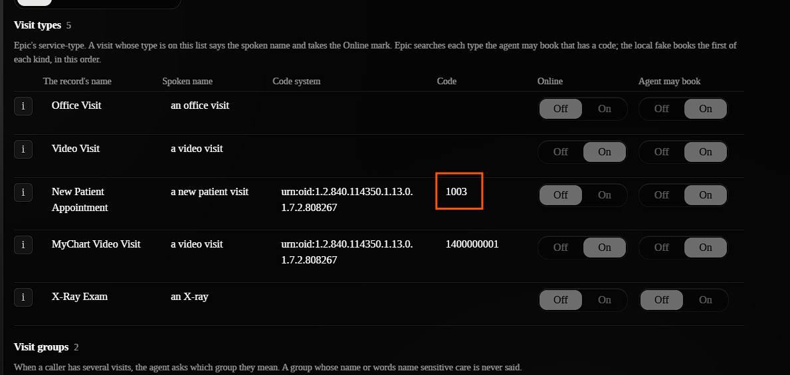

# DeetsHealth — Config › Hospital: the hospital's own lists

> **Part:** built · 2026-11-15. The owner, 2026-11-14: "config > Hospital we can include lists
> for the hospital to configure per their setup like the list of service types. We can also
> include a section for hospital hours, configurable list for time of day, configurable list of
> available specialties, indications, and location-references." His forks of 2026-11-15:
> **1B**, every section now, each list that no call reads yet marked so ("1B will let us know
> what we have left to build out and something to work towards"); **2A**, one hospital for
> every EHR source ("One hospital for now, i want to implement multiple hospitals and use rules
> based routing later": ideas/README.md).

**Terms.**
- **A list** is a table of rows that the hospital keeps. Each row maps the hospital's own code
  (from its EHR build) or the record's own name to the words the agent says and the words a
  caller may say.
- **Config › Hospital** is a page under Config, after Config › System
  ([SYSTEM-PAGE.md](SYSTEM-PAGE.md)). Config › System holds words and variables. Config ›
  Hospital holds facts about the hospital's setup.
- **The call's hospital** is the version that was active when the call opened. The call keeps
  it to its end.

## 1. Why
Epic's `$find` needs the hospital's own codes (EPIC.md §7.1). The visit type is required: with
no visit-type list, no Epic booking can start. The time of day, the specialty, the reason and
the location are the inputs that let a caller say "mornings at the north clinic with a skin
doctor". Each needs a list that only the hospital can fill. Until 2026-11-15 each was a fixed
value in one of three fixtures or a constant in the code.

## 2. The sections
Four tabs: **Visits**, **Times**, **Places**, **Booking**. "Used now" means a call reads it
today. "Not used yet" means the page keeps it and no call reads it; its note on the page says
so.

### 2.1 Visit types (Epic's `service-type`) — Visits tab, used now
- Above the table: the **Visit type list**, one OID for every row (§5.1). Columns: the
  record's name, the spoken name, the ID ("R PRC 1003"), Online, Agent may book.
- A visit or a slot whose type, as the record names it, is on the list (in any case) says the
  row's spoken name and takes the row's Online mark. A spoken name that names sensitive care
  makes the visit private (FUTURE-SETTINGS.md §9). A type not on the list keeps the record's
  words, and the `ONLINE` word list in `visit_about.rs` still decides whether it is online.
- Epic's `$find` searches each row with Agent may book **and** a code, one search per row that
  fits the caller's in person or online (`Hospital::coded_bookable`). The local fake books the
  first row of each kind with Agent may book (`Hospital::fake_type`), so the order matters.
- The Default: "Office Visit" and "Video Visit" (the fake's, no code), Epic's sandbox build
  "New Patient Appointment" (1003) and "MyChart Video Visit" (1400000001), and "X-Ray Exam"
  (not booked). Epic's own `$find` sample uses "Office Visit" 95014 in the system
  `urn:oid:1.2.840.114350.1.13.0.1.7.3.808267.11`; it is not on the list, because the probe
  did not book with it (EPIC.md §5.2).

### 2.2 Visit groups — Visits tab, used now
- Columns: the name the caller hears, the caller's words, the visit types (by the record's
  name).
- Uses: `find_visit`'s `group`, and the narrowing question when a caller has several visits
  (EPIC.md §7.10). A group whose name or words name sensitive care is never named
  (`VisitGroups::new`). Since 2A the groups apply in Epic mode too.

### 2.3 Reasons as codes (Epic's `indications`) — Visits tab, not used yet
- Above the table: the **Diagnosis list**, the OID of the hospital's own diagnoses (§5.1).
  Columns: the caller's words, the code system by name (SNOMED CT, ICD-10-CM, the hospital's
  diagnoses), the code, the visit type, the specialty.
- Decided 2026-11-14 (EPIC.md §5.2): booking sends the reason in the caller's words only. This
  list is the map for when a hospital codes reasons. The Default row is Epic's own sample:
  SNOMED 46866001, a broken leg.
- **Still kept (2026-11-15).** The owner asked whether this section still matters. No call uses
  it, and none will while booking sends the caller's words. It stays, marked "not used", by his
  1B ("1B will let us know what we have left to build"): Epic says a hospital's Cadence rules
  may require `indications`, and then this list is the map.

  

### 2.4 The time zone — Times tab, used now
- One IANA name for the hospital. Uses: the call's today and time (`OpenCallReply.local_now`),
  `$find`'s `startTime` and `endTime`, and each visit's local time. `$find` also sends each
  department's own zone with a slot, and that wins for the slot (EPIC.md §7.2).

### 2.5 Times of day — Times tab, used now
- Columns: the name ("morning"), the start (HH:MM), the length in hours.
- Uses: `find_slots`'s `time_of_day`, which may hold only these names (the model's list comes
  from the call's own version, `OpenCallReply.times_of_day`); Epic's `$find` gets
  `Timing.repeat.timeOfDay`, `duration` and `durationUnit`. The days of the week need no list.

### 2.6 Hours and closed days — Times tab, not used yet
- Hours: day of the week, opens, closes. Closed days: the date and a name.
- For later: what the agent says when no person can take a hand-off now (FUTURE-SETTINGS.md
  §10), and when a nurse may join a call on a staff flag (FLAGS.md §5). `$find` returns open
  slots only, so the hours never filter slots.

### 2.7 Locations (Epic's `location-reference`) — Places tab, used now in part
- Columns: the record's name, the spoken name, the FHIR id, the address, the phone.
- Used now: a visit at a Location on the list says the spoken name; the first row is said when
  a record names no place (`Hospital::place`). Not used yet: the FHIR id (`$find`'s
  `location-reference`, "the same place as last time"), the address and phone ("where to go").
  `Location.Read` could fill the address and phone, once per row, never once per call.

### 2.8 Specialties (Epic's `specialties`) — Places tab, not used yet
- Above the table: the **Specialty list**, one OID (§5.1). Columns: the spoken name, the
  caller's words, the ID. Epic gives no list of a hospital's specialty codes by API.
- **What the sandbox can give (2026-11-15).** A department's specialty, one at a time:
  `Location.Read` (registered) returns it as an extension, with its code and system (EPIC.md
  §7.11). The departments come from the Location references on the test patients' visits and on
  `$find`'s proposed slots. So the sandbox can fill this list, the Specialty list's OID and the
  Locations' FHIR ids, address and phone for the sandbox's own departments. The whole list of a
  hospital's departments and specialties comes from the hospital (`Location.Search` exists in
  Epic's catalog, `api:10084`).
- **Tried the same day** (EPIC.md §2.2, after the owner registered `Location.Search`): one
  `Location.Search` by address returns every location of the sandbox's organization, 435, in one
  page; 325 carry a specialty. The sandbox's Specialty list OID is
  `urn:oid:1.2.840.114350.1.13.0.1.7.10.686980.110` (9 Family Medicine, 4 Cardiology, 40
  Radiology). So an import from Epic is possible: one search fills Locations (DEP departments,
  each under its EAF facility) and Specialties. Not built.

  

### 2.9 Booking — Booking tab, used now
- Slots offered at a time (1 to 5); visits before the narrowing question; groups one question
  names; days back for a past visit; the search windows for the visits to come (each longer
  than the one before; one Epic read per window, then one with no end). FUTURE-SETTINGS.md
  §13.2 and §13.3 list the choices not built yet (the order, the clinician's name, times on one
  day).
- **The label after the reason in the booking note** (`booking_note_label`; the owner's N2,
  2026-11-15: "configurable (can be '(automated transcription from patient)' to start)").
  Epic's `$book` files `appointmentNote` as the caller's words, a space, then the label; the
  label is kept whole and the words are cut to fit Epic's 500 characters
  (`Hospital::booking_note`). Empty: the words alone. Epic mode only: the local fake keeps the
  words, so a read-back never says the label.

### 2.10 What a code and its system mean (Epic's docs, 2026-11-15)
> **Part:** research · 2026-11-15. The whole record, with Epic's document ids: EPIC.md §7.11.

- **The code system names the list; the code names the row in it.** In
  `urn:oid:1.2.840.114350.1.13.0.1.7.2.808267`: `1.2.840.114350` is Epic, `.1.13` is Epic's
  EDI application, `0` is the organization (the sandbox), `1` the environment (Epic's own; a
  hospital's production is 2, its test is 3), `.7` HL7 use, and `.2.808267` the records of the
  PRC master file (P R C in ASCII: 80 82 67), Cadence's visit types.
- **All of one hospital's visit types share one system.** The system changes between the
  hospital's test and production Epic, and between hospitals.
- **A code alone does not say what it is.** 1003 is a visit type here because its system is
  PRC. Departments and facilities also have short record IDs (Epic's sample: department "1",
  system `.2.686980`, DEP).
- **A hospital may name its visit types two ways:** by record ID (`.2.808267`, as the sandbox
  does) or by the value of PRC item 11 (`.3.808267.11`, as Epic's `$find` sample does).
- **Reasons (`indications`):** the hospital's own diagnosis list (EDG, `.2.696871`) and SNOMED
  CT; when both are sent, the hospital's code wins. Epic's sample also sends ICD-10-CM.
- **Specialties:** a category list (`.10.…`), small codes ("3" = Allergy in Epic's sample).
- **Locations:** `$find` takes a reference to a Location, not a code. `Location.Read` gives the
  name, address, phone, hours and specialty.
- **No API lists these.** The hospital's Epic team gets the OIDs from Epic's OID Generator
  utility and the codes from its Cadence build.

## 3. Where the values come from
- **The store**: the `hospital` service of the settings store (`settings_hospital`, migration
  0009), one setting per list or number (`hospital.rs › KEYS`). Whole versions, insert-only;
  each save says who saved it. A save reaches each call that opens after it.
- **The Default**: `ehr/fixtures/hospital.json`. The agent seeds it as version 0
  (`config.py › hospital_defaults`). `ehr` builds the same file in and uses it when it has no
  store, when the store has no version, or when the active version cannot be read; the call
  record then says "file".
- **Typed by the hospital** on the page. Importing a file from the hospital's Cadence team is
  open (§7).
- **No protected data.** A row is a fact about the hospital, never a patient. Every error names a
  list and a row number, never a value.

## 4. Every place it runs
- **The call:** the same on any phone. The model sees only the spoken names it may offer and
  the time-of-day names, never a code.
- **The console:** one page, four tabs of tables, each row edited in place. Who may edit waits on
  the roles (ACCESS-ROLES.md). On a phone each table scrolls on its own (`.sys-table-wrap`).
- **The deploy:** A2 and B read the lists from the settings store.
- **Each EHR:** the columns are Epic's. Another adapter maps its own concepts behind the same
  lists (athenahealth's appointment types, Oracle Health's; OTHER-EHRS.md). A list an EHR does
  not use stays empty.
- **Many hospitals** (later; the owner, 2026-11-15): one deploy serving several hospitals, with
  rules that route a call to its hospital. Today there is one.

## 5. As built (2026-11-15)
> Where this section and the design above disagree, this section is the code.

- **ehr**
  - `hospital.rs`: the typed rows, `check_key` (one setting), `Hospital::from_pairs` (the whole
    set; a key a version lacks takes the file's value), `Hospital::file`, and the lookups a call
    uses: `about` and `booked` (spoken name, Online mark, the sensitive screen), `group_of`,
    `place`, `time_of_day`, `time_names`, `coded_bookable`, `fake_type`, `limits`, `tz`.
  - `settings.rs`: `HOSPITAL` (the same keys), `Kind::Hospital` (checked by name in `check`),
    and `coherent("hospital")`, which builds the whole hospital.
  - `service.rs › call_hospital`: `OpenCall` reads the active version once; the session holds
    it (`Session::hospital`). `FindSlots`, `Book` and `FindVisit` pass it to the adapters
    (`Scheduler` methods take `h: &Hospital`) and to `visits::narrow` (`Limits`).
  - `scheduler.rs`: the fake's six slots are in person or online; each takes its type from the
    list. `epic_ehr.rs`: no time zone, place, groups or types of its own; the rail's list
    (`ehr epic-sandbox`) uses the file's time zone, because it is not a call.
  - The fixtures: `sandbox.json` and `epic-sandbox.json` keep the test patients, the fake's
    visits and the rail's place only.
  - `store.rs`: `calls.hospital_version`, from the record's `hospital` event.
- **The wire**: `OpenCallReply.times_of_day` and `hospital_version` (EHR-SERVICE.md).
- **The agent**: `ehr_client.py` keeps each call's names (`call_times`) and writes the
  `hospital` event (call record schema 13); `flow.py › CallFlow.times_of_day` builds
  `find_slots`'s list; `dev_server.py`: `GET` and `POST /agent/hospital` (DEV-API.md),
  `hospital_view`.
- **The console**: `hospital.ts`, built from System's table parts (`system.ts` exports
  `table`, `row`, `field`, `heading`, `grow`); `api.ts` types; the `settings.hospital` store.
  The page checks each row as ehr does (`problem`) and shows the first problem above the tabs;
  Save waits until there is none. No new CSS.
- **The columns' alignment** (the owner, 2026-11-15): the words of an editable cell started
  about 13 px right of their header, on this page and on Config › System. Fixed in
  `config.css › .sys-table .prompt-control`: the control moves left by the box's inner padding
  and edge.

  

### 5.1 One Epic list per list (the owner's A, 2026-11-15)
> **Part:** built · 2026-11-15. The owner: "Let's go with A and I'll iterate for usability
> afterwards. Code system wouldn't make sense to an analyst in the scope of their work, so
> translating to master files, id types, and records works best. and no inventing or guessing,
> we respect Epic's decision and listen to their guidance here."

- **ehr › `hospital.rs`:** three new keys, each one OID or empty: `visit_type_list`,
  `diagnosis_list`, `specialty_list` (`check_key` takes `urn:oid:` and dotted numbers). The
  visit type and specialty rows lose `system`; `code` is the row's ID in its list. A reason's
  `system` is a name from `REASON_SYSTEMS`: `snomed`, `icd10cm` or `hospital`. `from_pairs`
  refuses a row with an ID when its list is empty, and a "hospital" reason when the diagnosis
  list is empty; the error names the row.
- **Versions saved before A** are read in today's shape (`hospital::upgrade`, called by
  `settings::get` for the hospital): rows that all name one OID give it to the list, when the
  version has no list key; a reason's SNOMED or ICD-10-CM OID becomes its name; another OID
  becomes "hospital" and the diagnosis list. Rows that name two OIDs stay as they are, so the
  version does not fit and the call uses the file (as for any version that does not fit).
- **`$find`** sends `visit_type_list` as the system of every visit type (`epic_ehr.rs`). The
  request to Epic is unchanged.
- **The console:** each list has a one-row table above its rows: the OID (edited in place) and
  "What the OID says". A row's ID shows its list's prefix in gray, "R PRC 1003"; the prefix
  changes as the OID is typed. A reason's code system is a dropdown; a reason on the hospital's
  list shows the diagnosis list's prefix. `console/src/pages/epic-oid.ts` reads an OID.
- **What the page reads from an OID, and only this** (Epic says to treat an OID as opaque,
  open.epic tutorial:2659): Epic's documented pattern `1.2.840.114350.1.13.<CID>.<EnvType>.7.…`,
  with EnvType in Epic's words (1 Epic's own environment, 2 production, 3 non-production), and
  two forms that Epic's own examples name: `.7.2.<file>`, a master file's records (Epic's AIP
  example: the letters as ASCII codes), shown as "R PRC"; and `.7.5.737384.<n>`, an ID type
  (Epic's MRN example), shown as "R IIT n". Any other OID says "Not a form Epic's documentation
  names: kept as entered", and its rows show no prefix. The page never builds an OID.
- **The Default:** `visit_type_list` is the sandbox's PRC OID; `diagnosis_list` and
  `specialty_list` are empty; the reason row is `snomed`.

**Decided inside the owner's choices (for his review):**
- A: the list's OID sits in a one-row table above its rows, titled "Epic's OID for the list"
  and "What the OID says". An OID that is not in Epic's documented forms gets no label and no
  prefix, never a guess. A specialty list's OID (a category list, `.10.…`, in Epic's sample)
  gets no label for that reason.
- A reason's systems are named SNOMED CT, ICD-10-CM and "The hospital's diagnoses"; "None" is
  allowed for a row with no code.
- The tabs and columns of §2, and the spoken names of the Default ("an office visit", "a video
  visit", "a new patient visit", "an X-ray"; "EMC Family Medicine" says "the family medicine
  clinic").
- A visit type without a code may be booked by the fake only; the Office Visit and Video Visit
  rows keep the fake's bookings as they were.
- The first location is the place said when a record names none.
- The page sits after System in Config's nav.
- A list's words are typed comma separated in one cell.
- A row moves with Up; Remove takes it out. Add puts an empty row at the end to fill in.
- Closed days and hours have one zone: the hospital's.

## 6. Desk test
1. `npm run dev`. Open Config › Hospital. Read shows four tabs; Visits shows five visit types.
2. Choose Edit. On Visits, change the spoken name of "Office Visit" to "a clinic visit". Save.
   The status says the new version is active from the next call.
3. On Chat, Local, start a typed call as Jordan Ellis and book a visit. Ask what the visit is.
   The agent says "It is listed as a clinic visit."
4. On Times, add a time of day "lunch" from 11:30 for 2 hours. Save. Start a new call and ask
   for "a lunch time slot". `find_slots` gets `time_of_day: lunch`.
5. Clear a visit type's name. The problem shows above the tabs and Save waits.
6. Choose the Default in the versions list: the page shows it, read only.
7. In Epic mode, a call that asks for Camila Lopez's next visit says "the family medicine
   clinic".
8. **One list per list (§5.1).** Restart `npm run dev` first (a new `ehr`). On Visits, the
   Visit type list shows the OID and "Records of the master file PRC (organization 0, Epic's
   own environment)". New Patient Appointment's ID reads "R PRC 1003"; Office Visit's ID is
   empty and has no prefix.
9. Choose Edit. Clear the Visit type list's OID. The problem "Visit types, row 3: an ID needs
   the visit type list's OID" shows and Save waits. Type the OID back: the prefixes come back.
10. On a reason row, choose "The hospital's diagnoses": the problem asks for the Diagnosis
    list's OID. Choose SNOMED CT again.
11. Choose an older version (saved before today): it shows in the new shape, each ID in its
    list.
12. In Epic mode, ask to book a visit: `$find` still returns times (the same request as before).

## 7. Open
- **Decided 2026-11-15: A, one Epic list per list** (built, §5.1). Not chosen: B, an OID on
  each row. The owner will iterate on the page's usability after his desk test. The research
  behind it: §2.10, EPIC.md §7.11.

  
- A label for an OID form that Epic's documentation does not name (an item, `.3.<file>.<item>`,
  as Epic's `$find` sample sends; a category list, `.10.…`): only from Epic's own words, when a
  hospital needs it.
- Import from a file (the hospital's Cadence export), as well as typing. Places can come from
  Epic itself: §8.
- Whether a location may override the hospital's hours and time zone, or only add to them.
- Each list that is not used yet waits for its feature: the specialty and location in `$find`,
  coded reasons, hours with the hand-off.
- Many hospitals and the routing rules (ideas/README.md).

## 8. Import Places from Epic (designed)
> **Part:** designed · 2026-11-15. The owner: "Since an import is possible, let's doc the route
> first, can help with fast onboarding for a clinic / hospital." And: "EAF / DEP split is perfect,
> helps distinguish higher level locations with sublocations/departments and EAF / DEP are very
> familiar terms for hospital folks." The facts behind it: EPIC.md §2.2 (the sandbox try).

**Terms.** An **EAF** is a facility record ("EHS Hospital", "EHS Clinic"): a higher-level
location. A **DEP** is a department record ("EMC Cardiology"): the place a visit is booked in,
`partOf` one facility. Both are master files; the page names them "R EAF n" and "R DEP n"
(epic-oid.ts).

### 8.1 The route, for a new hospital
1. **Before:** the hospital adds our client to its Epic (`Location.Read` and `Location.Search
   (Organizational Directory) (R4)` are in our registration, EPIC.md §2.1) and names its time
   zone. Nothing else is needed for Places: the search's reply carries its own systems.
2. **One search:** `Location?address=<the hospital's state>`. On the sandbox this returned every
   location of the organization (435) in one page. A hospital in several states: one search per
   state. A `next` link is followed when a page is cut. Cost: 1 to a few reads per import, never
   per call. No protected data: a location is a fact about the hospital.
3. **Split by kind:** an EAF has an identifier in `….7.2.<EAF>` and no `partOf`; a DEP has an
   identifier in `….7.2.<DEP>` and `partOf` an EAF. Anything else (rooms, billing offices) is
   shown apart, not imported unless chosen.
4. **Places › Locations:** one row per DEP, grouped under its EAF: the record's name, the FHIR id,
   the DEP ID, the address, the phone, the hours (`hoursOfOperation`). The spoken name stays empty
   for the analyst to write; empty means the record's words.
5. **Places › Specialties:** the distinct specialties across the DEPs. Their one system becomes
   the Specialty list's OID; each code becomes a row's ID; Epic's display becomes a draft spoken
   name. The analyst adds the caller's words ("skin doctor").
6. **A draft, never live:** the import fills the page in Edit, with each new or changed row
   marked. Save makes the version, as for any edit. A later import of the same hospital shows
   what is new, gone or changed since the active version (a refresh).
7. **Not from this search:** visit types (PRC) and reasons (EDG). They come from the hospital's
   Cadence team, or, for visit types, from the visits and `$find` replies seen.

### 8.2 What the page needs for it (not built)
- Locations gain columns: the kind (EAF or DEP), the facility it is part of, the DEP ID, the
  hours. The table groups DEPs under their EAF.
- An "Import from Epic" control on the Places tab, and an `ehr` RPC that runs the search (EHR
  facts behind the EHR adapter; another EHR gets its own).
- **The Default today** (2026-11-15, from the probe's printout, no new search): the Specialty
  list's OID and IDs 9 (family medicine), 4 (cardiology), 40 (radiology, a new row); the
  sandbox's four departments on Camila Lopez's visits by name. Their FHIR ids, addresses and
  phones were not printed by the probe, so those cells stay empty until the import exists.

### 8.3 Open (his to decide when the import is built)
- A hospital in several states or cities: one search per state, or a list the analyst types.
- Inactive locations (`status` other than active): left out, or shown greyed.
- The table: DEPs grouped under each EAF heading, or one flat table with a Facility column.
- Who may run an import: waits on the roles (ACCESS-ROLES.md).
