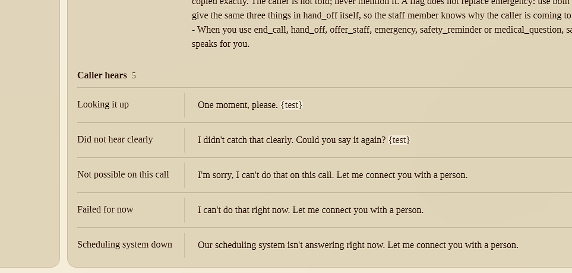

# DeetsHealth — Config › System: variables and tools

Config › System shows the analyst every variable and every tool that the agent's words can
use: what each one is, where its value comes from, and the value now. The analyst can change
the clinic's variables and add new ones. In the agent's words on Config › Agent, typing `{`
opens a list of the variables, and typing " ." opens a list of the tools.

**Terms.**
- A **section** is one block of `agent/prompts/AGENT-PROMPT.md` under a `## name` heading,
  and one row on Config › Agent. There are 78 (`prompts.py` › `PLACEHOLDERS` is the list).
- A **variable** is a `{name}` in a section. The code puts a value in its place when the
  call runs.
- A **tool** is a function that the model can call, for example `end_call`.
- A **step** is one node of the call flow: greet, verify, menu, schedule (`flow.py` ›
  `STEPS`).

## 1. What the code does before this build (2026-11-13)
> **Part:** designed · 2026-11-13

**Two kinds of variable.**
- **Clinic values.** `{clinic}` is a constant in `flow.py` (`CLINIC`). `{today}` is the date,
  made by the code for each call.
- **Call values.** `{given}` `{family}` `{birth}` `{code}` `{options}` `{number}` `{visit}`
  `{visit_type}` `{reason}`. The code fills each one in its own fixed line only, from the
  record or the call. Most are protected data.

**The rule.** Each section must hold exactly the variables in its row of `PLACEHOLDERS`, no
more and no fewer (`prompts.py` › `check`; `ehr` › `settings.rs` › `PROMPT` holds the same
list). 13 sections hold variables; 65 hold none:

| Section | Its variables |
|---|---|
| `role` | `{clinic}` `{today}` |
| `task.greet` | `{clinic}` |
| `line.greeting` | `{clinic}` |
| `line.read_back` | `{given}` `{family}` `{birth}` |
| `text.code` | `{code}` |
| `line.slots` | `{options}` |
| `line.slot_option` | `{number}` `{visit}` |
| `line.confirm_slot` | `{number}` `{visit}` |
| `line.change_booked` | `{visit}` |
| `line.booked` | `{visit}` |
| `line.next_visit` | `{visit}` |
| `line.visit_type` | `{visit_type}` |
| `line.visit_reason` | `{reason}` |

**Tools.** 16 tools. Seven are in every step (`call.py` › `global_functions`): `hand_off`,
`offer_staff`, `end_call`, `emergency`, `safety_reminder`, `medical_question`,
`flag_for_staff`. Nine are in some steps only:

| Step | Its own tools |
|---|---|
| greet | `identify` `confirm_details` |
| verify | `check_code` `resend_code` `identify` `confirm_details` |
| menu | `find_slots` `next_visit` `change_visit` |
| schedule | `choose_option` `book` `find_slots` `change_visit` |

The words name tools as plain text. Nothing checks those names. A test on 2026-11-13 showed
that plain names cannot be checked: `book` matches "book a visit" in `line.verified`, and
`emergency` matches the word in `line.emergency`.

## 2. What the owner decided (2026-11-13)
> **Part:** designed · 2026-11-13
- **The tool list opens on " ."**: a space, then a period, with no space after it (fork 1,
  B). Epic's SmartPhrases start with a period, so an analyst who knows Epic knows it.
- **Analysts can make their own variables** (fork 2, A), for example `{pharmacy_hours}`.
  This is also the path to more default variables as features grow.
- **Grant visibility and configurability where possible.** The owner's aim: a rules engine
  can later act on a variable's value (§8).

## 3. The design (one option was left each time)
> **Part:** built · 2026-11-14 — §6 is the as-built record.

### 3.1 Two kinds of variable
- **System variables.** A name, a meaning and a value, kept in the settings store as their
  own service (`system`), with versions, Read | Edit and Default, like Cartesia. `{clinic}`
  is the first one. It is built in: its value can change, but it cannot be removed or
  renamed. An analyst adds others. A System variable **can be used in any section**,
  including `text.code`.
- **Code values.** Filled by the code, each in its own sections only: `{today}` (in `role`)
  and the nine call values. The analyst sees them on System, read only, and can never use
  one in another section, because the code fills it only there. A section must keep its
  own code values.
- **The new rule.** A section must hold its own code values, and may also hold any System
  variable. Nothing else. `{clinic}` stops being required in `role`, `task.greet` and
  `line.greeting`: the analyst may take it out.

### 3.2 A variable's limits
- **Name:** lowercase letters, digits and `_`, starts with a letter, at most 32 characters.
  It cannot be a code value's name.
- **Meaning:** one line, at most 200 characters. The analyst reads it on System and in the
  `{` list.
- **Value:** one line, at most 300 characters, no `{` or `}` (so a value can never put a
  variable or a code value into a text), no control characters.
- At most 100 System variables.
- **A value is never protected data.** It is the clinic's own text (a name, hours, an
  address). The page says so under the value box.

### 3.3 The checks
- **A prompt save** is refused when a section holds a variable that is neither its own code
  value nor a System variable of the active System version. The message names the section
  and the variable.
- **A System save** is refused when it removes or renames a variable that a section of the
  active prompt version still uses. The message names the variable and the first section.
- **Both checks run in `ehr`**, the store's gatekeeper, and again in the agent at start-up
  (the prompt file against the variables file).
- **A section that names a tool its step does not offer** is refused (§3.5).

### 3.4 Where the values go
- **The call takes a copy.** At its start, each call takes the active prompt version and the
  active System version, and uses both until it ends. A save during a call changes nothing
  in it. The call record keeps both version labels.
- **The agent** fills each section from the call's System variables plus the code's values
  for that line (`prompts.py` › `text`).
- **`ehr`** fills `text.code`: `OpenCall` carries the System version's id as well as the
  prompt version's id, and `ehr` fills the variables when the call opens. `{code}` is still
  filled only when the text goes out.
- **The file.** In dev, each System save also writes `agent/prompts/VARIABLES.md`, as a
  prompt save writes `AGENT-PROMPT.md` (PROMPT-EDITOR.md §6, item 2). A hand edit to it
  becomes a new System version when the dev server starts. Git, the tests and `ehr`'s
  compiled-in default read it.
- **The kept recordings.** Their stamp covers the words and the variables. A changed value
  makes the recordings out of date, as an edit to the words does.
- **Each place it runs.** The call: no change for the caller. The console: one more page.
  A2 and B: the store holds the versions, as for the prompt. Each EHR: no effect.

### 3.5 Tools in the words
- **A tool name in the words has backticks**: `` `end_call` ``. Without a marker, the code
  cannot tell the tool `book` from the word "book" (§1). The model reads the backticks as a
  function name.
- **" ."** opens the tool list. A choice replaces " ." with " `name`".
- **The check.** A section may name only the tools of the steps where it is read:
  - `role`: the seven tools of every step.
  - `task.<step>`: that step's tools and the seven.
  - `tool.<name>`, `arg.<name>.*`: the tools of every step that offers that tool.
  - `note.*`: the tools of the step where its tool runs.
  - `line.*` and `text.code`: none. The caller hears or reads these, so a tool name never
    belongs there.
- **This build does not change the words.** The names in the file stay plain text until
  someone edits them, so the kept recordings stay valid. A plain name is not checked and
  shows no chip.
- The check runs in the agent (it knows the steps), before the save reaches `ehr`.

### 3.6 The page
**Config › System** has a tab bar, **Variables | Tools**, in the Config frame (Read | Edit,
the versions, Discard | Save).

**Variables.** Three groups, under headings:
- **Clinic** — the System variables. Each row: the name, the meaning, the value, and the
  sections that use it. In Edit, the meaning and the value are boxes. **Add a variable** adds
  a row; **Remove** removes one (not `{clinic}`).
- **Filled by the code** — `{today}` and its section; read only.
- **From the call** — the nine call values, each with what it is, its source, its section,
  and a **Protected** marker where it holds protected data. Read only. Never a value.

**Tools.** One row per tool: its name, what it does in plain words, the steps that offer it,
its arguments, the lines it can speak, whether it reads or writes the record, and a link to
its words on Config › Agent. Read only. The plain words live in
`agent/prompts/TOOLS.md`; a test checks that every tool has an entry and that each line it
names exists.

**The lists on Config › Agent (Edit).**
- `{` opens the variables this section may use: its own code values and every System
  variable. Each item: the name, the meaning, and, for a System variable, its value.
- " ." opens the tools this section may name (§3.5). Each item: the name and what it does.
- The arrow keys move, Enter or Tab chooses, Escape closes. Typing goes on filtering the
  list. Ctrl+Space opens the list for the text before the cursor.
- In Read, a tool name in backticks shows as a chip, as `{clinic}` does now.

## 4. What I decided inside the owner's choices
> **Part:** designed · 2026-11-13
- The service name `system`, the file name `VARIABLES.md`, the limits in §3.2.
- Backticks mark a tool name (§3.5): the only marker that the code can check and that the
  model reads as a function name.
- `{today}` stays a code value. Its format could become a setting later.
- The tool check runs in the agent, not in `ehr`: it is about quality, not about protected
  data, and only the agent knows the steps.

## 5. The desk test
> **Part:** built · 2026-11-14

**First:** stop the dev server (Ctrl+C) and start it again with `npm run dev`. It builds the new
`ehr`, runs migration 0006, and makes System's Default from `agent/prompts/VARIABLES.md`.

1. Config: the nav reads Agent, System, Cartesia, Anthropic. Press System. The dropdown reads
   "Active | [Default]"; the bar reads Variables | Tools.
2. Variables, in Read: two tables (the owner, 2026-11-13: tables for lists; each row's title
   alone, the rest under its "i"). "Clinic variables": columns Variable · What it is · Value ·
   Used in; `{clinic}` as a chip, its value as plain text, "3 sections". Its "i" rolls down
   "Kind: Built in…" and "Used in:" with links. "Code values 10": Variable · What it is ·
   Filled from · Protected data (Yes or No); `{today}` first. No value shows for any of them.
3. In `{clinic}`'s "i", press a section under Used in: the page moves to Agent, opens its tab,
   scrolls to it, and it glows once.
4. Back to System, press Edit. Change the clinic's value to "North Clinic". Add a variable:
   name `pharmacy_hours`, a meaning, a value "9 to 5". Try a name `Given`, then `given`, then a
   value with `{`: each shows its reason in red, and Add does nothing. Save: "Saved as 11-14 |
   1. Active from the next call". `git diff agent/prompts/VARIABLES.md` shows both.
5. Agent, Edit, Open and close › Goodbye. Type `{`: the list opens at the cursor with
   `{clinic}` and `{pharmacy_hours}` and their values. Type `ph`: one row. Press Enter:
   `{pharmacy_hours}` goes in. Press Ctrl+Z: it comes out. Escape closes a list.
6. In Goodbye, type " ." (space, period): the list says the caller hears this section, so no
   tool name belongs. In Step 4 (Visits › Step 4: choose and book), type " ." then `bo`: `book`
   with what it does. Enter puts in `` `book` ``. In Read it shows as a chip. Put `` `book` `` in
   Step 1: "`book` is not offered in this step" in red; Save stays off.
7. Type `{given}` in Goodbye: "{given} is filled only in its own section". Remove it.
8. Save the Goodbye with `{pharmacy_hours}`. Chat, Test, a typed call that ends: the goodbye
   holds "9 to 5". The greeting says "North Clinic". The record's first line has
   `"system_version": "11-14 | 1"`.
9. Chat, a call with the code text: the text names the clinic as saved (when `text.code` holds
   `{clinic}`; add it there to try).
10. System, Edit: Remove `pharmacy_hours`, Save: "Not saved: variables: {pharmacy_hours} is
    still used in line.goodbye". Take it out of Goodbye on Agent first; then the Remove saves.
11. System › Tools: one table, "Tools 16": Tool · Name in the words (a chip) · What it does ·
    Steps; the tools of some steps first, in the call's order, then those of every step. A
    row's "i": Record, Fields, Lines it can speak (links) and Its words (links to Agent).
11a. Edit: the What it is and Value cells fade into boxes with no shift; Remove shows at the
    row's end (not for `{clinic}`); Add a variable sits under the table. Read hides both.
12. Choose Default in System's dropdown: the changed variables glow, the Variables tab shows a
    dot.
13. Agent shows "Recordings are out of date" after step 4 (a value changed what the model
    reads). Record and test makes it match again.

## 6. As built (2026-11-14)
> **Part:** built · 2026-11-14
Where this disagrees with §3, this is the code.
- **`ehr`** (`settings.rs`): `SYSTEM` (one setting, `variables`, `Kind::Variables`); `BUILT_IN`
  and the limits; `code_values()` read from `PROMPT`, which now lists only code values
  (`role` keeps `{today}`; `task.greet` and `line.greeting` keep none); `variables()`,
  `file_variables()` (VARIABLES.md compiled in), `prompt_variables()` (the cross check),
  `fill()` (one pass; escapes kept until the last pass). An error echoes a `{name}` only when
  it is a valid name. `service.rs`: the cross checks in `save_settings` (not on a Default
  seed), `system_variables()`, `OpenCall` fills the variables into `text.code`. `texts.rs`:
  the compiled template is filled from VARIABLES.md; the code goes in by `fill`.
- **The agent** (`prompts.py`): `VARIABLES`, `Variable`, `check_variables`, `load_variables`,
  `write_variables`; `check(sections, names)`; `Words` carries `variables`, `system_id`,
  `system_label`; `text()` fills the call's variables, then the code values; `digest` covers
  the variables' values; `mention_problems` (backticks only); `CODE_VALUE_INFO`;
  `load_tools` (TOOLS.md). `flow.py`: `CLINIC` is gone; `global_functions()`, `tool_steps()`,
  `tool_scope()`, `NOTE_TOOL`. `dev_server.py`: `/agent/system`; the variables file synced
  before the prompt file; `active_words` takes both versions and falls back to the files when
  the pair fails the agent's check, so no call meets a `{name}` it cannot fill.
- **The console**: `system.ts` (the page), `word-picker.ts` (the lists), `tab-bar.ts` (the bar,
  shared), `agent.ts` (the new rule, chips, the lists, `deets:show-section`,
  `deets:system-saved`).
- **First desk test (the owner, 2026-11-13, evening).** He changed `{clinic}` and added
  `{test}` in Looking it up (`line.one_moment`) and Did not hear clearly (`line.say_again`).
  The greeting said the new clinic name; `{test}` was never heard, because neither line was
  spoken on that call: `line.say_again` plays only when `ehr` refuses an input as malformed,
  and `line.one_moment` only when a reply hits the token cap. The model said "Sorry, I didn't
  catch that" in its own words. The variable worked; the line's name misled.

  
- **Not built from §3:** none. **Known gap:** the cross check reads the active version of the
  other service before the save's own lock, so two saves at the same instant (one on each
  page) could both pass. `active_words` then falls back to the files for the next call, and
  the log says so.

## 7. Not now (each waits for its own work)
> **Part:** idea · 2026-11-13
- Turning a tool on or off for a hospital (FUTURE-SETTINGS.md). `emergency` can never be
  turned off.
- The format of `{today}`.
- Moving the existing plain tool names in the words to backticks. That changes the words,
  so the kept scripts must be recorded again (about a cent each).

## 8. The rules engine (idea)
> **Part:** idea · 2026-11-13
The owner, 2026-11-13: "this can enable us to build a rules engine around this in the code
where {visit_type} = online or where {clinic} = north if we ever do multiple clinics".
- **A rule on a call value** (`{visit_type}` = online) runs in the code, inside the wall,
  during the call. The console shows the rule, never a call's value. One such rule is
  already built: `line.visit_online` is spoken in place of `line.visit_type`.
- **A rule on a System variable** (`{clinic}` = North) lets one deploy serve several
  clinics. A System variable would then hold one value per clinic, chosen by the number the
  caller dialed or by the visit's location.
- Each needs its own design.
