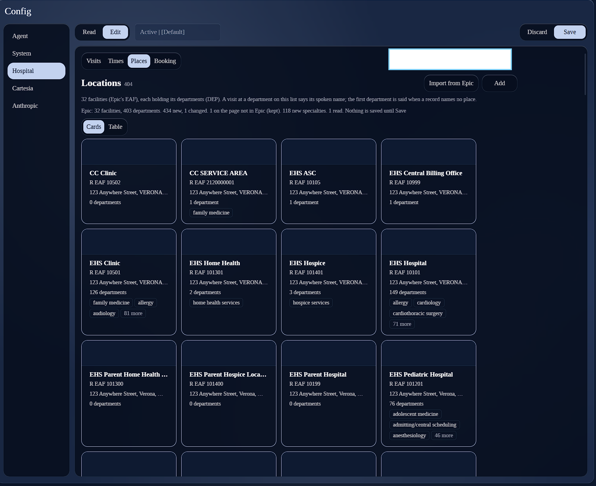

# DeetsHealth — The console's one table

> One table part for every table in the console, as `tab-bar.ts` is for every tab bar:
> `console/src/pages/data-table.ts` and `console/src/styles/data-table.css`. A page gives the
> columns and the rows; the part gives the look, the alignment, the row tools, Add and the
> motion. Every size, color and timing is a token.

## 1. Why (the owner, 2026-11-15)
The owner's screenshot of Config › Hospital › Places, Table view:

What the code did wrong:
1. Up was hidden on a list's first row (`hidden`), so Remove stood alone there. The column had no
   width, so the two links stacked on some rows and sat side by side on others.
2. The text boxes had a negative margin so that their words lined up under the header; the
   select did not, so it sat lower and was shorter.
3. The browser sized each column from its content. Empty columns shrank, full ones wrapped, and
   a column could move while the analyst typed.
4. Three builders (`system.ts › table`, `config-kit.ts › kit.table`, Auth's own) and three style
   sets (`.sys-table`, `.cfg-table`, `.auth-table`).

## 2. The owner's choices (2026-11-15)
- **1A: the row tools at the right edge**, in one column: ↑ ↓ ✕, each an icon in the "i"'s
  rounded square (`--info-size`). Always there; a tool that cannot act is dimmed, never hidden.
- **2: Add on the title line.** Each section's title line holds the title and its count at the
  left and **Add** at the right, in the tab bar's frame (as Discard | Save). The title grows to
  match the button. A new row slides in.
- **3A: every table in one change**: Config › Hospital, Config › System, Config › Cartesia,
  Teams › Auth, Teams › Roles.
- "Go" on the follow list (§3), with Import from Epic on the Locations title line.
- "I'd like to minimize visual inconsistencies where possible."

## 3. Decided inside his choices

### 3.1 Fixed columns
Each column names a kind; the table is `table-layout: fixed`, with the
widths on `<col>` elements (a help row or a group row can come first). Kinds and their widths:
`text` (shares what is left, at least `--col-min`), `id` (`--col-id`), `short` (`--col-short`:
a time, a date, a count), `choice` (`--col-choice`), `flag` (`--col-flag`: Off | On), `num` (`--col-num`: a short word or number in a read-only list, Analytics › Logs; since 2026-11-22). The "i"
and the tools have their own columns. Below the sum, the table scrolls sideways inside its box,
never the page.

### 3.2 One cell box
A text box, a select, a number and Off | On each fill their cell from the
same top edge, one box tall: a line of words in a text box's padding and edge
(`data-table.css › --dt-box`, from `--space-3`, `--line-height` and `--edge`). Before, a select
was `--field-height` and a text box was taller. No negative margins.

### 3.3 The words line up under the header
(the owner's rule, 2026-11-15). A header starts at
the box's inner padding, so its word sits over the box's words, in Read and in Edit.

### 3.4 The "i" and the tools are level with a row's first line
, however many lines the boxes
take.

### 3.5 Read shows words in every cell
A select shows its chosen option's words, Off | On shows
"On" or "Off", a number shows the number: nothing greys. The words and the control sit in the
same place, so nothing moves on a switch. The tools column and Add keep their space in Read
(hidden, not removed), so the columns never move.

### 3.6 Body type size in every table
System's size, from Config › Agent. Auth and Roles were the small size; they move up to it,
and their headers take the Config look (regular weight, `--text-3`; before, bold `--text-2`).

### 3.7 A new row goes at the foot of its list
Order matters in some lists (the first department
is the one said when a record names no place), so a row at the top would change a default
without a word. The table scrolls to the new row, it slides in, and the cursor goes to its first
box.

Add a facility is the one exception: a new facility is a card with nothing to show, so Add
opens it, drilled in (from the Table view too), with the cursor in its name box.

### 3.8 Every row change moves
↑ and ↓ slide the two rows past each other. ✕ fades the row out,
then the rows under it slide up into its place. Add slides the new row in. All use
`--dur-collapse` and `--ease`; with reduced motion the rows change at once.

### 3.9 The icons
↑ and ↓ are the rail's chevron (`M6 9l6 6 6-6`), turned; ✕ is two strokes in
the same weight. They take the theme's text color; a pressed confirm takes the error colors.

### 3.10 Which tools a table shows
↑ ↓ where the order is kept and used (every Config › Hospital
list); ✕ where a row can go. Clinic variables, Pronunciations and Keyterms keep no order, so
they show ✕ alone. A built-in variable's ✕ is dimmed. (His 1A said the tools are always
there; ↑ ↓ on a list whose order means nothing would be a control that does nothing. Ask him.)

### 3.11 Remove a facility
It is the ✕ on the facility's row in its drill-in. It still takes every
department in it (its "i" says so). Nothing is saved until Save.

### 3.12 Auth's ✕ asks "Confirm?"
A remove there takes sign-in away at once. The first press
turns the ✕ into "Confirm?" in the error colors, inside the same column (`--split-half`
wide), for `--confirm-hold`; the second press removes. Two presses, as before.

### 3.13 Sticky headers on Auth only
Its table scrolls in its own box; the Config tables scroll
with the page.

### 3.14 Group rows
"Not in a facility", and one per facility in Places' Table view: a part of the table, not of
Places.

### 3.15 Tables that are not lists
Booking's Setting | Value, Time zone, a list's OID, Code values and Tools have no tools column
and no Add.

### 3.16 Cartesia
Pronunciations and Keyterms sit in a Config row. Add sits at the top right of
the row's control, level with the row's name and "i". A new row is blank; Save waits until
every cell has words, so an empty word never reaches Cartesia.

### 3.17 Auth and Roles
They keep their own rows (a row opens a panel; a level cycles), on the table's
header, lines, padding and type. Their Add moves to the tab bar's frame on the title line.

### 3.18 Buttons on a title line hide in Read
Add, and Import from Epic on the Locations line, hide in Read and keep their space. Before,
Import from Epic was grey in Read with an "Edit only" hint. Each section title is a page
heading's size (`--text-page`), as Auth's "Users"; a facility's own title in its drill-in
matches it.

## 4. The parts (as built)
`data-table.ts`:
- `table(label, columns, tools?)` — the box, the `<colgroup>`, the header. `columns` are
  `{ head, kind }` or a header alone (`text`); `tools` is `{ move?, remove?, wide? }` (none: no
  column). The table's least width is the sum of its columns; below it, it scrolls sideways.
- `row(item, title, cells, facts, tools?)` — a row and its help row under it, the "i" first (no
  facts: no "i"). `item` is the draft's own object: the motion finds the row again by it. A
  cell that is not a control (`.cfg-control`, `.dt-cell`) is put in `.dt-text`, the box's
  padding.
- `groupRow(t, ...parts)` — a heading row across the table.
- `toolButton(kind, label)`, `rowTools(what, { up, down, remove })` — the ↑ ↓ ✕ squares; a
  tool left out is not shown, a tool set to null is dimmed. `listTools(list, item, what, done,
  { move, remove, peers })` — the tools of a list row, ↑ ↓ among its peers (Places: within its
  facility).
- `titleLine(title, count, note, ...actions)`, `addButton(label, on)`, `addTo(list, item,
  done, max)`.
- `field` (a text box with its words), `dual(control, words)` (a select, Off | On or a number
  with its words for Read), `grow`.
- `change(mutate, redraw, { added?, removed? })` — the motion around one edit (FLIP: each row's
  place before the edit, then a slide from there after the redraw; the boxes take their height
  before the measure).

`data-table.css`: `.dt-*` only, and `--dt-box`, one box's height. Tokens added to `skin.css`:
`--col-min`, `--col-id`, `--col-short`, `--col-choice`, `--col-flag`, `--icon-size`.

## 5. Desk test
1. Config › Hospital › Places › Table, Edit: every row has ↑ ↓ ✕ in one column at the right; the
   first row's ↑ and the last row's ↓ are dimmed. The "None" select's top edge is level with the
   text boxes'. Each header's first letter is over its box's words.
2. Type a long name: no column moves; the box grows down.
3. Press ↓ on the first department: the two rows slide past each other. Press ✕: the row fades
   and the rows under it slide up. Discard brings it back.
4. Specialties › Add (on the title line): a blank row slides in at the foot; the cursor is in its
   first box.
5. Switch to Read: every cell shows words (the select shows "None"); no column moves; Add and the
   tools leave their space.
6. Import from Epic sits on the Locations title line, left of Add; its panel still opens under it.
7. Config › System: Clinic variables shows ✕ only, dimmed on built-in rows. Config › Cartesia:
   Pronunciations › Add gives a blank row; Save stays grey until both cells have words.
8. Teams › Auth: ✕ → "Confirm?" in red without moving a column; a second press removes. The
   header sticks while the list scrolls.
9. With the OS's reduced motion on, every change happens at once.

## 6. Long lists: windowing and the search box

> **Part:** built · 2026-11-15, desk test closed 2026-11-22 (§6.6) (the owner chose windowing; W1 A, W2 A,
> W3 B and W4 A the same day)

### 6.0 As built (2026-11-15): read this first
Where it differs from the design below, this is the code.
- **Files:** `console/src/pages/list-window.ts` (the windower: `fillTable`, `fillGrid`,
  `heightsOf`, `flushWindows`, `revealItem`), `data-table.ts` (`growAll`, `refilter`, `track`,
  the kept open help, `listTools`' `still`), `config-kit.ts` (`Kit.apply`, the status once a
  frame, `flushWindows` on each draw), `hospital.ts` (the Specialties tab, `Search`,
  `markMatches`, the search box and Ctrl+F, every list through `fill`), `config.css`
  (`.cfg-search`, `::highlight(deets-search)`), `data-table.css` (`.lw-*`). Token:
  `--search-width`.
- **Measured on the owner's saved import** (404 departments, Table view, 2026-11-15): the page
  draws 15 to 20 rows of 437 (with the facility headings); scrolled to the middle, rows 190 to
  207. One window update that draws 17 new rows takes 70 to 100 ms; most of that is the new
  rows' Specialty selects and their first layout. Frame times in the test tab were not a fair
  measure (its window was behind another, so Chrome slowed its frames on every tab alike).
- **Decided while building** (each open to change):
  - **A hidden view keeps its rows.** The design said it would drop them; windowing already
    keeps a hidden view small (about 20 rows), so a page switch puts back little.
  - **The scroller is found on each update**, as the nearest box that scrolls up and down and
    overflows. A table's sideways box (`.dt-wrap`) reads `overflow-y: auto` too, and on a first
    load the page has no height yet; both fooled a lookup made once.
  - **↑ ↓ dim while a search is on.** A move would swap a row with one the search hides.
  - **A row added during a search shows** until the words change (it matches nothing yet). A
    row's match is kept until the words change, so a row never leaves while it is edited.
  - **The search reads** each row's own words and lists of words; a department also its
    specialty's name and its hours; a reason its code system's name; Hours its day's name;
    Booking each setting's name and help. The list OIDs and the time zone are not lists and
    always show.
  - **The marks** use the CSS Custom Highlight API (`--accent` behind, `--on-accent` on it):
    the page's text is not changed. They show on words that are text (Read, the cards, the
    group rows), not inside a text box in Edit. A browser without the API shows no marks.
  - **The search box is one element for the view's life:** a search draws the tab's sections
    again, not the card, so the cursor stays in the box. A draw of the whole card (a tab, a tool)
    puts the same box back.
  - **A row that leaves goes at once;** rows that stay slide and rows that come fade in, so the
    typing never waits for a fade.
  - **The Specialties note** now says what a specialty is and how a department names it.

### 6.1 Why (measured 2026-11-15)
An import from Epic put 32 facilities, 403 departments and 118 specialties in the Places draft.
The page froze while it drew them, and it stayed slow on each visit. The agent was not the
cause: `GET /agent/hospital` answered in 11 to 14 ms, and a fresh tab drew the page in 235 ms.
The causes are in the console:
1. **A kept view keeps its rows.** `nav.ts` and `subnav.ts` build a view once per tab and keep
   it. Each visit puts the whole tree back on the screen.
2. **`grow` forces one layout per text box.** It sets the height to `auto`, then reads
   `scrollHeight`. N boxes make N layouts of the whole page (N²). It runs twice per draw, and
   again on each resize: each draw adds a `ResizeObserver` to the card.
3. **Each key press compares the whole draft.** `changed` → `showStatus` → `differing` turns
   every list of both drafts into JSON, then runs `problem`.
4. **Smaller:** `departments()` scans every location once per facility; `facilityChanged`
   turns rows into JSON one by one; `showMode` finds every control on the page after each draw.

DeetsMusic met the same problem with a 3,897-row library and solved it with windowing
(`../DeetsMusic/docs/architecture/LIBRARY-VIRTUALIZATION.md`, option A, shipped in 0.4.0).

### 6.2 The owner's ask (2026-11-15)
Windowing. He asked two more things: a box per section that shows about 20 table rows or 5
lines of cards and scrolls by itself, and a search box at the top right of the Hospital card
that replaces the browser's Ctrl+F.

### 6.3 The forks (all chosen 2026-11-15)
**W1. Where a long list scrolls.** Chosen: **A** (the owner, 2026-11-15).
- **A. One page scroll; Specialties gets its own tab** (Visits, Times, Places, Specialties,
  Booking). Recommended. Each long list is a page of its own, so no list sits 400 rows below
  another. One scroll bar. Cost: one more tab.
- **B. One page scroll; Specialties stays under Locations.** Cost: in Table view, Specialties
  is about 400 rows down. The search box or the End key reaches it.
- **C. A box per list, about 20 rows or 5 lines of cards tall, with its own scroll bar.** Cost:
  a scroll bar inside a scroll bar; the wheel stops at a box's end and then moves the page; on
  a phone, a box inside a page is hard to scroll; the drill-in, ↑ ↓ and Add at the foot work
  inside a small window. A box of 403 rows still needs windowing inside it.

**W2. What the search box does.** Chosen: **A** (the owner, 2026-11-15), with motion: rows
that stay slide to their new places, rows that leave fade out, rows that come fade in (`change()`,
§4). The filter runs on the draft in memory and windowing draws only the rows in view, so a key
press shows its result in the same frame. B becomes a future setting (FUTURE-SETTINGS.md › The
console): in jump mode, a match inside a facility moves Cards to Table (the view toggle's own
motion), so no match is out of sight.
- **A. Filter.** Recommended. Only the rows that match show. The title's count reads "12 of
  403". The matched letters are marked. In Cards, a facility shows when its own words or any of
  its departments match, and its card reads "3 of 126 departments match"; its drill-in shows
  only those departments.
- **B. Find and jump, as the browser's find does.** Every row stays. Enter goes to the next
  match, Shift+Enter to the one before; the box reads "3 of 12". Cost: in Cards, a match inside
  a facility needs a drill-in to see.

**W3. What the search box covers.** Chosen: **B** (the owner, 2026-11-15). The console has
no way yet to show results from several tabs and go to one. A Compass for the whole console
comes later (ideas/README.md).
- **A. Every list on the Hospital page.** Each tab shows its count of matches next
  to its name, and a tab with none dims. The box sits on the tab bar's line, as in his
  screenshot, so it reads as the whole card's.
- **B. The shown tab only.** The words stay in the box when the tab changes, and filter the
  new tab.

**W4. Ctrl+F (⌘F on a Mac).** Chosen: **A** (the owner, 2026-11-15). B becomes a future
setting (FUTURE-SETTINGS.md › The console).
- **A. The first press goes to the box and selects its words. A second press, while the box
  has the focus, opens the browser's own find.** Recommended. Nothing is lost.
- **B. Every press goes to the box.** The browser's find opens only from its menu.

Both: only while a page with a search box shows; Escape clears the box and leaves it. A page
may take Ctrl+F in every browser the console runs in (Chrome, Edge, Firefox, Safari) and in the
installed web app. The box searches the draft, not the screen, so it finds rows that windowing
has not drawn. The browser's find cannot.

### 6.4 Decided inside the owner's choice (windowing)
- **The part:** one windower for every console list (`console/src/pages/list-window.ts`), as
  `data-table.ts` is for every table. `table()` and the Places cards both use it.
- **Only long lists window:** above 200 rows (DeetsMusic's `WINDOW_MIN`). A shorter list draws
  whole, as now.
- **The scroll:** the page's own (`.cfg-scroll` in `config-kit.ts`), unless W1 C is chosen.
- **Rows of any height.** A row is measured once it is drawn. A row not drawn yet counts as the
  median of the drawn ones. A spacer above and a spacer below hold the full height, so the
  scroll bar is true. Cards window by grid line; a line is as tall as its tallest card.
- **One unit:** a row and its help row move as one. A group row ("Not in a facility", a
  facility's heading in Table view) is a row.
- **Margin:** one screen of rows above and below the view is drawn.
- **The focus stays.** The row that holds the focus is never taken out. An open help row stays
  open when its row is drawn again (held by the draft's own object).
- **A redraw keeps the place:** the row at the top stays at the top (DeetsMusic's
  `renderKeepingPlace`). A new row (Add) scrolls into view.
- **Motion:** `change()` and the wave act on the drawn rows only.
- **Screen readers:** `aria-rowcount` on the table and `aria-rowindex` on each row.
- **A hidden view drops its rows** and keeps only its draft; it draws again when it shows.
- **The fixes that come with it:** `grow` sets every height to `auto`, reads every height, then
  writes every height (2 layouts, not N), once per draw; the `ResizeObserver` is let go before
  the next draw. `differing` compares only the list the edit changed, and the Save check runs
  once per frame. `departments()` groups by facility once per draw. `showMode` looks only
  inside the view.
- **The import:** "Importing from Epic" shows while Epic answers; the merge is one step; the
  rows then draw windowed.
- **A phone:** the same windowing. A phone has no Ctrl+F; the box takes the whole line under
  the tabs.

### 6.5 Later
- The windowed rows' cost: a department row builds a select of every specialty (118 options).
  A shared list, or the words in Read and the select only in Edit, would cut a window update.
- The other Config pages and Teams › Auth can use `fillTable` and a search box when their lists
  grow; Compass (ideas/README.md) searches across them.

### 6.6 Desk test
1. Config › Hospital: five tabs (Visits, Times, Places, Specialties, Booking) and a search box at
   the right of their line. Specialties shows the Specialty list and its table; Places no longer
   does.
2. Places › Table: the page opens at once; scroll from top to bottom and back with the wheel and
   by dragging the scroll bar. Rows are there at every place, the scroll bar does not jump, and
   the last row is at the foot.
3. Leave for Config › System and come back: Hospital shows at once.
4. Press Ctrl+F: the cursor is in the search box. Type "cardio": the title reads "22 of 404"
   (or the count your import gives), the rows that stay slide, the new ones fade in, and
   "cardio" is marked. Press Ctrl+F again: the browser's own find opens.
5. Cards: each card shown reads "n of m departments match"; open one: only those departments.
6. Edit, with a search on: ↑ ↓ are dimmed; type in a row so it no longer matches: it stays.
   Add on Specialties: the blank row shows. Esc clears the box; Esc again leaves it.
7. Visits and Times with a search: each list filters; a list with none says "No match".
8. Edit, Places › Table, no search: scroll far down, type in a row, open its "i": both work;
   scroll away and back: the "i" is still open.
9. Reduced motion on: the search changes the rows at once.
