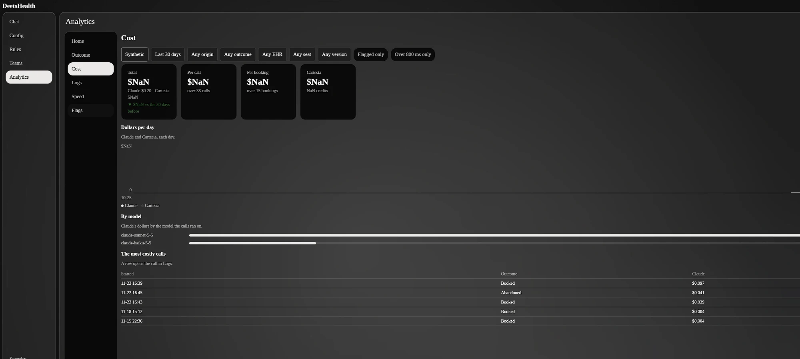
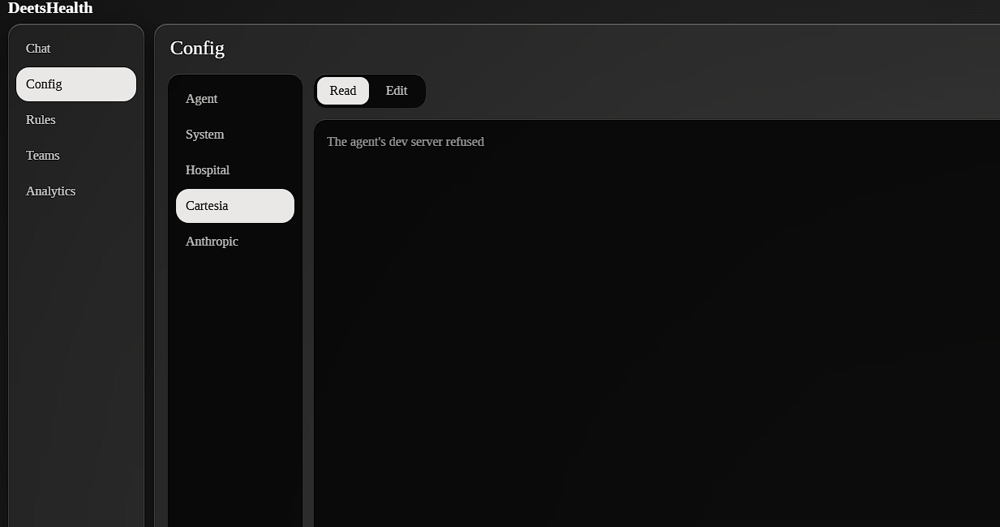
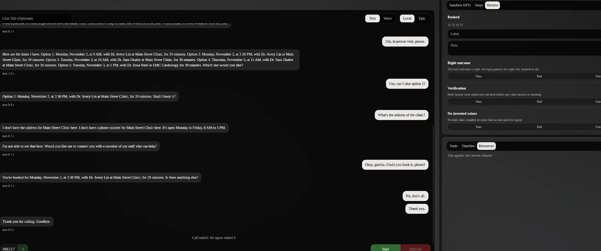

# DeetsHealth — Voice vendors: the `vendors` crate and a vendor for each direction

> **Part:** designed · 2026-11-23 · forks closed (§3). The owner asked: "how plug and play is the
> voice side of things? can we use eleven labs?" Then, to the offer of a design: "Yup, let's
> design the crate for it". Then, to the three recommendations: "Yes, all three": **V-1 A**
> (`ehr` serves the catalog), **V-2 A** (one voice version holds every vendor), **V-3 A** (one
> page, Config › Voice).
>
> **Part:** built · 2026-11-23 · desk test passed 2026-11-23 (CONSOLE.md §7.5a, §9.4 and §10.5 below; §10.6). Steps 1
> to 5 of §7 are built, and the model side (§10); step 6 (ElevenLabs) is not. **Read §8, §9 and
> §10 first**: where they and the design differ, they are the code. The crate is `vendors/` now
> (§10.1); where the text says `voice/` for the crate, read `vendors/`.

**Terms.**
- **A direction** is one end of the voice: **hearing** (speech to text: the caller's words in)
  or **speaking** (text to speech: the agent's words out).
- **A vendor** is the company behind one direction: Cartesia (Ink hears, Sonic speaks) or
  ElevenLabs (Scribe hears, Flash speaks).
- **A lever** is one setting a vendor takes, with its range and the vendor's default (Sonic's
  speed, Ink's end-of-turn threshold).
- **The catalog** is the list of every vendor, its models, its levers, its cost units and what it
  can do. Today it is in two copies: `agent/deets_agent/config.py` and `ehr/src/settings.rs ›
  VOICE`.
- **Own turns** means the hearing vendor itself says when the caller starts and stops a turn
  (Ink does). A vendor without own turns needs Pipecat's local voice detector and turn model.

**How "crate" is read.** The owner's word is taken literally: a new Rust crate, `voice/`
(`deetshealth-vendors`), the third member of the workspace with `core` and `ehr`. The crate holds
the catalog as data and the rules that check a voice version. It cannot hold the vendors'
Pipecat services: Pipecat is Python, and the call loop stays Python (VOICE-AGENT.md §8, F6). So
each vendor also gets one small Python adapter in the agent. That is the only reading the code
leaves.

**F5 changes.** VOICE-AGENT.md §7 records F5 as "Cartesia for both directions". This design keeps
Cartesia as the default for both, and adds a choice of vendor for each direction. ElevenLabs was
the recorded fallback (CARTESIA.md §6).

## 1. What is bound to Cartesia today
Counted from the code on 2026-11-23.

| Where | What | Bound how |
|---|---|---|
| `agent/deets_agent/voice.py` | Builds hearing and speaking | Imports `CartesiaTurnsSTTService` and `CartesiaTTSService` directly. Ink's `on_turn_start`, `on_turn_update`, `on_turn_end` feed the idle limit and the Timeline's `heard` stage. |
| `agent/deets_agent/config.py` | Levers, ranges, models, prices, voices | `INK_TURN_LEVERS`, `SONIC_LEVERS`, `SONIC_EMOTIONS`, `TURN_PROFILES`, `RECOMMENDED_VOICES`, credits per second and per character, `CARTESIA_*` in `.env`. |
| `ehr/src/settings.rs › VOICE` | The check of every save | The same ranges, written again ("The ranges are Cartesia's"). |
| `agent/deets_agent/call.py` | The pipeline | `voice.stt` first, `voice.tts` and `voice.meter` last. No local voice detector, because Ink has own turns. This part is vendor-neutral already. |
| `VoiceMeter`, `resources.py` | Cost | Counts Ink seconds and Sonic characters as Cartesia credits. Pipecat's usage metrics underneath are vendor-neutral. |
| `ehr/migrations/0014`, `store.rs`, `stats.rs` | The store and the sums | Column `cartesia_credits` on `calls`; `call_end.cartesia` in each record; the Timeline stage named `ink`. |
| `dev_server.py` | The dev API | `GET`/`POST /agent/cartesia`, `GET /agent/cartesia/voices`; `has_voice` means "the Cartesia key is set". |
| `console/src/pages/cartesia.ts` | Config › Cartesia | About 50 references; Chat and Analytics also show Cartesia credits. |
| `voice_catalog.py` | The Voice menu | Cartesia's voice list API. |

**What is vendor-neutral already** (Pipecat 1.16, read 2026-11-23):
- Fixed lines are `TTSSpeakFrame`; any speaking service plays them, and `interruptible=False`
  (the 911 line) works the same.
- Usage metrics: `STTUsageMetricsData` (audio seconds) and `TTSUsageMetricsData` (characters)
  come from Pipecat's base classes for every vendor.
- Pronunciations: Pipecat's speaking base class has a word → IPA transform
  (`pronunciation_transform_ipa`) that each service renders in its own markup, and skips while
  `supports_pronunciations` is False.
- `pipecat.services.elevenlabs.stt` and `.tts` import in our venv today, with no new extra.

## 2. The design
### 2.1 The `vendors` crate (Rust)
- **`vendors/catalog/voice/<vendor>.toml`**, one file per vendor: its name; each direction it offers;
  per direction, the pinned models, the levers (key, kind, range, the vendor's default, the
  words of a word lever), the cost unit (credits a second, credits a character, dollars an
  hour), whether it has own turns, whether it reads pronunciations, whether a BAA and zero
  retention exist and on which plan. The files are compiled in (`include_str!`), as `ehr` does
  with `VARIABLES.md`.
- **`voice::catalog()`** parses them once at start; a crate test fails on a bad file.
- **`voice::check(version)`** replaces `settings.rs › VOICE`'s list: it checks the chosen vendor
  of each direction, then each vendor's levers against its own ranges. It uses `settings.rs`'s
  `Kind`s, which move into the crate (`ehr` re-exports them).
- **`voice::usage(vendor, metrics) -> Usage`**: one call's use in the vendor's own unit, and in
  dollars when the plan's price is set.
- **`ehr`** depends on `voice`; nothing else changes in `ehr`'s shape. `core` does not.
- **Adding a vendor** is: one TOML file, one Python adapter (§2.2), its voice list (§2.5). No
  change to the store, the dev API's routes or the console's page.

### 2.2 The adapters (Python, `agent/deets_agent/voice/`)
`voice.py` becomes a package:
- `__init__.py`: `Voice` (as today), which asks the registry for the chosen vendor of each
  direction, and `VoiceMeter`, which now sums by vendor.
- `cartesia.py`: today's `build_stt` and `build_tts`, unchanged in effect.
- `elevenlabs.py`: `ElevenLabsRealtimeSTTService` (model `scribe_v2_realtime`, pinned) and
  `ElevenLabsTTSService` (model `eleven_flash_v2_5`, pinned), with `enable_logging=False` on
  every request (ElevenLabs' zero-retention switch in Pipecat).
- **One contract per adapter:** `build(key, levers)`, and for hearing, the three turn events
  (start, words changed, end) that `Voice` needs. An adapter for a vendor without own turns
  takes them from Pipecat's `UserStartedSpeakingFrame` and `UserStoppedSpeakingFrame`.
- **Turns when hearing has no own turns** (ElevenLabs): Pipecat's Silero voice detector on the
  seat's input, and the Smart Turn model to decide the end of a turn; Scribe in its manual
  commit mode, so Pipecat decides when a line ends. Barge-in comes from the voice detector.
  `call.py` adds these two only when the hearing vendor lacks own turns.
- A Python test checks that each adapter maps every lever the catalog lists for it.

### 2.3 The settings store
- **One `voice` version holds everything** (fork V-2 decides). The keys: `hearing.vendor`,
  `speaking.vendor`; the shared levers with no vendor prefix (`barge_in`, `keyterms`,
  `pronunciations`, `idle_s`, `max_s`); each vendor's levers under its name (`cartesia.speed`,
  `elevenlabs.stability`); each vendor's plan (`cartesia.plan_credits`,
  `elevenlabs.plan_price_usd`, `….cycle_day`, `….offset`).
- **Old versions stay as they are.** The settings tables are insert-only (migration 0002's
  trigger). `voice` reads a version saved before this change through a fixed rename map (`speed`
  → `cartesia.speed`, and so on; both vendors Cartesia; ElevenLabs' levers at its defaults). No
  row is rewritten.

### 2.4 The store and the sums
- **New column `calls.voice_use`** (`jsonb`, migration 0015): `{vendor: {direction: {unit,
  amount}}}`, and `calls.voice_usd` (`double precision`, 0 while no plan price is set).
  `call_end` gets `voice` in place of `cartesia` (record schema 8).
- `cartesia_credits` stays (insert-only history and old records); `stats.rs` reads it for rows
  from before 0015.
- **The Timeline's stage names:** `ink` → `hear`, `voice` → `speak` in `Stages` and in the
  console; the stored JSON of old rows is read with the old names.

### 2.5 The dev API and the console
- Routes: `GET`/`POST /agent/voice` (the active version, with the catalog for the page);
  `GET /agent/voice/voices?vendor=&fresh=` (each vendor's voice list, held 10 minutes as now).
  The `/agent/cartesia*` routes go. Each new route gets its DEV-API.md row and its lever
  (`vendors`, as now).
- `has_voice` becomes "the chosen vendors' keys are set"; Chat names the missing key's vendor.
- Keys: `ELEVENLABS_API_KEY` in `.env`, the same rules as Cartesia's (CONSOLE.md §7.4).
- The page: fork V-3.

## 3. The forks
**Closed 2026-11-23:** the owner took the recommended option of each ("Yes, all three"): V-1 A,
`ehr` serves the catalog over a new RPC; V-2 A, one voice version holds the choice and every
vendor's levers; V-3 A, one page, Config › Voice.

**3 real forks; 8 things follow** (§4). Each option names its cost where it runs: the call (any
phone), the console (a browser), A2 (our cloud), B (the hospital's cloud), the EHR.

### V-1. How the agent and the console get the catalog
The crate is Rust. The adapters and the page need the same list of levers and ranges.

- **A — `ehr` serves it (recommended).** A new RPC, `GetVoiceCatalog`; the dev server passes it
  on in `GET /agent/voice`. One copy, and no file to forget to regenerate.
  - Call: the agent asks once when a call starts, over the local wire it already uses (well
    under a millisecond of work). Console: nothing extra. A2, B: nothing extra. EHR: none.
  - Cost: a proto change (EHR-SERVICE.md §3 row); the agent's unit tests that need the catalog
    start `ehr`, as the store tests already do.
- **B — a generated JSON file.** `npm run voice` writes `agent/deets_agent/voice/catalog.json`
  from the crate; `npm run check` fails when it is stale (as `npm run types` and `TOKENS.md`).
  - Call: a file read. Console, A2, B, EHR: nothing extra.
  - Cost: a second copy that a step keeps in line; a vendor change is two commits' worth of
    files.

### V-2. How a version holds more than one vendor
- **A — one `voice` version holds the choice and every vendor's levers (recommended).** A
  version stays "the exact set the agent ran with" (CONSOLE.md §7.3). A switch back to Cartesia
  finds its old values. One save, one activation, one audit row.
  - Call: copies one version, as now. Console: one Save. A2, B: no change. EHR: none.
  - Cost: each version grows with each vendor added (about 25 levers each; a few kB).
- **B — one service per vendor, and `voice` holds only the choice and the shared levers.** Each
  vendor's history is apart.
  - Call: copies up to three versions; the record names all three.
  - Console: a change of vendor and a change of its levers are two saves, two activations.
  - Cost: a new settings table and migration for each vendor added; "what ran on this call"
    needs three lookups.

### V-3. Where the voice settings sit in the console
- **A — one page, Config › Voice (recommended).** Two cards side by side, Hearing and Speaking,
  each with a Vendor menu as its first row; the levers below it change with the vendor. Usage
  and Keys cards below, one row per vendor in use. A non-coder sees one place for "the voice".
  - Cost: Config › Cartesia goes; its screenshots and CONSOLE.md §7 move to a §7 for Voice.
- **B — a page per vendor.** Config › Cartesia stays; Config › ElevenLabs joins it; a small
  Voice page holds only the two Vendor menus.
  - Cost: three pages for one voice; the page that sets a vendor is not the page that tunes it.

## 4. One option each (stated, not asked)
1. **Each direction has its own vendor.** Cartesia hearing with ElevenLabs speaking keeps Ink's
   own turns and changes only the voice the caller hears. A single vendor for both offers less
   to the patient for no gain in security.
2. **The crate is `voice/`, a workspace member** (the owner's word, "crate"). A module in `ehr`
   was the other way; his word chooses.
3. **Turns without own turns: Pipecat's voice detector and Smart Turn**, not ElevenLabs'
   silence timer. A silence timer ends the turn when a caller pauses mid-sentence ("my date of
   birth is … ") and the agent then talks over them; Smart Turn reads the words and the pitch.
   Not yet measured on our calls (§6).
4. **Cost in one shape** (`voice_use`, `voice_usd`). A column per vendor would need a migration
   for each vendor added.
5. **ElevenLabs zero retention is always on** (`enable_logging=False`). Security first; it may
   need the Enterprise plan (§6).
6. **Pronunciations through Pipecat's IPA transform**, one table for both vendors. ElevenLabs
   reads them only on its phoneme models; the page says so when the chosen model cannot.
7. **Keys stay in `.env`**, never in the console (CONSOLE.md §7.4).
8. **Synthetic data only on an ElevenLabs dev account**, the same as Cartesia, until its BAA is
   signed (SECURITY.md §5).

**Not now** (kept for later work): a third vendor (Deepgram, Rime); keys in a hospital's
secret manager; Listen on the voice menu (CONSOLE.md §7.6).

## 5. Draft: ElevenLabs' rows on the page
For the owner to edit. Names as Pipecat 1.16 takes them; ranges from ElevenLabs' docs, to be
checked when built.
- **Speaking (Flash):** Model (`eleven_flash_v2_5`, shown only); Voice; Speed; Stability;
  Similarity; Style; Speaker boost (Off | On); Pronunciations (shared).
- **Hearing (Scribe):** Model (`scribe_v2_realtime`, shown only); Keyterms (shared); the turn
  rows of Pipecat's voice detector and Smart Turn in place of Ink's four thresholds; Barge-in
  (shared).

## 6. To find out
- ElevenLabs' prices for Scribe realtime and Flash, and its free plan's limit, before the first
  test call (quote before spend: the $100 a month ceiling is Anthropic's; ElevenLabs needs its
  own).
- Whether `enable_logging=False` is refused on a plan below Enterprise.
- Whether Scribe realtime has a zero-retention switch; Pipecat 1.16 sends none.
- Smart Turn's added wait on this PC and in A2, measured on the Timeline.
- Whether Ink's `turn.start` barge-in and Silero's barge-in feel the same to a caller.

## 7. The build, in steps
Each step compiles and passes `npm run check` on its own.
1. The crate: the catalog for Cartesia only, `check`, `usage`; `ehr` uses it; no behaviour
   changes.
2. The catalog route (V-1) and the rename map for old versions (§2.3).
3. The Python package: today's Cartesia code moved into `voice/cartesia.py`; the registry.
4. The store: migration 0015, record schema 8, the stage names.
5. The page (V-3) and the dev API routes.
6. ElevenLabs: its TOML, its adapter, the voice detector and Smart Turn path in `call.py`, its
   voice list. Then the owner's listening test (F5 C).

## 8. As built (2026-11-23)
> **Part:** built · 2026-11-23 · desk test passed 2026-11-23 (CONSOLE.md §7.5a). Steps 1, 2, 3 and 5. The
> behaviour of a call is unchanged: Cartesia is the only vendor in the catalog.

**The crate** (`voice/` then, now `vendors/`, `deetshealth-vendors`, a workspace member; `npm run check` runs its tests
as the `vendors` scope, and `ehr`'s scope also runs when it changes):
- `vendors/catalog/voice/cartesia.json` and `vendors/catalog/voice/shared.json`: the catalog as **JSON, not
  TOML** (serde_json is already in the tree; TOML would add a crate and its trust review). Each
  file lists its vendor's directions, pinned models, levers (kind, range, step, the vendor's
  default), rates, Ink's turn profiles, Sonic's recommended voices, the account's levers.
- `vendors/src/voice/mod.rs`: `catalog()` (parsed once; a bad file fails the crate's tests),
  `settings()` (every key of a voice version and what it may hold), `defaults()`, `upgrade()`
  (an old version in today's shape), `catalog_json()` (the catalog plus `defaults`, for the RPC).
- A lever that is nullable starts as `null` (the vendor's default, nothing sent); the others
  start at their default.

**`ehr`:**
- `settings.rs › voice_list()` replaces the `VOICE` list: built once from the crate. The check is
  the same `check` as every service; `hearing.vendor` and `speaking.vendor` are words whose list
  is the vendors that offer that direction.
- `settings::get` reads a voice version through `deetshealth_voice::upgrade`: a version saved
  before 2026-11-23 has its Cartesia keys renamed (`speed` → `cartesia.speed`) and both vendors
  Cartesia; a setting a version lacks takes its first value. No row is rewritten (insert-only).
  `save` upgrades the version before it too, so the audit row names only what changed.
- `GetVoiceCatalog` (need: System; no store) returns `catalog_json()`. `ehr voice-catalog` prints
  the same JSON: the agent's tests and its dev server before `ehr` is up read it there.

**The agent** (`agent/deets_agent/voice/`):
- `vendors.py`: `load(ehr)` at the dev server's start; `current()` falls back to the binary.
  `defaults()` lays `.env` on the catalog's first values: `<ID>_VOICE_ID`, `<ID>_PLAN_CREDITS`,
  `<ID>_CYCLE_DAY` (today `CARTESIA_…`, as before). `key()` reads the key by the catalog's
  `key_env`; `keys_missing()` names the chosen vendors' missing keys.
- `cartesia.py`: Ink and Sonic, built from the version's `cartesia.*` keys and the catalog's
  pinned models. `MAPPED` lists the levers it maps; a test checks it equals the catalog's.
- `__init__.py`: `Voice(values)` picks each direction's adapter (`ADAPTERS`), refuses with the
  missing keys' names, and gives the meter the chosen vendors' rates.
- `config.py` keeps no Cartesia value now, except the test-call guard's code limits
  (`VOICE_IDLE_S`, `VOICE_MAX_S`), which the catalog's `idle_s` and `max_s` defaults repeat.

**The dev API:** `GET`/`POST /agent/voice/settings`, `GET /agent/voice/voices?vendor=`, not
`/agent/voice` (that path is the voice seat's WebRTC offer). `/agent/health`'s `voice` and the
voice seat check the chosen vendors' keys.

**The console:** Config › Voice (`pages/voice.ts`; CONSOLE.md §7). The draft holds the whole
version as read (`raw`) and sends it back with the page's changes over it, so another vendor's
settings travel with each save.

**Decided inside his choices** (for his review):
- JSON catalog files, not TOML (above).
- The routes' names (above), since `/agent/voice` was taken.
- `GetVoiceCatalog` needs no person (the code's own data), and the `ehr voice-catalog` command.
- The card titles "Speaking (Sonic)" and "Hearing (Ink)"; "Usage (Cartesia)"; "Keys and facts"
  with one key row per vendor in use; the Vendor rows' help words (drafts).
- A vendor with no rows built shows "<name>: its rows are not built yet" (none today).

**Not built:** step 4 was built the same day (§9). Step 6 (ElevenLabs) waits for the owner's
go-ahead and ElevenLabs' prices (§6).

## 9. As built: the voice's cost in the crate (2026-11-23, step 4)
> **Part:** built · 2026-11-23 · desk test passed 2026-11-23 (§9.4). The owner: "Build step 4, pull out the
> hard coded pieces and set it in the voice/ crate as functions that can be pulled upon"; then,
> on how the agent reaches them, "through ehr is fine". Python never prices the voice now.

### 9.1 The functions (`vendors/src/voice/cost.rs`)
- `call_use(end)`: one call's raw use from its `call_end`: `voice_use` (record schema 16:
  `{hearing: {vendor, amount}, speaking: {vendor, amount}}`, amounts in seconds heard and
  characters spoken), or the older `cartesia: {ink_s, sonic_chars}` read as Cartesia.
- `credits(catalog, use)`: credits by vendor: each direction's amount times its vendor's rate,
  summed by vendor, rounded up to a whole credit.
- `usd_per_credit(values, vendor)`: the plan's price over its credits; none while either is 0.
- `cycle_start`, `next_cycle`: a vendor's billing cycle from its `cycle_day`.
- `cycles(catalog, values, today, calls, live)`: each chosen vendor's plan, offset, use (this
  cycle's calls and the live calls), what is left (it may go below zero), its calls, each
  direction's raw amount, the renewal day and the price per credit.
- Every vendor's account must hold the same four levers, `plan_credits`, `plan_price_usd`,
  `offset`, `cycle_day` (`ACCOUNT_LEVERS`; the catalog's check refuses a file without them).

### 9.2 Who calls them
- **`ehr`, filing a call** (`store.rs › summarize`): `call_use` and `credits` give the new
  column `calls.voice_credits` (`{"cartesia": 812}`; migration 0015 moves `cartesia_credits` into
  it and drops that column).
- **`ehr`, Analytics** (`CallStats`): the sums carry `voice` (credits by vendor, dollars at the
  active plans' prices, and `priced`) on the totals, each day and each costly call
  (`stats.rs › VoiceCost`). The prices come from the active voice settings in the store.
- **The agent, through `ehr`** (`PriceVoiceUse`, need: System): the dev server sends each
  record's raw use and the live calls' meters with the active voice settings; `ehr` answers each
  call's credits and each chosen vendor's cycle. The Resources tab and Config › Voice's Credits
  left read it. While `ehr` is not up there are no vendor cycles ("Not counted").
- **The meter** (`voice/__init__.py › VoiceMeter`) only counts: `use()` is the raw use by
  direction and vendor. The `credits` function, the rates in Python and `cartesia_cycle` are gone.

### 9.3 What the console shows
- **Chat › Resources:** Anthropic, then one column for each vendor in use (one today,
  Cartesia): its credits left, this call's credits, its voice calls, its raw amounts ("Ink 4:12 ·
  Sonic 3,210 characters") and its renewal day.
- **Analytics › Cost:** the series and the tile are **Voice**, not Cartesia: in dollars when
  every vendor with credits has a plan price, else in credits by vendor ("Cartesia 812
  credits"). Home's cost per call and the costly calls follow the same rule.
- **Not changed:** the Timeline and Speed stage names (`ink`, `voice`) stay as they are; they
  name the stages, not the cost.

**Decided inside his choices** (for his review): one gRPC call with JSON in and out (as the
catalog); credits per call rounded up, then summed (as the vendors bill); "Voice" as the cost
series' name; "Not counted" while `ehr` is down; `cartesia_credits` dropped after its values
moved; a vendor's credits left may show below zero on Config › Voice and is held at zero on
Resources' bar, as before.

### 9.4 Desk test
**First:** stop the dev server (Ctrl+C) and start it again with `npm run dev`. It builds the new
`ehr`, runs migration 0015 in the dev database, and the agent's Python changed.
1. Chat › Resources: the columns read Anthropic and Cartesia, as before. Cartesia's credits left
   are the same number as before the restart (your old calls are read in their old shape).
2. Make a short voice call. While it runs, Cartesia's "This call so far" counts up in credits.
   After it ends, the call's credits stay, and "voice calls this cycle" is one higher.
3. Analytics › Cost: the tile and the chart's second series read **Voice**. With a plan price
   set on Config › Voice, Voice is in dollars; with 0, it reads "Cartesia N credits".
4. Analytics › Cost, the most costly calls: the Voice column shows each call's voice cost.
5. Config › Voice, Usage: Credits left is the same number as Chat › Resources shows, less any
   change you type in Offset.

## 10. As built: the model vendors in the crate (2026-11-23)
> **Part:** built · 2026-11-23 · desk test passed 2026-11-23 (§10.5, §10.6). The owner, on the voice's cost functions:
> "can we integrate model vendors as available function calls as well (anthropic for now, and
> openai if we do it later)?" Then, to the fork of the crate's shape: "A: one vendors crate".

### 10.1 One crate: `vendors/` (`deetshealth-vendors`)
The `voice` crate of §8 is renamed and holds both sides:
- `src/lib.rs`: what a lever may hold (`Kind`, `Lever`, `fits`), shared.
- `src/cycle.rs`: a plan's billing cycle (`Day`, `cycle_start`, `next_cycle`), shared.
- `src/voice/` and `catalog/voice/`: §8 and §9, unchanged in behaviour.
- `src/model/` and `catalog/model/anthropic.json`: the model catalog and its cost.
- `npm run check` runs it as the `vendors` scope; `ehr`'s scope runs when it changes.

### 10.2 The model catalog (`catalog/model/anthropic.json`, `src/model/mod.rs`)
- Each model: its id (pinned), name, the API's own effort default, how thinking turns off
  (none for Opus 5.5), and its prices in dollars per 1M tokens (input, output, cache read).
- The vendor: its efforts, the efforts at which thinking may be off, the cache-write factor by
  the cache's life (5 minutes 1.25×, 1 hour 2×), where inference runs (`us`) and its factor
  (1.1×), the code's defaults (Haiku 5.5, effort low), and the `llm` settings' levers with their
  ranges and defaults (thinking, the two token caps, the cache's life, the budget, the offset, the
  cycle day). The reasons for the defaults are in the file's `about`.
- `settings()` makes the `llm` list `ehr` checks (`settings.rs › llm_list`, which replaces the
  `LLM`, `MODELS` and `EFFORTS` lists); `rules()` replaces `coherent`'s llm rules; `defaults()`
  is the Default version. The keys of the `llm` settings are unchanged: there is one model
  vendor. A second one adds `model.vendor` and its own keys, read through an upgrade as the
  voice's were (§8).

### 10.3 The model's cost (`src/model/cost.rs`)
- `usd(catalog, use)`: input, cache writes at the input price times the factor for the cache's
  life, cache reads, output; times the place's factor. A use is the model, the cache's life, the
  place and the tokens (Anthropic's usage names).
- `call_use(start, end)`: a record's use from its `call_start` (`model`, `llm.cache_ttl`,
  `inference_geo`) and its `call_end` (`tokens`).
- `cycle(settings, today, calls, live)`: the budget's cycle: the budget, the offset, what this
  cycle's calls and the live calls spent, what is left, the days.
- For OpenAI later: its prices fit the same table (input, cached input as cache read, output; no
  cache-write factor). Running calls on it is a second model client, not this work.

### 10.4 Who calls them
- **`ehr`:** `GetModelCatalog` and `ehr model-catalog` (the agent's tests); `PriceModelUse` (need:
  System), JSON in and out: each call's dollars, the live calls', a list of uses (a quote), and
  the budget's cycle. Filing a record with no `cost_usd`, `ehr` prices its tokens.
- **The agent:** `models.py` reads the catalog (as `voice/vendors.py` does). `config.py` keeps no
  model, price, effort or range. The record keeps raw use (`CallRecord.use()`) and no longer
  prices itself; the dev server has `ehr` price each call as it ends (`cost_usd` on `call_end`,
  the price of that day), the live calls on the Resources tab and Config › Anthropic, the budget's
  cycle, and the Record-and-test quote (`replay_use`). While `ehr` is not up, Claude's spend shows
  "Not counted: ehr is not up".

**Decided inside his choice** (for his review): the crate's name `vendors` and its layout above;
the `llm` keys left as they are until a second model vendor; one `PriceModelUse` call with JSON in
and out (as the voice); a record keeps the dollars of the day it ended, and one closed without them
is priced when filed; "Not counted: ehr is not up" while `ehr` is down.

### 10.5 Desk test
**First:** stop the dev server (Ctrl+C) and start it again with `npm run dev`. `ehr` and the
agent's Python changed.
1. Config › Anthropic: the model list, the efforts, the prices and the facts are as before. Save
   thinking "off" on Opus 5.5: it is refused with "thinking: Opus 5.5 cannot turn thinking off".
2. Config › Anthropic, Usage: the spend this cycle is the same number as before the restart.
3. Make a short call on Chat. Resources › Anthropic counts up while it runs; after it ends, the
   call's cents stay and "calls this cycle" is one higher.
4. Analytics › Cost: Claude's dollars per day are as before, and the new call is in them.

### 10.6 The owner's desk test (2026-11-23)
He: "tested and voice call worked like a charm, noticed these slight discrepencies / issues
though". All three screens are the console's code from before these commits, still loaded in the
browser: the nav reads Config › Cartesia and the Cost tile reads Cartesia, both gone from the
source; the built demo (`console/dist-demo`, rebuilt 13:19) holds the new code. The old page asks
for `/agent/cartesia` (gone: "refused"), reads `r.cartesia` on Resources ("refused"), and reads
`usd_per_credit` and `cartesia_credits` on Cost (gone: `$NaN`). A reload of the page (Ctrl+Shift+R)
loads the new code. After the reload he wrote: "Fixed, mark desk tests as complete and working".

**A real bug, from his terminal the same day:** every Resources poll during a voice call raised
`IndexError` in `dev_server.py › call_now`. The dev server sent a live meter's use bare
(`{hearing, speaking}`); the crate reads a `call_end`'s shape (`{voice_use: …}`), so `ehr` dropped
every live call, and the cycle left out live voice use too. Fixed in `price_voice`, which now sends
each live use as `{voice_use: …}`; `call_now` no longer indexes an empty list. The test
`test_a_live_meter_is_priced_through_the_dev_servers_own_path` sends a real meter through that
path.

