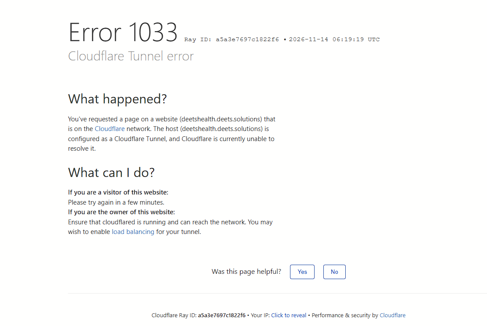
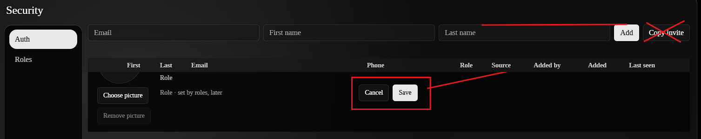
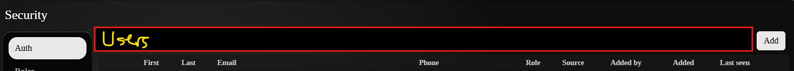
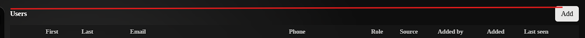

# DeetsHealth — The demo over a tunnel

> Built; read §7 first. **Desk test passed 2026-11-21** (the owner: "cloudflare access is good
> to go, demo tunnel as well"): the tunnel (§6) and the guest list's writes to the Access group
> (Security › Auth, §3.5). Friends open
> the console from their own PCs at `https://deetshealth.deets.solutions/demo/` and use it as
> an analyst would.

**Words used here.**
- **Tunnel:** `cloudflared` on the owner's PC opens an outbound link to Cloudflare. Cloudflare
  serves an `https` address that leads back to one port on this PC. No port opens to the
  internet.
- **Access:** Cloudflare Zero Trust's sign-in gate in front of that address. A person types
  their email and gets a one-time code. Only the emails on the policy get in.
- **Access token:** the signed JWT that Access adds to every request it lets through, in the
  `Cf-Access-Jwt-Assertion` header. It names the person's email.
- **Guest:** a friend on the Access policy.
- **TURN:** a relay for a WebRTC call's audio, for when two ends cannot reach each other
  directly. **STUN:** a free service that tells each end its public address, so they can try
  to connect directly first.

## 1. The owner's choices (2026-11-13)
- "imagine my friends are analysts and I want to give them full demo / full access."
- "pretend they are like me in terms of access. We can worry more when we set up RBAC." No
  spend cap for now. Roles came on 2026-11-18 ([ACCESS-ROLES.md](../architecture/ACCESS-ROLES.md)): a guest now needs one (§3.5).
- **Several calls at once** (fork A): "this can help us test the PHI tab with each analyst / me
  spectating each others and also testing their own."
- **The address:** "deetshealth.deets.solutions/demo".
- **Hot reload:** asked for; §3.2 gives what is possible.
- **The guest list from inside the console**, later replaced by staff sign-in (§3.5).
- **No email on guest writes for now:** "we'll design when we design the audit log".
- **No "synthetic data" marker** in the top bar.

So a guest gets everything the owner gets: Testing calls (typed and voice), Demo, PHI mode,
the catalog, ratings and notes, and every Config page with its saves. This replaces the
watch-only view in the earlier idea ([ideas/README.md](../ideas/README.md)).

## 2. What the code says (read 2026-11-13)
1. **Vite's proxy adds the launch token** to every `/agent/*` request (`console/vite.config.ts`).
   Anyone who reaches the Vite address can use the whole agent. That is safe today only
   because Vite listens on this PC.
2. **The Vite dev server must never face the tunnel.** Its root is `console/`, but it serves
   files from the whole repo through `/@fs/`. Its block list covers `.env*`, `*.crt`, `*.pem`
   and `.git`. It does not cover `dev-certs/*.key` (the mTLS private keys) or `dev-dumps/`.
   Vite has also had several bugs that got around that block list. And the dev server sends
   each source file as its own request, which is slow over a tunnel.
3. **The agent's wall** (`State.allowed` in `dev_server.py`) takes the launch token and an
   Origin of `http://localhost:<port>` or `http://127.0.0.1:<port>`. A tunnel's origin fails it.
4. **One call at a time.** A second Start gets "a test call is already running"
   (`_refuse_call`). The watch stream and PHI mode follow `state.live`, the one live call.
5. **The voice seat uses WebRTC with host candidates only** ("On this PC both ends are local";
   `new RTCPeerConnection()` with no ICE servers in `transport.ts`). A guest's browser cannot
   reach this PC's UDP ports, so a voice call from a guest fails without STUN and TURN.
6. **The console assumes it sits at `/`.** 19 paths in `console/src` start with `/agent`;
   `index.html` and `manifest.webmanifest` (`id`, `start_url`, `scope`, icons) use `/`. The
   console has no URL routing, so nothing else depends on the path.
7. **A full console build takes about 1.7 s** on this PC (`vite build`, 2026-11-13).
8. **Cloudflare, read with `cf` 2026-11-13:** the zone `deets.solutions` is active; the Access
   team is `deetssolutions.cloudflareaccess.com` with email codes (set up for DeetsMusic,
   DeetsMusic's `docs/ops/LIVE-MCP.md` §8); no tunnel exists yet.

## 3. The design

### 3.1 The address and the path of a request
**The address:** `https://deetshealth.deets.solutions/demo/`.
- One level under `deets.solutions` is covered by the free Universal SSL certificate. A deeper
  name such as `demo.deetshealth.deets.solutions` would need Advanced Certificate Manager
  ($10 a month). The path gives the nesting for free.
- The console is built with Vite's `base: "/demo/"`. Its 19 `/agent` paths go through one
  helper that adds the base, and the manifest's `id`, `start_url`, `scope` and icons move under
  `/demo/`. On this PC, `npm run dev` still serves the console at `/`.
- **The Access app covers the whole hostname**, not only `/demo`. So nothing on
  `deetshealth.deets.solutions` is ever outside Access. The agent answers only under
  `/demo/`; every other path gives 404. If the real console comes to this hostname later, it
  gets its own Access app or staff sign-in then.

**The path of a request:** guest's browser → Access (sign-in) → the tunnel → the agent's dev
server on `127.0.0.1:<agent port>`. Vite's dev server is not on this path (§2.2).

### 3.2 Live reload (what "hot reload" can be here)
True hot reload (Vite's HMR, which swaps a module in place) needs the Vite dev server on the
tunnel, and §2.2 rules that out. The design gives **live reload** instead:
1. `npm run dev` (with the demo on, §7) runs `vite build --watch` into its own folder. A saved change rebuilds in
   about 2 s or less (§2.7).
2. The agent serves that folder. When a build finishes, it tells each open page over the watch
   stream.
3. A page reloads itself at once when it is idle: no call running in that tab and no unsaved
   edit on a Config page. Otherwise it reloads when the call ends or the edit is saved or
   dropped. A guest never loses a call or a draft to a reload.
4. A change to the agent (Python) or to `ehr` (Rust) still needs a restart of `npm run dev`.

The owner's own Vite tab on this PC keeps true hot reload.

### 3.3 A second door in the wall
A request passes if it has either:
- the launch token and a local origin (the owner's Vite, as today); or
- a valid Access token and the origin `https://deetshealth.deets.solutions`.

The agent checks the Access token itself: the signature against the team's keys
(`/cdn-cgi/access/certs`, cached), the issuer, the app's `aud` tag and the expiry. It also
checks that the token's email is still on the guest list (§3.5, cached 30 s). So a request
that slips past Access gets a 403, and a removed guest is out within 30 s, even with a live
Access session. The same check runs on every WebSocket upgrade and on the voice route. The
launch token never leaves this PC.

### 3.4 The tunnel and the Access app
- **The Access app:** `DeetsHealthDemo`, self-hosted, on `deetshealth.deets.solutions`. Its
  policy allows one Access group, *DeetsHealth demo guests*: the owner's email and each
  friend's. The emails live only in that group, never in a doc, a commit or this repo. Session
  length: 24 hours.
- **The tunnel:** a named tunnel `deetshealth-demo`, locally managed. Its credentials file sits
  in `~/.cloudflared/<id>.json`, outside the repo. `npm run dev` (the owner, 2026-11-13:
  "tie it to npm run dev with the guards"; §7) also starts the build watch (§3.2) and runs
  `cloudflared tunnel run --credentials-file … --url http://127.0.0.1:<agent port> <id>`. The port is
  free-picked at each launch. Ctrl+C stops the tunnel first, then everything else, and waits
  (5 s at most) for each to end. The tunnel's shutdown lines are dropped: it logs a normal
  shutdown at ERR level (streams cut, connections closed). When the dev server
  is not running, the address shows Cloudflare's error page and reaches nothing.

### 3.5 The guest list from the console
Yes, the console can manage it.
- **Now:** a console page lists the guests' emails, with Add and Remove. The agent makes the
  change through Cloudflare's API on the one Access group (§3.4). A Remove also revokes that
  person's Access sessions, and the wall's own check (§3.3) ends their requests within 30 s.
- **The Cloudflare API token** sits in `.env` and never reaches a browser. Its scope is
  "Access: Apps and Policies Edit" on this account. Cloudflare cannot narrow a token to one
  group, so the agent's code touches only the one group id. The token could in principle
  edit DeetsMusic's Access apps too; a separate Cloudflare account for DeetsHealth would close
  that, at the cost of a second account.
- **Because guests are "like me"**, a guest can add or remove guests too. Roles change this
  later (ACCESS-ROLES.md).
- **Later, with staff sign-in** ([ideas/STAFF-SIGN-IN.md](../ideas/STAFF-SIGN-IN.md)): the
  same page sits on an interface, "who may sign in". Its first backend is the Access group. Its
  next is the hospital's IdP (Entra ID, Okta) and our roles. The page does not change; the
  backend does.
- **Not now:** the page's place in the nav, its name and its controls are forks for when it
  is built.

### 3.6 Several calls at once (fork A)
- The agent holds a set of live calls, each with its own record, keyed by call id.
  `_refuse_call` no longer refuses a second call; it keeps the per-call checks.
- The watch stream carries each event with its call id. A watcher asks for one call, or for
  the list of live calls.
- **PHI mode picks the call to watch**, so the owner and each guest can watch any live call,
  their own or another's. How the picker looks is a fork for when it is built (CHAT.md).
- The cost line on Config › Anthropic sums every live call.

### 3.7 Voice through STUN and TURN
- For each voice call the agent asks Cloudflare for short-lived TURN credentials
  (`POST https://rtc.live.cloudflare.com/v1/turn/keys/<key id>/credentials/generate-ice-servers`,
  TTL one hour). The browser and the agent get the same `iceServers`. The port-53 URL is
  dropped, because browsers block it and the voice seat does not trickle candidates.
- ICE tries a direct link first (STUN, free). It uses the TURN relay only when the direct link
  fails.
- The TURN key id and its API token sit in `.env`. The owner's local calls keep host
  candidates only.
- **Privacy:** WebRTC encrypts the audio end to end with DTLS. Cloudflare relays encrypted
  packets and sees only addresses, ports and times. Every caller in the demo is synthetic.
  TURN is not on the production path: real calls come in through Twilio.

**The cost (read 2026-11-13 from Cloudflare's Realtime pricing and TURN FAQ):**
- $0.05 per GB, metered on data sent from Cloudflare to each TURN client. The first 1,000 GB
  each month are free (shared with Cloudflare's SFU, which we do not use). STUN is free.
- One voice call is about 50 kbit/s each way with headers. If both ends use the relay, that is
  about 0.75 MB a minute, or 45 MB an hour.
- So 1,000 GB is more than 20,000 hours of relayed calls a month. The demo costs nothing here.
  Past the free GB, an hour of relayed voice costs about $0.002.
- Still to check when the TURN key is made: whether Cloudflare asks for a payment method.

### 3.8 Later: Twilio over the same tunnel
TURN and Twilio sit at different layers (the owner asked, 2026-11-13):
- **The swap point is the transport.** `Call` (`call.py`) takes any Pipecat `BaseTransport`,
  and `_run_call` (`dev_server.py`) passes one in. The typed seat uses a WebSocket; the voice
  seat uses `SmallWebRTCTransport`. Twilio becomes a third seat: a route that builds
  `FastAPIWebsocketTransport` with Pipecat's Twilio serializer (8 kHz μ-law, Media Streams)
  and calls the same `_run_call`. The call loop does not change.
- **TURN serves only the browser seat.** It stays under that seat when Twilio comes; phone
  calls never use it. So TURN stays small (§3.7): no interface of its own.
- **The tunnel carries over.** BUILD-ORDER.md plans "a real Twilio number and a tunnel". The
  same tunnel brings Twilio's webhook and its Media Streams WebSocket to this PC. That route
  cannot sit behind Access (Twilio cannot sign in): it gets its own path outside Access and
  checks Twilio's request signature (`X-Twilio-Signature`) instead.
- **The BAA first.** A real person's phone audio is protected data. Until the BAA is signed,
  only synthetic test calls reach the number. Guests could then call a phone number, which is
  closer to the product than the browser seat.
- **Before a number exists**, the fake Twilio caller (VOICE-AGENT.md §9, layer 5) tests the
  Twilio seat, the 8 kHz path and barge-in from WAV files.

### 3.9 The route ledger
New routes (the build watch's reload signal, the guest list, the TURN credentials) each get
their row in [architecture/DEV-API.md](../architecture/DEV-API.md) in the same commit.

## 4. Each place it runs
- **The call:** no change. The phone line is not part of the demo.
- **The console:** any recent browser, on a PC or a phone. A hospital network may block
  WebSockets or WebRTC to an unknown site; TURN over TLS on port 443 gets through most of them.
- **Deploy targets:** none. This runs on the owner's PC only and goes away with the cloud
  deploy ([integrations/CLOUD.md](../integrations/CLOUD.md)).
- **EHRs:** Local and Epic's public sandbox, as on Chat today. Several guests on Epic add
  sandbox reads; the 5-minute cache on `/agent/sandbox` keeps them low.

## 5. Build steps
1. `cf`: create the tunnel, the DNS record, the Access group and app, and the TURN key, with
   the owner's go for each (they face the internet). Done (§7).
2. The wall's second door and the Access token check, with tests in `agent/tests/`. Built (§7).
3. The base path (`/demo/`), `--static` in the dev server, the build watch and live reload,
   the demo inside `npm run dev` with its guards. Built (§7).
4. Several calls at once (§3.6), PHI's Caller list (fork A) and the label beside Start (fork
   2A). Built (§7).
5. STUN and TURN for guest voice calls (§3.7). Built (§7).
6. The guest list page (§3.5), after its forks.
7. The desk test (§6). Then this doc's status becomes `built`. Passed 2026-11-21.

## 6. Desk test (passed 2026-11-21)
1. `npm run dev`. The output says `[demo] on: https://deetshealth.deets.solutions/demo/`.
2. On a phone on mobile data, open the address: Access asks for an email. A non-listed email
   gets no code.
3. Sign in with a listed email. The console opens.
4. Start a typed call on Local, then a voice call. Both run.
5. On the PC, type a title in "Chat Title (Optional)" at the canvas's top left and start a second call at the same time. In PHI's
   Caller tab on each side, both calls are listed, the label on the PC's; press the other
   call's row and watch it from its start. When it ends, its label is in Demo's list.
5a. Start `npm run dev` in a second terminal while the first runs: it says the tunnel already
   has a connector and runs without the demo. In the Pipecat worktree it says it is a worktree.
6. Change a console file and save it. The phone's page reloads within a few seconds when no
   call runs; during a call it waits for the call to end.
7. `https://deetshealth.deets.solutions/` and `/demo/@fs/` give 404.
8. Remove the phone's email from the guest list. Within 30 s its page stops getting answers.
9. Keep a demo page open and press Ctrl+C. No tunnel ERR lines show. `[dev] stopped` is the
   last line, then the prompt. The address stops answering.

## 7. As built
> **Part:** built · 2026-11-13 — steps 1 to 5 of §5. Desk test passed 2026-11-21.

**Run it:** `npm run dev`. The demo is part of it (the owner, 2026-11-13: "tie it to npm run
dev with the guards"; there is no `npm run demo`). `scripts/dev.mjs` checks first, and when
every piece is there it also runs `vite build --watch` under `/demo/` into
`console/dist-demo/` (git-ignored), passes that folder to the agent (`--static`), and runs
`cloudflared tunnel run --url http://127.0.0.1:<agent port>`. It prints `[demo] on: …` or
`[demo] off: <the reason>`. Your own tab on this PC works as before, with Vite's hot reload.

**The guards** (each turns the demo off with its reason; the dev server always runs):
- **One connector only.** `cf tunnels connections list` before the tunnel opens. A listed
  connection gets 20 s to clear (a run stopped a moment ago); then the demo stays off. So two
  dev servers never share the tunnel and split a guest's requests. If the list cannot be read
  three times, 2 s apart, the demo stays off too, and the line names why (`cf`'s own first
  line, its exit code, or no answer in 20 s). On Windows `cf` starts through `cmd.exe`, not
  Node's `shell` option (that option printed a DEP0190 warning).
- **Seen 2026-11-14, the root cause:** `cf` was signed in only inside Claude Code's sandboxed
  shell, which keeps its own `AppData` (the token file `xdg.config/cloudflare/config/default.json`
  was there and not on the real disk). In the owner's terminal `cf` said "No authentication
  token found" and then crashed on exit (0xC0000409). Each check Claude ran passed, which hid
  it. **The owner signs `cf` in from his own terminal:** `cf auth login`. A missing sign-in is
  now final (no retries) and the `[demo] off` line says to run that command. With the demo off,
  no connector runs, so the address gives Cloudflare's error 1033 (the tunnel cannot be found).
  
- **The main checkout only.** A git worktree (`git rev-parse --absolute-git-dir` differs from
  `--git-common-dir`) never opens the tunnel.
- **A stopped tunnel or build ends the demo, not the dev server.**
- **Off on purpose:** `npm run dev -- --no-demo`. Off without a word on a machine whose `.env`
  has no `DEETS_TUNNEL_ID`.

**Several calls at once** (§3.6; the owner's forks A, 1A and 2A, 2026-11-13):
- `State.lives`, one `LiveCall` per call (`dev_server.py`): its record, seat, EHR, who started
  it (`OWNER` or the guest's email, in memory only), the label, the page's tag, its own
  `Voice`. At most `MAX_LIVE_CALLS` (8).
- Each call's warnings go to its own record: `redact.set_dev_tap` is a context variable now, so
  the tasks a call starts inherit its tap. A warning from a thread no call started (grpc's own)
  reaches no record.
- The fake Twilio's text joins the call whose tool call is newest (a count, since Windows'
  clock can give two calls the same time). Two calls verifying in the same instant could swap
  texts; dev only.
- The record (schema 11): `label` and `started_by` (`owner` or `guest`, never the email) on
  `call_start`. When the call ends, its label becomes its label in the catalog.
- The watch stream: `hello` lists the live calls (`LiveInfo`), `started` carries one, events
  carry their call id as before. The page sends a random tag with Start and knows its own call
  by it.
- The console: PHI's Caller tab lists the live calls, newest first (label or "<who>'s call";
  time, starter, seat, EHR, step, turns). PHI follows the newest call until a row is pressed;
  then it stays on that call, drawn from its start, until it ends. The label box, "Chat Title
  (Optional)", sits at the canvas's top left in Testing (the owner, 2026-11-14; it sat left of
  Start | End until then), greyed during a call, cleared after it.
- Not yet: the `calls` row at Start with status `live`, and the user profile table that
  `started_by` will point to (the owner, 2026-11-13: "a user profile record in our db"). Both
  touch `ehr` and the schema; their draft comes first.

**`.env` (repo root, git-ignored):**

| Name | What it is | Read by |
|---|---|---|
| `DEETS_TUNNEL_ID` | the tunnel's id; its credentials file is `~/.cloudflared/<id>.json` | `scripts/dev.mjs` |
| `DEETS_ACCESS_TEAM` | the Access team's domain, `deetssolutions.cloudflareaccess.com` | `access.py` |
| `DEETS_ACCESS_AUD` | the Access app's audience tag | `access.py` |
| `DEETS_DEMO_ORIGIN` | `https://deetshealth.deets.solutions` | `access.py` |
| `DEETS_TURN_KEY_ID`, `DEETS_TURN_API_TOKEN` | the TURN key; without them guests can type but not speak | `turn.py` |

With `--static` and no Access settings, the agent refuses to start: the second door never opens
half set up.

**On Cloudflare (created 2026-11-13 with `cf`, the owner's go):**
- Tunnel `deetshealth-demo`, locally managed, id `fcabc7a2-b577-47e3-9e3c-05ad960bfdd0`. Its
  secret is only in `~/.cloudflared/<id>.json`.
- DNS: `deetshealth.deets.solutions`, a proxied CNAME to `<id>.cfargotunnel.com`.
- Access group *DeetsHealth demo guests* (`d84f81f2-…`): the owner's email only.
- Access app `DeetsHealthDemo` (`967dcd42-…`), self-hosted on the whole hostname, 24 h session,
  email codes, policy *Demo guests* (that group). Its `aud` tag goes in `.env`.
- TURN key `deetshealth-demo` (`38e4f591…`). A script made it and appended the six settings to
  `.env` (append only, with the owner's leave), without printing the token. A first try made
  two keys it could not read (Cloudflare wraps its answer in `result`); both were deleted.
- **The Mac (2026-11-14), the same tunnel (the owner's choice):** a script fetched the tunnel's
  credentials with `cf tunnels token get` into `~/.cloudflared/<id>.json` (mode 600), made the
  Mac's own TURN key `deetshealth-demo-mac`, and wrote the demo settings into `.env`; it printed
  no value. `cf` names the new key's secret `secret`, not `key`: three keys made before that was
  found were deleted. Checked: 2 ICE servers with a relay (8 URLs). Both machines now hold the
  same tunnel secret; `npm run dev`'s one-connector guard keeps one of them serving. A lost
  machine: rotate the tunnel's secret and fetch it again on the other.
- **`cf` cannot make API tokens.** Its sign-in has no scope for them (`/user/tokens` and
  `/accounts/<id>/tokens` answer 403, and a forced sign-in asks for the same scopes). The
  Access-link token (`DEETS_CF_API_TOKEN`) is made by hand in the dashboard, one per machine,
  with the two permissions below, and pasted into `.env` by the owner.
- **Checked 2026-11-13:** the agent reads the settings, and Cloudflare gives 2 ICE servers with
  a relay (8 URLs after the port-53 filter). The tunnel connected (`healthy`). Without a
  sign-in, `https://deetshealth.deets.solutions/demo/` answers 302 to the team's email-code
  page, and a forged `Cf-Access-Jwt-Assertion` gets the same.

**The parts:**
- `agent/deets_agent/access.py` — `AccessGate`: the token check of §3.3. The guest-list hook
  (`guests`, 30 s cache, `forget()`) is there; nothing fills it until the guest list page
  (§3.5), so Access's policy is the list for now.
- `agent/deets_agent/turn.py` — `ice_servers()`: one-hour credentials from Cloudflare, the
  port-53 URLs dropped; `for_aiortc()` for the agent's end.
- `dev_server.py` — `State.admit` (the two doors), `GET /agent/ice`, the ICE servers on
  `POST /agent/voice` for a guest, `GET /agent/build`, `GET /demo/…`, `DemoPrefix`. The fake
  Twilio refuses any request that came through the tunnel. Routes: DEV-API.md §2, §3.
- `console/src/agent/api.ts` — `at()` and `socketAt()` put every route under the page's base.
  `iceServers()` before each voice offer (`transport.ts`); a relay's candidates get 5 s to
  gather instead of 2 s.
- `console/src/reload.ts` — the live reload. A call in this tab (`chat.ts › setLive`) and an
  edit not saved on any Config view (`config-kit.ts › showStatus`) hold it.
- `console/public/manifest.webmanifest` — its paths are relative now, so the installed app
  works under `/demo/` too. On this PC they resolve to the same `/` as before.

**Teams › People and Security › Auth** (§3.5; the owner, 2026-11-14: fork A, the adder types the name; the table
and the view as drafted, "will mess with it more when we implement RBAC"):
- **The store is the record:** `users` (migration 0007; DATABASE.md §4). `ehr`'s `users.rs`
  and nine RPCs (EHR-SERVICE.md §3). The email and name sealed; a row found by a keyed hash of
  the email, with a key made from the data key by HKDF (`SealKey::lookup`), so no new secret.
- **Cloudflare's group follows the list** (`agent/deets_agent/cloudflare.py`): after each add
  or remove the agent writes the group's whole list of emails; a remove also ends the person's
  Access sessions and drops the second door's cache for them. If Cloudflare fails, the list is
  still saved and the page says Cloudflare was not updated.
- **At start** (`sync_people`): the group's emails that the list lacks come in (named by their
  email until renamed); on an empty list with one email, that person is the owner (the group was
  made with the owner's email alone). Then the group is made the list, and from then on the
  second door lets a guest in only while they are on the list (`AdmitUser`, which also stamps
  when they were last seen; cached 30 s).
- **Without the link** (no `DEETS_CF_API_TOKEN` in `.env`) the list still works in the store,
  the page says Cloudflare is not linked, and Access's own group alone decides who signs in.
- **Needs in `.env`:** `DEETS_CF_API_TOKEN` (a token with Access group edit and session revoke
  on this account), `DEETS_CF_ACCOUNT_ID`, `DEETS_ACCESS_GROUP_ID`. In place since 2026-11-14:
  a user token `deetshealth-demo-people` (`794de8b2…`) with only "Access: Groups Write" and
  "Access: Organizations Revoke" on this account, made by a script that wrote its value into
  `.env` unseen (append only, the owner's leave). Checked: it reads the group (1 email). No
  write was tried before the owner's desk test, which passed on 2026-11-21.
- **Teams › People** (`console/src/pages/people.ts`, `styles/people.css`), from the owner's
  sketch of 2026-11-14: one card per person, **read only** (the owner, the same day: "let's make
  the teams tab's people uneditable"). The owner's card first, then the rest as they are added.
  A card: a band in the theme's own color (`--theme-color`: black, orange, navy), the round
  picture over its lower edge, then left-aligned rows: the full name, the role, the phone number
  with its mark, the email. A value the store does not hold shows a placeholder in the dimmest
  text color: "Name", "Role" (no roles yet), "XXX-XXX-XXXX". The cards sit in a grid that wraps
  (`--card-width`, `--avatar-size`, `--card-band`).

  
- **Security › Auth** (`console/src/pages/auth.ts`, `styles/auth.css`; the owner, 2026-11-14:
  "a table of data that can be editable instead", and fork A for the edit). The title "Users"
  at the left and Add at the right, above a table: picture, First, Last, Email, Phone and its
  mark, Role, Source, Added by, Added, Last seen, Remove. A result or a refusal shows between
  them, as Config's status does. **Add puts a blank row at the table's foot** (the owner,
  2026-11-14: "a blank row with all placeholders with a panel underneath"): every cell a
  placeholder, its panel open. Nothing is stored until Save. The first Save puts them on the
  list; the row becomes theirs with its panel still open, so the picture can be added (Choose
  picture waits for that save). **A card may be saved incomplete** (the owner, 2026-11-14: "allow
  profiles to be made … even if incomplete so we can fill them in later"; "color the text of the
  title of the field that's missing red"). A Save with an empty box (first name, last name,
  email or phone) does not save: each empty box's title turns red (`--error`), Save turns red
  (`--error`, `--on-error`), and the status reads "Missing: …". The titles follow the boxes as
  they are filled. A second Save saves the card as it is. A card needs at least an email or a
  name. **A card with no email cannot sign in**: `ehr` keeps it on a random stand-in key
  (users.rs), it is not in Cloudflare's group, and the status says so. Its first email moves it
  to that email's key and into the group. A saved email can be changed but not cleared; Remove
  takes away sign-in. In the table an empty email shows the "Email" placeholder.
  Discard on the blank row takes it away; so does opening another row. Clicking a row (or Enter on it) opens a panel under
  it: the picture (Choose picture, Remove picture), a text box for the first name, the last
  name, the email and the phone, the role as "Role · set by roles, later". Config's
  Discard | Save tab bar sits at the panel's top right, with its result to its left (the owner,
  2026-11-14: "use similar styles and texts as we use already", "move the save/discard to the
  top right"); each greys when the boxes hold the stored values, and Discard puts them back.
  A save keeps the panel open, its boxes now the stored values (the phone as the store keeps
  it). "Added by" names the adder as "First L." (the owner, 2026-11-14: "Aditya S." format),
  read from their row each time, so a rename shows at once; their email until their card has a
  name; "Deets" on the owner's own row, which no one added (the owner, the same day: "instead
  of owner can we at least manually set it to Deets"). Clicking the row again closes the
  panel. One panel is open at a time. A save tells Teams ›
  People to read the list again. **Copy invite is off the page for now** (the owner, the same
  day); `invite` stays in `GET /agent/people`.

  The owner's screenshots, cropped to leave out the table's data row and the panel's fields (they
  showed his own email and phone number); his phone-jitter screenshot is not saved, since every
  part of it showed them:

  

  

  
- **The owner's forks for the card (2026-11-14):**
  - The phone is saved as typed, in E.164 (`+15552345678`; ten digits are a US number), shown
    as `555-234-5678`. **Not verified** until a text code proves it (not built). Its mark, right
    of the number: a white serif X on scarlet (not verified), a white serif V on forest green
    (verified), with the "i" button's rounding (`--unverified`, `--verified`, `--on-mark`,
    `--mark-size`). A changed number loses its mark.
  - The picture is **sealed in Postgres** (`user_photos`). The browser crops the middle square,
    makes it 256 px (`--photo-px`) and a WebP, and sends it. A browser that cannot make a WebP
    says so.
  - The role is **shown, not editable** until roles exist.
  - The email is **editable**. Save asks "Confirm?" first when the email changed: it moves who
    can sign in. Then the group is written again and the old email's Access sessions end.
    Another person's email, or a removed person's, is refused.
- **Since roles (2026-11-18; docs/architecture/ACCESS-ROLES.md §6, Hand-over 2):** a guest is no
  longer "like the owner". A new guest has no role and gets only `GET /agent/me` and
  `GET /agent/health` until someone with Roles Edit grants one; adding a guest needs People Edit;
  editing a card needs People Edit and the person at or below you (DEV-API.md §2a). The owner
  holds Deets. The rest of this paragraph is the rule before roles.
- **Decided inside his choices** (for his review): anyone signed in may edit any row, the
  owner's too (his rule until roles: guests are "like me"); the Add form takes a first and a
  last name; a first or a last name is required, each at most 49 characters; the owner's
  requests on this PC stamp his row's last seen at most once a minute (`SeenOwner`), as a
  guest's admit does; the panel is the canvas color; Remove picture deletes the stored picture.
- **Tests:** `ehr/tests/store.rs` (the table against Postgres: the owner from the first seed,
  sealed columns, last seen, the owner guard, a removal that keeps the row, a return on the same
  row; and the card: the old name split, a sealed save, the phone's mark kept and lost, the
  email moved, a taken email refused, the owner's last seen, the picture sealed and cleared);
  `users.rs`'s own (emails, names, phones, pictures, ids); `agent/tests/test_people.py` (11:
  the routes, the group kept as the list, an email move, a Cloudflare failure as a warning, the
  picture, the owner's last seen, the start sync, the wall).

**Tests:** `agent/tests/test_access.py` (21), `test_turn.py` (10), `test_demo_door.py` (21):
the two doors, the sockets, the fake Twilio behind the tunnel, the static files and their
limits, the ICE route. `test_live_calls.py` (15): two calls at once, the limit, owner or guest
in the record and never the email, `hello` and `started`, the text to the right call, the
label and tag rules.

**Decided inside the owner's choices** (for his review): the build goes to
`console/dist-demo/`; the tunnel is run by
id with a credentials file, so no `cloudflared login` is needed; an ICE failure for a guest
says "a guest voice call needs the TURN key in .env"; the live reload compares the page's
entry script, so a change that does not change the code does not reload anyone; at most 8
calls at once; the label box's 200-character limit (its words and place were his on
2026-11-14: "Chat Title (Optional)", the canvas's top left); a list row's name is the label, else "Owner's call"
or "<email>'s call"; the connector check waits 20 s for a stale connection.
