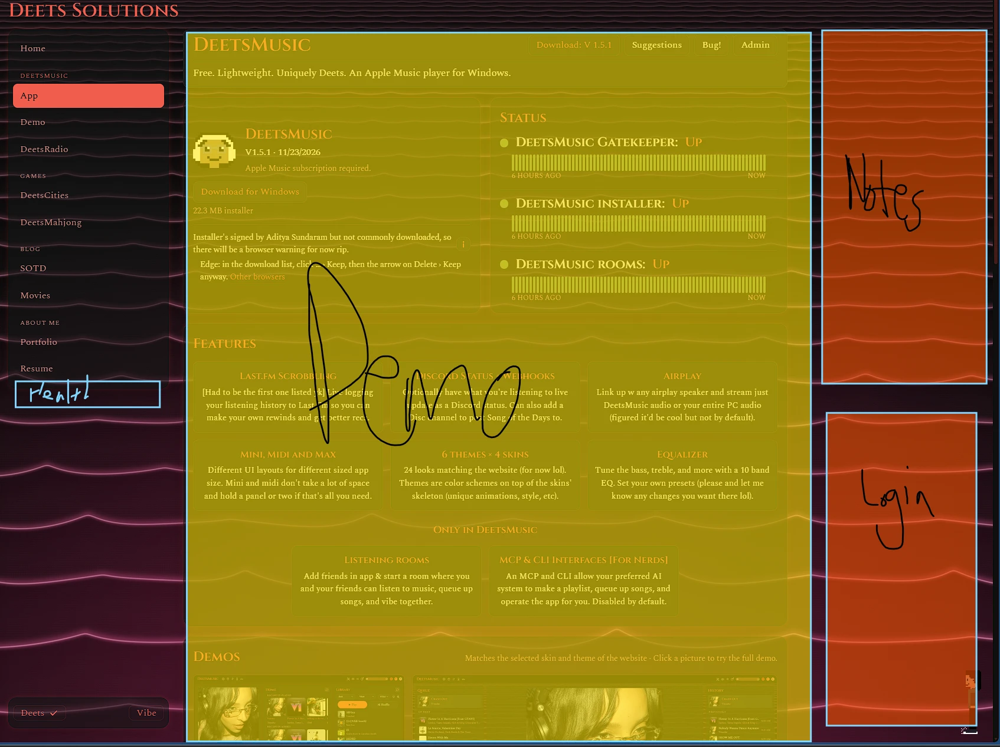

# DeetsHealth — The public demo at deets.solutions/health

> Designed with the owner on 2026-11-24: every fork is closed; §7 holds the drafts he edits. No
> code yet. A working console at `https://deets.solutions/health/` that a recruiter or a hiring
> manager opens and uses at once as a guest, or signs in to with a made-up name and a role: the
> Config pages first, then a typed call with the agent. It runs on
> Cloudflare Workers, with no Container and no server of ours. To get there, the call's rules
> and `ehr`'s rules move into Rust crates that build for both the product and a Worker (§4).
> §6 is the build, in five hand-overs. §9 is what a test of Pipecat in a Python Worker found.

**Words used here.**
- **Visitor:** a person on the public page. Not staff, not a patient. Every visitor's data is
  synthetic.
- **Live call:** the visitor types as the caller and Claude answers. It spends tokens.
- **Sample call:** a kept script (`agent/tests/scripts/`) run through the same loop, with
  Claude's answers read from the replay files. It spends nothing.
- **Worker:** Cloudflare's server code that runs per request. **Durable Object (DO):** a small
  Cloudflare server with its own state that can hold a WebSocket. **D1:** Cloudflare's SQLite
  database. **R2:** Cloudflare's file store. **WASM:** the format in which Rust runs in a
  Worker.
- **Rules:** what `flow.py` decides: the step, the tools a step allows, what a tool answers,
  every guard. **Turn loop:** the code that sends the messages to Claude, streams the answer
  and runs the tool calls.
- **The tunnel demo:** the demo of [DEMO.md](DEMO.md), on the owner's PC behind Cloudflare
  Access. This doc's demo replaces it as the link on Deets.Solutions; the tunnel stays for
  friends and for voice.

## 1. The owner's choices (2026-11-24)
- **The ask:** "strip out a lot of the safety features, use cloudflare as our db provider and
  have essentially a functioning version of deetshealth at deets.solutions/health able to be
  clicked in, used".
- **Live calls, no Containers:** "1A though not looking to spend anything on containers, let's
  think creatively about how we can rewire certain pieces to use D1/DO/R2".
- **Who visits:** "visitors here will be recruiters and hiring managers clicking around".
- **A living log and a fake login:** "a living log would be cool, we can come up with a fake
  login page wired to our security / rbac pieces to fill our audit log too".
- **Epic off:** "we can gray out the Epic button on the website and have text in a toast to
  contact me if you want a full FHIR demo".
- **One shared hospital:** "All shared, users edits can go into our versioning system so users
  know which version they're using / creating. All data is synthetic and we'll do a fake
  'login' so not worried".
- **The store is plain:** "Plain works, the highlight is the config pieces more than security
  for the demo. We can have a panel detailing the differences between the demo / emphasizing
  the security there".
- **The build:** option A of §4 (the rules in Rust), then 1A, 2A and "Shared Rust API works"
  (§4.6).
- **The numbers:** a cap of $2 a day; a reset every week; a typed name and a role at the fake
  login (§3.3, §3.6, §3.8).
- **The page:** his mockup, "this is what i was thinking" (§3.5): the console in the site
  page's main column, Notes and Login in boxes at its right, a Health entry in the site's nav.

## 2. What a visitor gets
1. The console at once, as a guest (§3.5). The Login box beside it takes a name and a role
   (§3.3).
2. The whole console, as that role allows: Chat (Testing, Demo, PHI), Analytics, Config
   (Agent, Hospital, System, Anthropic, Voice), Rules, Teams, Security (Auth, Roles, Audit
   Logs).
3. A save on a Config page makes a new version with the visitor's name on it (§3.4).
4. A typed call on the Local sandbox: live while the day's cap allows (§3.6), else a sample
   call.
5. Each page opened, each save and each refusal writes an audit row. Security › Audit Logs
   shows the rows of every visitor since the last reset.

**Off, each with a greyed control and a toast** (§3.9): Epic mode, the voice seat, Import from
Epic, Record and test, a person's picture.

## 3. The design

### 3.1 Where each piece runs
| Piece | In the product | In the public demo |
|---|---|---|
| The console | Vite build, served by us | The same source, a second build under `/health/`, as static files on Deets.Solutions (§4.7) |
| The console's API | `dev_server.py` today | The shared Rust API crate (§4.6), served by a Worker |
| `ehr`'s rules (verify, the gate, the scheduler, the hospital, roles, audit) | The `ehr` service | The same crate as WASM (§4.2) |
| The call's rules | `flow.py` today | The same Rust crate as on the phone path (§4.1) |
| The turn loop | Pipecat | A small typed loop in Rust, in a DO per live call (§4.4) |
| The agent-to-`ehr` wire | gRPC over mTLS | None: one process, a direct call |
| The store | Postgres, sealed | D1, plain (§3.2) |
| Kept scripts, replay files, recorded calls | Files in the repo | R2 |
| Staff sign-in | Cloudflare Access today; the hospital's IdP later | The fake login (§3.3) |
| Voice, Twilio, Epic | Pipecat, Twilio, the Epic adapter | Not in the demo |

### 3.2 The store: D1, one writer
- **One D1 database holds the one shared hospital:** settings and their versions, people,
  roles, the audit trail, the call log and its transcripts, annotations.
- **One writer**, as DATABASE.md §2 rules for the product. A single DO (the *store DO*) makes
  every write. Reads go from the Worker to D1 directly. The audit trail is a hash chain
  (AUDIT.md §4), and a chain needs its rows written one at a time.
- **Plain.** No column is sealed. The sealing interface stays in the Rust crate, with a
  stand-in that stores the value as it is (§4.2). The product's path does not change.
- **No schemas and no database roles.** SQLite has neither, so the `synthetic` and `real`
  separation of `ehr/migrations/0010_data_classes.sql` does not exist here. Every row in the
  demo is synthetic.
- **No migration history.** The reset (§3.8) makes the database from the current schema and
  the seed.
- A second D1 table set holds what must outlast a reset: the spend counter and the limits
  (§3.6, §3.7).

### 3.3 The fake login, the roles and the audit trail
- The page asks for a **display name** and a **role**, with a Sign in button. The roles are the
  owner's templates (ACCESS-ROLES.md §4).
- Sign in makes a new person in the store with that name and that role, and gives the browser
  a session (a signed cookie). Every request then runs as that person, through the same rules
  as the product (`ehr/src/access.rs`): the lever each route needs, "at or below you", the
  conflict rule.
- So the audit trail fills as visitors use the console: a real row per page opened, per save,
  per refusal (AUDIT.md §3). Teams › People shows the day's visitors.
- **Nothing here is a credential.** No password, no email, no code. The page says so.
- A visitor signs out from the top bar and may sign in again as another role.
- **The name is free text on a shared page** (the owner's choice, with its cost named: a real
  or an offensive name stays visible until the reset). The limits on it are in §8.

### 3.4 Versions and the locked Default
- A save on a Config page makes a new version, as in the product, and the version carries the
  visitor's name.
- **The Default version of each settings service is locked.** No visitor can change or remove
  it.
- **A save does not change the hospital's active version for the next visitor.** A visitor's
  session starts on Default. After a save, that visitor's session uses their new version; the
  version picker shows which one is in use and who made each. A call keeps the versions it
  started with, as today (PROMPT-EDITOR.md).
- This differs from the product, where a save makes the new version active for every call that
  starts after it. The demo panel says so (§3.10).

### 3.5 The page: the demo, Notes and Login

The owner's mockup (2026-11-24: "this is what i was thinking"), drawn over the DeetsMusic page
of Deets.Solutions in its wide layout:
- **`/health/` is a page of Deets.Solutions,** inside the site's own shell: the "Deets
  Solutions" title, the left nav, the Sign in and Vibe dock. The nav gets a new entry,
  **Health**, drawn under Resume.
- **Demo:** the page's main column holds the console. It sits in a frame, as the DeetsMusic
  demo's app does (`../DeetsSolutions/deetsmusic/demo/index.html` frames `./app/`). So the
  built console is copied to `health/app/`, and the page at `health/` is the site's.
- **Notes:** a box at the right, above Login. It holds the demo panel: how the demo differs
  from the product (§3.10), and where the security design is (SECURITY.md and
  SECURITY-BRIEF.md on GitHub).
- **Login:** a box at the right, under Notes. It holds the fake login of §3.3. So the login is
  the site page's, outside the console's frame. The frame and the page are one origin, so the
  session cookie that Login sets is the one the console's requests carry.
- **The site's rules apply to this page** (`../DeetsSolutions/CLAUDE.md`): its tokens only,
  every theme and skin, no dependency, the pre-paint head script and its hash in `_headers`,
  a row in its page inventory, and its own strings file with `[ph]` on every draft word.
- **A narrow screen** has no room for three columns. The order there, top to bottom: Login,
  the demo, Notes (a draft, §7).

**Before sign-in: usable at once as a guest** (the owner, 2026-11-24, fork A).
- The console loads with a guest session: a new person named as a guest, with the Junior
  Analyst template (a draft, §7). A visitor can open pages in the first second.
- The Login box then says the visitor is a guest, and offers the name and the role of §3.3.
  Sign in replaces the guest with the named person.
- A guest's rows are in the audit trail as any person's are.
- The bot check moves: a guest gets a session without it; it is asked for at Sign in and
  before a guest's first live call (§3.7).

**The console's look: its own, inside a box** (the owner, 2026-11-24: "We can contain the
DeetsHealth console within a container like Deetsmusic's demo does").
- The frame sits in a box drawn in the site's card style for the chosen skin, as the
  DeetsMusic demo's does (DeetsMusic's `docs/features/WEB-DEMO.md`, fork 5). Inside the box
  the console keeps its own themes, its own skin and its own picker.
- So the console gains no theme or skin of the site's, and the product's console does not
  change for the demo.

### 3.6 Calls: live, sample, and the cap
- **A live call** runs the typed loop (§4.4) against the Anthropic API with the key held as a
  Worker secret. The model and its settings are the visitor's version of Config › Anthropic,
  inside the limits of §3.7.
- **A sample call** runs a kept script through the same loop, with each of Claude's answers
  read from R2 by the request's hash (the replay cache of AGENT.md). A sample call matches only
  while the visitor is on the Default prompt, hospital and model versions; on another version
  the control is greyed and says why.
- **The cap (the owner, 2026-11-24): $2 a day for all visitors together**, priced by the
  model catalog's own functions (VOICE-VENDORS.md §10). About 40 live calls a day at about 5¢
  each, and at most about $60 of the $100 a month. **5 live calls per visitor per day.**
- At either limit, Start offers sample calls only, with one line that says the day's live
  calls are used and when they return.
- The day turns at midnight Pacific. The counter lives outside the weekly reset (§3.2).

### 3.7 The guards a public page needs
1. **The spend cap** of §3.6, checked before each request to Claude, so a call that is
   running stops at the cap too.
2. **A bot check** (Cloudflare Turnstile) at Sign in, and before a guest's first live call
   (§3.5). A guest's session itself needs none, so its rate limits (item 3) are the tighter
   ones.
3. **Rate limits** per session and per address on sign-in, on saves and on call starts.
4. **Limits on a live call:** a ceiling on turns, on the caller line's length and on the
   call's length. The model setting may not go above the ceilings the demo sets, whatever
   the visitor saves in Config › Anthropic.
5. **A "synthetic only" notice** on the fake login and at the call's text box: this is a public
   demo, every patient is made up, do not type real information.
6. **No protected data rule changes** (SECURITY.md §4): logs, toasts and hints still name a
   kind of thing and never a value.

### 3.8 The weekly reset and the seed
- **Every week (the owner, 2026-11-24), Sunday night Pacific,** a scheduled Worker makes the
  hospital's database again from the schema and the seed. Sessions end; a visitor signs in
  again.
- **The seed is new and synthetic.** It is never a copy of a dev store: the dev `users` table
  holds the owner's real email and phone number. The seed holds the Default version of every
  settings service, a small made-up staff list across the role templates, the sandbox
  patients, and a history of recorded calls with their audit rows, so Analytics and Audit Logs
  are not empty on Monday.
- The audit trail is reset with the rest. In the product it is never reset (AUDIT.md §2); the
  demo panel says so.

### 3.9 What is off, and how it shows
Each control stays in its place, greyed, and a press shows a toast.
| Control | Why it is off | The toast names |
|---|---|---|
| The Epic / Local button (CHAT.md §13) | No Epic key on a public host; Epic's sandbox rules | Contact the owner for a full FHIR demo (the owner's words, §1) |
| The voice seat (CHAT.md §17) | A Worker has no WebRTC end; voice spend | Voice runs in the product, not in this demo |
| Places › Import from Epic | As Epic | As Epic |
| Record and test (Config › Agent) | It records every kept script with Claude | Recording runs in the product |
| A person's picture (Security › Auth) | A stranger's image on a shared public page | Pictures are off in this demo |

The words of each toast are a draft for the owner (§7).

### 3.10 The demo and the product, side by side
The content of the demo panel (§3.5).
| | The product | This demo |
|---|---|---|
| Data | A hospital's own; real after BAAs | Synthetic only |
| Sign-in | The hospital's IdP; today Cloudflare Access | A made-up name and a role |
| The store | Postgres, each protected field sealed under the hospital's key | D1, not sealed |
| Synthetic and real rows | Two schemas, two database roles, two keys | One kind of row |
| Agent to `ehr` | gRPC over mTLS | One process |
| A save | Active for every call after it | A version for the visitor who made it |
| The audit trail | Never reset | Reset every week |
| EHR | The Local sandbox, Epic, then others | The Local sandbox |
| The call | A phone call, and a typed test call | A typed call |
| The rules, roles and audit code | The same crates | The same crates |

## 4. The build: the rules move to Rust
Pipecat cannot serve the demo: §9. So the parts that decide things move into Rust crates that
build natively and as WASM. Python keeps the voice.

### 4.1 The `flow` crate: the call's rules
- **Holds:** the call's state (today `CallFlow`'s fields), the steps, each step's tools, every
  tool handler, the guards (the name guard, "the caller said it", invented values, words
  before a fixed-line tool, the repeat guard), the emergency screen, the prompt files' parser,
  and the choice of each fixed line. The words stay in `agent/prompts/AGENT-PROMPT.md`.
- **Ports:** `flow.py`, `prompts.py`, `screen.py`, and the guards in `call.py` and `llm.py`.
- **Its shape:** an engine that takes an event (the call starts, a caller line, a tool call
  from the model with its arguments) and returns actions (say this fixed line, answer the tool
  with this, move to this step with these messages and tools, raise this flag, end the call).
  It reaches the chart through an `Ehr` interface. It does no I/O of its own.
- **No network, no threads, no clock of its own:** it must build for `wasm32-unknown-unknown`.

### 4.2 The `ehr-core` crate: `ehr`'s rules without its server
- **Holds:** verify, the session and the gate, the scheduler, the hospital's lists, visits,
  settings and their checks, people, roles, the audit chain, the stats.
- **The store behind an interface,** with two backends: Postgres (today's SQL, in `ehr`) and
  SQLite (for D1, in the Worker crate). The store's tests run against both.
- **Sealing behind an interface:** AWS-LC in `ehr` (today's `seal_key.rs`); a stand-in that
  seals nothing for the demo.
- `ehr` keeps what cannot build for a Worker: tonic, mTLS, sqlx, the Epic adapter, Twilio's
  text.

### 4.3 The phone path after the move (1A and 2A)
- **1A: Pipecat still builds and sends the request to Claude.** Pipecat Flows stays. The
  Python `flow.py` becomes an adapter: it forwards each event to the Rust rules and applies
  the actions that come back.
- **2A: the adapter reaches the rules over `ehr`'s gRPC,** with new calls on the same mTLS
  wire. The model's tool call goes to Rust, which checks the step's scope before anything
  runs. Each new RPC gets its row in EHR-SERVICE.md §3 and its PHI tags.
- The caller hears nothing new. A tool call gains one local hop.

### 4.4 The typed loop in the demo
- A DO per live call holds the visitor's WebSocket (the caller's seat of DEV-API.md §6) and
  runs the loop: build the request, send it, stream the answer, hand each tool call to the
  `flow` engine, repeat.
- **It must build the same requests as the Pipecat path.** The proof: each kept script, run
  through this loop, hits the recorded replay file for every request, with no new recording.
- It emits the same call record events as `call_record.py`, so Chat's panels, the Timeline and
  Demo's replays read it unchanged.
- The watch stream (DEV-API.md §5) comes from the same DO.

### 4.5 The Worker crate
- Routes: the shared API (§4.6) under `/health/agent/…`, the fake login, the session check.
- DOs: the store DO (§3.2), a DO per live call (§4.4).
- Bindings: D1 (the hospital; the counters), R2 (kept scripts, replay files, recorded calls),
  the Anthropic key and the session key as secrets, Turnstile's secret, a weekly and a daily
  schedule.
- The project already uses Wrangler for `ehr/jwks-worker`; this Worker follows it.

### 4.6 The shared API crate
"Shared Rust API works" (the owner, 2026-11-24).
- The console's API handlers move from `dev_server.py` into a Rust crate over `ehr-core`.
  `ehr` serves them for the product; the Worker serves them for the demo. A route is written
  once.
- This is also the "read API for the console" that DATABASE.md §5 lists as not built, and the
  one API of [ideas/CONSOLE-MCP.md](../ideas/CONSOLE-MCP.md).
- `dev_server.py` keeps what is Python's: the call seats, voice, the fake Twilio, the tunnel
  demo's door. On the owner's PC it passes the other routes on to `ehr`.
- DEV-API.md's route ledger and its checks (12 to 14) move with the routes, in the same
  commit as each move.

### 4.7 The console's second build, and Deets.Solutions
- `vite build` with the base `/health/`, as the tunnel demo builds under `/demo/`
  (`console/src/agent/api.ts › at`, `socketAt`).
- A build flag for the demo turns on the greyed controls of §3.9 and reads the session that
  the page's Login set. The fake login and Notes are not in the console: they are the site
  page's (§3.5).
- A publish script, after DeetsMusic's `scripts/demo-publish.mjs`: build, copy the output to
  `../DeetsSolutions/health/app/`, deploy the Worker. Only from `main`, only on the owner's
  word.
- Deets.Solutions gets: the page at `health/` with its Notes and Login boxes and the frame
  (§3.5), the built folder under it, the Health entry in its nav, its lines in `_headers` (the
  console carries its own Content-Security-Policy, CONSOLE.md §5.1; the site lets only itself
  frame its pages), a Worker route for `/health/agent/*`, and the Portfolio page's Demo link,
  which points at the tunnel today. That work is done in the DeetsSolutions repo, under its
  own rules.

### 4.8 The repo's shape
| Folder | Now | After |
|---|---|---|
| `core/` | `Shielded`, FHIR, sealing types | The same |
| `vendors/` | The voice and model catalogs | The same |
| The `ehr-core` crate | — | New (§4.2) |
| The `flow` crate | — | New (§4.1) |
| The API crate | — | New (§4.6) |
| The Worker crate | — | New (§4.5) |
| `ehr/` | Rules, server, store, Epic | The server, Postgres, Epic, the new flow calls |
| `agent/` | Pipecat, the rules, the dev API | Pipecat, voice, the flow adapter, the local seats |
| `console/` | One build | A second build for the demo |

The crate and folder names are a draft (§7).

## 5. Each place it runs
- **The call (any phone):** the rules move behind `ehr`'s wire (§4.3). The words, the steps
  and the voice do not change. One more local hop per tool call.
- **The console (a browser):** one source, two builds. A new route is written once (§4.6). The
  demo build adds a login page and a panel; it removes nothing from the product build.
- **The deploy targets (A2, then B):** unchanged in shape: `ehr`, the agent, Postgres. `ehr`
  now also serves the console's API. The Worker is a new, separate target for the demo only;
  it holds no real data and needs no BAA.
- **Each EHR:** the adapters stay in `ehr`. The demo has the Local sandbox only.
- **Cost:** Claude, at most about $60 a month at the cap. Cloudflare: inside the owner's
  Workers Paid plan at recruiter volume (D1 and DO rows: 25 billion read and 50 million written
  a month included, read 2026-11-24); the DO compute numbers were not read.

## 6. The build, in five hand-overs
One load-bearing piece in flight (CLAUDE.md › Working style). Each hand-over is one sitting's
brief: it ends with `npm run check` green and its desk test written here.

**Before any of them:** every kept script must pass on `main` (`cd agent && uv run pytest`).
The replay suite is the proof for hand-overs 2 and 4; a suite that already misses proves
nothing.

### Hand-over 1 — `ehr-core`, with no change in behaviour
- **Goal:** `ehr`'s rules in their own crate, the store and the sealing behind interfaces,
  Postgres and AWS-LC as the only backends still.
- **Read first:** EHR-SERVICE.md, DATABASE.md §4a, CORE-CRATE.md, `ehr/src/service.rs`,
  `ehr/src/store.rs`.
- **Done when:** `cargo test -p deetshealth-ehr` and the agent's tests pass unchanged; the new
  crate passes `cargo check --target wasm32-unknown-unknown`; `npm run check` has a scope for
  it; DEPENDENCIES.md, EHR-SERVICE.md and CORE-CRATE.md say what moved.
- **Desk test:** `npm run dev`; a typed call on Local and one on Epic; a save on each Config
  page; Audit Logs shows the rows. Nothing looks different.

### Hand-over 2 — the `flow` crate behind the phone path
- **Goal:** §4.1 and §4.3. The rules in Rust, reached over new RPCs; `flow.py` an adapter.
- **Read first:** CALL-FLOW.md (the map of every rule into the code), AGENT.md §3,
  AGENT-PROMPT.md, `agent/deets_agent/flow.py`, the tests under `agent/tests/`.
- **Done when:** all the kept scripts replay with **no file under `agent/tests/replays/`
  changed**; the agent's other tests pass; the crate has its own tests for each guard; it
  passes the WASM check; CALL-FLOW.md points at the Rust symbols; the RPC ledger has the new
  rows.
- **Desk test:** the typed calls of BOOKING-RULES.md §5 and one voice call, heard by the
  owner. The Step, Tools and Timeline panels show what they showed before.

### Hand-over 3 — the shared API crate
- **Goal:** §4.6. The routes move out of `dev_server.py`, a group at a time (settings; people
  and roles; audit; the catalog, logs and stats).
- **Read first:** DEV-API.md (all of it), ACCESS-ROLES.md §7, `console/src/agent/api.ts`.
- **Done when:** the console works against `ehr`'s API on the owner's PC; `docs:check` 12 to
  14 pass against the new home of each route; the tunnel demo still works.
- **Desk test:** DEV-API.md §8, and the tunnel demo's steps 2 to 5 of DEMO.md §6.

### Hand-over 4 — the Worker
- **Goal:** §3.2, §4.4, §4.5: the SQLite store backend, the store DO, the typed loop, the
  bindings, the seed and both schedules.
- **Read first:** this doc; AGENT.md (the replay cache); `agent/deets_agent/call_record.py`;
  Cloudflare's docs for D1, Durable Objects and `workers-rs` (read them, do not trust memory).
- **Done when:** the store's tests pass against SQLite; each kept script, run through the
  typed loop in `wrangler dev`, hits its replay files; a live call runs with the owner's key
  in `.dev.vars`; the cap stops a call.
- **Desk test:** the console's demo build against `wrangler dev` on the owner's PC: sign in,
  save a version, run a sample call and a live call, read the audit rows.

### Hand-over 5 — the public page
- **Goal:** §3.3, §3.5 (after its forks), §3.7, §3.9, §4.7. The fake login, the guards, the
  greyed controls, the panel, the publish script, Deets.Solutions.
- **Read first:** CONSOLE.md (the shell, the tokens, §12's speed rules), MOBILE-UI.md,
  `../DeetsSolutions/CLAUDE.md` and its `docs/architecture.md`.
- **Done when:** the page is live at `https://deets.solutions/health/` on the owner's go; the
  Portfolio link points at it; this doc's status is `built` with an "as built" section.
- **Desk test:** on a phone on mobile data: sign in, change a setting, run a sample call and a
  live call, open Audit Logs, press each greyed control, reach the cap with a test limit.

Each Cloudflare resource (the D1 database, the R2 bucket, the Worker, the route on
`deets.solutions`, Turnstile) is made on the owner's go, and each sign-in is made in the
owner's own terminal.

## 7. Drafts for the owner to edit
- **The names:** crates `deetshealth-flow` in `flow/`, `deetshealth-ehr-core` in `ehr-core/`,
  `deetshealth-api` in `api/`, the Worker in `edge/`.
- **Routes the demo does not serve:** the voice routes, `/agent/ice`, `/agent/build`,
  `/agent/prompt/estimate`, `/agent/prompt/record`, `/agent/hospital/import-places`, the
  picture routes, the fake Twilio, `/demo/…`. The demo shows the verification code on the page
  as the dev server's fake Twilio does today (CHAT.md §8.3). Every other row of DEV-API.md §2
  is served.
- **The roles offered at the fake login:** every template of ACCESS-ROLES.md §4, in its order;
  Deets is not offered. The first one is chosen at the start.
- **The toasts of §3.9** and the notice of §3.7: their words.
- **The limits of §3.7, item 4,** and the rate limits: their numbers.
- **The seed's history:** how many recorded calls, over how many days.
- **Where the prompt files live** once Rust reads them: `agent/prompts/` as today.
- **The page on a narrow screen** (§3.5): Login, then the demo, then Notes.
- **The guest's role** (§3.5): the Junior Analyst template; and how a guest is named.

## 8. Decided inside the owner's choices
For his review; none is built.
- D1 is the hospital's store, because his words name D1 and one shared hospital; a single DO
  makes the writes (§3.2).
- The display name: at most the length a person's name may have in the store today
  (`ehr/src/users.rs`), letters, spaces, hyphens and apostrophes only, never empty.
- The per-visitor limit of 5 live calls a day goes with his $2 (the option he chose).
- A save is the visitor's own version and never the next visitor's active one (§3.4), from
  "so users know which version they're using / creating".
- The reset includes the audit trail and ends every session (§3.8).
- Sample calls are offered only on the Default versions (§3.6).
- The spend counter and the limits survive the reset (§3.2).
- The Pipecat test's files are kept in `docs/ops/pipecat-worker-test/` (§9).

## 9. Pipecat in a Python Worker: what a test found (2026-11-24)
> **Part:** built · 2026-11-24 — a test, run and taken down the same day. Its files:
> [pipecat-worker-test/](pipecat-worker-test/pyproject.toml). The source for a public write-up.

**The question:** can the agent's own Pipecat call loop run in a Cloudflare Python Worker
(Pyodide), so the demo needs no rewrite?

**The answer:** it runs and it is correct, but each request took 17 to 27 s on Cloudflare,
because nothing stays warm. That is why §4 moves the rules to Rust.

**What ran.** The kept script `book_a_visit`, through the real `flow.py`, `call.py`, `llm.py`
and Pipecat 1.16's Anthropic service. Claude's answers came from the replay files; `ehr`'s
answers came from a tape recorded from a native run ([record_tape.py](pipecat-worker-test/record_tape.py)).
- Locally (`pywrangler dev`) and deployed: the greeting and all 9 replies the same as the
  native run, word for word; 11 of 11 requests hit their replay file; the same 8 `ehr` calls;
  the call ended by its tool.

**What it needed.**
1. **Stand-ins for four packages with no Pyodide build,** three of them imported by every
   Pipecat module: `loudness`, `pipecat-resampler`, `sentencex`; and `onnxruntime`, which the
   default turn strategy builds a model with even for a typed call. Of the 47 packages behind
   Pipecat's Anthropic extra, 36 are pure Python and 6 have a Pyodide build
   ([classify.py](pipecat-worker-test/classify.py)).
2. **A stand-in for `grpcio`** whose channel plays the tape. `ehr_client.py` and the generated
   code ran unchanged.
3. **Pipecat's source copied in.** Its package cannot install for Pyodide, since it requires
   those packages.
4. **The agent's code copied to `/tmp` at start.** The Worker's module folder is read-only, and
   the agent finds its prompt files by its own location.
5. **The model catalog handed in.** `models.py` asks the `ehr` binary through a subprocess.
6. `WorkerRunner(handle_sigint=False)`.

**What Cloudflare refused, in order.**
1. **"multipart: message too large"** for a bundle of 55 MB in 7,496 files, under the
   documented 64 MiB. The Anthropic and OpenAI SDKs were 5,297 of the files. Packed into one
   zip that the Worker imports from ([zip_vendor.py](pipecat-worker-test/zip_vendor.py)), the
   bundle was 2,019 files and 41 MB, and the upload passed. So the count of files was the
   limit, as far as this test can tell.
2. **"Python startup exceeded memory limits"** with Pipecat imported at the top level, which
   is how a Python Worker gets its fast-start memory snapshot.
3. With the imports in the request handler, the deploy passed (startup 1,130 ms).

**The numbers, deployed.** `/call`: 16.7 s, then 26.7 s, 24.0 s, 19.6 s. A two-step pipeline
alone: 16.7 s. Imports alone: 20.5 s. Locally, warm: 4 s for the call and 9 ms for the import
check. Every deployed request paid for the imports again.

**Not proven:** the cause. The reading is that Pipecat with its dependencies needs more than a
Worker's 128 MB, so no snapshot is kept and the instance does not last. The Worker's logs were
not read. **Not tested:** a live streamed request to Claude, more than one script, a DO.

**Windows:** `pywrangler` could not start the Pyodide interpreter from a folder under a user
name that holds a space. The test ran from a folder at the drive's root.

## 10. Open
- **The Health entry's place and group in the site's nav,** the name of the Login box (the
  site's dock has a real Sign in), and the words of Notes and Login: the owner's, in the
  DeetsSolutions repo.
- **Two navs side by side** (§3.5): the site's, and the console's own inside the box. Whether
  the console's top bar shows in the box is the owner's, when he sees it.
- **The drafts of §7.**
- **The DO compute cost** (§5): read Cloudflare's numbers before hand-over 4.
- **The public write-up of §9:** where it is published, and whether the test is run again on
  a Mac first.
- **Voice in the demo:** not designed. It needs a WebSocket seat in place of WebRTC and a
  spend decision.
